## Script: WeightedBatchPreProcessing (WBPP)
Aquest article es basa en la utilització de PixI 1.8.9-2 amb la versió v2.7.0 de WBPP.

Els exemples mostrats utilitzen lights en color (OSC, One Shot Color) realitzades amb una càmera Nikon D90 i per tant amb extensió `*.nef`; el procés és el mateix per a fitxers `*.fit`.

En resum, podem dir que WBPP és un script de PixInsight que s'utilitza per realitzar l'apilat dels nostres lights.

## Què obtenim? Fitxers de sortida
Com a resultat de fer servir WBPP, es crea una carpeta `/master/...` que conté els fitxers Masterlight en format PixI (`*.xisf`). Aquests masterlights són els fitxers resultants de l'apilat i són els que processarem.

La carpeta `/master/...` té l'aspecte següent:

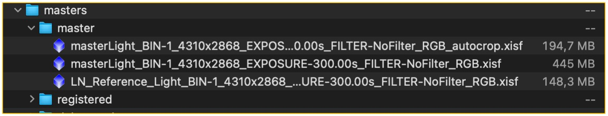

El primer masterLight té sufix autocrop, perquè hem activat l'opció "autocrop"; aquesta opció el que fa és eliminar les vores "brutes" de la imatge.

El segon és el que ens interessa i el tercer fitxer l'utilitza com a referència per a l'apilat; podem prescindir-ne.

També es generen quatre carpetes més:

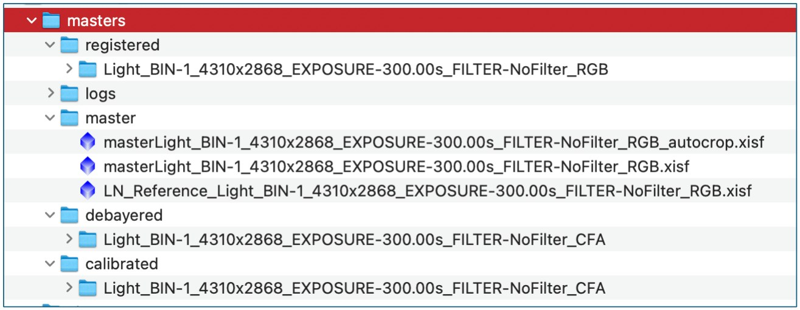

- **Calibrated**: aquí col·loca els fitxers `nomlight_c.xisf` que han estat calibrats (c).
- **Debayered**: aquí col·loca els fitxers `nomlight_c_d.xisf` que han estat calibrats (c) i debayeritzats (d).
- **Registered**: aquí col·loca els fitxers `nomlight_c_d_r.xdrz` que han estat calibrats (c), debayeritzats (d) i registrats (StarAlignment, r).
- **logs**: on es col·loquen els logs generats durant el funcionament de WBPP.

WBPP és molt potent i serveix per a multisessió i multifiltre però per tenir èxit cal ser ordenat; sobretot quan augmenten el nombre de lights i sessions perquè els flats i darkflats augmenten de forma lineal amb elles; segurament a raó de 100 o més per sessió/filtre.

## On guardem els nostres lights?
Anem a allò pràctic; jo aconsello tenir per a cada nou objecte que processem una carpeta amb diverses subcarpetes fixes; utilitzo aquest patró que conté 7 subcarpetes.

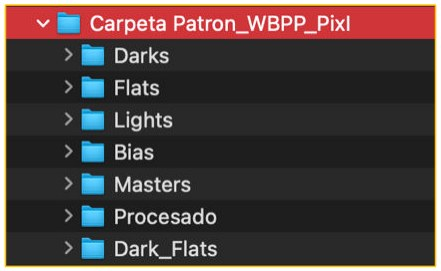

*/Darks, Flats, Bias i Dark_Flats/* per posar els fitxers de correcció dels nostres lights.

*/Lights/* on col·loquem les nostres preses de llum.

*/Masters/* és la subcarpeta que configurarem a WBPP perquè col·loqui els fitxers de sortida resultants.

*/Procesado/* és la subcarpeta on guardo tots els fitxers intermedis que es van generant al postprocessat.

Més endavant veurem l'avantatge de fer servir aquesta estructura.

## Pantalla principal de WBPP
Quan arrenquem l'script la pantalla que apareix és la següent:

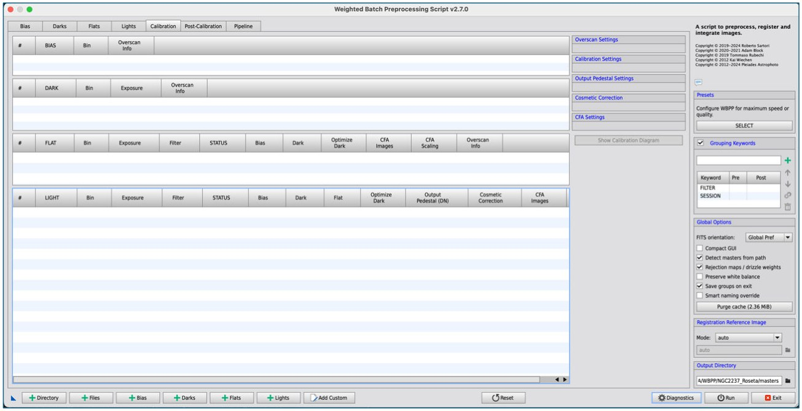

A la part superior tenim set pestanyes. Les tres primeres són per col·locar els quatre tipus de fitxers de correcció. Quatre!!?? Sí, perquè Darks i Dark-Flats es col·loquen a la mateixa pestanya.

La de *Calibration* és on veiem tots els fitxers carregats i la relació entre lights i fitxers de correcció.

La de *Post-Calibration* on observem els lights objecte de l'apilat amb les característiques principals i els temps d'integració resultants.

La pestanya *Pipeline* ens indica els processos que es duran a terme amb els nostres lights.

Aquesta pestanya s'actualitza a temps real quan arrenquem WBPP i es manté activa tot el procés fins que finalitza. Imprescindible per saber en quin punt es troba WBPP.

Aquí cal remarcar que com que estem treballant amb un script no podem fer res més amb Pixi fins que finalitza. És una de les grans diferències en el funcionament de scripts i processos.

A la part inferior tenim set botons que serveixen per incorporar el tipus de fitxers indicats.

Quan seleccionem un d'ells marquem els fitxers que volem importar i premem *"Open"*; s'incorporaran a la carpeta indicada.

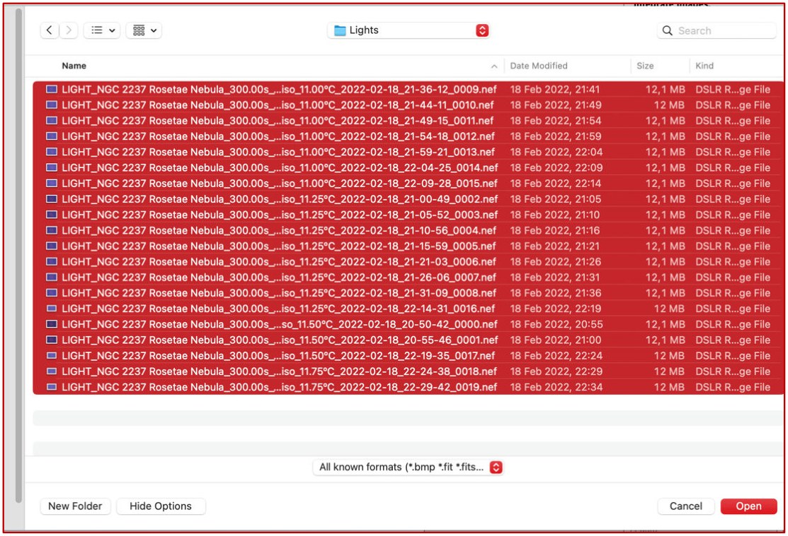

*Add Custom* és per afegir fitxers a mida.

El botó més important és *Directory* perquè si el premem i seleccionem el nostre directori de l'objecte que estem processant, amb la nostra estructura patró, carrega de cop tots els fitxers col·locats en ell... i poden ser centenars!!!, és una meravella.

Aquest és el nostre directori exemple.

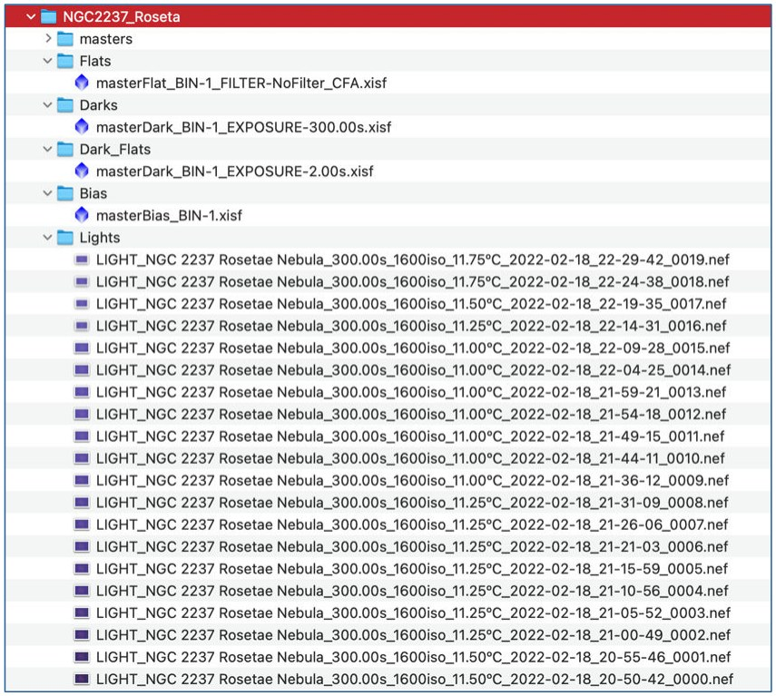

Les subcarpetes dels fitxers de correcció no contenen els lights corresponents perquè dels objectes que ja he processat només guardo els màsters corresponents per motius de capacitat.

Validem el nostre directori /NGC2237_Roseta i carreguem els 20 fitxers lights i els quatre màsters de correcció.

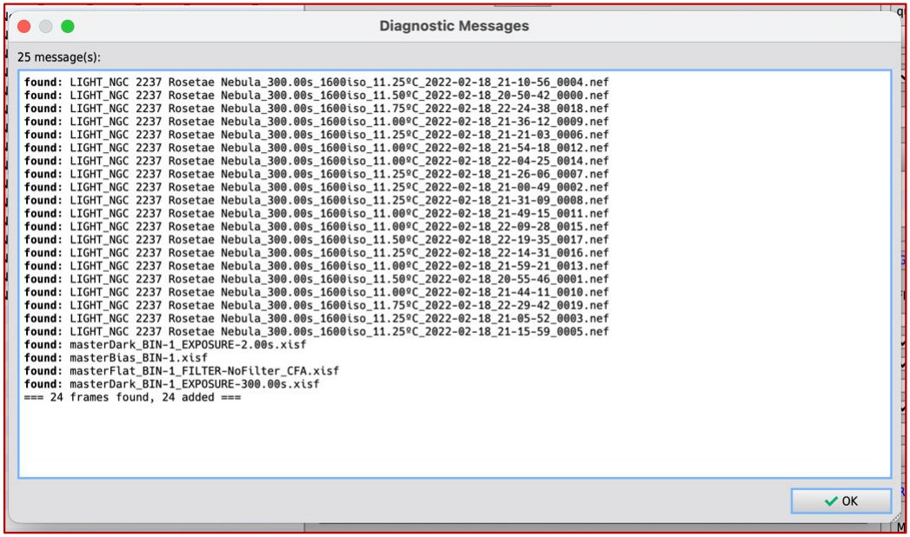

Com que faig 40 darks i 50 bias per objecte més 50 flats i 50 darkflats per sessió OSC, hauria carregat 210 fitxers de forma automàtica!!... i això per a una única sessió!

L'aspecte de cada pestanya els mostro a continuació per fer-nos una idea:

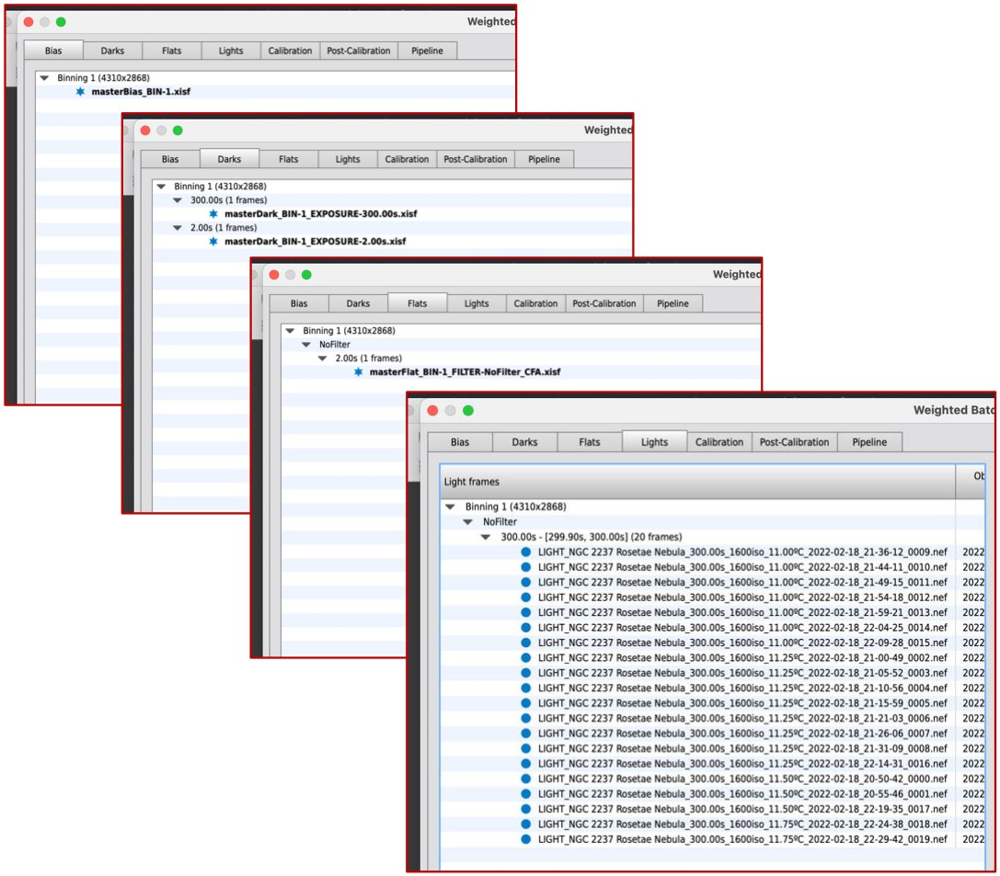

## Les pestanyes de Calibration, Post-Calibration i Pipeline
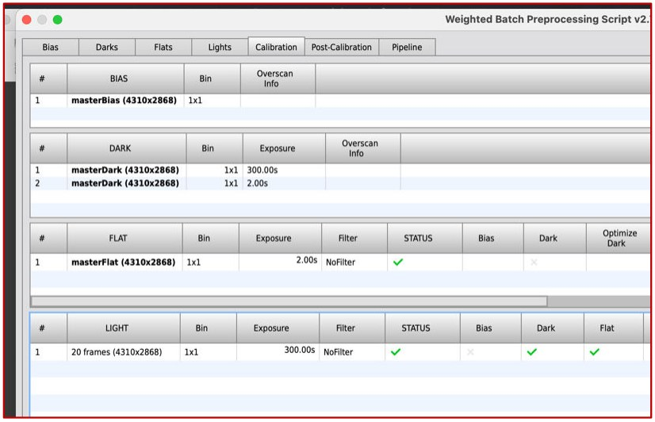

Aquí podem veure que els Dark de 300s i els Dark.flat de 2s es troben a la mateixa pestanya.

També podem apreciar que la línia de Lights té: status, dark i flat com OK; això vol dir que ha trobat els fitxers de correcció dels lights a processar.

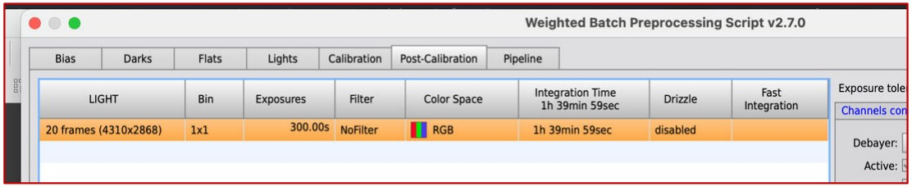

La carpeta de *Post-Calibration* ja veiem que ens indica que tenim 1h 39min 59s de temps d'integració amb 20 frames RGB.

A la dreta de la pestanya de Post-Calibració tenim algunes caixes; comentem el més important:

*Channels configuration*: permet triar el tipus de debayeritzat (color). Combined RGB funciona bé per a la majoria de situacions.

*Drizzle configuration*: permet escollir l'opció drizzle que és aconsellable sobretot per a imatges amb lleuger (o no tant) submostreig. Drizzle 1 és aconsellable en la majoria de casos, però drizzle 2 i superiors augmenta la mida dels màsters de forma dramàtica superant els 2Gb!!

*Fast Integration*: és una opció incorporada en les darreres actualitzacions i està pensada per a *lucky imaging*, tècnica en què es realitzen molts centenars de fotos de petita (molt petita) durada. És fora dels nostres objectius.

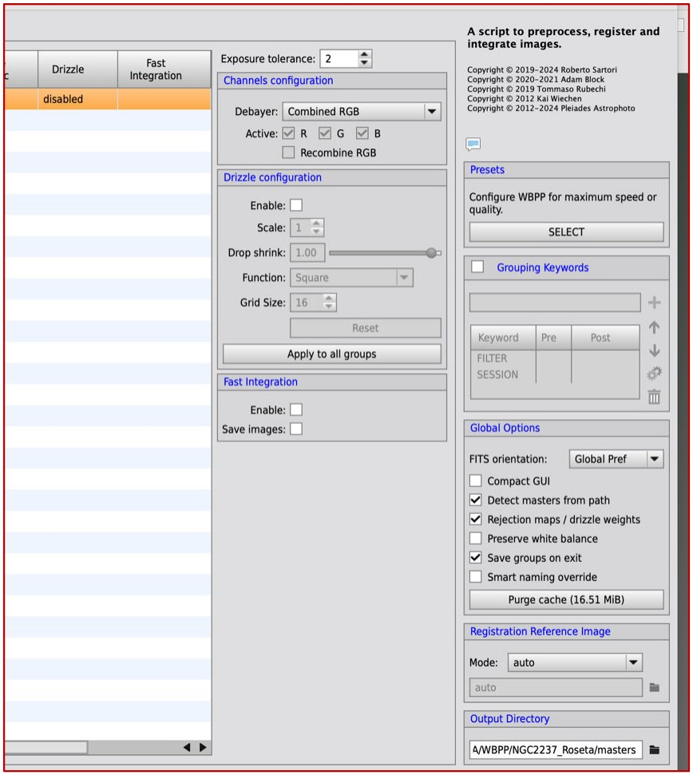

*Presets*: permet seleccionar el compromís velocitat de procés-qualitat; a gust de l'usuari.

*Grouping Keywords*: ho comento en multisessió.

*Global Options*: es manté per defecte, igual que Registration Reference Image.

*Output Directory*: com hem comentat a part és la pestanya on es desaran tots els nostres fitxers de sortida. L'haurem configurat al nostre directori patró de treball.

## Passos del nostre procés; pestanya Pipeline
La pestanya *Pipeline* ens indica totes les operacions que durà a terme WBPP.

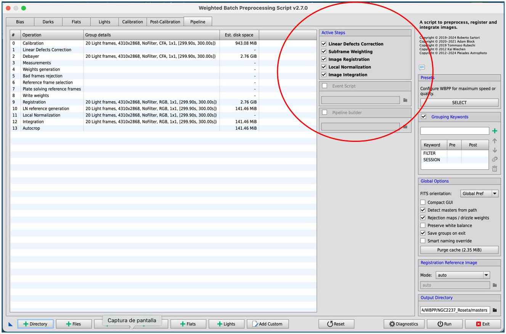

A la part dreta podem seleccionar els passos que ha de fer el nostre apilat:

- *Linear Defects Correction*
- *Subframe Weighting*
- *Image Registration*
- *Local Normalization*
- *Image Integration*

Cadascun consisteix en el següent:

- *Linear Defects Correction*: correcció dels defectes lineals de les imatges deguts a problemes associats a il·luminació o simplement deguts al nostre sensor; sol donar-se en sensors CCD. Es pot triar correcció per files, columnes o tots dos.
- *Subframe Weighting*: Mesura i dóna un pes a cada subframe en funció del *PSF, SNR o Weighting Formula* entre d'altres; en aquest darrer cas podem triar entre sis presets, sent *Nebula, Galaxy i Cluster* els més coneguts. Aquesta selecció de Weighting Formula és la que acostumo a utilitzar.
- *Image Registration*: Aquesta operació consisteix a alinear tots els lights en funció de les estrelles. Podem triar fins a onze opcions per al registre de les nostres imatges. L'opció *Auto* funciona perfectament.
- *Local Normalization*: Iguala la quantitat de llum dels lights; sobretot útil quan tenim diferents sessions. Utilitza cinc criteris d'avaluació. Valors per defecte són correctes.
- *Image Integration*: L'apilat pròpiament dit; valors per defecte són adequats.

Tots aquests passos se seleccionen a la pestanya *Pipeline* que ens mostra tots els passos que l'script realitzarà.

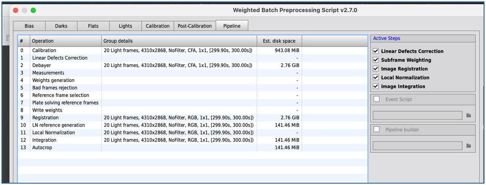

Aquí veiem que les operacions que ha de fer són només 14 passos perquè els fitxers de correcció ja els tenim com a màsters perquè he aprofitat integracions ja realitzades.

Per aquest motiu, la primera acció és calibrar els lights amb els màsters de correcció.

## Ajustaments dels Active Steps
L'ajust dels paràmetres corresponents als cinc "*Active Steps*" que hem comentat es realitza a cadascuna de les pestanyes corresponents dels diferents lights:

*A Bias, Darks i Flats* podem ajustar *Image Integration* i deixant el *Rejection algorithm* en Auto és suficient.

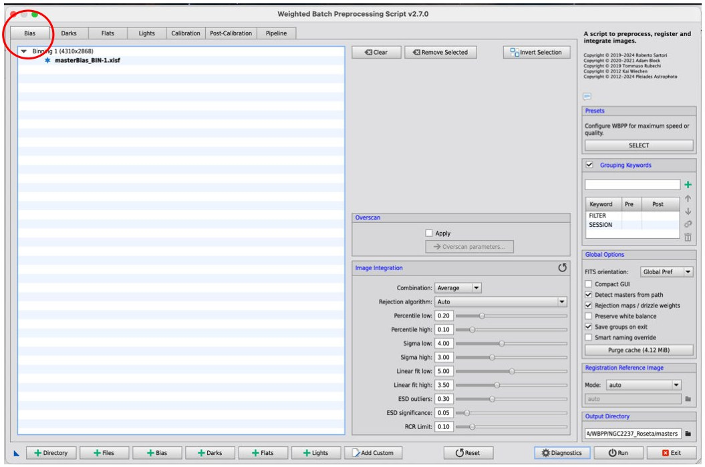

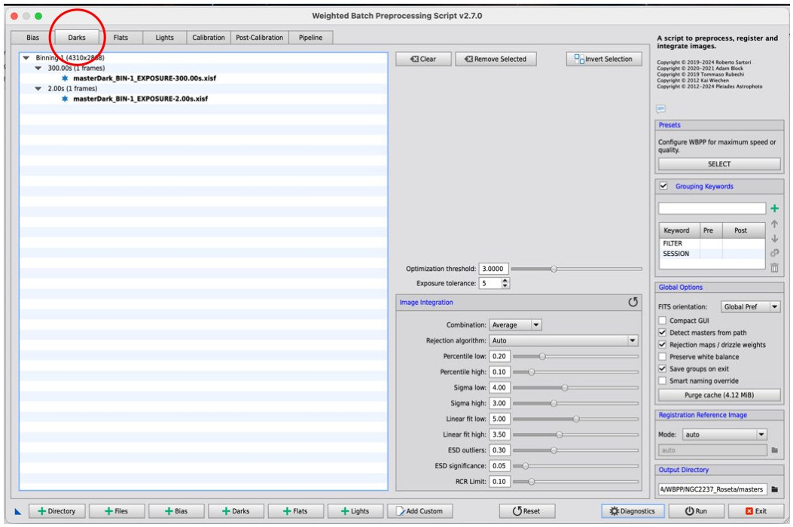

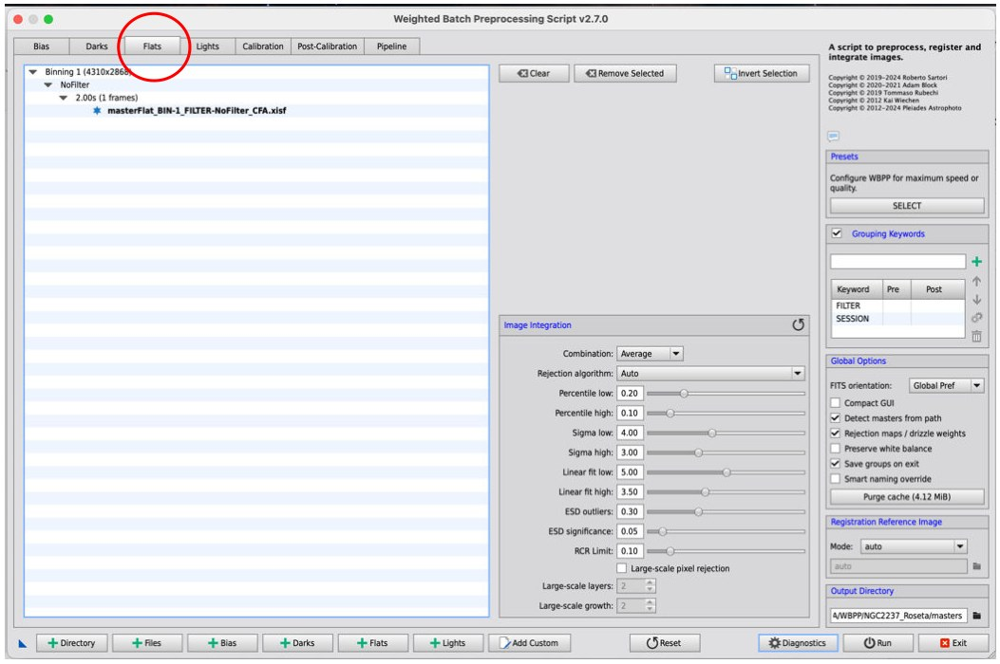

El corresponent als fitxers de llum és el més complet.

Com a la majoria de processos de PixI, aquest script funciona bé amb les opcions per defecte.

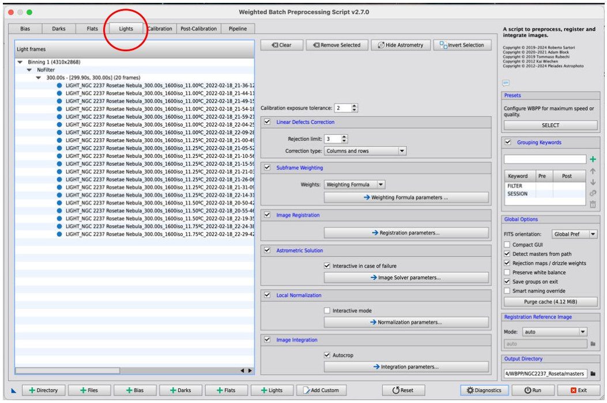

Potser l'únic que no té preset automàtic és l'opció "*Weighting Formula*" a "*Subframe Weighting*" ja que "Weighting Formula parameters" té sis presets diferents que tenen a veure amb les característiques del nostre objecte en quatre d'aquestes opcions.

Aquestes pantalles il·lustren el comentari:

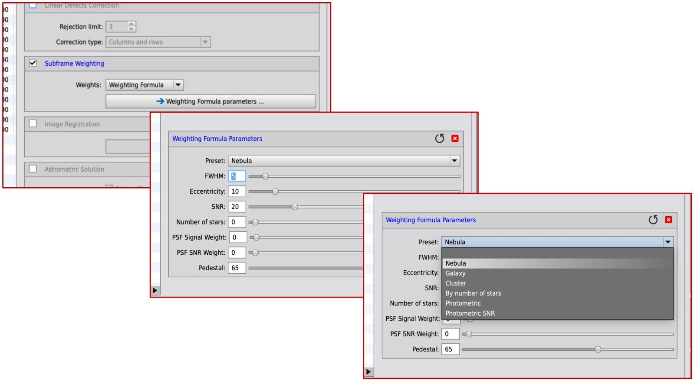

En el cas dels lights, a la pestanya *Image Integration* valdria la pena seleccionar *Winsorized Sigma Clipping* com a *Rejection Algorithm* perquè aquesta selecció (si tenim un mínim de 8 lights) elimina molt bé les traces de satèl·lits.

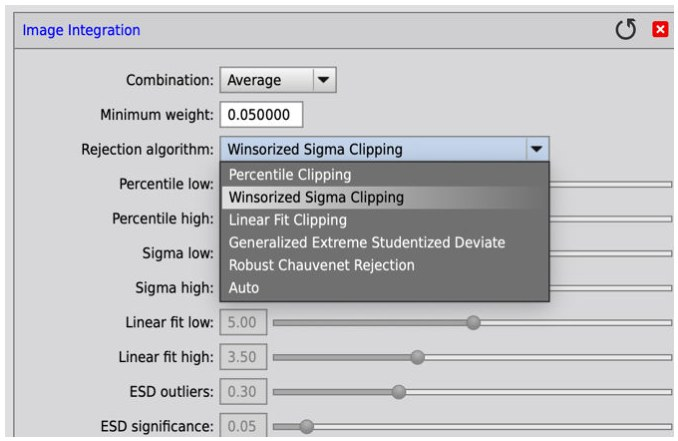

L'opció *Astrometric Solution* requereix ajustar amb precisió els paràmetres relatius al nostre objecte i veig més amigable utilitzar el procés "*ImageSolver*" quan en aplicar-ne d'altres durant el post-processat, com per exemple SPCC, demanen resolució astromètrica.

Si volem activar l'opció durant l'apilat podem seleccionar la casella "*Interactive in case of failure*" que atura el procés d'apilat si es produeix una fallada; llavors tenim l'opció de resoldre'l o anul·lar perquè segueixi amb l'apilat.

Al següent screenshot del monitor d'execució de WBPP veiem precisament com ens indica la fallada en aquesta operació.

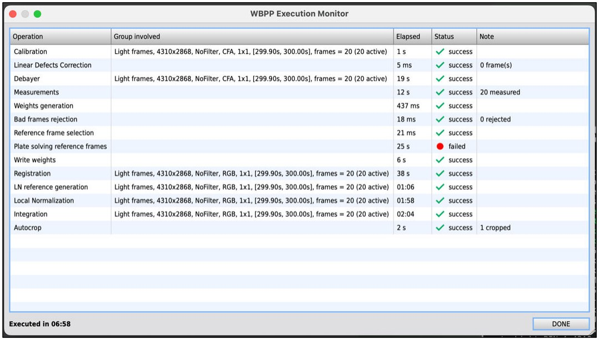

## Inici del preprocessat
Un cop tenim tota la informació revisada, premem el botó "*Diagnostics*" i WBPP revisa que tot es trobi Ok i en cas contrari dóna un missatge d'error per advertir dels problemes que eventualment hagi pogut trobar.

També indica l'espai de disc que necessita i el total disponible.

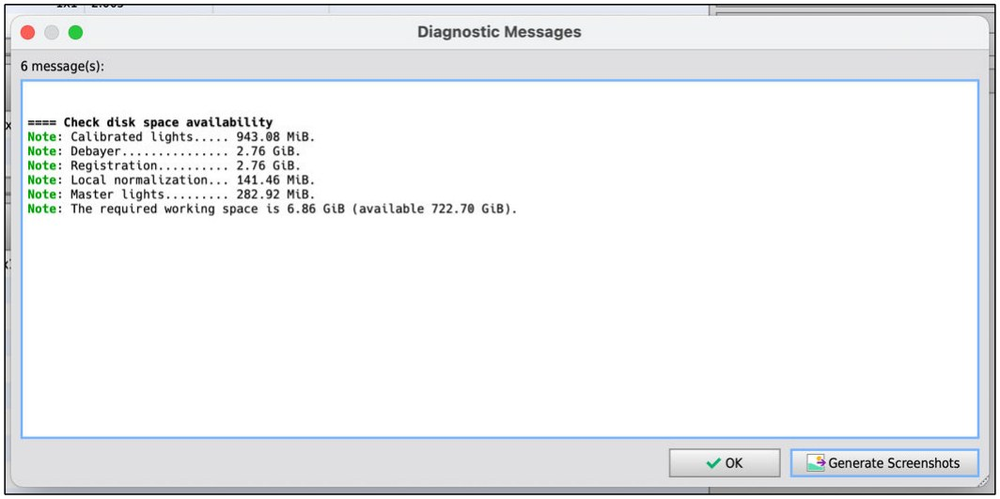

En aquest exemple veiem que tot és correcte.

Si polsem el botó "*Generate Screenshots*" ens guardarà a */Masters/log/...* les set pantalles corresponents a les pestanyes superiors de WBPP.

Prement el botó "*Run*" apareix un missatge similar a l'anterior i l'opció "*continue*" ens permetrà començar el procés d'apilat.

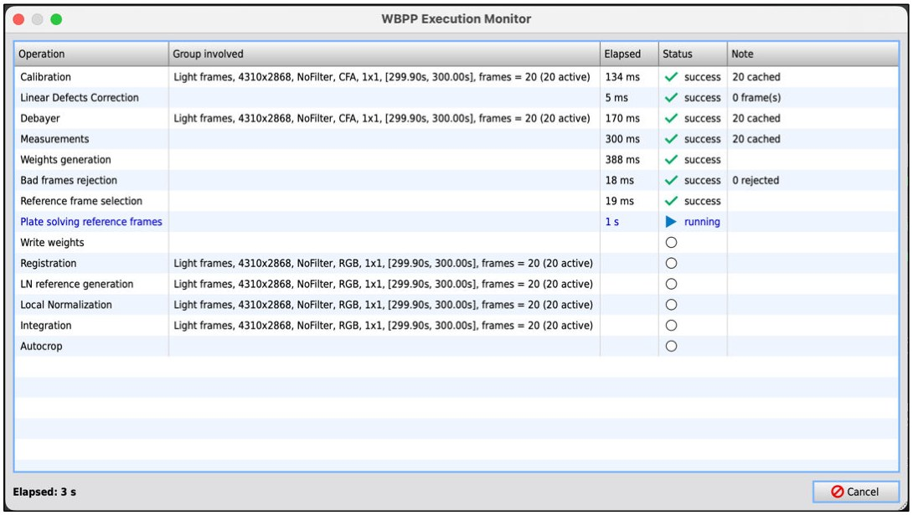

El procés es pot cancel·lar amb el botó inferior a qualsevol moment.

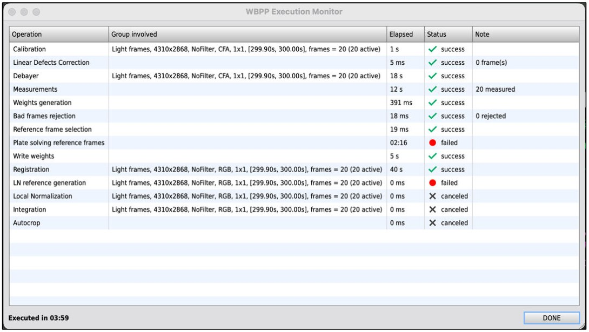

A la pantalla prèvia podem veure com hem avortat el procés de plate solving i tres passos més endavant hem cancel·lat.

## Multisessió i multifiltre
Fins ara hem processat preses OSC en sessió única.

Donarem una mirada ràpida a multisessió amb càmera monocroma i diversos filtres.

L'aspecte de la pestanya Calibration per a 91 lights preses en 3 sessions diferents i temps d'integració acumulat de 9h 6min té l'aspecte següent:

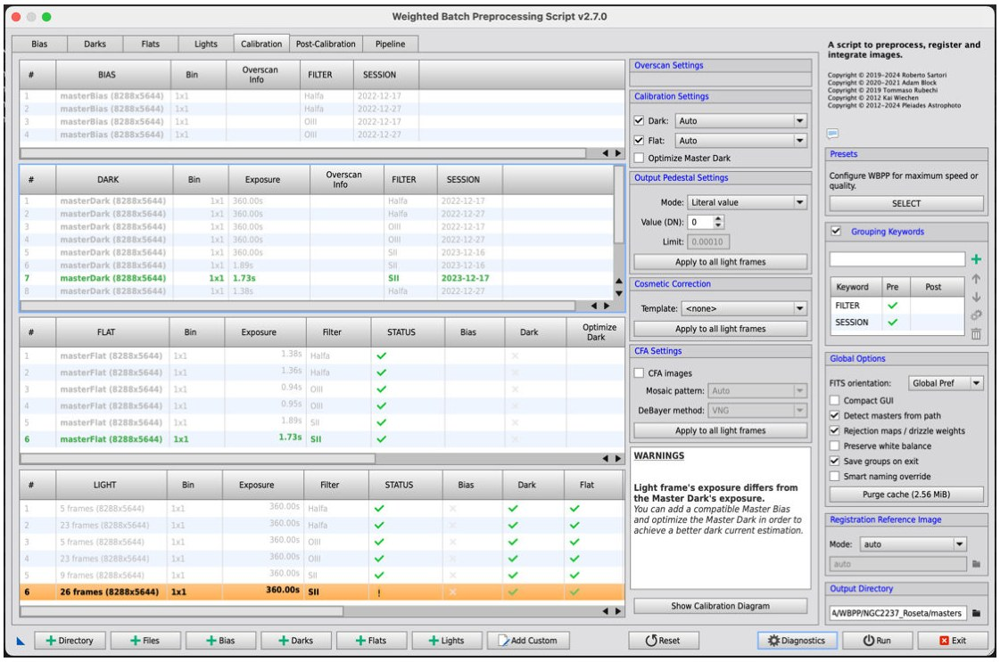

On veiem que els lights bias, dark i flats ja han estat integrats.

De fet, per disminuir l'espai en disc i millorar els temps de processament final, normalment integro els flats i darkflats després de cada sessió per disminuir l'espai acumulat de disc perquè un cop obtinc els màsters elimino els lights corresponents que ja no aporten informació i a més, redueixo el temps d'apilat final (quan tinc tots els lights) perquè part dels màsters de calibratge de les sessions prèvies ja han estat processats.

¡¡Abans d'esborrar comprovo que els màsters siguin vàlids!!

La pestanya *Pipeline* és en aquest cas més completa que en el primer exemple amb càmera OSC:

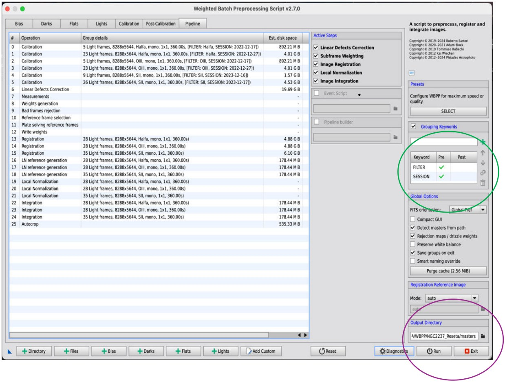

Amb les *"Global Options"* per defecte es guarden tots els lights i configuracions quan sortim de l'script (*"Save groups on exit"* a ON); es guarda l'estat de la darrera utilització, encara que haguem tancat PixI.

*Aquesta és una important excepció pel que fa al funcionament general dels scripts.*

Al gràfic anterior he marcat en morat *"Output Directory"*; aquí s'apunta a la carpeta *"màsters"* de la nostra estructura estàndard; en ella WBPP col·locarà tots els fitxers intermedis que va generant i els màsters finals a la carpeta *"màster"* que es generarà de forma automàtica.

També hem remarcat en verd una funció important, els "*Grouping Keywords*" que es fan servir perquè WBPP agrupi els lights i els associï amb els fitxers de correcció segons la data de la sessió i el filtre utilitzat.

Perquè els nostres lights tinguin incorporat en nom seu la SESSION i el FILTER hem de programar el nostre soft de captura perquè els construeixi d'aquesta manera.

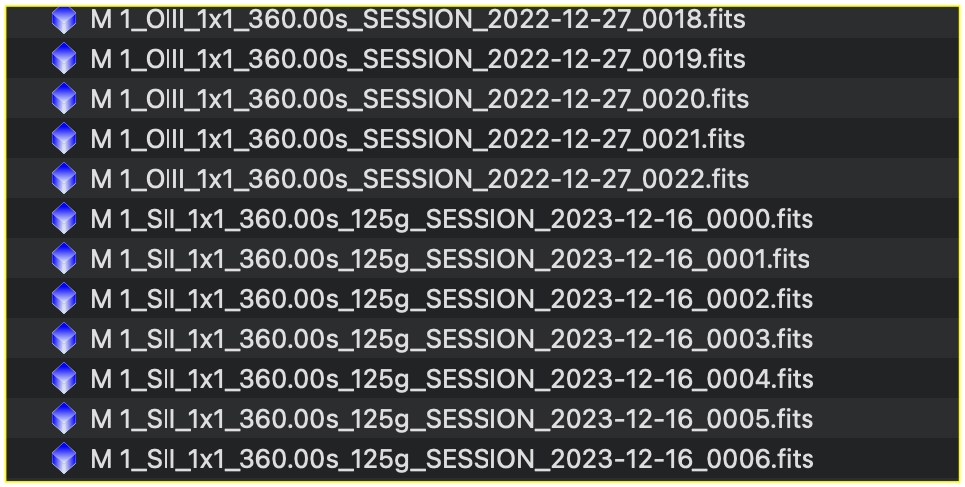

Aquests lights estan capturats amb NINA i en definir les regles per al nom dels lights triem incloure `$$FILTER$$` i també "SESSION" amb valors `$$DATEMINUS12$$`; aquesta funció pren la data de la sessió i li resta 12 hores per evitar el canvi de sessió passades les 00:00h.

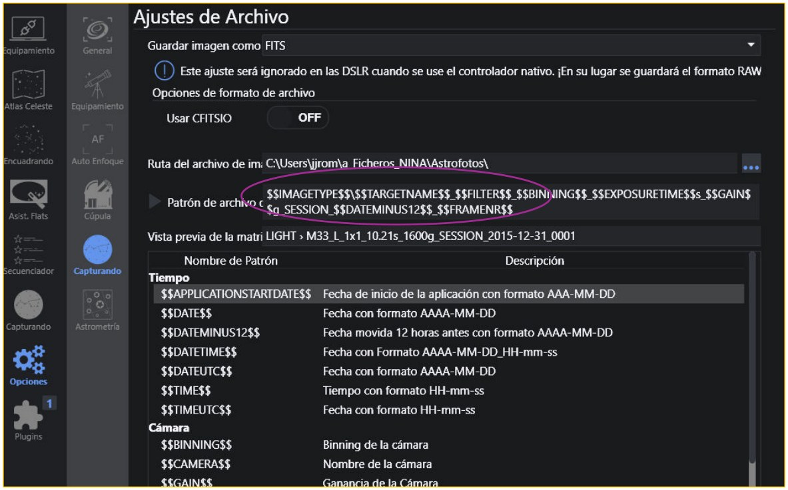

Fins aquí aquesta introducció a l'apilat amb PixInsight!!

Cels clars!!
