## Script: WeightedBatchPreProcessing (WBPP)
Este artículo está basado en la utilización de PixI 1.8.9-2 con la versión v2.7.0 de WBPP.

Los ejemplos mostrados utilizan lights en color (OSC, One Shot Color) realizadas con una cámara Nikon D90 y por lo tanto con extensión `*.nef`; el proceso es el mismo para ficheros `*.fit`.

En forma resumida, WBPP es un script de PixInsight que se utiliza para realizar el apilado de nuestros lights.

## ¿Qué obtenemos? Ficheros de salida
Como resultado de utilizar WBPP, se crea una carpeta `/master/...` que contiene los ficheros Masterlight en formato PixI (`*.xisf`). Estos masterlights son los ficheros resultantes del apilado y son los que vamos a procesar.

La carpeta `/master/...` tiene el siguiente aspecto:

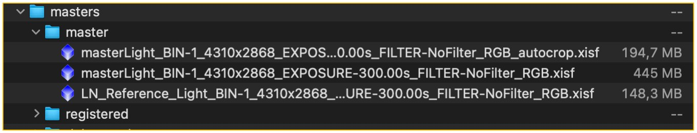

El primer masterLight tiene sufijo autocrop, porque hemos activado la opción "autocrop"; esta opción lo que hace es eliminar los bordes "sucios" de la imagen.

El segundo es el que nos interesa y el tercer fichero lo utiliza como referencia para el apilado; podemos prescindir de él.

También se generan otras cuatro carpetas:

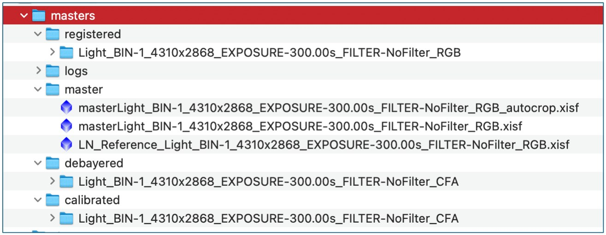

- **Calibrated**: aquí coloca los ficheros `nombrelight_c.xisf` que han sido calibrados (c).
- **Debayered**: aquí coloca los ficheros `nombrelight_c_d.xisf` que han estado calibrados (c) y debayerizados (d).
- **Registered**: aquí coloca los ficheros `nombrelight_c_d_r.xdrz` que han estado calibrados (c), debayerizados (d) y registrados (StarAlignment, r).
- **logs**: donde se colocan los logs generados durante el funcionamiento de WBPP.

WBPP es muy potente y sirve para multisesión y multifiltro pero para tener éxito es necesario ser ordenado; sobre todo cuando aumentan el número de lights y sesiones porque los flats y darkflats aumentan de forma lineal con ellas; seguramente a razón de 100 o más por sesión/filtro.

## ¿Dónde guardamos nuestros lights?
Vamos a lo práctico; yo aconsejo tener para cada nuevo objeto que procesamos una carpeta con varias subcarpetas fijas; utilizo este patrón que contiene 7 subcarpetas.

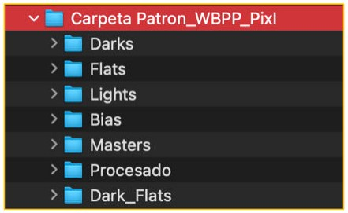

*Darks, Flats, Bias y Dark_Flats/* para poner los ficheros de corrección de nuestros lights.

*Lights/* donde colocamos nuestras tomas de luz.

*Masters/* es la subcarpeta que configuraremos en WBPP para que coloque los ficheros de salida resultantes.

*/Procesado/* es la subcarpeta donde guardo todos los ficheros intermedios que se van generando en el postprocesado.

Más adelante veremos la ventaja de utilizar esta estructura.

## Pantalla principal de WBPP
Cuando arrancamos el script la pantalla que aparece es la siguiente:

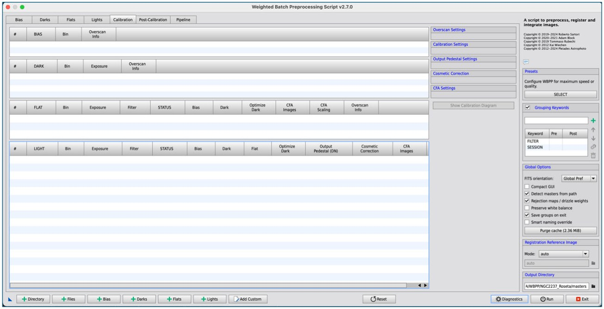

En la parte superior tenemos siete pestañas. Las tres primeras son para colocar los cuatro tipos de archivos de corrección. ¡Cuatro!!?? Sí, porque Darks y Dark-Flats se colocan en la misma pestaña.

La de calibración es donde vemos todos los ficheros cargados y la relación entre lights y ficheros de corrección.

La de Post-Calibración donde observamos los lights objeto del apilado con sus características principales y los tiempos de integración resultantes.

La pestaña *Pipeline* nos indica los procesos que van a llevarse a cabo con nuestros lights.

Esta pestaña se actualiza en tiempo real cuando arrancamos WBPP y se mantiene activa todo el proceso hasta que finaliza. Imprescindible para saber en qué punto se encuentra WBPP.

Aquí hay que remarcar que como estamos trabajando con un script no podemos hacer nada más con Pixi hasta que finaliza. Es una de las grandes diferencias en el funcionamiento de scripts y procesos.

En la parte inferior tenemos siete botones que sirven para incorporar el tipo de ficheros indicados.

Cuando seleccionamos uno de ellos marcamos los ficheros que deseamos importar y pulsamos *"Open"*; se incorporarán a la carpeta indicada.

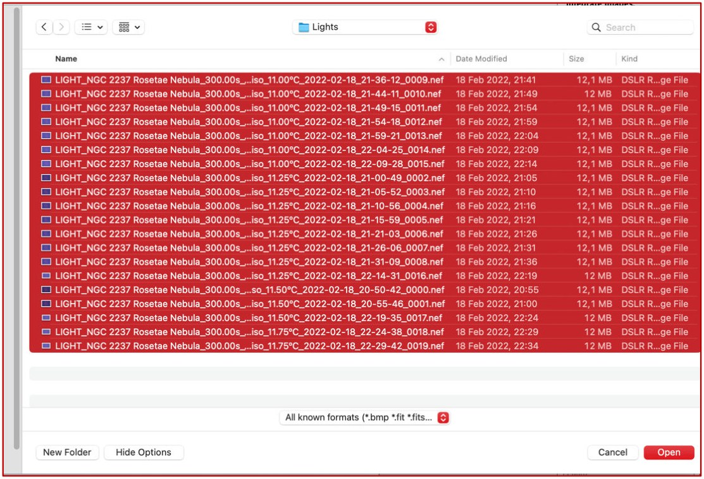

*Add Custom* es para añadir ficheros a medida.

El botón más importante es *Directory* porque si lo pulsamos y seleccionamos nuestro directorio del objeto que estamos procesando, con nuestra estructura patrón, carga de golpe todos los ficheros colocados en él... ¡y pueden ser cientos!!!, es una maravilla.

Este es nuestro directorio ejemplo.

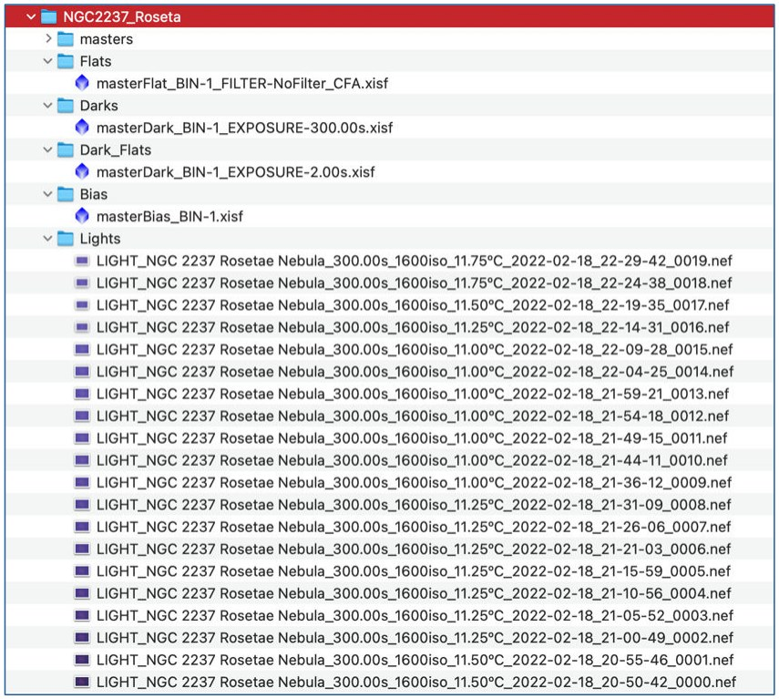

Las subcarpetas de los ficheros de corrección no contienen los lights correspondientes porque de los objetos que ya he procesado solamente guardo los masters correspondientes por motivos de capacidad.

Validamos nuestro directorio /NGC2237_Roseta y cargamos los 20 ficheros lights y los cuatro masters de corrección.

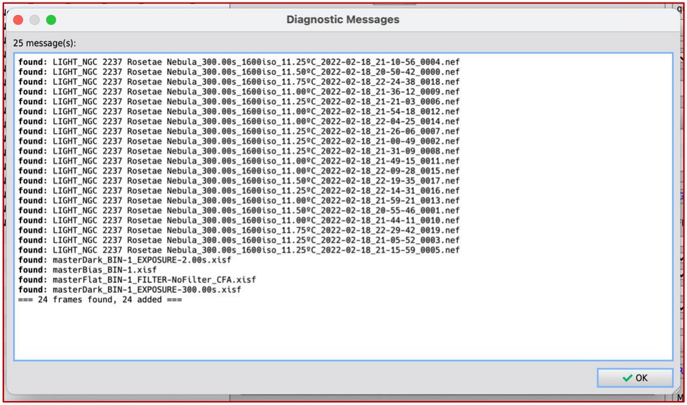

Como hago 40 darks y 50 bias por objeto más 50 flats y 50 darkflats por sesión OSC, habría cargado 210 ficheros ¡de forma automática!!... y eso para una única sesión!

El aspecto de cada pestaña los muestro a continuación para hacernos una idea:

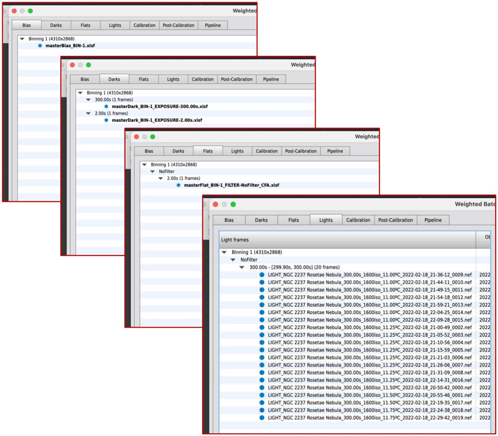

## Pestañas Calibration, Post-Calibration y Pipeline
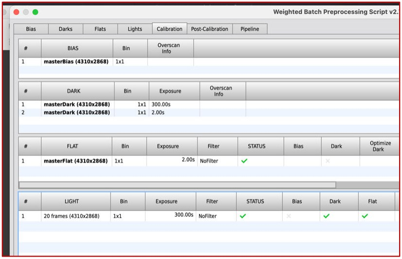

Aquí podemos ver que los Dark de 300s y los Dark.flat de 2s se encuentran en la misma pestaña.

También podemos apreciar que la línea de Lights tiene: status, dark y flat como OK; esto quiere decir que ha encontrado los archivos de corrección de los lights a procesar.

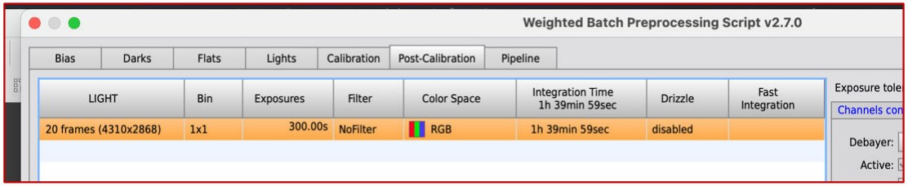

La carpeta de *Post-Calibration* ya vemos que nos indica que tenemos 1h 39min 59s de tiempo de integración con 20 frames RGB.

A la derecha de la pestaña de Post-Calibración tenemos algunas cajas; comentamos lo más importante:

*Channels configuration*: permite elegir el tipo de debayerizado (color). Combined RGB funciona bien para la mayoría de situaciones.

*Drizzle configuration*: permite escoger la opción drizzle que es aconsejable sobre todo para imágenes con ligero (o no tanto) submuestreo. Drizzle 1 es aconsejable en la mayoría de casos, pero drizzle 2 y superiores aumenta el tamaño de los masters de forma dramática superando los 2Gb!!

*Fast Integration*: es una opción incorporada en las últimas actualizaciones y está pensada para *lucky imaging*, técnica en la que se realizan muchos cientos de fotos de pequeña (muy pequeña) duración. Está fuera de nuestros objetivos.

*Presets*: permite seleccionar el compromiso velocidad de proceso-calidad; a gusto del usuario.

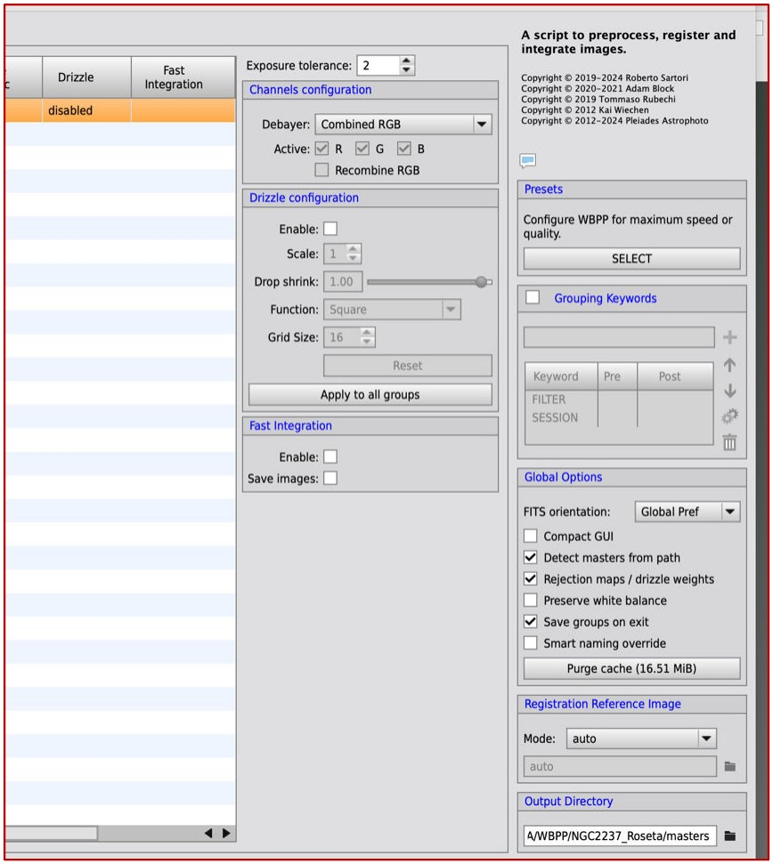

*Grouping Keywords*: lo comento en multisesión.

*Global Options*: se mantiene por defecto, igual que Registration Reference Image.

*Output Directory*: como hemos comentado aparte es la pestaña donde se guardarán todos nuestros archivos de salida. La habremos configurado en nuestro directorio patrón de trabajo.

## Pasos de nuestro proceso; pestaña Pipeline
La pestaña *Pipeline* nos indica todas las operaciones que llevará a cabo WBPP.

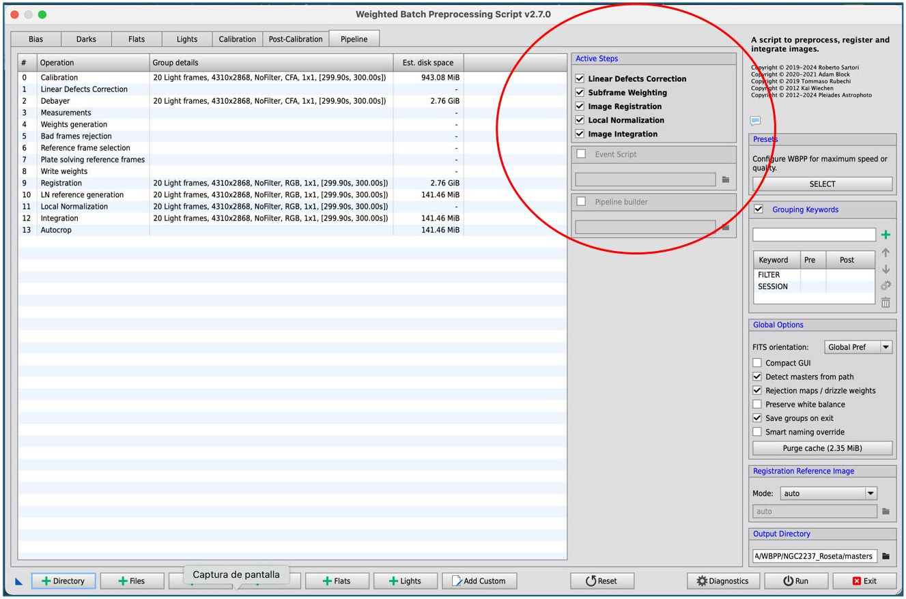

En la parte derecha podemos seleccionar los pasos que ha de realizar nuestro apilado:

- *Linear Defects Correction*
- *Subframe Weighting*
- *Image Registration*
- *Local Normalization*
- *Image Integration*

Cada uno de ellos consiste en lo siguiente:

- *Linear Defects Correction*: corrección de los defectos lineales de las imágenes debidos a problemas asociados a iluminación o simplemente debidos a nuestro sensor; suele darse en sensores CCD. Se puede elegir corrección por filas, columnas o ambos.
- *Subframe Weighting*: Mide y da un peso a cada subframe en función del *PSF, SNR o Weighting Formula* entre otros; en este último caso podemos elegir entre seis presets, siendo *Nebula, Galaxy y Cluster* los más conocidos. Esta selección de Weighting Formula es la que suelo utilizar.
- *Image Registration*: Esta operación consiste en el alineado de todos los lights en función de las estrellas. Podemos elegir hasta once opciones para el registro de nuestras imágenes. En *Auto* funciona perfectamente.
- *Local Normalization*: Iguala la cantidad de luz de los lights; sobre todo útil cuando tenemos diferentes sesiones. Utiliza cinco criterios de evaluación. Valores por defecto son correctos.
- *Image Integration*: El apilado propiamente dicho; los valores por defecto son adecuados.

Todos estos pasos se seleccionan en la pestaña *Pipeline* que nos muestra todos los pasos que el script va a realizar.

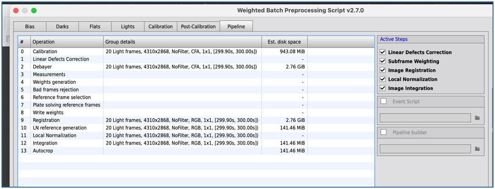

Aquí vemos que las operaciones que tiene que realizar son solamente 14 pasos porque los ficheros de corrección ya los tenemos como masters porque he aprovechado integraciones ya realizadas.

Por este motivo, la primera acción es calibrar los lights con los masters de corrección.

## Ajustes de los Active Steps
El ajuste de los parámetros correspondientes a los cinco "*Active Steps*" que hemos comentado se realiza en cada una de las pestañas correspondientes de los diferentes lights:

En *Bias, Darks y Flats* podemos ajustar *Image Integration* y dejando el *Rejection algorithm* en Auto es suficiente.

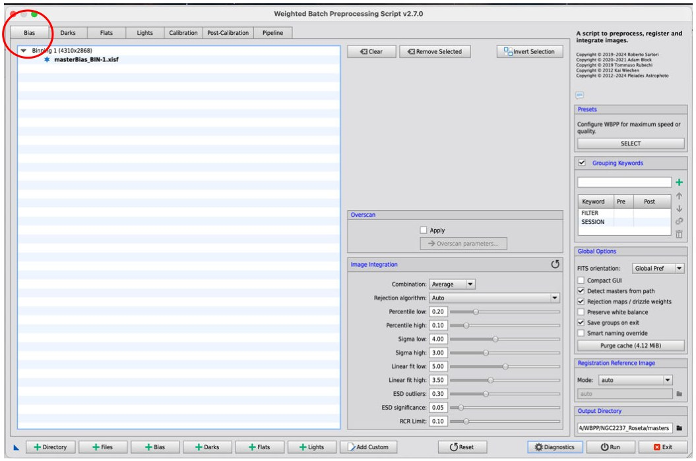

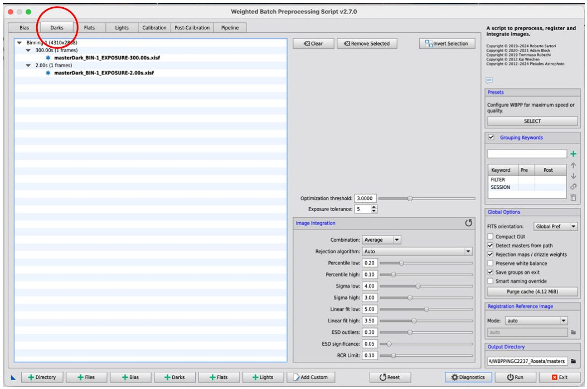

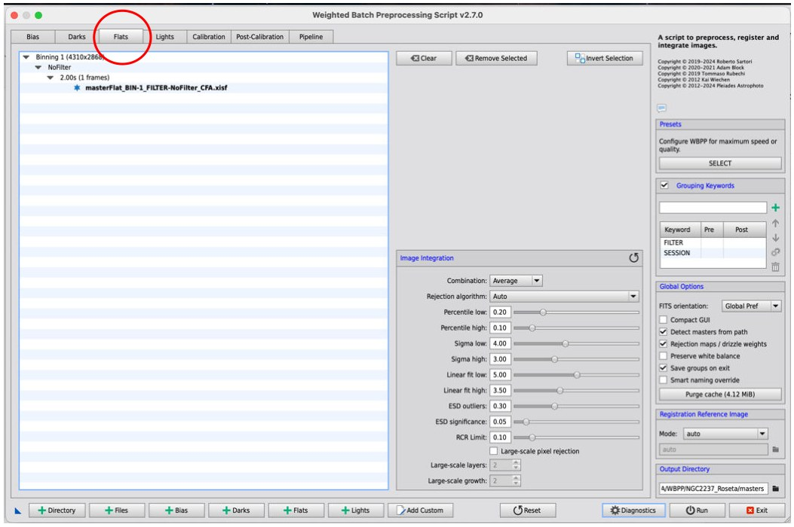

El correspondiente a los ficheros de luz es el más completo.

Como en la mayoría de procesos de PixI, este script funciona bien con las opciones por defecto.

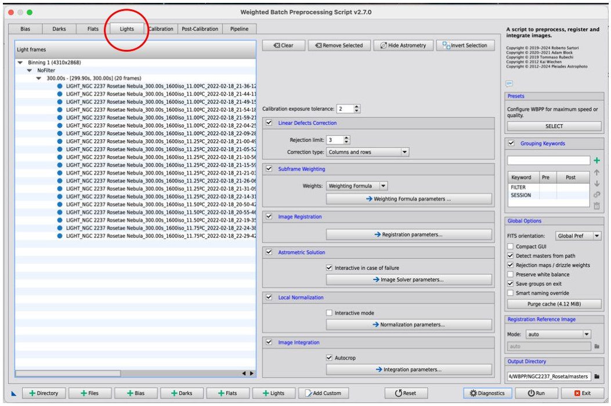

Tal vez el único que no tiene preset automático es la opción "*Weighting Formula*" en "*Subframe Weighting*" ya que "Weighting Formula parameters" tiene seis presets diferentes que tienen que ver con las características de nuestro objeto en cuatro de ellos.

Estas pantallas ilustran el comentario:

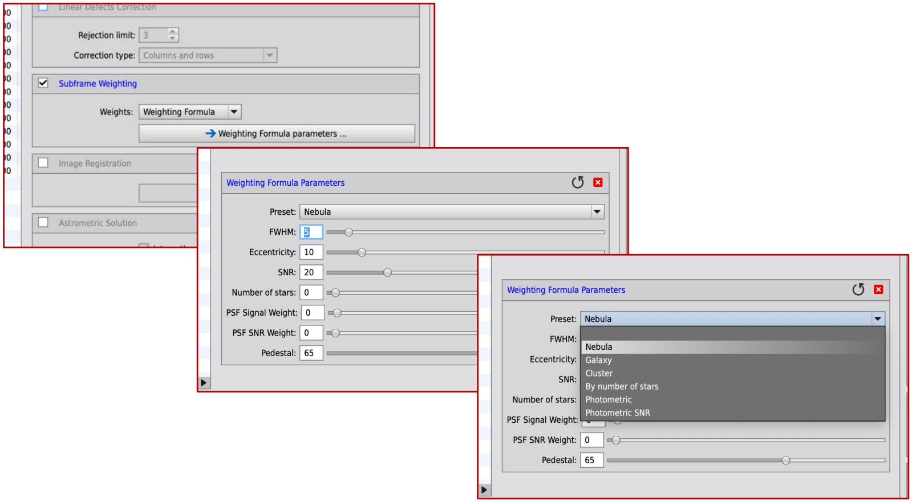

En el caso de los lights, en la pestaña *Image Integration* valdría la pena seleccionar *Winsorized Sigma Clipping* como *Rejection Algorithm* porque esta selección elimina (si tenemos un mínimo de 8 lights) muy bien las trazas de satélites.

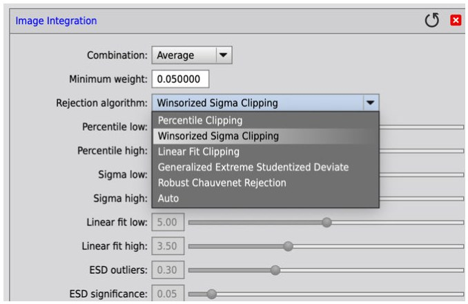

La opción *Astrometric Solution* requiere ajustar con precisión los parámetros relativos a nuestro objeto y veo más amigable utilizar el proceso "*ImageSolver*" cuando al aplicar otros durante el post-procesado, como por ejemplo SPCC, piden resolución astrométrica.

Si queremos activar la opción durante el apilado podemos seleccionar la casilla "*Interactive in case of failure*" que detiene el proceso de apilado si se produce un fallo; entonces tenemos la opción de resolverlo o anular para que siga con el apilado.

En el siguiente screenshot del monitor de ejecución de WBPP vemos precisamente como nos indica el fallo en esa operación.

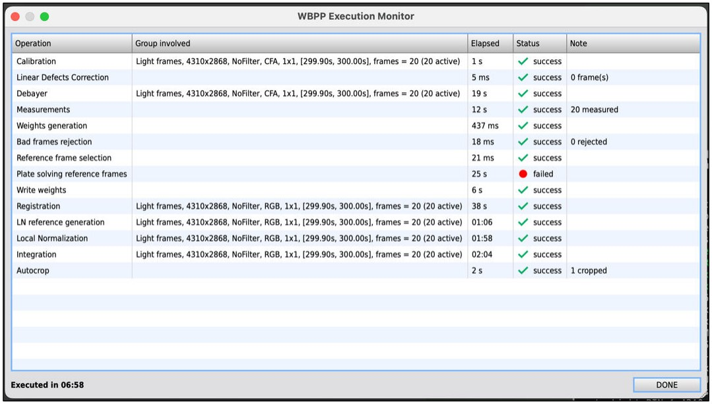

## Arranque del preprocesado
Una vez tenemos toda la información revisada, pulsamos el botón "*Diagnostics*" y WBPP revisa que todo se encuentre Ok y en caso contrario da un mensaje de error para advertir de los problemas que eventualmente haya podido encontrar.

También indica el espacio de disco que necesita y el total disponible.

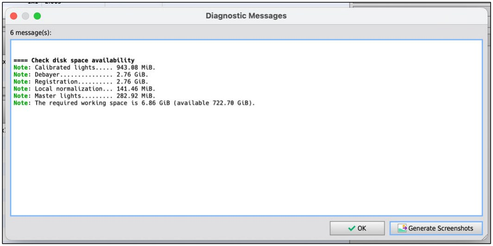

En este ejemplo vemos que todo está correcto.

Si pulsamos el botón "*Generate Screenshots*" nos guardará en */Masters/log/...* las siete pantallas correspondientes a las pestañas superiores de WBPP.

Pulsando el botón "*Run*" aparece un mensaje similar al anterior y la opción "*continue*" nos permitirá empezar el proceso de apilado.

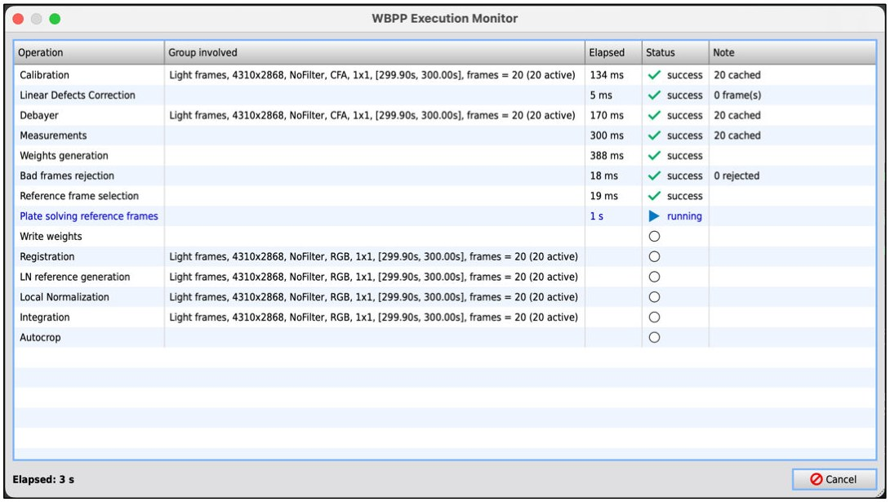

El proceso se puede cancelar con el botón inferior en cualquier momento.

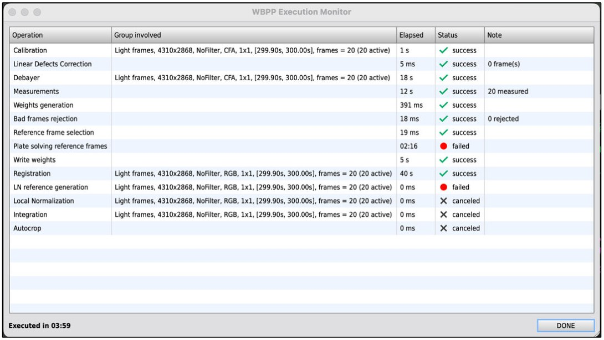

En la pantalla previa podemos ver cómo hemos abortado el proceso de plate solving y tres pasos más adelante hemos cancelado.

## Multisesión y multifiltro
Hasta ahora hemos procesado tomas OSC en sesión única.

Vamos a dar una mirada rápida a multisesión con cámara monocroma y varios filtros.

El aspecto de la pestaña Calibration para 91 lights tomadas en 3 sesiones diferentes y tiempo de integración acumulado de 9h 6min tiene el siguiente aspecto:

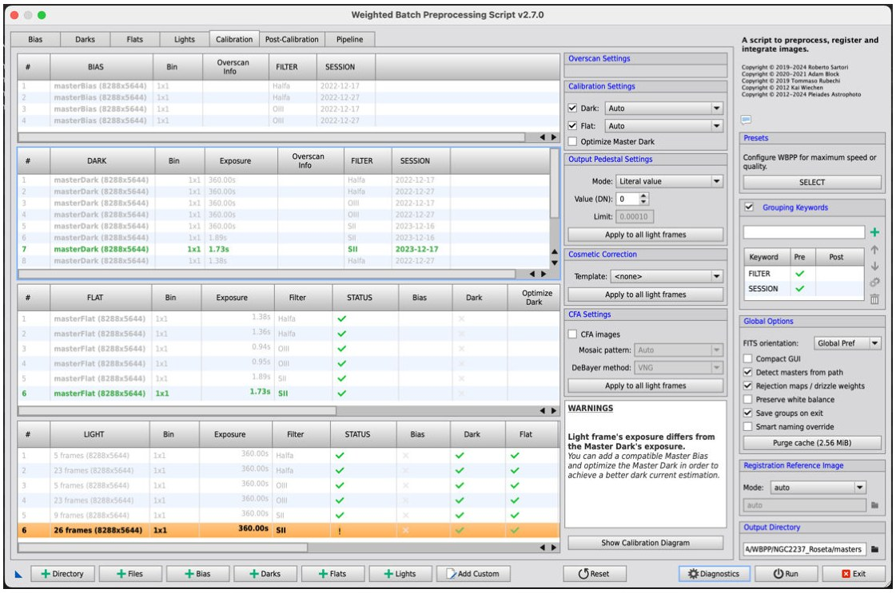

Donde vemos que los lights bias, dark y flats ya han sido integrados.

De hecho, para disminuir el espacio en disco y mejorar los tiempos de procesado final, normalmente integro los flats y darkflats después de cada sesión para disminuir el espacio acumulado de disco porque una vez obtengo los masters elimino los lights correspondientes que ya no aportan información y además, reduzco el tiempo de apilado final (cuando tengo todos los lights) porque parte de los masters de calibración de las sesiones previas ya han sido procesados.

¡¡Antes de borrar compruebo que los masters sean válidos!!

La pestaña *Pipeline* es en este caso más completa que en el primer ejemplo con cámara OSC:

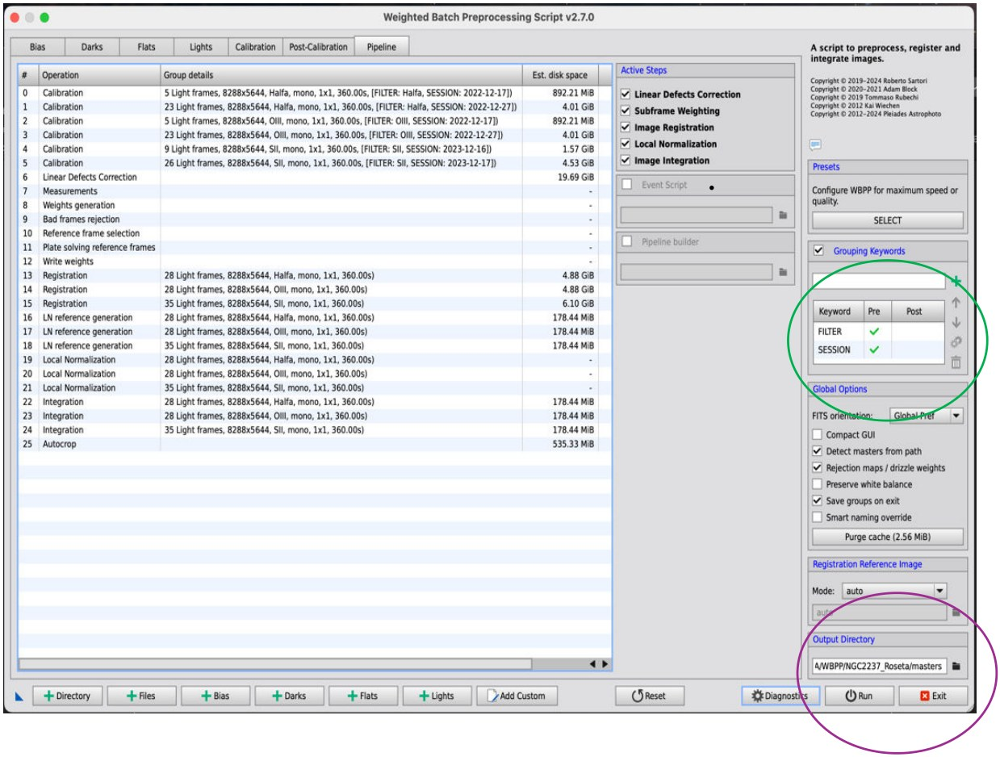

Con las "Global Options" por defecto se guardan todos los lights y configuraciones cuando salimos del script (*"Save groups on exit"* a ON); se guarda el estado de la última utilización, aunque hayamos cerrado PixI.

*Esta es una importante excepción respecto al funcionamiento general de los scripts.*

En el gráfico anterior he marcado en morado *"Output Directory"*; aquí se apunta a la carpeta *"masters"* de nuestra estructura estándar; en ella WBPP colocará todos los ficheros intermedios que va generando y los masters finales en la carpeta *"master"* que se generará de forma automática.

También hemos remarcado en verde una función importante, los "*Grouping Keywords*" que se utilizan para que WBPP agrupe los lights y los asocie con los ficheros de corrección según la fecha de la sesión y el filtro utilizado.

Para que nuestros lights tengan incorporado en su nombre la SESSION y el FILTER hemos de programar nuestro soft de captura para que los construya de esa forma.

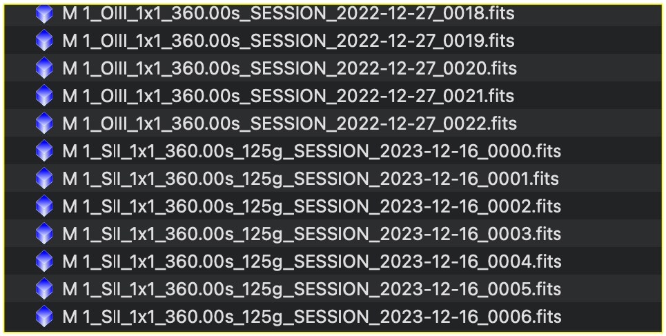

Estos lights están capturados con NINA y al definir las reglas para el nombre de los lights elegimos incluir `$$FILTER$$` y también "SESSION" con valores `$$DATEMINUS12$$`; esta función toma la fecha de la sesión y le resta 12 horas para evitar el cambio de sesión pasadas las 00:00h.

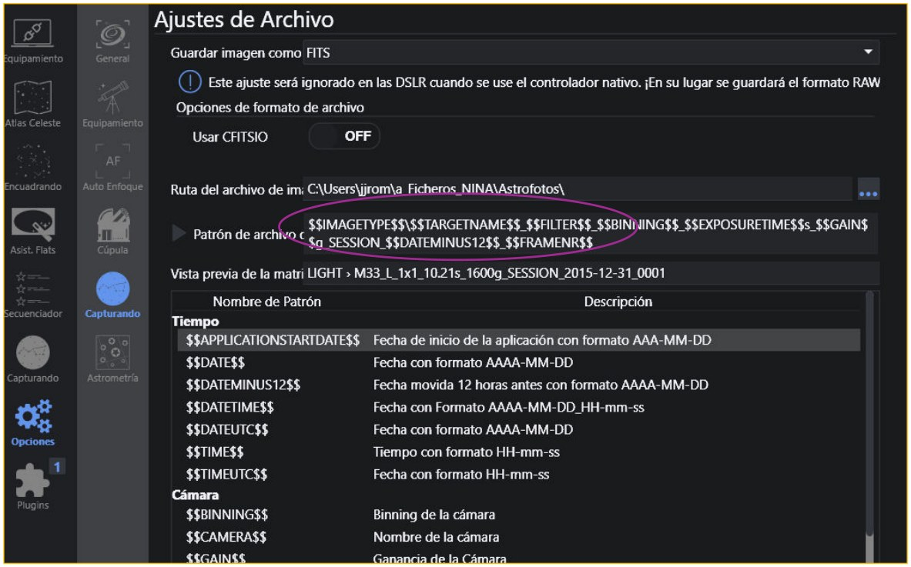

¡Hasta aquí esta introducción al apilado con PixInsight!!

¡Cielos limpios!!
