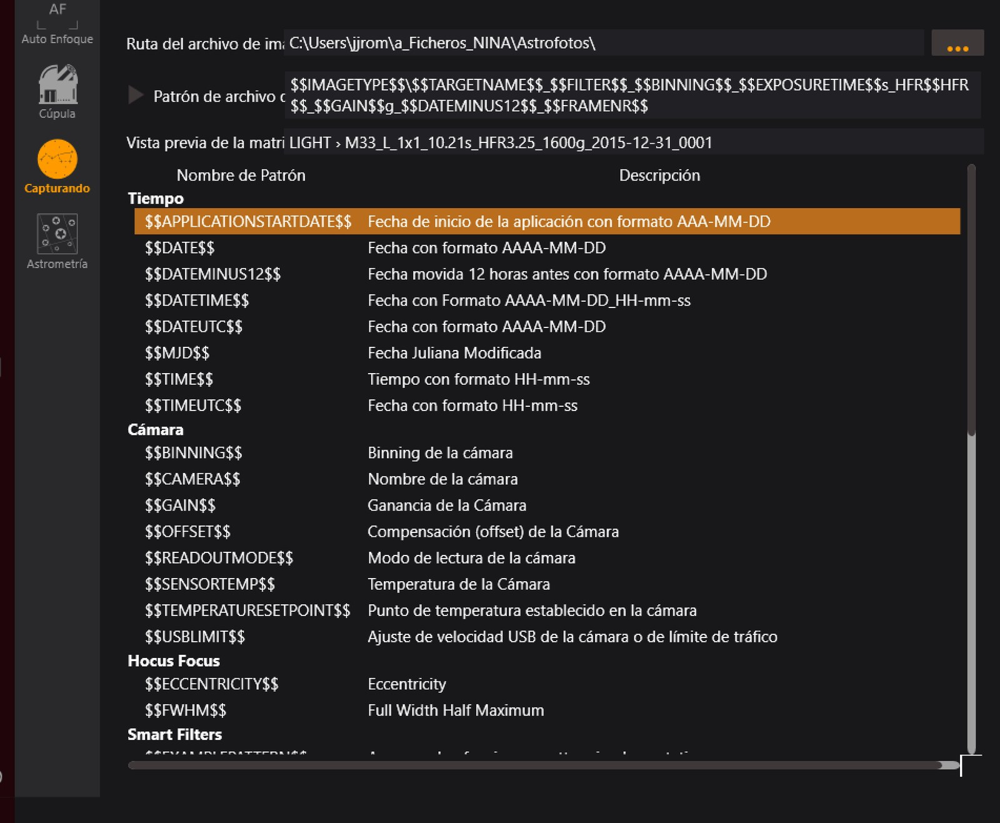
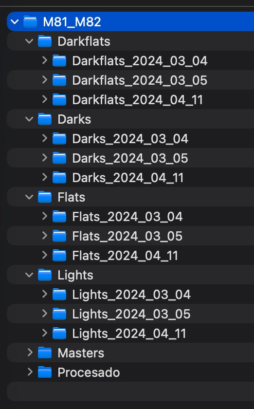
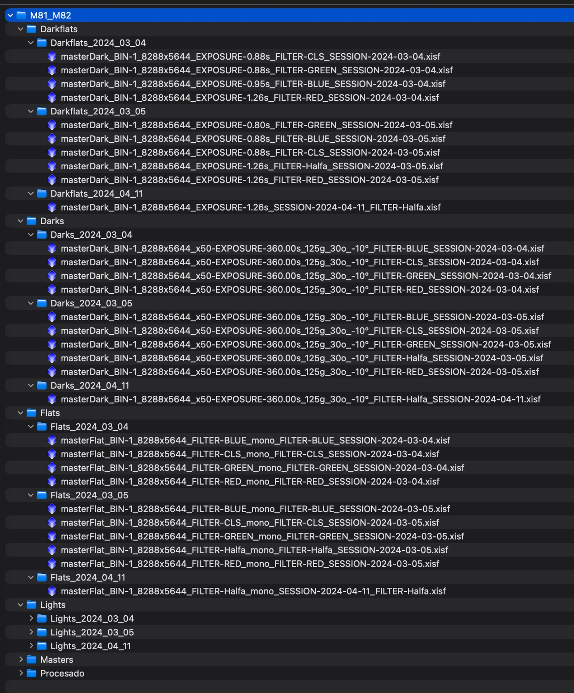
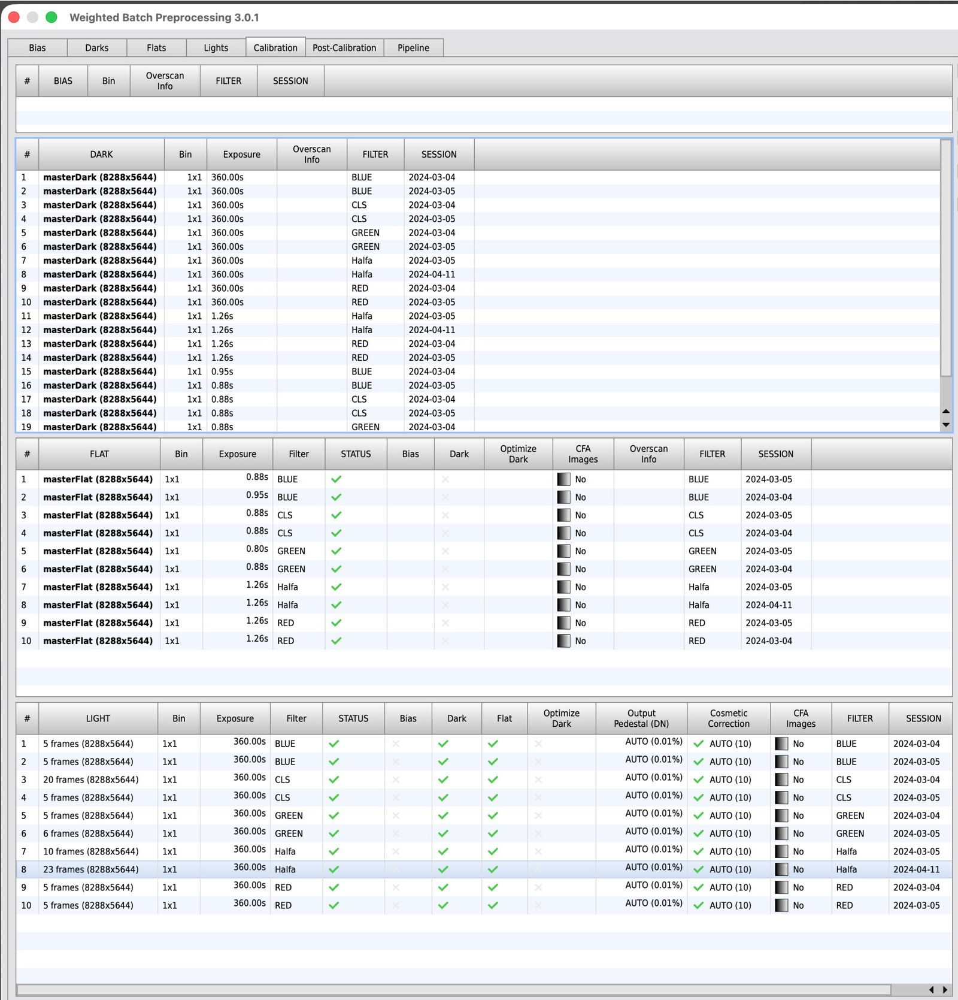
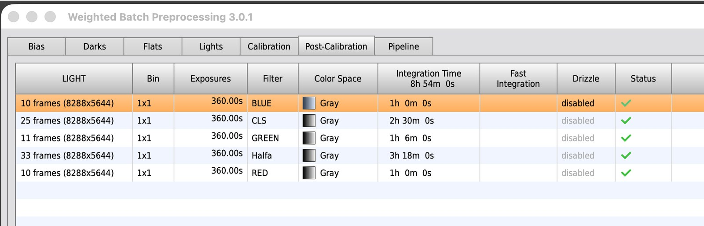
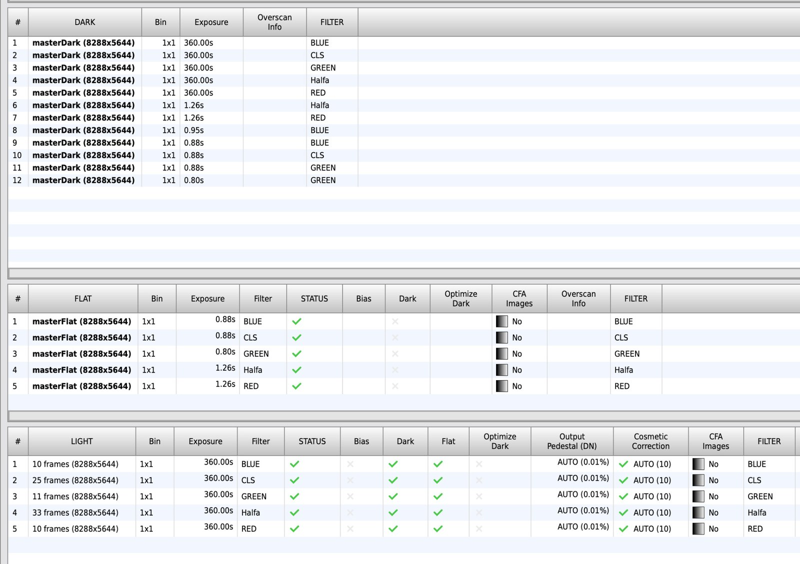
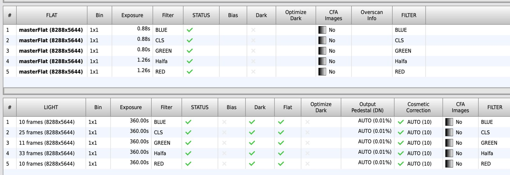
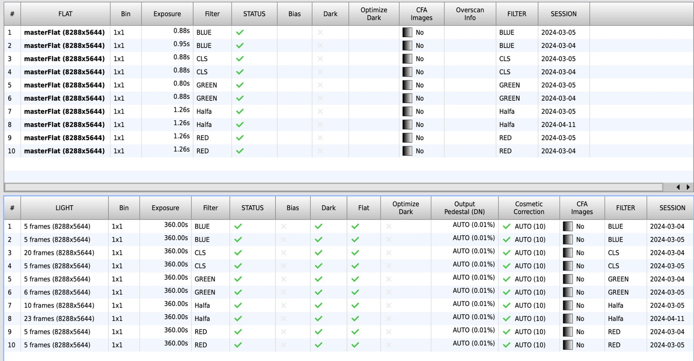

Un dels aspectes més importants de les nostres sessions d'astrofotografia és aconseguir bones preses. No obstant això, una vegada aconseguida la qualitat desitjada, també necessitem capturar imatges durant el major temps possible.

Com que depenem de diversos factors externs, és fàcil que entre dues sessions transcorri més temps del desitjat. A més, la zona del cel que podem fotografiar va canviant al llarg de l'any, per la qual cosa pot passar una o fins i tot diverses temporades abans que puguem continuar fotografiant un objecte determinat.

Quan ha transcorregut un cert temps, i pel fet que hem seguit utilitzant els nostres ordinadors i modificant l'organització dels seus discos, pot resultar molt difícil —si no impossible— recuperar el punt on deixem el processament d'un objecte.

Davant d'una situació com aquesta, només hi ha una manera d'evitar el desastre: disposar d'un procediment establert i treballar de manera metòdica i ordenada.

Com a referència faré servir programes com NINA i PixInsight, encara que els criteris que explicaré també es poden aplicar a altres programes.

Disposar d'un procediment implica sempre etiquetar els fitxers de la mateixa manera i emmagatzemar-los seguint una estructura coherent per a cada sessió de treball.

## Organització d'una carpeta de projecte
Per a cada sessió d'astrofotografia utilitzo la següent estructura de carpetes:

```text
\Objeto_XXXX
    \BIAS
    \DARK
    \DARKFLAT
    \FLAT
    \LIGHT
```

### Què conté cada carpeta
**LIGHT:** exposicions de l'objecte astronòmic. Són les imatges que contenen el senyal que volem conservar i que finalment integrarem.

**FLAT:** exposicions d'una font uniforme que corregeixen el vinyetatge, les partícules de pols i altres variacions d'il·luminació del tren òptic. S'han d'obtenir sense alterar l'orientació de la càmera, l'enfocament ni la posició dels elements òptics.

**DARK:** exposicions realitzades amb el sensor sense rebre llum. Enregistren el senyal tèrmic, el patró electrònic i possibles efectes com l'amp glow. Per reutilitzar-les han de coincidir, com a mínim, l'exposició, la temperatura, el guany, l'òfset, el binning i el mode de lectura.

**DARK FLAT:** dark amb el mateix temps d'exposició i els mateixos paràmetres electrònics que els flats. S'utilitza per retirar-ne el senyal fosc i el component de lectura.

**BIAS:** exposició presa amb la mínima durada possible i sense entrada de llum, destinada a caracteritzar el senyal de lectura. El seu ús o substitució per dark flats depèn del comportament de la càmera i del flux de calibratge escollit.

A cada sessió incorporarem nous fitxers, com a mínim, a les carpetes `\DARKFLAT`, `\FLAT` i `\LIGHT`, i potser també a `\BIAS`, si utilitzem aquest tipus de fitxers. Al meu equip utilitzo dark flats en lloc de bias perquè s'adapten millor al comportament de la meva càmera. Aquesta elecció s'ha d'ajustar a les característiques de cada sensor i al procediment de calibratge utilitzat.

No incloc nous fitxers a `\DARK` després de cada sessió perquè normalment es necessiten entre 30 i 40 preses amb la mateixa exposició, guany, òfset, binning, temperatura i mode de lectura que els lights. Per això utilitzo una biblioteca de darks o, preferiblement, de master darks —els arxius mestres resultants d'integrar les preses dark—, que renovo periòdicament i sempre que canvia alguna d'aquestes condicions.

Més endavant veurem per què mantinc aquesta carpeta dins l'estructura estàndard.

Segons hem comentat, després d'una sessió tindrem:

```text
\Objeto_XXXX
    \BIAS
    \DARK
    \DARKFLAT
        30 arxius per cada filtre
    \FLAT
        30 arxius per cada filtre
    \LIGHT
        Tots els lights de la sessió
```

Fem alguns càlculs per entendre el pas següent.

Si fem 40 fotografies amb una càmera en color (OSC), en finalitzar la sessió tindrem:

```text
\Objeto_XXXX
    \BIAS
    \DARK
    \DARKFLAT
        30 arxius
    \FLAT
        30 arxius
    \LIGHT
        40 arxius
```

Això suposa un total de 100 fitxers.

Nota: En aquest text, OSC significa One Shot Color o càmera en color; MM, càmera monocroma; i LRGB designa els filtres de luminància, vermell, verd i blau. Més endavant, SHO farà referència a sofre ionitzat (SII), hidrogen alfa (Ha) i oxigen doblement ionitzat (OIII).

Si utilitzem una càmera monocroma (MM) amb una configuració típica L, R, G i B, i realitzem també 40 preses en total, tindrem:

```text
\Archivos_NINA
    \BIAS
    \DARK
    \DARKFLAT
        120 arxius
    \FLAT
        120 arxius
    \LIGHT
        40 arxius
```

El resultat serà un total de 280 fitxers. Si afegíssim un filtre Ha i mantinguéssim el total de 40 lights, sumaríem altres 30 flats i 30 dark flats, fins a assolir 340 arxius. Tot això sense comptabilitzar els fitxers MasterBias i MasterDark.

Amb aquest volum de dades, durant el dia següent utilitzo Weighted Batch Preprocessing (WBPP), l'script de preprocessament per lots de PixInsight, per integrar per separat els flats i els dark flats i generar els seus respectius arxius mestres. Al meu equip, aquest procés sol portar menys de deu minuts.

D'aquesta manera, obtenim un únic fitxer master flat i un únic master dark flat per cada filtre i sessió.

Un cop obtinguts i verificats els màsters, i després de fer una còpia de seguretat, podem traslladar els fitxers de correcció originals a un emmagatzematge secundari. Conservar-los permet tornar a generar els màsters en el futur amb altres paràmetres o amb una versió posterior del programa.

És possible que el directori de captura estigui en un mini-PC instal·lat sobre la muntura. En aquest cas, és aconsellable alliberar espai després de cada sessió, però només quan els fitxers originals ja s'hagin copiat i verificat en un altre suport. Si l'espai disponible obliga a eliminar-los definitivament, hauríem de conservar almenys els màsters comprovats i les metadades necessàries per identificar com es van generar.

Per a cada objecte genero un directori amb la mateixa estructura utilitzada durant la captura de dades i el conservo permanentment. Com a exemple, per a un objecte fotografiat a SHO utilitzaria:

```text
\M20_Trifida
    \BIAS
        MasterBias
    \DARK
        MasterDark
    \DARKFLAT
        MasterDarkFlat_Ha_sesion_1
        MasterDarkFlat_Ha_sesion_2
        MasterDarkFlat_Ha_sesion_3
        MasterDarkFlat_OIII_sesion_1
        MasterDarkFlat_OIII_sesion_2
        MasterDarkFlat_OIII_sesion_3
        MasterDarkFlat_SII_sesion_1
        MasterDarkFlat_SII_sesion_2
        MasterDarkFlat_SII_sesion_3
    \FLAT
        MasterFlat_Ha_sesion_1
        MasterFlat_Ha_sesion_2
        MasterFlat_Ha_sesion_3
        MasterFlat_OIII_sesion_1
        MasterFlat_OIII_sesion_2
        MasterFlat_OIII_sesion_3
        MasterFlat_SII_sesion_1
        MasterFlat_SII_sesion_2
        MasterFlat_SII_sesion_3
    \LIGHT
        12 fitxers Ha, sessió 1
        12 fitxers Ha, sessió 2
        12 fitxers Ha, sessió 3
        12 arxius OIII, sessió 1
        12 arxius OIII, sessió 2
        12 arxius OIII, sessió 3
        12 fitxers SII, sessió 1
        12 fitxers SII, sessió 2
        12 arxius SII, sessió 3
```

Fins ara encara no hem aplicat els fitxers de correcció ni hem apilat els nostres lights.

A l'exemple mostrat tenim 20 fitxers de correcció (masters):

1 + 1 + 9 + 9 = 20

També tenim:

12 × 9 = 108 lights

Això suposa un total de 128 fitxers.

Estem suposant 12 fitxers per filtre i sessió. Amb tres filtres i exposicions de 300 segons, cada sessió conté 36 lights: 12 × 3 × 300 s = 10.800 s, és a dir, tres hores d'integració total —una hora per filtre.

Si no utilitzéssim el sistema descrit i conservéssim els MasterBias i MasterDark, però també tots els flats i dark flats originals de les tres sessions, tindríem:

1 + 1 + (9 × 30) + (9 × 30) = 542 fitxers de correcció

A aquests hauríem d'afegir els 108 lights, cosa que donaria un total de 650 arxius.

Per tant:

650 ÷ 128 = 5,08

És a dir, tindríem aproximadament cinc vegades més fitxers.

Vegem ara quant espai d'emmagatzematge podem estalviar.

Amb el meu equip, treballant sempre en bin 1, les mides aproximades són les següents:

- Un màster dark, màster flat o màster dark flat ocupa uns 374 MB.
- Un fitxer light ocupa uns 93,6 MB.

Aplicant aquests valors a l'exemple anterior, el directori M20_Trifida ocuparia, utilitzant màsters:

20 × 374 MB + 108 × 93,6 MB ≈ 17,2 GiB

Si conservéssim tots els fitxers de correcció originals de cada sessió:

542 × 93,6 MB + 108 × 93,6 MB ≈ 59,4 GiB

Per tant:

59,4 ÷ 17,2 = 3,45

Això suposa utilitzar aproximadament 3,45 vegades més espai d'emmagatzematge. En aquests càlculs s'ha fet servir la conversió binària, per la qual cosa la unitat correcta és GiB (1 GiB = 1.024 MB).

Si per traslladar les dades d'un ordinador a un altre utilitzem discos de seguretat, aquests volums d'informació són molt significatius, especialment pel temps necessari per fer les transferències.

Un cop analitzat això, reordenarem les nostres dades per a més claredat:

```text
\M20_Trifida
    \BIAS
        MasterBias
    \DARK
        MasterDark
    \DARKFLAT
        SESSION_1
            MasterDarkFlat_Ha_sesión_1
            MasterDarkFlat_OIII_sesión_1
            MasterDarkFlat_SII_sesión_1
        SESSION_2
            MasterDarkFlat_Ha_sesión_2
            MasterDarkFlat_OIII_sesión_2
            MasterDarkFlat_SII_sesión_2
        SESSION_3
            MasterDarkFlat_Ha_sesión_3
            MasterDarkFlat_OIII_sesión_3
            MasterDarkFlat_SII_sesión_3
    \FLAT
        SESSION_1
            MasterFlat_Ha_sesión_1
            MasterFlat_OIII_sesión_1
            MasterFlat_SII_sesión_1
        SESSION_2
            MasterFlat_Ha_sesión_2
            MasterFlat_OIII_sesión_2
            MasterFlat_SII_sesión_2
        SESSION_3
            MasterFlat_Ha_sesión_3
            MasterFlat_OIII_sesión_3
            MasterFlat_SII_sesión_3
    \LIGHT
        SESSION_1
            12 fitxers Ha, sessió 1
            12 arxius OIII, sessió 1
            12 fitxers SII, sessió 1
        SESSION_2
            12 fitxers Ha, sessió 2
            12 arxius OIII, sessió 2
            12 fitxers SII, sessió 2
        SESSION_3
            12 fitxers Ha, sessió 3
            12 arxius OIII, sessió 3
            12 arxius SII, sessió 3
```

D'aquesta manera facilitem la traçabilitat de les dades, sobretot quan ha transcorregut molt de temps entre sessions —de vegades, fins i tot uns quants anys—.

## Comencem a ordenar des de la captura
Quan veiem el nom d'un fitxer, hauríem de poder identificar immediatament les dades que ens interessen.

La informació que incloem en el nom és subjectiva i depèn dels gustos i de l'experiència de cada persona.

Al principi ens podem sentir temptats a incorporar tota mena d'informació. No obstant això, quan els programes processen els fitxers i els traslladen entre diferents carpetes i subcarpetes —temporals o definitives—, la ruta completa pot superar el límit admès pel sistema o per l'aplicació. Quan això passa, el programa pot deixar de funcionar. A mi m'ha passat.

Com a recomanació pràctica, encara que no es tracti de límits màxims absoluts, convé:

- Mantenir els noms del fitxer per sota dels 100 caràcters.
- Mantenir la ruta completa per sota dels 240 caràcters.
- Utilitzar únicament lletres, números, guionets i guions baixos.

A NINA disposem d'una gran quantitat de paràmetres que podem incloure automàticament en assignar un nom a cada nou frame.



Els textos compresos entre dobles signes de dòlar són variables o tokens: NINA els substitueix automàticament pel valor real de cada exposició. No formen part literal del nom final del fitxer.

Hi ha nombrosos patrons per anomenar les nostres preses light des del moment de la captura i facilitar així el seu posterior seguiment. En el meu cas utilitzo els següents:

### `$$IMAGETYPE$$`
Indica el tipus d'imatge i la carpeta on s'emmagatzemarà: LIGHT, FLAT, etc. A la vista prèvia de la captura de pantalla es tracta d'un LIGHT.

### `$$TARGETNAME$$`
Introdueix el nom que hem assignat a l'objecte fotografiat. A l'exemple és M33.

### `$$FILTER$$`
Indica el filtre utilitzat. A l'exemple apareix L, corresponent a luminància.

### `$$BINNING$$`
Indica el binning utilitzat. A l'exemple és bin 1 o 1×1.

### `$$EXPOSURETIME$$`
Indica el temps d'exposició. A l'exemple és de 10,21 s.

### `$$HFR$$`
Inclou el valor de HFR calculat per NINA per a la imatge.

L'HFR —Half Flux Radius— és una mesura numèrica relacionada amb la mida aparent de les estrelles i constitueix una referència molt útil per avaluar l'enfocament i la qualitat relativa de les preses obtingudes amb un mateix equip.

Mesura el radi, expressat en píxels, des del centre d'una estrella fins al punt que conté la meitat del flux lluminós total.

### `$$GAIN$$`
Indica el guany utilitzat durant l'exposició.

### `$$DATEMINUS12$$`
Introdueix la data de captura restant dotze hores.

Aquest paràmetre és molt important perquè probablement la nostra sessió s'allargarà més enllà de la mitjanit. En restar dotze hores, totes les fotografies de la mateixa nit queden etiquetades amb la mateixa data relativa.

A efectes d'ordenació, això és fonamental per distingir correctament diferents sessions realitzades en nits consecutives.

### `$$FRAMENR$$`
Correspon al número d'ordre consecutiu de l'exposició realitzada.

D'aquesta manera, en observar el nom següent:

```text
Light\Sh2-114_Halfa_1x1_300.00s_HFR3.64_125g_2026-07-04_0118
```

podem saber automàticament que es tracta de l'exposició número 118, realitzada durant la sessió del 4 de juliol de 2026, corresponent a l'objecte Sh2-114 —la nebulosa del Drac Volador—, capturada amb un filtre H-alfa, a bin 1, amb una exposició de 300 segons, un guany de 125 i un HFR de 3,64.

Tota aquesta informació està continguda en només 60 caràcters, comptant la carpeta `Light\`.

El valor de l'HFR és especialment útil per comparar exposicions obtingudes amb el mateix equip i unes condicions semblants. No s'hauria d'utilitzar com a únic criteri de selecció, ja que també hi influeixen el seguiment, el fons de cel, els núvols i altres factors.

Les diferents sessions, juntament amb totes les carpetes associades, es guarden utilitzant una ordenació que fa referència a SESSION. D'aquesta manera mantenim la coherència amb el filtratge que posteriorment realitza WBPP a PixInsight.

> Important: crear una carpeta anomenada SESSION_1 o escriure SESSION al nom del fitxer no garanteix per si mateix que WBPP pugui agrupar-lo. WBPP ha de trobar la paraula clau SESSION i el seu valor a les metadades que interpreta. Abans d'executar el procés cal comprovar que la columna SESSION apareix correctament emplenada per a lights, flats i màsters implicats.

L'aspecte de l'estructura de fitxers de les sessions que he fet sobre M81+M82 és el que es mostra a la imatge adjunta.



En desplegar les carpetes dels fitxers de correcció, obtenim el següent aspecte:



Encara que els master dark procedeixin d'una biblioteca i un mateix fitxer sigui vàlid per a diferents filtres quan coincideixen exposició, temperatura, guany, òfset, binning i mode de lectura, en el meu flux de treball acostumo a duplicar-los i etiquetar una còpia per a cada filtre i sessió.

Aquesta duplicació no és una necessitat física del calibratge, sinó una convenció organitzativa personal que faig servir per simplificar l'assignació automàtica en projectes complexos.

Amb aquesta nomenclatura, WBPP identifica de manera consistent els grups definits per FILTER i SESSION. No obstant això, també es pot emprar una biblioteca comuna de darks correctament identificada, evitant duplicar fitxers.

Per tant, recomano entendre aquest procediment com una solució pràctica dins del meu sistema d'arxivament, i no com un requisit general de WBPP.

Com veurem a continuació, els dos camps estratègics per organitzar aquest flux de treball són FILTER i SESSION; gràcies a ells podem separar de manera lògica el calibratge per filtre i per sessió.

A WBPP, els dark flats s'incorporen com a darks de curta exposició. El programa els distingeix dels darks dels lights pel seu temps d'exposició i els utilitza per calibrar els flats quan troba una correspondència adequada.

## Incorporació de les dades a WBPP
Prenguem ara aquest mateix exemple de M81+M82 durant tres sessions: 04/03/2024, 05/03/2024 i 11/04/2024.

Els fitxers s'han desat seguint l'estructura estàndard descrita anteriorment.

En iniciar WBPP i seleccionar el directori de M81_M82, obtenim el resultat següent:



Tots els fitxers s'han carregat automàticament. A l'apartat Calibration podem comprovar que els lights apareixen amb l'estat OK i que tenen associats els corresponents darks i flats. L'estat OK confirma que WBPP ha trobat una combinació compatible; no garanteix per si mateix que els màsters siguin adequats o que no tinguin defectes, per la qual cosa sempre convé revisar les assignacions.

L'apartat Post-Calibration presenta el següent aspecte:



A Grouping Keywords hem seleccionat l'agrupació per filtre i per sessió de captura:


A Pre-Calibration, l'ordre indicat implica que els fitxers s'agrupen primer segons el filtre utilitzat i, dins de cada filtre, segons la sessió de treball. Aquesta separació permet aplicar a cada grup els flats corresponents.

La casella Pre s'utilitza per separar els grups durant el calibratge. Si volem obtenir al final una sola integració per filtre reunint totes les nits, SESSION no s'ha de mantenir com a criteri d'agrupació a Post-Calibration. Si no, WBPP pot produir una integració diferent per a cada sessió.

Si no seleccionem la paraula clau SESSION, el resultat mostrat a Post-Calibration seria aparentment el mateix. Tot i això, el contingut de Calibration canviaria:



Vegem ambdues configuracions amb més detall:



Com podem observar, si ometem SESSION, WBPP ja no distingeix els flats de les diferents dates i pot utilitzar per a un grup un màster flat pertanyent a una altra sessió. Els darks, en canvi, poden procedir d'una biblioteca comuna sempre que coincideixin tots els paràmetres de captura.

No és el que desitgem per als flats. Necessitem que els lights de cada sessió es calibrin amb els flats obtinguts per a l'estat concret del tren òptic en aquesta data.



Per aquest motiu afegim la paraula clau SESSION a Pre-Calibration, dins de Grouping Keywords.

En comparar les dues imatges podem comprovar clarament aquesta diferència.

Alguns màsters poden compartir el mateix temps d'exposició sense ser intercanviables. Els flats de cada sessió registren l'estat concret del tren òptic: partícules de pols, ombres, vinyetatge, rotació de la càmera i possibles variacions respecte a sessions anteriors. Els dark flats han de correspondre a l'exposició i als paràmetres electrònics d'aquests flats; no depenen de les partícules de pols ni del filtre.

## Conclusions
Una nomenclatura estable, una estructura de carpetes coherent i unes metadades fiables permeten reprendre projectes multisessió fins i tot després de mesos o anys.

La paraula clau SESSION és especialment útil per associar els flats a l'estat del tren òptic de cada nit, mentre que els darks es poden gestionar mitjançant una biblioteca comuna quan coincideixen els paràmetres de captura.

Un cop generats i comprovats els master flats i master dark flats, i després de conservar almenys dues còpies de seguretat verificades, els fitxers originals utilitzats per crear-los es poden eliminar. D'aquesta manera es redueix considerablement l'espai ocupat sense comprometre el futur calibratge del projecte.

Per garantir la traçabilitat, els màsters han de conservar les metadades i estar clarament identificats per filtre, sessió i paràmetres de captura.

---

Fins aquí el tema d'ordenació i arxivament d'imatges astronòmiques multisessió

Cels nets!
