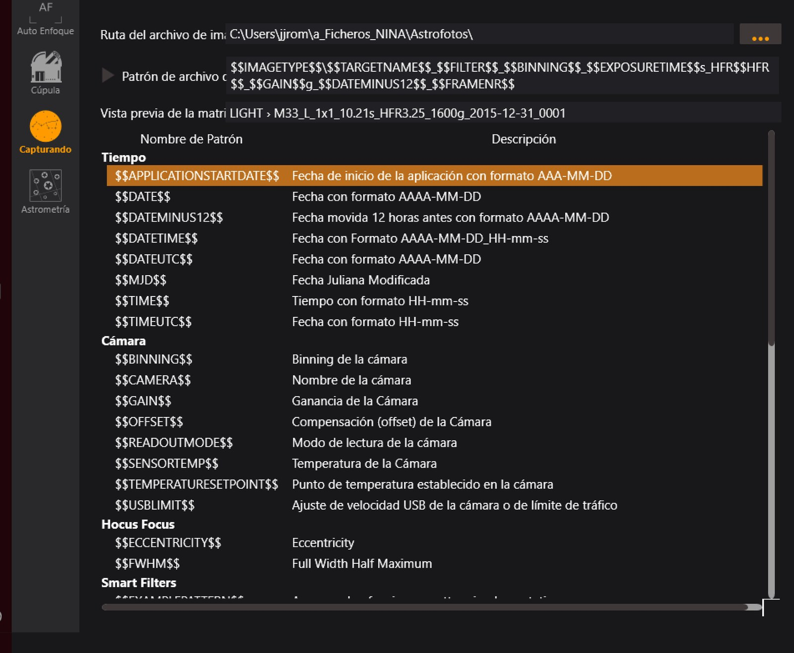
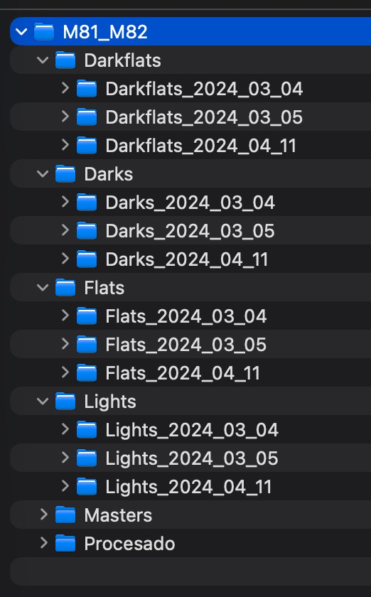
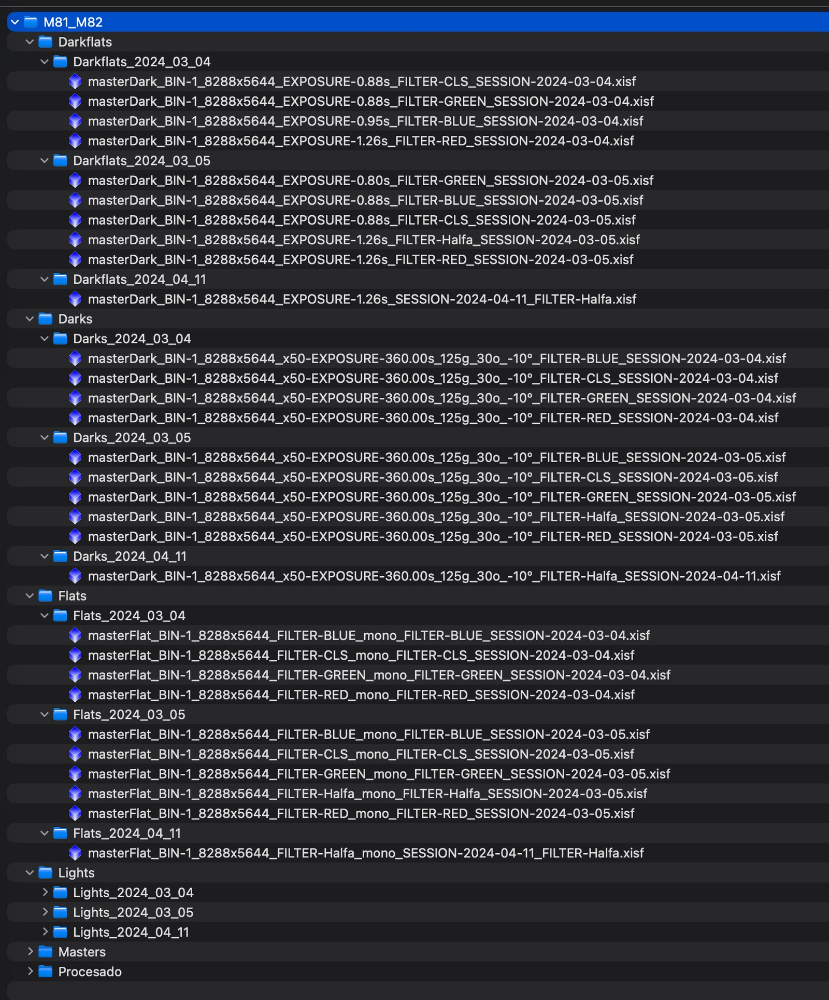
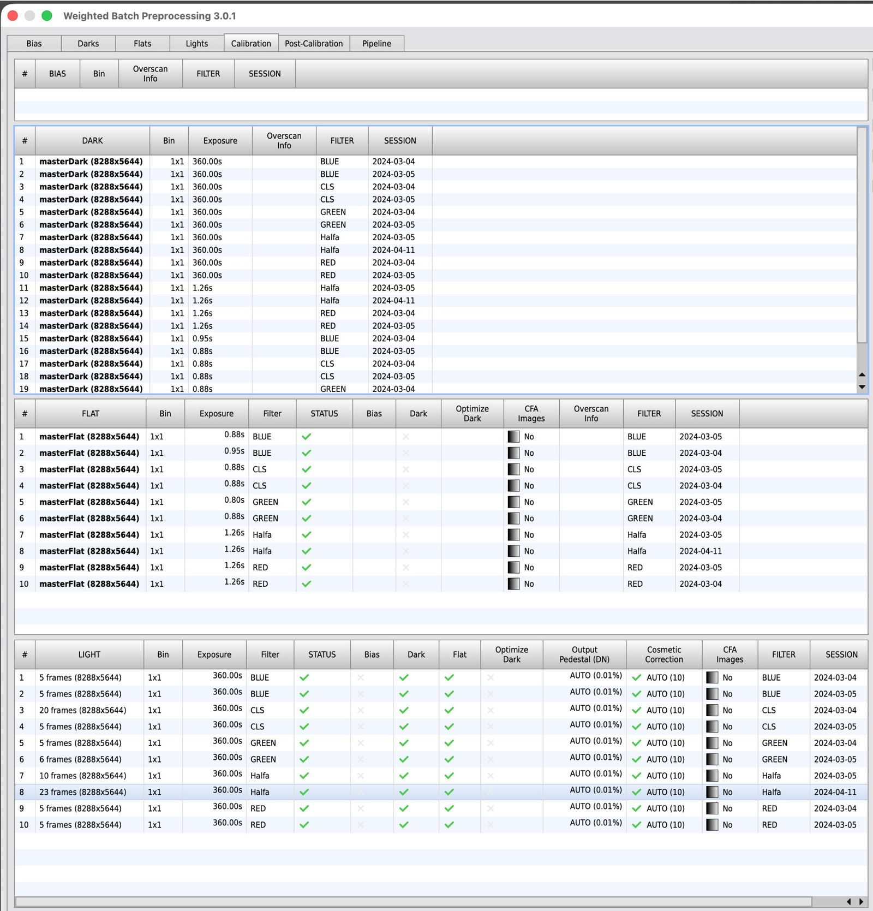
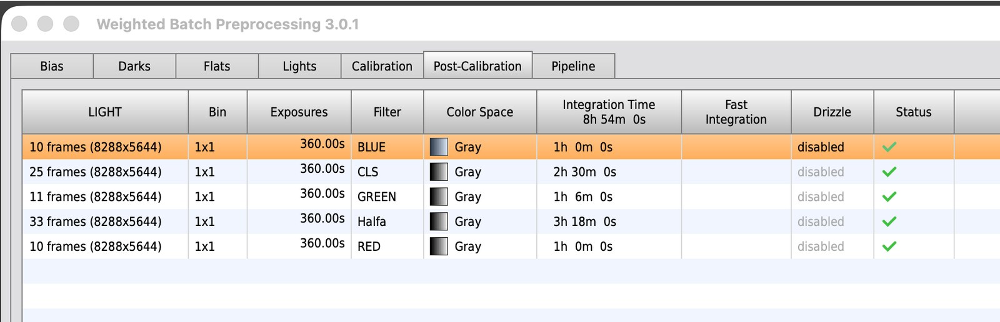
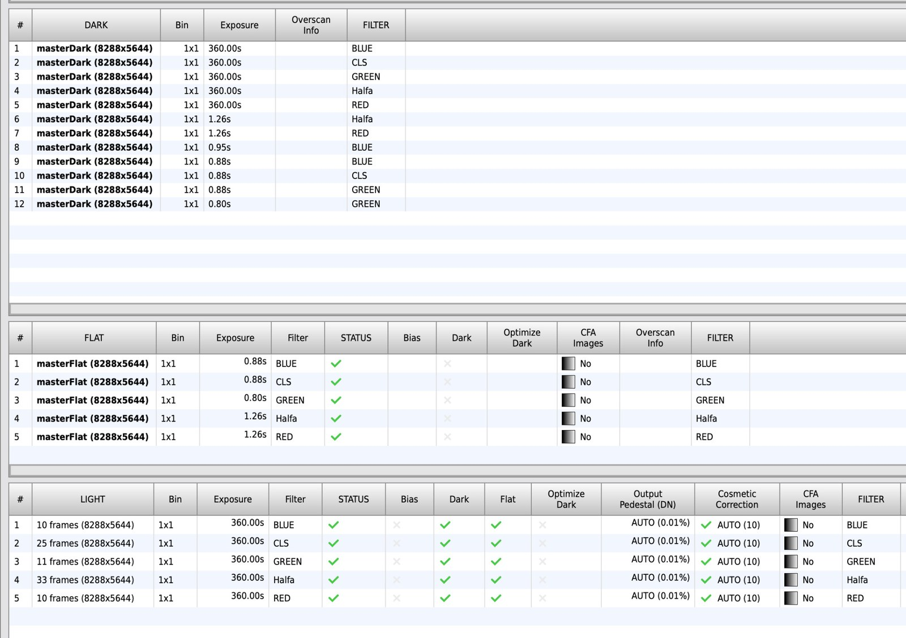
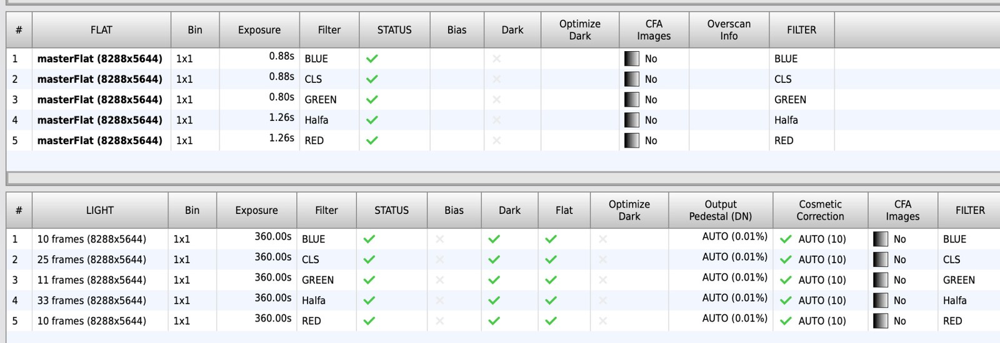
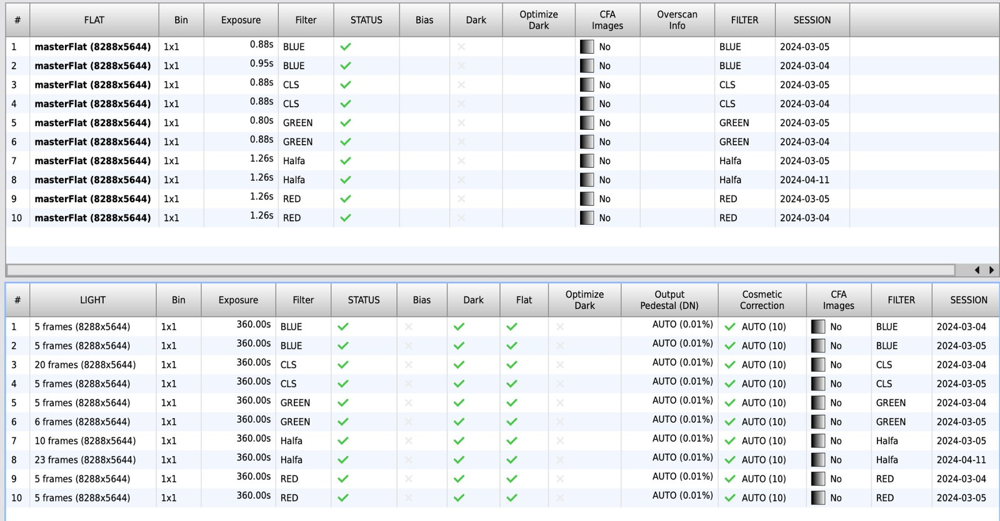

Uno de los aspectos más importantes de nuestras sesiones de astrofotografía es conseguir buenas tomas. Sin embargo, una vez alcanzada la calidad deseada, también necesitamos capturar imágenes durante el mayor tiempo posible.

Como dependemos de diversos factores externos, es fácil que entre dos sesiones transcurra más tiempo del deseado. Además, la zona del cielo que podemos fotografiar va cambiando a lo largo del año, por lo que puede pasar una o incluso varias temporadas antes de que podamos continuar fotografiando un determinado objeto.

Cuando ha transcurrido cierto tiempo, y debido a que hemos seguido utilizando nuestros ordenadores y modificando la organización de sus discos, puede resultar muy difícil —si no imposible— recuperar el punto en el que dejamos el procesamiento de un objeto.

Ante una situación como esta, solo existe una forma de evitar el desastre: disponer de un procedimiento establecido y trabajar de manera metódica y ordenada.

Como referencia utilizaré programas como NINA y PixInsight, aunque los criterios que explicaré también pueden aplicarse a otros programas.

Disponer de un procedimiento implica etiquetar siempre los archivos de la misma forma y almacenarlos siguiendo una estructura coherente para cada sesión de trabajo.

## Organización de una carpeta de proyecto
Para cada sesión de astrofotografía utilizo la siguiente estructura de carpetas:

```text
\Objeto_XXXX
    \BIAS
    \DARK
    \DARKFLAT
    \FLAT
    \LIGHT
```

### Qué contiene cada carpeta
**LIGHT:** exposiciones del objeto astronómico. Son las imágenes que contienen la señal que queremos conservar y que finalmente integraremos.

**FLAT:** exposiciones de una fuente uniforme que corrigen el viñeteo, las motas de polvo y otras variaciones de iluminación del tren óptico. Deben obtenerse sin alterar la orientación de la cámara, el enfoque ni la posición de los elementos ópticos.

**DARK:** exposiciones realizadas con el sensor sin recibir luz. Registran la señal térmica, el patrón electrónico y posibles efectos como el amp glow. Para reutilizarlas deben coincidir, como mínimo, la exposición, temperatura, ganancia, offset, binning y modo de lectura.

**DARK FLAT:** dark con el mismo tiempo de exposición y los mismos parámetros electrónicos que los flats. Se utiliza para retirar de estos su señal oscura y su componente de lectura.

**BIAS:** exposición tomada con la mínima duración posible y sin entrada de luz, destinada a caracterizar la señal de lectura. Su uso o sustitución por dark flats depende del comportamiento de la cámara y del flujo de calibración elegido.

En cada sesión incorporaremos nuevos archivos, como mínimo, en las carpetas `\DARKFLAT`, `\FLAT` y `\LIGHT`, y quizá también en `\BIAS`, si utilizamos este tipo de archivos. En mi equipo empleo dark flats en lugar de bias porque se adaptan mejor al comportamiento de mi cámara. Esta elección debe ajustarse a las características de cada sensor y al procedimiento de calibración utilizado.

No incluyo nuevos archivos en `\DARK` después de cada sesión porque normalmente se necesitan entre 30 y 40 tomas con la misma exposición, ganancia, offset, binning, temperatura y modo de lectura que los lights. Por este motivo utilizo una biblioteca de darks o, preferiblemente, de master darks —los archivos maestros resultantes de integrar las tomas dark—, que renuevo periódicamente y siempre que cambia alguna de estas condiciones.

Más adelante veremos por qué mantengo esta carpeta dentro de la estructura estándar.

Según lo que hemos comentado, después de una sesión tendremos:

```text
\Objeto_XXXX
    \BIAS
    \DARK
    \DARKFLAT
        30 archivos por cada filtro
    \FLAT
        30 archivos por cada filtro
    \LIGHT
        Todos los lights de la sesión
```

Hagamos algunos cálculos para entender el siguiente paso.

Si realizamos 40 fotografías con una cámara en color (OSC), al finalizar la sesión tendremos:

```text
\Objeto_XXXX
    \BIAS
    \DARK
    \DARKFLAT
        30 archivos
    \FLAT
        30 archivos
    \LIGHT
        40 archivos
```

Esto supone un total de 100 archivos.

Nota: En este texto, OSC significa One Shot Color o cámara en color; MM, cámara monocroma; y LRGB designa los filtros de luminancia, rojo, verde y azul. Más adelante, SHO hará referencia a azufre ionizado (SII), hidrógeno alfa (Ha) y oxígeno doblemente ionizado (OIII).

Si utilizamos una cámara monocroma (MM) con una configuración típica L, R, G y B, y realizamos también 40 tomas en total, tendremos:

```text
\Archivos_NINA
    \BIAS
    \DARK
    \DARKFLAT
        120 archivos
    \FLAT
        120 archivos
    \LIGHT
        40 archivos
```

El resultado será un total de 280 archivos. Si añadiéramos un filtro Ha y mantuviéramos el total de 40 lights, sumaríamos otros 30 flats y 30 dark flats, hasta alcanzar 340 archivos. Todo ello sin contabilizar los ficheros MasterBias y MasterDark.

Con este volumen de datos, durante el día siguiente utilizo Weighted Batch Preprocessing (WBPP), el script de preprocesado por lotes de PixInsight, para integrar por separado los flats y los dark flats y generar sus respectivos archivos maestros. En mi equipo, este proceso suele llevar menos de diez minutos.

De esta manera, obtenemos un único archivo master flat y un único master dark flat por cada filtro y sesión.

Una vez obtenidos y verificados los masters, y después de realizar una copia de seguridad, podemos trasladar los archivos de corrección originales a un almacenamiento secundario. Conservarlos permite volver a generar los masters en el futuro con otros parámetros o con una versión posterior del programa.

Es posible que el directorio de captura se encuentre en un mini-PC instalado sobre la montura. En ese caso, resulta aconsejable liberar espacio después de cada sesión, pero solo cuando los archivos originales ya se hayan copiado y verificado en otro soporte. Si el espacio disponible obliga a eliminarlos definitivamente, deberíamos conservar al menos los masters comprobados y los metadatos necesarios para identificar cómo se generaron.

Para cada objeto genero un directorio con la misma estructura utilizada durante la captura de datos y lo conservo permanentemente. Como ejemplo, para un objeto fotografiado en SHO utilizaría:

```text
\M20_Trifida
    \BIAS
        MasterBias
    \DARK
        MasterDark
    \DARKFLAT
        MasterDarkFlat_Ha_sesion_1
        MasterDarkFlat_Ha_sesion_2
        MasterDarkFlat_Ha_sesion_3
        MasterDarkFlat_OIII_sesion_1
        MasterDarkFlat_OIII_sesion_2
        MasterDarkFlat_OIII_sesion_3
        MasterDarkFlat_SII_sesion_1
        MasterDarkFlat_SII_sesion_2
        MasterDarkFlat_SII_sesion_3
    \FLAT
        MasterFlat_Ha_sesion_1
        MasterFlat_Ha_sesion_2
        MasterFlat_Ha_sesion_3
        MasterFlat_OIII_sesion_1
        MasterFlat_OIII_sesion_2
        MasterFlat_OIII_sesion_3
        MasterFlat_SII_sesion_1
        MasterFlat_SII_sesion_2
        MasterFlat_SII_sesion_3
    \LIGHT
        12 archivos Ha, sesión 1
        12 archivos Ha, sesión 2
        12 archivos Ha, sesión 3
        12 archivos OIII, sesión 1
        12 archivos OIII, sesión 2
        12 archivos OIII, sesión 3
        12 archivos SII, sesión 1
        12 archivos SII, sesión 2
        12 archivos SII, sesión 3
```

Hasta este momento todavía no hemos aplicado los archivos de corrección ni hemos apilado nuestros lights.

En el ejemplo mostrado tenemos 20 archivos de corrección (masters):

1 + 1 + 9 + 9 = 20

También tenemos:

12 × 9 = 108 lights

Esto supone un total de 128 archivos.

Estamos suponiendo 12 archivos por filtro y sesión. Con tres filtros y exposiciones de 300 segundos, cada sesión contiene 36 lights: 12 × 3 × 300 s = 10.800 s, es decir, tres horas de integración total —una hora por filtro—.

Si no utilizáramos el sistema descrito y conserváramos los MasterBias y MasterDark, pero también todos los flats y dark flats originales de las tres sesiones, tendríamos:

1 + 1 + (9 × 30) + (9 × 30) = 542 archivos de corrección

A estos tendríamos que añadir los 108 lights, lo que daría un total de 650 archivos.

Por tanto:

650 ÷ 128 = 5,08

Es decir, tendríamos aproximadamente cinco veces más archivos.

Veamos ahora cuánto espacio de almacenamiento podemos ahorrar.

Con mi equipo, trabajando siempre en bin 1, los tamaños aproximados son los siguientes:

- Un master dark, master flat o master dark flat ocupa unos 374 MB.
- Un archivo light ocupa unos 93,6 MB.

Aplicando estos valores al ejemplo anterior, el directorio M20_Trifida ocuparía, utilizando masters:

20 × 374 MB + 108 × 93,6 MB ≈ 17,2 GiB

Si conserváramos todos los archivos de corrección originales de cada sesión:

542 × 93,6 MB + 108 × 93,6 MB ≈ 59,4 GiB

Por tanto:

59,4 ÷ 17,2 = 3,45

Esto supone utilizar aproximadamente 3,45 veces más espacio de almacenamiento. En estos cálculos se ha empleado la conversión binaria, por lo que la unidad correcta es GiB (1GiB=1024MB).

Si para trasladar los datos de un ordenador a otro utilizamos discos de respaldo, estos volúmenes de información resultan muy significativos, especialmente por el tiempo necesario para realizar las transferencias.

Una vez analizado esto, vamos a reordenar nuestros datos para mayor claridad:

```text
\M20_Trifida
    \BIAS
        MasterBias
    \DARK
        MasterDark
    \DARKFLAT
        SESSION_1
            MasterDarkFlat_Ha_sesión_1
            MasterDarkFlat_OIII_sesión_1
            MasterDarkFlat_SII_sesión_1
        SESSION_2
            MasterDarkFlat_Ha_sesión_2
            MasterDarkFlat_OIII_sesión_2
            MasterDarkFlat_SII_sesión_2
        SESSION_3
            MasterDarkFlat_Ha_sesión_3
            MasterDarkFlat_OIII_sesión_3
            MasterDarkFlat_SII_sesión_3
    \FLAT
        SESSION_1
            MasterFlat_Ha_sesión_1
            MasterFlat_OIII_sesión_1
            MasterFlat_SII_sesión_1
        SESSION_2
            MasterFlat_Ha_sesión_2
            MasterFlat_OIII_sesión_2
            MasterFlat_SII_sesión_2
        SESSION_3
            MasterFlat_Ha_sesión_3
            MasterFlat_OIII_sesión_3
            MasterFlat_SII_sesión_3
    \LIGHT
        SESSION_1
            12 archivos Ha, sesión 1
            12 archivos OIII, sesión 1
            12 archivos SII, sesión 1
        SESSION_2
            12 archivos Ha, sesión 2
            12 archivos OIII, sesión 2
            12 archivos SII, sesión 2
        SESSION_3
            12 archivos Ha, sesión 3
            12 archivos OIII, sesión 3
            12 archivos SII, sesión 3
```

De esta forma facilitamos la trazabilidad de los datos, sobre todo cuando ha transcurrido mucho tiempo entre sesiones —en ocasiones, incluso varios años—.

## Empezamos a ordenar desde la captura
Cuando vemos el nombre de un archivo, deberíamos poder identificar inmediatamente los datos que nos interesan.

La información que incluimos en el nombre es algo subjetivo y depende de los gustos y de la experiencia de cada persona.

Al principio podemos sentirnos tentados a incorporar todo tipo de información. Sin embargo, cuando los programas procesan los archivos y los trasladan entre diferentes carpetas y subcarpetas —temporales o definitivas—, la ruta completa puede superar el límite admitido por el sistema o por la aplicación. Cuando esto sucede, el programa puede dejar de funcionar. A mí me ha ocurrido.

Como recomendación práctica, aunque no se trate de límites máximos absolutos, conviene:

- Mantener los nombres de archivo por debajo de los 100 caracteres.
- Mantener la ruta completa por debajo de los 240 caracteres.
- Utilizar únicamente letras, números, guiones medios y guiones bajos.

En NINA disponemos de una gran cantidad de parámetros que podemos incluir automáticamente al asignar un nombre a cada nuevo frame.



Los textos comprendidos entre dobles signos de dólar son variables o tokens: NINA los sustituye automáticamente por el valor real de cada exposición. No forman parte literal del nombre final del archivo.

Existen numerosos patrones para nombrar nuestras tomas light desde el momento de la captura y facilitar así su posterior seguimiento. En mi caso utilizo los siguientes:

### `$$IMAGETYPE$$`
Indica el tipo de imagen y la carpeta en la que se almacenará: LIGHT, FLAT, etc. En la vista previa de la captura de pantalla se trata de un LIGHT.

### `$$TARGETNAME$$`
Introduce el nombre que hemos asignado al objeto fotografiado. En el ejemplo es M33.

### `$$FILTER$$`
Indica el filtro utilizado. En el ejemplo aparece L, correspondiente a luminancia.

### `$$BINNING$$`
Indica el binning utilizado. En el ejemplo es bin 1 o 1×1.

### `$$EXPOSURETIME$$`
Indica el tiempo de exposición. En el ejemplo es de 10,21 s.

### `$$HFR$$`
Incluye el valor de HFR calculado por NINA para la imagen.

El HFR —Half Flux Radius— es una medida numérica relacionada con el tamaño aparente de las estrellas y constituye una referencia muy útil para evaluar el enfoque y la calidad relativa de las tomas obtenidas con un mismo equipo.

Mide el radio, expresado en píxeles, desde el centro de una estrella hasta el punto que contiene la mitad de su flujo luminoso total.

### `$$GAIN$$`
Indica la ganancia utilizada durante la exposición.

### `$$DATEMINUS12$$`
Introduce la fecha de captura restando doce horas.

Este parámetro es muy importante porque probablemente nuestra sesión se prolongará más allá de la medianoche. Al restar doce horas, todas las fotografías de una misma noche quedan etiquetadas con la misma fecha relativa.

A efectos de ordenación, esto resulta fundamental para distinguir correctamente distintas sesiones realizadas en noches consecutivas.

### `$$FRAMENR$$`
Corresponde al número ordinal consecutivo de la exposición realizada.

De esta forma, al observar el siguiente nombre:

```text
Light\Sh2-114_Halfa_1x1_300.00s_HFR3.64_125g_2026-07-04_0118
```

podemos saber automáticamente que se trata de la exposición número 118, realizada durante la sesión del 4 de julio de 2026, correspondiente al objeto Sh2-114 —la nebulosa del Dragón Volador—, capturada con un filtro H-alfa, en bin 1, con una exposición de 300 segundos, una ganancia de 125 y un HFR de 3,64.

Toda esta información está contenida en solo 60 caracteres, contando la carpeta `Light\`.

El valor del HFR resulta especialmente útil para comparar exposiciones obtenidas con el mismo equipo y unas condiciones semejantes. No debería utilizarse como único criterio de selección, pues también influyen el seguimiento, el fondo de cielo, las nubes y otros factores.

Las diferentes sesiones, junto con todas sus carpetas asociadas, se guardan utilizando una ordenación que hace referencia a SESSION. De esta forma mantenemos la coherencia con el filtrado que posteriormente realiza WBPP en PixInsight.

> Importante: crear una carpeta llamada SESSION_1 o escribir SESSION en el nombre del archivo no garantiza por sí solo que WBPP pueda agruparlo. WBPP debe encontrar la palabra clave SESSION y su valor en los metadatos que interpreta. Antes de ejecutar el proceso hay que comprobar que la columna SESSION aparece correctamente cumplimentada para lights, flats y masters implicados.

El aspecto de la estructura de archivos de las sesiones que realicé sobre M81+M82 es el mostrado en la imagen adjunta.



Al desplegar las carpetas de los archivos de corrección, obtenemos el siguiente aspecto:



Aunque los master dark procedan de una biblioteca y un mismo archivo sea válido para distintos filtros cuando coinciden exposición, temperatura, ganancia, offset, binning y modo de lectura, en mi flujo de trabajo acostumbro a duplicarlos y etiquetar una copia para cada filtro y sesión.

Esta duplicación no es una necesidad física de la calibración, sino una convención organizativa personal que utilizo para simplificar la asignación automática en proyectos complejos.

Con esta nomenclatura, WBPP identifica de forma consistente los grupos definidos por FILTER y SESSION. No obstante, también puede emplearse una biblioteca común de darks correctamente identificada, evitando duplicar archivos.

Por tanto, recomiendo entender este procedimiento como una solución práctica dentro de mi sistema de archivo, y no como un requisito general de WBPP.

Como veremos a continuación, los dos campos estratégicos para organizar este flujo de trabajo son FILTER y SESSION; gracias a ellos podemos separar de forma lógica la calibración por filtro y por sesión.

En WBPP, los dark flats se incorporan como darks de corta exposición. El programa los distingue de los darks de los lights por su tiempo de exposición y los utiliza para calibrar los flats cuando encuentra una correspondencia adecuada.

## Incorporación de los datos en WBPP
Tomemos ahora este mismo ejemplo de M81+M82 durante tres sesiones: 04/03/2024, 05/03/2024 y 11/04/2024.

Los archivos se han guardado siguiendo la estructura estándar descrita anteriormente.

Al iniciar WBPP y seleccionar el directorio de M81_M82, obtenemos el siguiente resultado:



Todos los archivos se han cargado automáticamente. En el apartado Calibration podemos comprobar que los lights aparecen con el estado OK y que tienen asociados sus correspondientes darks y flats. El estado OK confirma que WBPP ha encontrado una combinación compatible; no garantiza por sí solo que los masters sean adecuados o que carezcan de defectos, por lo que siempre conviene revisar las asignaciones.

El apartado Post-Calibration presenta el siguiente aspecto:



En Grouping Keywords hemos seleccionado la agrupación por filtro y por sesión de captura:


En Pre-Calibration, el orden indicado implica que los archivos se agrupan primero según el filtro utilizado y, dentro de cada filtro, según la sesión de trabajo. Esta separación permite aplicar a cada grupo los flats correspondientes.

La casilla Pre se utiliza para separar los grupos durante la calibración. Si queremos obtener al final una sola integración por filtro reuniendo todas las noches, SESSION no debe mantenerse como criterio de agrupación en Post-Calibration. De lo contrario, WBPP puede producir una integración distinta para cada sesión.

Si no seleccionamos la palabra clave SESSION, el resultado mostrado en Post-Calibration sería aparentemente el mismo. Sin embargo, el contenido de Calibration cambiaría:



Veamos ambas configuraciones con más detalle:



Como podemos observar, si omitimos SESSION, WBPP ya no distingue los flats de las diferentes fechas y puede utilizar para un grupo un master flat perteneciente a otra sesión. Los darks, en cambio, pueden proceder de una biblioteca común siempre que coincidan todos sus parámetros de captura.

No es lo que deseamos para los flats. Necesitamos que los lights de cada sesión se calibren con los flats obtenidos para el estado concreto del tren óptico en esa fecha.



Por este motivo añadimos la palabra clave SESSION en Pre-Calibration, dentro de Grouping Keywords.

Al comparar las dos imágenes podemos comprobar claramente esta diferencia.

Algunos masters pueden compartir el mismo tiempo de exposición sin ser intercambiables. Los flats de cada sesión registran el estado concreto del tren óptico: motas de polvo, sombras, viñeteo, rotación de la cámara y posibles variaciones respecto a sesiones anteriores. Los dark flats deben corresponder a la exposición y a los parámetros electrónicos de esos flats; no dependen de las motas de polvo ni del filtro.

## Conclusiones
Una nomenclatura estable, una estructura de carpetas coherente y unos metadatos fiables permiten reanudar proyectos multisesión incluso después de meses o años.

La palabra clave SESSION es especialmente útil para asociar los flats al estado del tren óptico de cada noche, mientras que los darks pueden gestionarse mediante una biblioteca común cuando coinciden sus parámetros de captura.

Una vez generados y comprobados los master flats y master dark flats, y después de conservar al menos dos copias de seguridad verificadas, los archivos originales utilizados para crearlos pueden eliminarse. De esta forma se reduce considerablemente el espacio ocupado sin comprometer la calibración futura del proyecto.

Para garantizar la trazabilidad, los masters deben conservar sus metadatos y estar claramente identificados por filtro, sesión y parámetros de captura.

---

Hasta aquí el tema de ordenación y archivo de imágenes astronómicas multisesión

Hasta la próxima,

Cielos limpios!!
