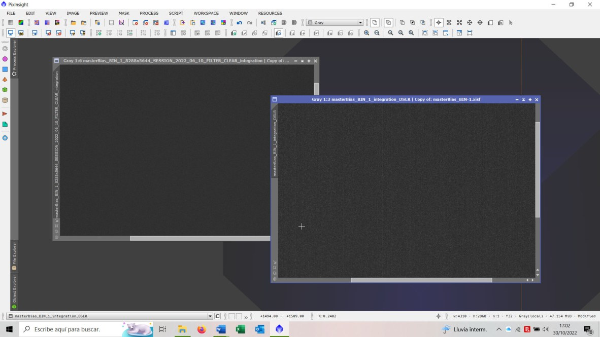
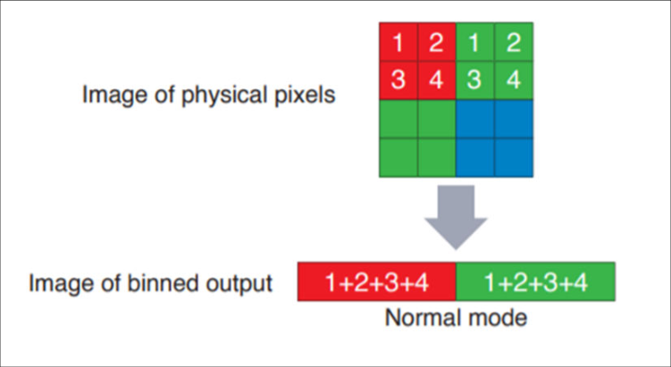
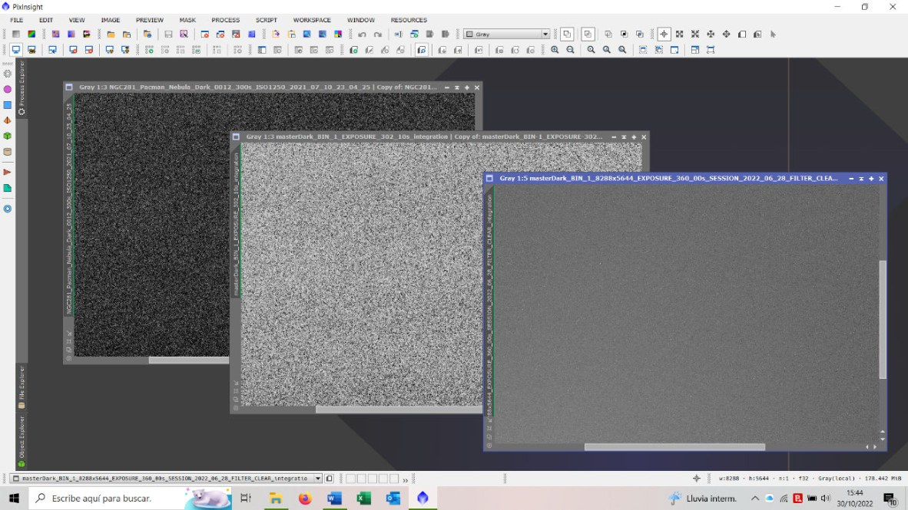
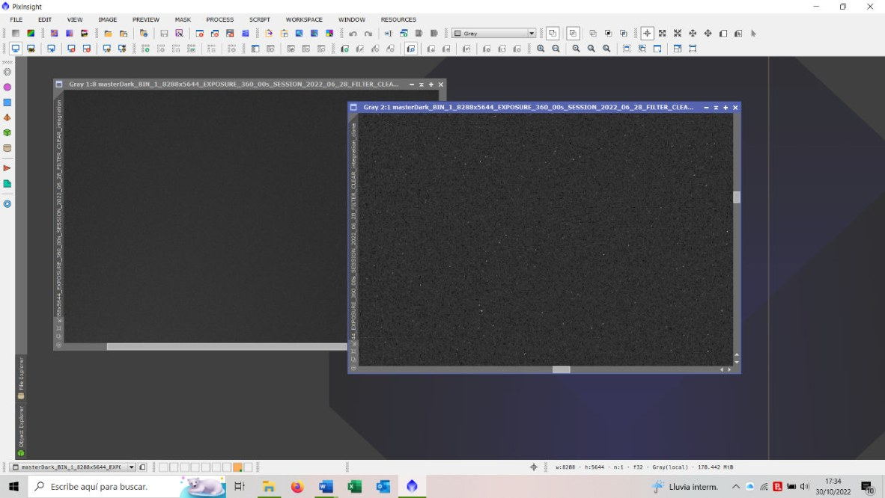
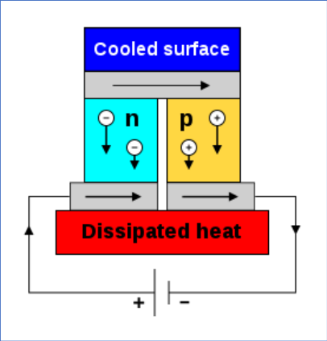
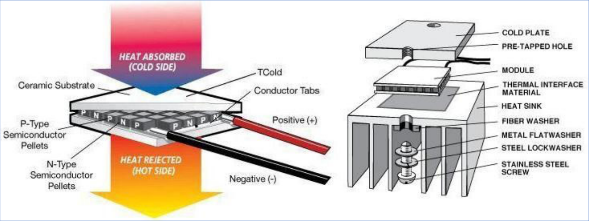
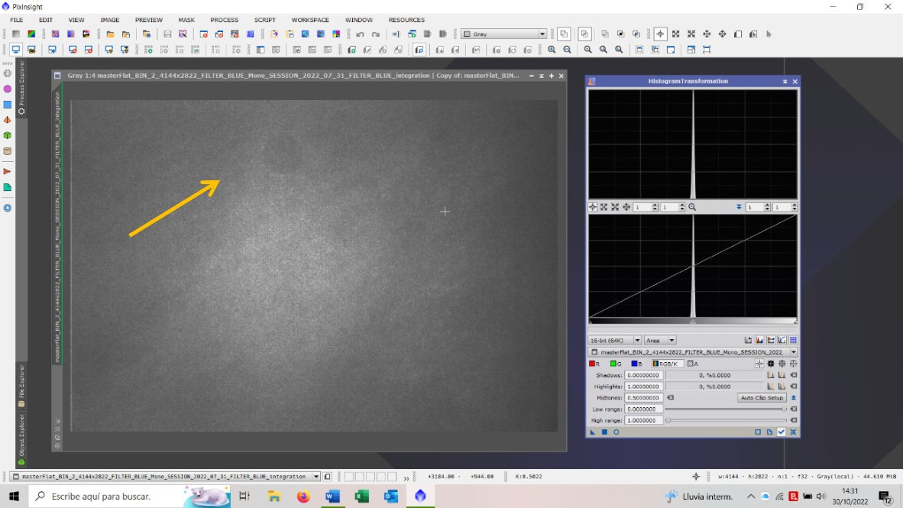
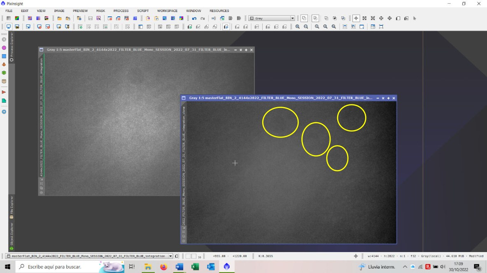
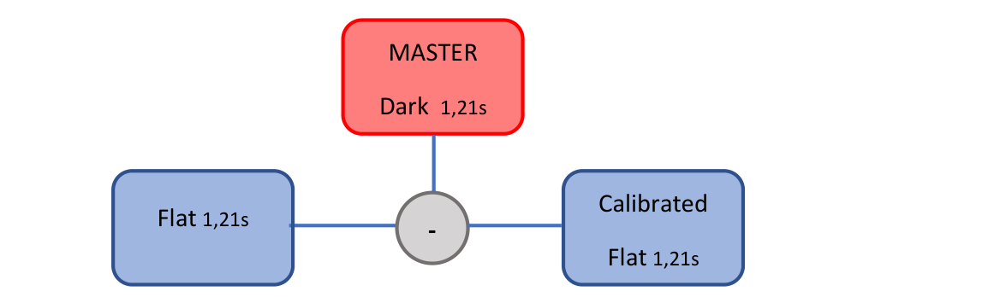
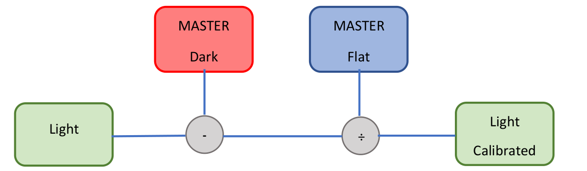

## Captar i processar la llum
L'astrofotografia és una disciplina fascinant; ens permet observar objectes que no podem percebre a simple vista, encara que en el millor dels casos podem arribar a percebre tènues taques blanquinoses.

Això és així perquè els nostres ulls capten la llum que els arriba a cada moment però són incapaços “d'integrar” aquesta llum, és a dir, no poden acumular la informació que els arriba durant l'estona que dura l'observació. Per aquest motiu no podem veure les meravelles que hi ha a l'univers proper.

Amb l'arribada dels xips electrònics, CCD i últimament CMOS, podem gaudir de càmeres amb impressionants prestacions. Els sensors de les càmeres estan compostos per matrius de díodes sensibles a la llum que, simplificant al màxim, poden anar emmagatzemant els fotons que li arriben i transformar-los en senyals elèctrics que es poden convertir en informació digital per ser processada posteriorment.

La part negativa d'aquest procés és que el funcionament mateix dels nostres xips genera petits nivells de senyal que anomenem soroll, es independent dels fotons que captem i que se suma a la informació dels nostres frames. S'anomena soroll electrònic en general per ser una interferència destructiva del nostre senyal.

L'efecte d'aquest soroll acumulatiu és important sobretot en fotografia de cel profund, on els objectes són de magnituds aparents per sobre de diguem-ne mag.+6 i en general molt tènues.

Per eliminar els diferents tipus de soroll o informació no desitjada als nostres fitxers Lights utilitzem uns fitxers que anomenem “de correcció”. Això és així perquè el soroll electrònic és aleatori, no podem modelitzar-lo i per tant l'hem de “fotografiar” per poder corregir-lo.

Tenim quatre tipus diferents d'arxius de correcció: Bias, Darks, Flats i DarkFlats; veurem què són i per a què serveixen cadascun.

## Bias
Com hem comentat, els sensors de les nostres càmeres estan formats per matrius de díodes que recol·lecten fotons i els converteixen en senyals elèctrics que processem posteriorment de forma digital.

Per al funcionament d'aquesta electrònica cal una alimentació permanent de la mateixa; es genera un mínim corrent que produeix una interferència que anomenem “soroll” (perquè embruta o emmascara el nostre senyal útil); aquest petit nivell de senyal és indesitjable i inherent al funcionament de la nostra electrònica.

Sol també anomenar-se soroll electrònic de lectura. Per combatre'l fem fotos amb l'objectiu tapat (fotos fosques, negres) i a la màxima velocitat que la nostra càmera sigui capaç de funcionar (el menor temps d'exposició).

Amb això aconseguim gravar el soroll de la nostra càmera pel sol fet de funcionar; a aquesta velocitat de captura no es pot manifestar cap altre tipus de soroll. També comentar que els Bias no depenen dels elements que formen l'eix òptic perquè només busquem una imatge del que capta la càmera en foscor; tapant el nostre objectiu/telescopi és suficient.

Els nostres Bias no tenen més complicació i més endavant veurem perquè es fan servir.

La figura següent mostra dues imatges amb un estirat suau; la primera correspon a un MasterBias d´una OSC Nikon D-90 sense refrigerar i podem apreciar el soroll de lectura amb les típiques franges verticals d´aquestes càmeres. Al fons, amb la mateixa escala de zoom, un MasterBias d'una ASI294MM refredada a -5ºC.

En aquesta, el soroll de lectura és molt menor tal com es podia esperar

Quants Bias fer? 50 Bias pot ser una quantitat correcta. Un bon moment per fer-los serà amb l'equip muntat mentre esperem tenir prou foscor.

Si utilitzem una càmera OSC (One Shot Color) només caldrà realitzar un sol conjunt de Bias. En el cas d’una càmera monocroma amb filtres LRGB farem un conjunt de Bias per cada bining utilitzat; és a dir, si seleccionem bining 1 per a L (o CLS) i bining 2 per a R,G,B, hem de realitzar un conjunt de Bias a bining 1 i un conjunt de Bias a bining 2.

> Recordem aquí que el binning és una tècnica per la qual en comptes de registrar cada píxel de manera individual (bin 1), prenem 4 píxels (bin 2) adjacents i els assignem com un únic píxel. La resolució disminueix, però augmenta la sensibilitat (capacitat de captar fotons). És una pràctica comuna fer els frames de Luminància a bin 1 i els de crominància a bin 2.

Resumint, fer Bias implica:

- Seleccionar el menor temps d'exposició possible
- Realitzar un conjunt de Bias per cada bining utilitzat
- Usar igual sensibilitat/guany que per als Lights
- Mateixa temperatura que els Lights
- Independència del tren òptic

## Darks
Per tal de captar la màxima quantitat de fotons amb la nostra càmera allarguem el temps d'exposició fins a potser uns 300 s o més (això sobretot és així en cel profund).

En augmentar els temps d'exposició es produeix un increment de la temperatura del nostre xip perquè treballa durant més temps de manera ininterrompuda; això produeix un increment de soroll tèrmic; ho diem així perquè depèn de la temperatura que adquireix el nostre xip en aquesta situació.

Per combatre'l generem uns arxius que cal gravar amb l'objectiu tapat (totalment fosc) i amb un temps d'exposició, una ISO/guany i una temperatura ambient idèntics a les dels nostres Lights.

Hem de respectar la mateixa ISO/guany perquè el soroll depèn d'aquest valor. La durada ha de ser la mateixa que la dels nostres Lights perquè així els uns i els altres pateixen el mateix nivell d'interferència i podem anul·lar-la per simple resta.

La temperatura ambient deu ser el més semblant a la de les sessions de Lights, però com que aquestes poden durar algunes hores, tindrem una diferència de temperatura entre l'inici i el final de la sessió de diversos graus.

Tenim almenys un parell d'alternatives per triar quan fer els Darks. Podem prendre la decisió de fer-los immediatament abans de la nostra sessió perquè la temperatura serà una mica més gran que al final i potser gravarem una mica més de soroll.

Si els fem al final de la sessió, la temperatura que tinguem en aquest moment serà inferior a la que hem tingut durant la major part de la sessió; en aquesta situació captarem menys soroll i per tant no ho podrem anul·lar tot.

Per tant, la primera situació sembla millor pel que fa a eliminació de soroll.

A continuació mostro tres imatges a què hem fet un estirat virtual (Screen Transfer Function); la que està al fons correspon amb un arxiu Dark de 300 s d'una OSC (Nikon D-90); la que és al mig és el MasterDark dels frames a 300s de la mateixa OSC; la que és al capdavant correspon al MasterDark d'una ASI294MM amb preses de 360s.

El zoom és igual a les tres i el primer que veiem és que hi ha més soroll tèrmic a la Nikon que a l'ASI. També podem veure com la imatge de MasterDark té en compte, després de “l'apilat”, la informació d'uns trenta fitxers Dark. ¿esperàvem veure una imatge negra?

A la següent imatge hem realitzat un estirat real però suau a la imatge de la càmera refrigerada ASI294MM. Veiem que la imatge del fons és fosca uniforme, però en la que és al davant, que és un clon de la primera, hem fet zoom i veiem que apareixen els píxels “excitats” pel soroll tèrmic. Són captures de 360s.

Aquí fem un petit parèntesi per comentar un avantatge extra que tenim quan tenim una càmera refrigerada. Com que fixem la temperatura de la càmera amb gairebé independència de la temperatura ambient, podem fer uns Darks a la mateixa temperatura que seleccionem a la càmera durant les sessions de captura.

Fent-ho així podem fer els Darks en qualsevol moment. Podem crear una biblioteca de Darks per utilitzar en qualsevol moment (la podem actualitzar cada tres mesos per allò que l'electrònica envelleix encara que sigui molt lentament).

D´aquesta manera ens estalviem molts minuts d´espera. El mateix criteri es pot aplicar als nostres Bias.

En el meu cas utilitzo una temperatura de -5ºC però -10ºC també és utilitzada per molts companys. Aquesta elecció, que és personal, té un límit tècnic que consisteix en que les càmeres refrigerades, generalitzant, solen tenir capacitat per reduir la temperatura ambient en 35ºC; o sigui que si estem a 24ºC a l'inici de la sessió, molt habitual a l'estiu a latitud aprox.41N, la càmera pot reduir, en condicions normals, fins a -11ºC. Si fixem una temperatura de -5ºC tenim un marge de 6ºC ¡¡¡ i a més això suposa menor consum de la nostra bateria si estem treballant en mode autònom!!.

> Per finalitzar el parèntesi obert, un comentari ràpid; per refrigerar les càmeres s'utilitzen cèl·lules Peltier; estan formades per uns semiconductors amb característiques de reducció de temperatura al pas d’un corrent elèctric; aquest fenomen s'anomena refrigeració termoelèctrica; un esquema explicatiu és el següent. El ventilador que veiem a la part del darrere de les càmeres refrigerades serveix per injectar aire sobre el radiador de la part calenta i així facilitar l'intercanvi.

La següent pregunta és ¿quants Darks fer?

La resposta seria els màxims que puguem; però com que requereixen molt de temps com a norma podem dir que entre 30 i 50 Darks és una quantitat correcta; concretament jo en faig servir 30 amb bons resultats perquè considero que la meva càmera en ser refrigerada no genera gaire soroll tèrmic. Utilitzant una càmera DSLR sense refrigerar realitzo 50 Darks.

Resumint, fer Darks implica:

- Seleccionar el mateix temps d'exposició que els Lights
- Tenir la mateixa temperatura que per als Lights
- Usar igual sensibilitat/guany que per als Lights
- Independència del tren òptic

## Flats
L'objecte dels flats és detectar les imperfeccions del nostre tren òptic. El tren òptic el formen: lent/telescopi + lents de correcció + filtres de qualsevol tipus + càmera.

Les imperfeccions poden ser de tipus òptic derivades de les deformacions resultants de les lents utilitzades o poden ser generades per cossos estranys com la brutícia, la pols, el greix, qualsevol adherència en algun element òptic, etc.

Les primeres poden produir efectes a les vores anomenat “vigneting” (vinyeteig) i les segones produeixen unes marques rodones (donuts) al voltant de la impuresa que ens genera la interferència.

La figura següent correspon a un MasterFlat amb filtre B (blue). Podem apreciar el “vigneting” i un artefacte de forma circular a causa d'una mota de pols. També podem observar a l'histograma que la corba està al 50%.

Si fem un estirat més sever veiem que apareixen més anomalies que ni tan sols havíem vist:

Com que les impureses poden estar en qualsevol element i en qualsevol posició és imperiós que no es mogui (girs) cap element del tren òptic entre el moment de capturar els nostres Lights i la realització dels nostres Flats.

Pel mateix motiu hem de fer Flats cada cop que substituïm un filtre; també si es fa servir una roda portafiltres!!. Si estem utilitzant filtres L,R,G i B hem de fer Flats amb cadascun.

Ja que volem detectar aquests defectes hem de fer les preses amb llum perquè els defectes es manifestin com a zones fosques.

¿Quant de temps i quanta llum per fer els Flats? Bona pregunta i resposta poc òbvia.

La primera norma que cal respectar és que hem d'obtenir exposicions amb un valor d'ADUS entre el 40 i el 50% de l'histograma (molts col·legues exposen el 30% de l'histograma); amb aquests valors s'aprecien bé els efectes de les anomalies.

La durada de les exposicions depèn de la font de llum que utilitzem, però jo aconsello utilitzar temps d'exposició al voltant de 1s; 0.8s o 1.4s poden ser vàlids.

Aquí una altra vegada alguns col·legues exposen algunes dècimes de segon (de fet jo mateix he utilitzat aquests temps) però 1s em dóna millors resultats; les anomalies queden millor reflectides.

Pel que fa a la font de llum, hi ha diversitat d'opcions:

- Es pot fer servir el cel blavós quan s'està posant el Sol; és una llum molt uniforme i força utilitzada. Sense regulació per obtenir valors d'ADU/tpo. exposició desitjats.
- Un altre sistema és utilitzar una Tablet; apuntant el telescopi al zenith i col·locant la Tablet a sobre ajustant la brillantor fins que obtinguem els valors d'ADU/tpo. exposició cercat.
- Algunes persones afegeixen amb la tècnica anterior una samarreta blanca entre pantalla i objectiu per difuminar/atenuar una mica la llum.
- Personalment utilitzo una caixa de flats autoconstruïda; amb regulació de la tensió d'alimentació per ajustar la brillantor desitjada. La col·loco o bé quan en un moment de la sessió he de parar per núvols o bé al final de la sessió.
- Caixes de flat comercials; tenen l'avantatge associat que es poden integrar al programa que s'utilitzi per al control de la sessió (NINA; SGP, APT, etc) amb la qual cosa l'ajust és automàtic. El preu pot ser l'únic inconvenient d'aquesta elecció.

La pregunta és de nou ¿quants Flats fer? Fer entre 30 i 50 Flats és correcte; jo acostumo a fer 30 amb bons resultats.

Resumint, fer Flats implica:

- Seleccionar el temps d'exposició fins a aconseguir valor desitjat d'ADUS
- Regular la font de llum fins aconseguir el temps d'exposició cercat
- Tenir la mateixa temperatura que per als Lights
- Usar igual sensibilitat/guany que per als Lights
- Mantenir intacte el tren òptic
- Cal fer un conjunt de flats per cada filtre sense moure el tren òptic

## DarkFlats
Per la similitud del seu nom amb els fitxers comentats fins ara ja podem imaginar que té a veure amb els dos que componen el seu nom… i és així.

Aquests fitxers es realitzen fent Darks (per tant objectiu tapat) de la mateixa durada i sensibilitat que els flats.

Són especialment importants quan la durada dels flats és >1s; sent menys importants si la durada dels mateixos és d'unes poques dècimes de segon. Amb ells, es pretén anul·lar el soroll tèrmic que es genera en fer els flats.

Resumint, fer DarkFlats implica:

- Temps d'exposició igual que els utilitzats als Flats
- Pel motiu anterior hi haurà tants conjunts com als Flats
- Igual temperatura que els Flats
- Igual sensibilitat/guany que els Flats

## Un exemple aclaridor
Amb la visió de conjunt que tenim ara, suposarem que realitzem una sessió amb filtres: LRGB i com a reforç de la luminància uns quants Lights amb filtre Halfa. (utilitzant 5 filtres en total); fent L y Ha a bin1 i RGB a bin2.

Podríem fer:

- 50 Bias bin1
- 50 Bias bin2
- 40 Darks
- 30 Flats per a L + 30 Flats per a R + 30 Flats per a G + 30 Flats per a B + 30 Flats per a Ha
- 30 DarkFlats per a L + 30 DarkFlats per a R + 30 DarkFlats per a G + 30 DarkFlats per a B + 30 DarkFlats per a Ha Remarcant de nou que cadascun dels cinc conjunts de Flats/DarkFlats seran d'una durada diferent, ¡¡segur!!

Però no tot és tan demolidor des del punt de vista del treball per gestionar tant fitxer! Si estem treballant amb càmeres OSC (color) utilitzant per exemple un filtre CLS tindríem:

- 50 Bias
- 40 Darks
- 30 Flats per a CLS
- 30 DarkFlats per a CLS Que encara que sembli una diferència tremenda no ho és tant si tenim una mica d’organització; a més, cal tenir en compte que hi ha programaris molt utilitzats que es mouen com a peix a l'aigua amb el tractament de sessions multifiltre; fins i tot multisessió!!

Amb tots els arxius de correcció realitzats només queda aplicar-los als nostres arxius “Lights”, que són els que contenen la informació útil del nostre objecte, durant la fase de preprocessament per eliminar la major quantitat de soroll possible i abordar la fase de postprocessat.

## Què fem amb els fitxers de correcció?
Els fitxers de correcció s'utilitzen a la fase de preprocessament. Aquesta fase té per objecte la millora de la qualitat i de l'homogeneïtzació dels nostres Lights.

L'objectiu d'aquestes operacions és poder apilar-los i millorar així la SNR (relació senyal-soroll).

Obtindrem després de l'apilat final (integració) uns fitxers “Masters” amb els que podrem començar la fase de postprocessament.

Per explicar què es fa amb tots aquests fitxers de correcció faré servir la nomenclatura de PixInsight però saltant els passos intermedis que són específics d'aquest programa i que no aporten res al que estem tractant.

Com hem comentat, els programes d'apilat el primer que fan és “combinar” cada família de fitxers entre ells per aconseguir uns fitxers màsters que es podran utilitzar per calibrar els nostres Lights.

Les operacions bàsiques que realitzen els programes d'apilat són bàsicament un calibratge i posterior integració dels arxius de correcció (desenes) per aconseguir un únic màster de cada tipus:

- 1 fitxer MasterDark
- 1 fitxer MasterFlat
- 1 fitxer MasterLight per cada filtre utilitzat Amb això en ment, la fase de pre-processat serà una cosa semblant al següent:

En primer lloc, els Bias són utilitzats per calibrar els fitxers Dark i ja no es fan servir per a res més. A partir dels Darks calibrats la següent operació és integrar-los i crear el MasterDark.

Seguidament els fitxers de Flats es calibren mitjançant el MasterDark que correspon al temps d'exposició com indica la figura adjunta.

Recordem aquí que hi ha tants DarkFlats com Flats tinguem !!

Posteriorment amb els Flats calibrats s'integren formant el Master Flat.

El següent procés és calibrar els Lights mitjançant els màsters de Darks i de Flats. Això s'indica a la figura adjunta.

El soroll s'elimina mitjançant la resta i les imperfeccions del tren òptic mitjançant divisió.

Després d'alguns processos intermedis els lights calibrats (els nostres frames) són integrats per generar els MasterLights que són el resultat d'apilar tots els nostres Lights corregits.

Si utilitzem càmeres OSC (One Shot Camera) obtindrem un MasterLight i si utilitzem càmeres monocromes un per cada filtre utilitzat.

## Consells generals
- Cal prendre els Lights, Darks i Bias a la mateixa temperatura.
- No es pot modificar el tren òptic perquè els nostres Flats siguin vàlids.
- Per als Bias podem crear un MasterBias amb el nostre soft d'apilat (DSS, PixI,etc) i poder-lo reutilitzar en sessions futures.
- Per als Darks podem igualment crear MasterDarks per a cada ISO/guany, bin i temperatura coincidents amb els nostres Lights i poder-los també reutilitzar.
- Els Flats són molestos de fer però són imprescindibles perquè l'efecte de la pols és molt difícil de tractar sense.
- Aprofitar períodes de núvols a les nostres sessions per fer els nostres arxius de correcció i així traiem profit de les interrupcions.

La creació dels MasterLights és el punt de partida per a la fase final del processament.

Es tracta de l'apassionant fase de postprocessat; en ella és on espremem les nostres dades per obtenir el millor resultat possible com a recompensa a tot l'esforç que hem aplicat a la fase de captura; però tot això ja és una altra història,….

Cels clars!!
