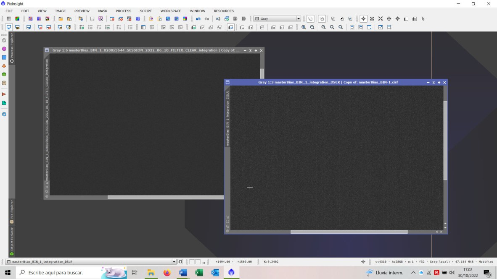
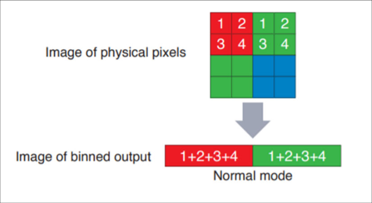
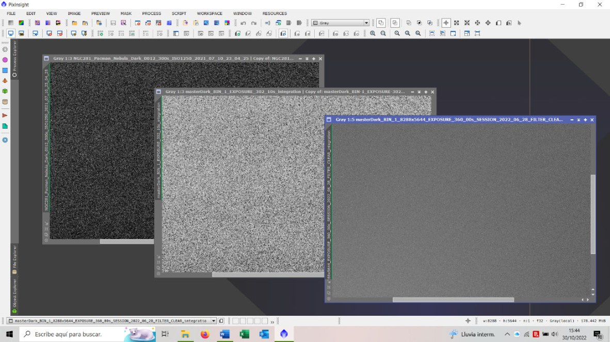
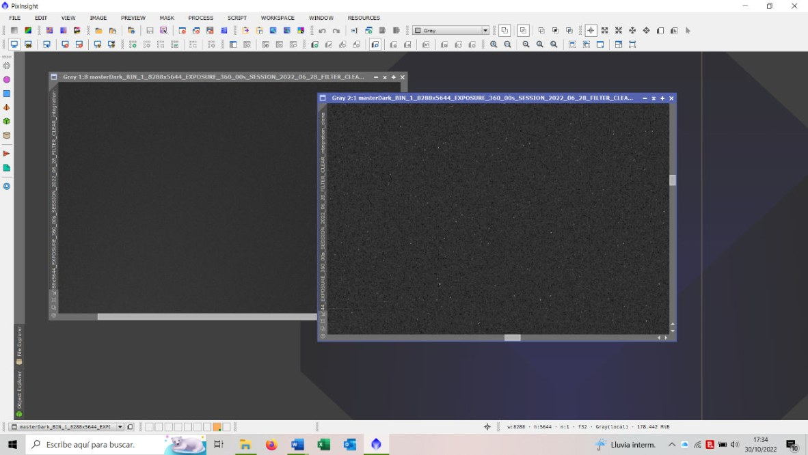
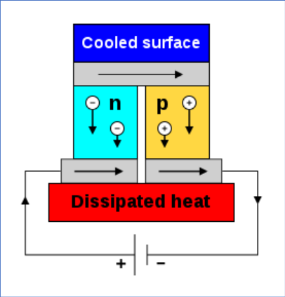
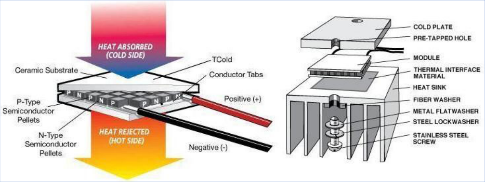
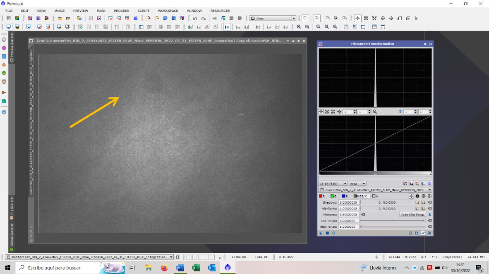
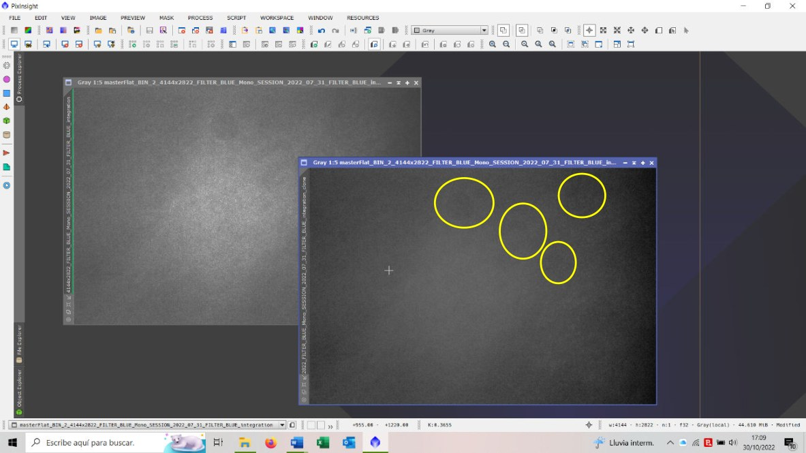
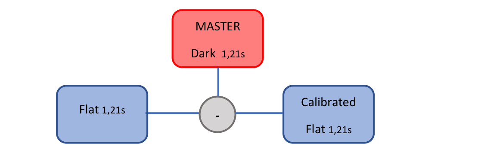
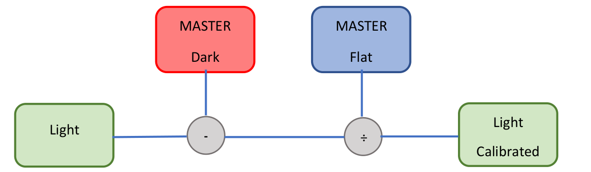

## Captar y procesar la luz
La astrofotografía es una disciplina fascinante; nos permite observar objetos que no podemos percibir a simple vista, aunque en el mejor de los casos podemos llegar a percibir tenues manchas blanquecinas.

Esto es así porque nuestros ojos captan la luz que les llega en cada momento pero son incapaces de “integrar” esa luz, es decir, no pueden acumular la información que les llega durante el rato que dura la observación. Por este motivo no podemos ver las maravillas que hay en el universo cercano.

Con la llegada de los chips electrónicos, CCD´s y últimamente CMOS, podemos disfrutar de cámaras con impresionantes prestaciones. Los sensores de las cámaras están compuestos por matrices de diodos sensibles a la luz que, simplificando al máximo, pueden ir almacenando los fotones que le llegan y transformarlos en señales eléctricas que a su vez pueden convertirse en información digital para ser procesada posteriormente.

La parte negativa de este proceso es que el propio funcionamiento de nuestros chips genera pequeños niveles de señal que llamamos ruido independiente de los fotones que captamos y que se suma a la información de nuestros frames. Se denomina ruido electrónico en general por ser una interferencia destructiva de nuestra señal.

El efecto de este ruido acumulativo es importante sobre todo en fotografía de cielo profundo, donde los objetos son de magnitudes aparentes por encima de digamos mag.+6 y en general muy tenues.

Para eliminar los diferentes tipos de ruido o información no deseada en nuestros archivos Lights utilizamos unos archivos que llamamos “de corrección”. Esto es así porque el ruido electrónico es aleatorio, no podemos modelizarlo y por tanto debemos “fotografiarlo” para poder corregirlo.

Tenemos cuatro tipos diferentes de archivos de corrección: Bias, Darks, Flats y DarkFlats; vamos a ver qué son y para qué sirven cada uno de ellos.

## Bias
Como hemos comentado, los sensores de nuestras cámaras están formados por matrices de diodos que recolectan fotones y los convierten en señales eléctricas que procesamos posteriormente de forma digital.

Para el funcionamiento de esta electrónica es preciso una alimentación permanente de la misma; se genera una mínima corriente que produce una interferencia que llamamos “ruido” (porque ensucia o enmascara nuestra señal útil); ese pequeño nivel de señal es indeseable e inherente al funcionamiento de nuestra electrónica.

Suele también denominarse como ruido electrónico de lectura. Para combatirlo hacemos fotos con el objetivo tapado (fotos oscuras, negras) y a la máxima velocidad que nuestra cámara sea capaz de funcionar (el menor tiempo de exposición).

Con ello conseguimos grabar el ruido de nuestra cámara por el mero hecho de funcionar; a esta velocidad no se puede manifestar ningún otro tipo de ruido. También comentar que los Bias no dependen de los elementos que forman el eje óptico porque solamente buscamos una imagen de lo que capta la cámara en oscuridad; tapando nuestro objetivo/telescopio es suficiente.

Nuestros Bias no tienen más complicación y más adelante veremos para que se utilizan.

La siguiente figura muestra dos imágenes con un estirado suave; la primera corresponde a un MasterBias de una OSC Nikon D-90 sin refrigerar y podemos apreciar el ruido de lectura con las típicas franjas verticales de estas cámaras. Al fondo, con misma escala de zoom, un MasterBias de una ASI294MM enfriada a -5ºC.

En esta última, el ruido de lectura es muchísimo menor tal como cabía esperar

¿Cuántos Bias hacer? 50 Bias puede ser una cantidad correcta. Un buen momento para hacerlos será con el equipo montado mientras esperamos tener la suficiente oscuridad.

Si utilizamos una cámara OSC (One Shot Color) bastará con realizar un solo conjunto de Bias. En el caso de una cámara monocroma con filtros LRGB haremos un conjunto de Bias por cada bining utilizado; es decir, si seleccionamos bining 1 para L (o CLS) y bining 2 para R,G,B, debemos realizar un conjunto de Bias a bining 1 y un conjunto de Bias a bining 2.

> Recordemos aquí que el binning es una técnica por la que en vez de registrar cada pixel de manera individual (bin 1), tomamos 4 pixeles (bin 2) adyacentes y los asignamos como un único pixel. La resolución disminuye pero aumenta la sensibilidad (capacidad de captar fotones). Es una práctica común hacer los frames de Luminancia a bin 1 y los de crominancia a bin 2.

Resumiendo, hacer Bias implica:

- Seleccionar el menor tiempo de exposición posible
- Realizar un conjunto de Bias por cada bining utilizado
- Usar igual sensibilidad/ganancia que para los Lights
- Misma temperatura que los Lights
- Independencia del tren óptico

## Darks
Con objeto de captar la máxima cantidad de fotones con nuestra cámara alargamos el tiempo de exposición hasta tal vez unos 300 s o más (esto sobre todo es así en cielo profundo).

Al aumentar los tiempos de exposición se produce un incremento en la temperatura de nuestro chip porque trabaja durante más tiempo de forma ininterrumpida; esto produce un incremento de ruido térmico; lo llamamos así porque depende de la temperatura que adquiere nuestro chip en esa situación.

Para combatirlo generamos unos archivos que se deben grabar con el objetivo tapado (totalmente oscuro) y con un tiempo de exposición, una ISO/ganancia y a una temperatura ambiente idénticos a las de nuestros Lights.

Debemos respetar la misma ISO/ganancia porque el ruido depende de ese valor. La duración debe ser la misma que la de nuestros Lights porque así unos y otros sufren el mismo nivel de interferencia y podemos anularla por simple resta.

La temperatura ambiente debe de ser lo más parecido a la de las sesiones de Lights, pero como estas pueden durar algunas horas, tendremos una diferencia de temperatura entre el inicio y el final de la sesión de varios grados.

Tenemos al menos un par de alternativas para elegir cuándo hacer los Darks. Podemos tomar la decisión de hacerlos inmediatamente antes de nuestra sesión porque la temperatura será algo mayor que al final y tal vez grabaremos algo más de ruido.

Si los hacemos al final de la sesión la temperatura que tengamos en ese momento será inferior a la que hemos tenido durante la mayor parte de la sesión; en esa situación captaremos menos ruido y por lo tanto no podremos anularlo todo.

Por lo tanto, la primera situación parece mejor en cuanto a eliminación de ruido se refiere.

A continuación muestro tres imágenes a las que hemos hecho un estirado virtual (Screen Transfer Function); la que está al fondo corresponde con un archivo Dark de 300s de una OSC (Nikon D-90); la que está en medio es el MasterDark de los frames a 300s de la misma OSC; la que está al frente corresponde al MasterDark de una ASI294MM con tomas de 360s.

El zoom es igual en las tres y lo primero que vemos es que hay más ruido térmico en la Nikon que en la ASI. También podemos ver como la imagen de MasterDark tiene en cuenta, después del “apilado”, la información de unos treinta archivos Dark. ¿esperábamos ver una imagen negra?

En la siguiente imagen hemos realizado un estirado real pero suave a la imagen de la cámara refrigerada ASI294MM. Vemos que la imagen del fondo es oscura uniforme, pero en la que está delante, que es un clon de la primera, hemos hecho zoom y vemos que aparecen los pixels “excitados” por el ruido térmico. Son capturas de 360s.

Aquí hacemos un pequeño paréntesis para comentar una ventaja extra que tenemos cuando disponemos de una cámara refrigerada. Como fijamos la temperatura de la cámara con casi independencia de la temperatura ambiente, podemos hacer unos Darks a la misma temperatura que seleccionamos en la cámara durante las sesiones de captura.

Haciéndolo así podemos hacer los Darks en cualquier momento. Podemos crear una biblioteca de Darks para utilizar en cualquier momento (la podemos actualizar cada tres meses por aquello de que la electrónica envejece aunque sea muy lentamente).

De esta forma nos ahorramos muchos minutos de espera. El mismo criterio puede aplicarse a nuestros Bias.

En mi caso utilizo una temperatura de -5ºC pero -10ºC también es utilizada por muchos compañeros. Esta elección, que es personal, tiene un límite técnico que consiste en que las cámaras , generalizando, suelen tener capacidad para reducir la temperatura ambiente en 35ºC; o sea que si estamos a 24ºC al inicio de la sesión, muy habitual en verano en latitud aprox.41N, la cámara puede reducir, en condiciones normales, hasta -11ºC. Si fijamos una temperatura de -5ºC tenemos un margen de 6ºC ¡¡¡ y además esto supone menor consumo de nuestra batería si estamos trabajando en modo autónomo!!.

> Para finalizar el paréntesis abierto, un comentario rápido; para refrigerar las cámaras se utilizan células Peltier; están formadas por unos semiconductores con características de reducción de temperatura al paso de una corriente eléctrica; a este fenómeno se denomina refrigeración termoeléctrica; un esquema explicativo es el siguiente. El ventilador que vemos en la parte trasera de las cámaras refrigeradas sirve para inyectar aire sobre el radiador de la parte caliente y así facilitar el intercambio.

La siguiente pregunta es ¿cuántos Darks hacer?

La respuesta sería los máximos que podamos; pero como requieren mucho tiempo como norma podemos decir que entre 20 y 50 Darks es una cantidad correcta; concretamente yo utilizo 30 con buenos resultados porque considero que mi cámara al ser refrigerada no genera mucho ruido térmico. Utilizando una cámara DSLR sin refrigerar realizo 50 Darks.

Resumiendo, hacer Darks implica:

- Seleccionar igual tiempo de exposición que los Lights
- Tener igual temperatura que para los Lights
- Usar igual sensibilidad/ganancia que para los Lights
- Independencia del tren óptico

## Flats
El objeto de los flats es detectar las imperfecciones de nuestro tren óptico. El tren óptico lo forman: lente/telescopio + lentes de corrección + filtros de cualquier tipo + cámara.

Las imperfecciones pueden ser de tipo óptico derivadas de las deformaciones resultantes de las lentes utilizadas o pueden ser generadas por cuerpos extraños como suciedad, polvo, grasa, cualquier adherencia en algún elemento óptico, etc.

Las primeras pueden producir efectos en los bordes llamado “vigneting” (viñeteo) y las segundas producen unas marcas redondas alrededor de la impureza que nos genera la interferencia.

La siguiente figura corresponde a un MasterFlat con filtro B (blue). Podemos apreciar el viñeteo y un artefacto de forma circular debido a una mota de polvo. También podemos observar en el histograma que la curva está en el 50%.

Si hacemos un estirado más severo vemos que aparecen más anomalías que ni siquiera habíamos visto:

Como las impurezas pueden estar en cualquier elemento y en cualquier posición es imperioso que no se mueva (giros) ningún elemento del tren óptico entre el momento de capturar nuestros Lights y la realización de nuestros Flats.

Por el mismo motivo debemos hacer Flats cada vez que sustituimos un filtro; también si se utiliza una rueda portafiltros!!. Si estamos utilizando filtros L,R,G y B debemos hacer Flats con cada uno de ellos.

Ya que queremos detectar estos defectos hemos de realizar las tomas con luz para que los defectos se manifiesten como zonas oscuras.

¿Cuánto tiempo y cuánta luz para hacer los Flats? Buena pregunta y respuesta poco obvia.

La primera norma a respetar es que hemos de obtener exposiciones con un valor de ADUS entre el 40 y 50% del histograma (muchos colegas exponen al 30% del histograma); con esos valores se aprecian bien los efectos de las anomalías.

La duración de las exposiciones depende de la fuente de luz que utilicemos, pero yo aconsejo utilizar tiempos de exposición alrededor de 1s; 0.8s o 1.4s pueden ser válidos.

Aquí otra vez algunos colegas exponen a algunas décimas de segundo (de hecho yo mismo he utilizado estos tiempos) pero 1s me da mejores resultados; las anomalías quedan mejor reflejadas.

Respecto a la fuente de luz hay diversidad de opciones:

- Se puede utilizar el cielo azulado cuando se está poniendo el Sol; es una luz muy uniforme y bastante utilizada. Sin regulación para obtener valores de ADU/tpo. exposición deseados.
- Otro sistema es utilizar una Tablet; apuntando el telescopio al zenith y colocando la Tablet encima ajustando el brillo hasta que obtengamos los valores de ADU/tpo. exposición buscado.
- Algunas personas añaden con la técnica anterior una camiseta blanca entre pantalla y objetivo para difuminar/atenuar algo la luz.
- Personalmente utilizo una caja de flats autoconstruida; con regulación de la tensión de alimentación para ajustar el brillo deseado. La coloco o bien cuando en un momento de la sesión debo de parar por nubes o bien al final de la sesión.
- Cajas de flat comerciales; tienen la ventaja asociada de que se pueden integrar en el programa que se utilice para el control de la sesión (NINA, SGP, APT, etc) con lo que el ajuste es automático. El precio puede ser el único inconveniente de esta elección.

La pregunta es de nuevo ¿cuántos Flats hacer? Hacer entre 20 y 50 Flats es correcto; yo suelo hacer 30 con buenos resultados.

Resumiendo, hacer Flats implica:

- Seleccionar el tiempo de exposición hasta conseguir valor deseado de ADUS
- Regular la fuente de luz hasta conseguir el tiempo de exposición buscado
- Tener igual temperatura que para los Lights
- Usar igual sensibilidad/ganancia que para los Lights
- Mantener intacto el tren óptico
- Hay que hacer un conjunto de flats por cada filtro sin mover el tren óptico

## DarkFlats
Por la similitud de su nombre con los ficheros comentados hasta ahora ya podemos imaginar que tiene que ver con los dos que componen su nombre,… y es así.

Estos ficheros se realizan haciendo Darks (por tanto objetivo tapado) de la misma duración y sensibilidad que los flats.

Son especialmente importantes cuando la duración de los flats es >1s; siendo menos importantes si la duración de los mismos es de unas pocas décimas de segundo. Con ellos, se pretende anular el ruido térmico que se genera al hacer los flats.

Resumiendo, hacer DarkFlats implica:

- Tiempo de exposición igual que los utilizados en los Flats
- Por el motivo anterior habrá tantos conjuntos como en los Flats
- Igual temperatura que los Flats
- Igual sensibilidad/ganancia que los Flats

## Un ejemplo aclaratorio
Con la visión de conjunto que tenemos ahora, vamos a suponer que realizamos una sesión con filtros: LRGB y como refuerzo de la luminancia unos cuantos Lights con filtro Halfa. (utilizando 5 filtros en total); haciendo L y Ha a bin1 y RGB a bin2.

Podríamos hacer:

- 50 Bias bin1
- 50 Bias bin2
- 40 Darks
- 30 Flats para L + 30 Flats para R + 30 Flats para G + 30 Flats para B + 30 Flats para Ha
- 30 DarkFlats para L + 30 DarkFlats para R + 30 DarkFlats para G + 30 DarkFlats para B + 30 DarkFlats para Ha Remarcando de nuevo que cada uno de los cinco conjuntos de Flats/DarkFlats serán de una duración diferente ¡¡seguro!!.

Pero no todo es tan demoledor desde el punto de vista del trabajo para gestionar tanto fichero!. Si estamos trabajando con cámaras OSC (color) utilizando por ejemplo un filtro CLS tendríamos:

- 50 Bias
- 40 Darks
- 30 Flats para CLS
- 30 DarkFlats para CLS Que aunque parezca una diferencia tremenda no lo es tanto si tenemos un poco de organización; además hay que tener en cuenta que existen softwares muy utilizados que se mueven como pez en el agua con el tratamiento de sesiones multifiltro; incluso multisesión!.

Con todos los archivos de corrección realizados solamente queda aplicarlos a nuestros archivos “Lights”, que son los que contienen la información útil de nuestro objeto, durante la fase de pre-procesado para eliminar la mayor cantidad de ruido posible y abordar la fase de post-procesado.

## ¿Qué hacemos con los ficheros de corrección?
Los ficheros de corrección se utilizan en la fase de preprocesado. Esta fase tiene por objeto la mejora de la calidad y de la homogeneización de nuestros Lights.

El objetivo de estas operaciones es poder apilarlos y mejorar de esta forma la SNR (relación señal-ruido).

Obtendremos después del apilado final (integración) unos ficheros “Masters” con los que podremos empezar la fase de post-procesado.

Para explicar qué se hace con todos estos ficheros de corrección utilizaré la nomenclatura de PixInsight pero saltando los pasos intermedios que son específicos de este programa y que no aportan nada a lo que estamos tratando.

Como hemos comentado, los programas de apilado lo primero que hacen es “combinar” cada familia de archivos entre ellos para conseguir unos ficheros masters que se podrán utilizar para calibrar nuestros Lights.

Las operaciones básicas que realizan los programas de apilado son básicamente una calibración y posterior integración de los archivos de corrección (decenas de ellos) para conseguir un único master de cada tipo:

- 1 fichero MasterDark
- 1 fichero MasterFlat - 1 fichero MasterLight por cada filtro utilizado

Con esto en mente, la fase de pre-procesado será algo parecido a lo siguiente:

En primer lugar, los Bias son utilizados para calibrar los ficheros Dark y ya no se emplean para nada más. A partir de los Darks calibrados la siguiente operación es integrarlos y crear el MasterDark.

Seguidamente los ficheros de Flats se calibran mediante el MasterDark que corresponde a su tiempo de exposición como indica la figura adjunta.

Recordemos aquí que hay tantos DarkFlats como Flats tengamos !!

Posteriormente con los Flats calibrados se integran formando el Master Flat.

El siguiente proceso es calibrar los Lights mediante los masters de Darks y de Flats. Esto se indica en la figura adjunta.

El ruido se elimina mediante resta y las imperfecciones del tren óptico mediante división.

Después de algunos procesos intermedios los lights calibrados (nuestros frames) son integrados para generar los MasterLights que son el resultado de apilar todos nuestros Lights corregidos.

Si utilizamos cámaras OSC (One Shot Camera) obtendremos un MasterLight y si utilizamos cámaras monocromas uno por cada filtro utilizado.

## Consejos generales
- Es necesario tomar los Lights, Darks y Bias a la misma temperatura.
- No se puede modificar el tren óptico para que nuestros Flats sean válidos.
- Para los Bias podemos crear un MasterBias con nuestro soft de apilado (DSS, PixI,etc) y poderlo reutilizar en futuras sesiones.
- Para los Darks podemos igualmente crear MasterDarks para cada ISO/ganancia, bin y temperatura coincidentes con nuestros Lights y poderlos también reutilizar.
- Los Flats son engorrosos de hacer pero son imprescindibles porque el efecto del polvo es muy difícil de tratar sin ellos.
- Aprovechar periodos de nubes en nuestras sesiones para hacer nuestros archivos de corrección y así sacamos provecho de las interrupciones.

La creación de los MasterLights es el punto de partida para la fase final del procesado.

Se trata de la apasionante fase de post-procesado; en ella es donde exprimimos nuestros datos para obtener el mejor resultado posible como recompensa a todo el esfuerzo que hemos aplicado en la fase de captura; pero todo esto ya es otra historia,…..

Cielos claros!!
