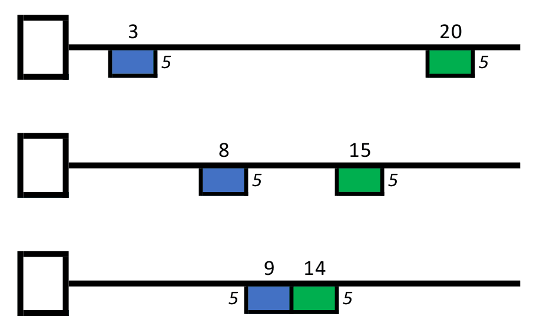
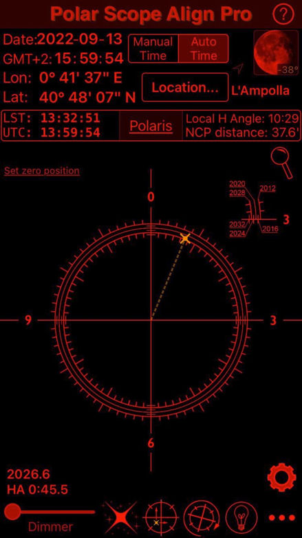

Aquí descrivim els passos que cal seguir per fer una de les nostres sessions d'astrofotografia partint de l'inici de tot el procés, la instal·lació del telescopi; seguirem amb l'equilibrat del conjunt muntura-telescopi, la posada en estació, preparacions prèvies i el sincronisme del nostre sistema amb la volta celeste.

## Requeriments per fer Astrofotografia
Normalment comencem en astrofotografia quan ja hem fet alguns passos a l'astronomia observant visualment el cel. Alguns dels elements que utilitzem per a les nostres sessions d'observació visual poden ser utilitzats per endinsar-nos al món de l'astrofotografia.

El cas típic és utilitzar la nostra càmera DSLR que utilitzem normalment i connectar-la al nostre telescopi… molts hem començat així.

Però has de tenir en compte certs aspectes que molts de nosaltres hem après amb fracassos.

Com a concepte general cal saber que la precisió requerida és molt més gran que en observació visual perquè a diferència dels nostres ulls que no integren la llum que els arriba, els xips de les nostres càmeres registren (detecten i emmagatzemen) qualsevol traça de llum (fotons) que els impacti, incloses les vibracions induïdes per les ràfegues d'aire (que produeixen ratlles a les traces d'estrelles) o defectes al guiatge de les nostres muntures (estrelles gruixudes o allargades) i com no, la presència de Lluna o altres fonts de llum (enllumenat públic, proximitat a nuclis poblats, etc.) que impacten negativament en els nostres frames fins a fer-los inservibles.

El primer que hem de tenir en compte és no sobrecarregar la muntura. La nostra muntura, per treballar en astrofotografia, es pot carregar amb un equip (tot inclòs) que tingui un pes no superior al 60% del pes màxim. Una muntura dissenyada per aguantar 14Kg (un cas molt comú), té el seu límit a 8.4Kg. Si el nostre equip és més pesat hem d'aconseguir una muntura de més capacitat.

En segon lloc, hem d'aconseguir tenir un conjunt el més compacte possible. Tots els accessoris i cables col·locats el més a prop possible del centre de gravetat de la muntura; més endavant fem alguna reflexió sobre aquestes qüestions.

La tercera consideració és tenir el conjunt tub+càmera de guiatge + soft ben ajustat i sobretot adequat a les dimensions (òptiques) del nostre OTA (reflector, refractor, SC, etc.). Aquest punt és prerequisit per aspirar a treballar cel profund, altres disciplines com a planetària no tenen aquest requeriment. Un error total al guiatge de <1” ja comença a ser acceptable.

Finalment, planificar amb antelació els objectes que fotografiarem (mides, enquadraments, altituds, etc.), les condicions del lloc on treballarem (visibilitat, arbres, edificis, etc.) i fonamental, disposar d'una bona previsió meteorològica.

## Instal·lació del telescopi
Primerament, hem de situar el trípode del telescopi amb el pin N cap a l'estrella polar o sigui cap al nord magnètic (si no estem en un entorn conegut, una brúixola ens pot ajudar si el muntatge ho fem de dia).

Ens hem d'assegurar que la superfície del cap del trípode, el seient de la muntura, està horitzontal utilitzant un nivell de bombolla i prenent dues lectures ortogonals.

Amb el trípode ben anivellat passem a instal·lar la muntura; ens assegurem que tots els cargols de trípode i ancoratge de la muntura estan correctament estrets. Seguidament instal·lem el nostre tub principal (OTA) i assegurem l'estrenyiment de les anelles del tub i l'ancoratge amb la platina de suport. Tot seguit anem completant la col·locació de la resta d'elements.

## Equilibrat
Per a un equilibrat correcte hem d'instal·lar tots els accessoris que s'utilitzin a la sessió: hub, mini pc, font alimentació/distribució d'energia, focuser, càmeres principal i guiat, roda portafiltres, bandes d'escalfament, etc. Per minimitzar les inèrcies tots els accessoris del maquinari utilitzat han d'intentar col·locar-se el més propers al tub i el més a prop de l'eix de gir (bandes de Velcro adhesives ajuden eficaçment).

És important col·locar tots els cables com els utilitzarem durant la sessió i treure les tapes de l'OTA i tub de guiatge. En primer lloc, equilibrem l'eix de declinació. Mentre movem els eixos de Dec i AR hem de comprovar que no es produeixen enganxalls ni fregaments dels cables que connecten la muntura amb el món fix; tenir en compte que un cable lleugerament enganxat es reflecteix de forma dramàtica als revolts de guiatge i per tant farem malbé el frame corresponent.

Per a l'equilibrat de l'eix d'AR hem d'aconseguir una posició dels pesos més properes a l'eix de gir per tal de disminuir el moment d'inèrcia i facilitar el posicionament/seguiment del motor corresponent.

Fixem-nos a la següent imatge que mostra el posicionament de dos contrapesos de 5kg en tres posicions diferents.

Podem veure que l'equilibri de pesos és igual en tots els casos, 115u's; però a la primera distribució el moment d'inèrcia és molt més gran que a la segona: 2.045u's > 1.445u's i per tant és un equilibrat que proporciona un funcionament més “crític”. Triaríem el segon posicionament.

Però encara tenim un moment menor en el tercer cas, 1.385 u's i per tant seria finalment l'elegit.

Un cop equilibrats tots dos eixos ja es pot fer la posada en estació, però abans una reflexió.

Es pot donar el cas que hàgim realitzat aquests ajustaments en caure la tarda per estar ja preparats quan tinguem foscor (altament aconsellable); si és així, tenim temps per realitzar els frames de Darks i Bias, així evitem haver de fer-los en finalitzar la sessió quan el somni ens pot induir a errors.

Cal fer els Darks a la mateixa temperatura que els lights. Podem fer els frames de correcció en aquest moment perquè la temperatura serà més elevada que durant la nit i per tant, sobretot els Darks, seran perfectament vàlids perquè el que volem corregir és el soroll provocat per la temperatura del sensor i aquesta no serà menor que durant la sessió de fotografia.

Si la nostra càmera té control de temperatura, segurament ja tindrem una biblioteca de Darks realitzats a la mateixa temperatura que utilitzem a la sessió; el mateix per als Bias.

També podem aprofitar per fer els Flats, sobretot si utilitzem la llum crepuscular del cel. És important tenir en compte que després de fer Flats no podem modificar el tren òptic, per tant ni girar la càmera.

Si encara falta temps perquè es faci fosc i puguem veure la Polar, convé tapar els objectius de l'OTA i de tub de guiat per protegir-los. El temps emprat en aquesta fase serveix a més perquè el nostre OTA s'equilibri tèrmicament abans de la sessió de fotografia; sobretot per a tubs que requereixin un temps elevat per assolir l'equilibri tèrmic (i.e. Maksutov).

## Posada en estació
La posada en estació amb la Polar és fonamental per a un seguiment correcte durant la nostra sessió d'astrofotografia (a l'hemisferi sud l'ajust es fa amb l'asterisme conegut com la Creu del Sud de la constel·lació del mateix nom). En primer lloc, hem de comprovar que la latitud de la nostra muntura està ajustada a la del nostre punt d'observació.

Tenim diversos mètodes per fer la posada en estació; el primer és ajustar la posició de la Polar mitjançant l'introscopi (petit cercador que s'incorpora roscat de manera solidària a l'eix d'AR o eix polar). És important tenir en compte que cada vegada que s'instal·li l'introscopi i fins i tot en el moment de l'adquisició del telescopi l'hem de calibrar adequadament mitjançant una referència terrestre llunyana de manera que el punt de referència quedi al mateix centre del visor durant un gir de 360º de l'eix AR.

La posició exacta de Polaris varia en funció de la data i hora així que com a ajuda utilitzem alguna App que ens indiqui la posició exacta en el moment de l'ajust; hem d'ajustar amb els nostres comandaments manuals d'azimut i elevació la posició indicada a l'App. A la foto adjunta veiem la pantalla de l'App “Polar Scope Align” que ens marca la posició en què hem de tenir l'estrella Polar.

Una segona forma seria més automatitzada, utilitzant el sistema “PoleMaster” de QHY, que consisteix en una petita càmera que es connecta mecànicament a la muntura al forat utilitzat per a l'introscopi i d'un programari dedicat per a PC que ens permet realitzar la posada en estació en menys de 5 minuts; és de fàcil utilització i sobretot molt precisa.

Hi ha altres sistemes cada cop més utilitzats que poden fer l'ajust fins i tot sense tenir visió directa de la Polar però que no analitzem aquí.

Un cop hem alineat el nostre eix d'AR el següent pas és “sincronitzar” el software que governa la nostra muntura amb la cúpula celeste perquè els nostres sistemes go-to trobin sense error els objectes desitjats.

Per fer-ho realitzem l'alineació de la muntura mitjançant el software que incorpora: 2 estrelles, 1 estrella, sistema solar, etc. Serveix perquè la muntura sàpiga on és i que el goto funcioni.

El sistema consisteix a posicionar la muntura mitjançant el go-to en una determinada estrella de control (normalment molt brillant, segurament suggerida pel soft de la muntura). Amb l'estrella posicionada, actuem sobre els comandaments de la nostra botonera o del PC per moure lentament el telescopi fins a deixar l'estrella al centre de la pantalla de la nostra DSLR o del PC des del qual governem la càmera (per a una sessió visual faríem servir un ocular reticulat).

Podem fer tantes sincronitzacions com vulguem i en particular si canviem de meridià convé fer una nova sincronització.

Un altre sistema més automatitzat consisteix a utilitzar un software de control tipus SGPPro, Sharpcap, NINA, APT, etc. i mitjançant la funció “Plate Solving” podem sincronitzar en un sol pas i amb total precisió.

Ens estendrem una mica en aquesta última opció; utilitzem tres eines principalment: programa de guiatge (i.e. PHD2), programa de planetari (i.e. CDC) i programa de control de la sessió d'astrofotografia (i.e. NINA).

Utilitzarem un programari de planetari tipus Stellarium, Cartes du Ciel (CDC), SkySafariPro, com a eina de “govern” fàcil de la nostra muntura; d'aquesta manera podrem veure “gràficament” on es troba/enviem la nostra muntura. Aquí per simplificar l'explicació farem servir NINA i CDC (qualsevol altra combinació funciona igual de bé).

Cartes du Ciel (CDC) deu estar connectat amb el nostre soft de control; deuen poder entendre's; és un tema d'ajustar els paràmetres del programa que utilitzem, no té dificultat.

En primer lloc seleccionem una estrella brillant fàcilment reconeixible (no és absolutament necessari) a CDC i ordenem “rotar”; un cop la muntura ha arribat a la posició, des de NINA ordenem un “Plate Solving”. NINA fa una foto, la compara mitjançant un “Astrometric solver” que torna la posició exacta del centre de la foto (per exemple ASTAP {el programa a utilitzar es configura al programa de control de sessió, NINA} o Astrometry). Aquesta posició veritable s'envia a la nostra carta celeste. CDC pren aquest valor com a nova posició i sincronitza amb ell.

A partir d'aquest moment, el nostre software de control i la volta celeste estan “enllaçats” amb sincronisme. Si ara marxem a CDC veurem que la posició on està la muntura ja no coincideix amb la inicial. ¡no estàvem en posició correcta!, tornem a seleccionar l'estrella desitjada a CDC i fem “rotar”; quan ens dóna “en posició” anem a NINA, fem una foto de control i voilà, apareix la nostra estrella perfectament centrada. Plate solving és tan ràpid d'utilitzar que és aconsellable realitzar-lo en cada nou posicionament d’un objecte.

## Realització de les preses
Com que la nostra muntura ja apunta al lloc de la volta celeste que desitgem amb precisió el pas següent és iniciar la sessió d'astrofotografia.

El següent pas abans de començar a disparar la nostra càmera és activar el guiatge. Potser el programa més emprat és PHD2 encara que no l'únic. No explicarem el seu funcionament però si recordar que les darreres versions (i.e. 2.6.11) permeten fer el guiat amb 10 estrelles: `/Guia/Configuracions Avançades/Guiando/` i aquí clicar “Utilitzar múltiples estrelles”. La millora en el guiatge és espectacular, possiblement >0.3 a l'error total.

Només ens queda revisar l’enfocament. És convenient reenfocar diverses vegades durant la nostra sessió; potser un ajustament cada 60 minuts o en canviar de filtre (això és obligat si no són parafocals entre ells i això sol passar en canviar de fabricant ¡!). Cal reenfocar perquè les dilatacions del tub amb el canvi de temperatura afecten la distància focal.

Si utilitzem un programa tipus NINA podem governar fàcilment la nostra “seqüència” de fotografies (el mateix amb qualsevol dels esmentats anteriorment), no entrarem en aquest tema.

En el cas d'utilitzar una DSLR també podem fer trets discrets amb el temporitzador incorporat a la nostra càmera o bé utilitzar un intervalòmetre, sistema utilitzat per gran part de la comunitat de fotògrafs; ens permet programar una seqüència de trets amb temps d’espera entre ells també programable.

Els paràmetres d'exposició, temps, sensibilitat ISO/Gain així com els sistemes per al pre i postprocessament de les nostres astrofotografies seran temes per comentar altres vegades.

Cels clars!!
