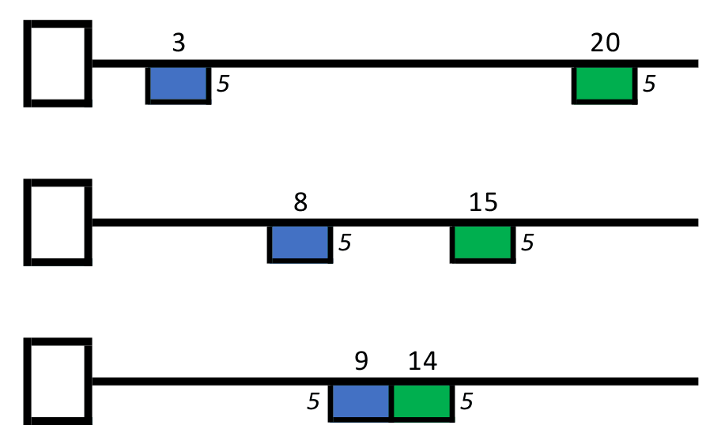
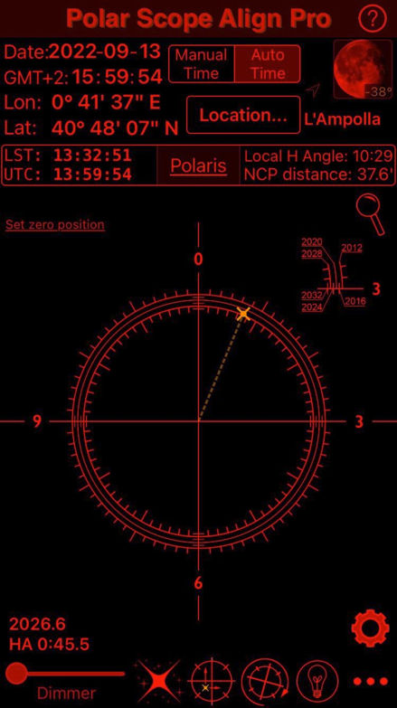

Aquí describimos los pasos a seguir para la realización de una de nuestras sesiones de astrofotografía partiendo del inicio de todo el proceso, la instalación del telescopio; seguiremos con el equilibrado del conjunto montura-telescopio, la puesta en estación, preparaciones previas y el sincronismo de nuestro sistema con la bóveda celeste.

## Requerimientos para hacer Astrofotografía
Normalmente empezamos en astrofotografía cuando ya hemos dado algunos pasos en la astronomía observando visualmente el cielo. Algunos de los elementos que utilizamos para nuestras sesiones de observación visual pueden ser utilizados para adentrarnos en el mundillo de la astrofotografía.

El caso típico es utilizar nuestra cámara DSLR que utilizamos normalmente y conectarla a nuestro telescopio,… muchos hemos empezado así.

Pero debes tener en cuenta ciertos aspectos que muchos de nosotros hemos aprendido a base de fracasos.

Como concepto general hay que saber que la precisión requerida es mucho mayor que en observación visual porque a diferencia de nuestros ojos que no integran la luz que les llega, los chips de nuestras cámaras registran (detectan y almacenan) cualquier traza de luz (fotones) que les impacte, incluidas las vibraciones inducidas por las ráfagas de aire (que producen rayas en las trazas de estrellas) o defectos en el guiado de nuestras monturas (estrellas gruesas o alargadas) y cómo no, la presencia de Luna u otras fuentes de luz (alumbrado público, cercanía a núcleos poblados, etc.) que impactan negativamente en nuestros frames hasta llegarlos a hacer inservibles.

Lo primero que hemos de tener en cuenta es no sobrecargar la montura. Nuestra montura, para trabajar en astrofotografía, puede ser cargada con un equipo (todo incluido) que tenga un peso no superior al 60% del peso máximo. Una montura diseñada para aguantar 14Kg (un caso muy común), tiene su límite en 8.4Kg. Si nuestro equipo es más pesado hemos de conseguir una montura de mayor capacidad.

En segundo lugar hemos de conseguir tener un conjunto lo más compacto posible. Todos los accesorios y cables colocados lo más cerca posible del centro de gravedad de la montura; más adelante hacemos alguna reflexión sobre estas cuestiones.

La tercera consideración es tener el conjunto tubo+cámara de guiado + soft bien ajustado y sobre todo adecuado a las dimensiones (ópticas) de nuestro OTA (reflector, refractor, SC, etc.). Este punto es prerrequisito para aspirar a trabajar cielo profundo, otras disciplinas como planetaria no tienen este requerimiento. Un error total en el guiado de <1” ya empieza a ser aceptable.

Finalmente, planificar con antelación los objetos que vamos a fotografiar (tamaños, encuadres, altitudes, etc.), las condiciones del lugar en el que vamos a trabajar (visibilidad, árboles, edificios, etc.) y fundamental, disponer de una buena previsión meteorológica.

## Instalación del telescopio
Primeramente, tenemos que situar el trípode del telescopio con el pin N hacia la estrella polar o sea, hacia el norte magnético (si no estamos en un entorno conocido, una brújula nos puede ayudar si el montaje lo hacemos de día).

Nos tenemos que asegurar de que la superficie de la cabeza del trípode, el asiento de la montura, se encuentra horizontal utilizando un nivel de burbuja y tomando dos lecturas ortogonales.

Con el trípode bien nivelado pasamos a instalar la montura; nos aseguramos de que todos los tornillos de trípode y anclaje de la montura están correctamente apretados. Seguidamente instalamos nuestro tubo principal (OTA) y aseguramos el apriete de las anillas del tubo y el anclaje con la pletina de soporte. Seguidamente vamos completando la colocación del resto de elementos.

## Equilibrado
Para un correcto equilibrado hemos de instalar todos los accesorios que se utilicen en la sesión: hub, mini pc, fuente alimentación/distribución de energía, focuser, cámaras principal y guiado, rueda portafiltros, bandas de calentamiento, etc. Para minimizar las inercias todos los accesorios del hardware utilizado deben de intentar colocarse lo más próximos al tubo y lo más cerca del eje de giro (bandas de Velcro adhesivas ayudan eficazmente).

Es importante colocar todos los cables como los vamos a utilizar durante la sesión y quitar las tapas del OTA y tubo de guiado. En primer lugar equilibramos el eje de declinación. Mientras movemos los ejes de Dec y AR hemos de comprobar que no se producen enganches ni rozamientos de los cables que conectan la montura con el mundo fijo; tener en cuenta que un cable ligeramente enganchado se refleja de forma dramática en las curvas de guiado y por lo tanto echaremos a perder el frame correspondiente.

Para el equilibrado del eje de AR hemos de conseguir una posición de las pesas lo más próximas al eje de giro con objeto de disminuir el momento de inercia y facilitar el posicionamiento/seguimiento del motor correspondiente.

Fijémonos en la siguiente imagen que muestra el posicionamiento de dos contrapesos de 5kg en tres posiciones diferentes.

Podemos ver que el equilibrio de pesos es igual en todos los casos, 115u’s; pero en la primera distribución el momento de inercia es mucho mayor que en la segunda: 2.045u’s > 1.445u’s y por lo tanto es un equilibrado que proporciona un funcionamiento más “crítico”. Elegiríamos el segundo posicionamiento.

Pero todavía tenemos menor momento en el tercer caso, 1.385 u’s y por lo tanto sería finalmente el elegido.

Una vez equilibrados ambos ejes ya se puede realizar la puesta en estación, pero antes una reflexión.

Puede darse el caso que hayamos realizado estos ajustes al caer la tarde para estar ya preparados cuando tengamos oscuridad (altamente aconsejable); si es así, tenemos tiempo para realizar los frames de Darks y Bias, de esta forma evitamos tener que hacerlos al finalizar la sesión cuando el sueño nos puede inducir a errores.

Es necesario realizar los Darks a la misma temperatura que los lights. Podemos realizar los frames de corrección en este momento porque la temperatura será más elevada que durante la noche y por tanto, sobre todo los Darks, serán perfectamente válidos porque lo que queremos corregir es el ruido provocado por la temperatura del sensor y esta no será menor que durante la sesión de fotografía.

Si nuestra cámara tiene control de temperatura, seguramente ya tendremos una biblioteca de Darks realizados a la misma temperatura que utilizamos en la sesión; lo mismo para los Bias.

También podemos aprovechar para hacer los Flats, sobre todo si para ello utilizamos la luz crepuscular del cielo. Importante tener en cuenta que después de hacer Flats no podemos modificar el tren óptico, por tanto ni girar la cámara.

Si aún falta tiempo para que oscurezca y podamos ver la Polar, conviene tapar los objetivos del OTA y de tubo de guiado para protegerlos. El tiempo empleado en esta fase sirve además para que nuestro OTA se equilibre térmicamente antes de la sesión de fotografía; sobre todo para tubos que requieran un tiempo elevado para alcanzar el equilibrio térmico (i.e. Maksutov).

## Puesta en estación
La puesta en estación con la Polar es fundamental para un correcto seguimiento durante nuestra sesión de astrofotografía (en el hemisferio sur el ajuste se hace con el asterismo conocido como la Cruz del Sur de la constelación del mismo nombre). En primer lugar, hemos de comprobar que la latitud de nuestra montura está ajustada a la de nuestro punto de observación.

Tenemos varios métodos para realizar la puesta en estación; el primero es ajustar la posición de la Polar mediante el introscopio (pequeño buscador que se incorpora roscado de forma solidaria al eje de AR o eje polar). Es importante tener en cuenta que cada vez que se instale el introscopio e incluso en el momento de la adquisición del telescopio hemos de calibrarlo adecuadamente mediante una referencia terrestre lejana de forma que el punto de referencia quede en el mismo centro del visor durante un giro de 360º del eje AR.

La posición exacta de Polaris varía en función de la fecha y la hora así que como ayuda utilizamos alguna App que nos indique la posición exacta en el momento del ajuste; tenemos que ajustar con nuestros mandos manuales de azimut y elevación la posición indicada en la App. En la foto adjunta vemos la pantalla de la App “Polar Scope Align” que nos marca la posición en que hemos de tener la estrella Polar.

Una segunda forma sería más automatizada, utilizando el sistema “PoleMaster” de QHY, que consiste en una pequeña cámara que se conecta mecánicamente a la montura en el agujero utilizado para el introscopio y de un software dedicado para PC que nos permite realizar la puesta en estación en menos de 5 minutos; es de fácil utilización y sobre todo muy precisa.

Existen otros sistemas cada vez más utilizados que pueden hacer el ajuste incluso sin tener visión directa de la Polar pero que no analizamos aquí.

Una vez hemos alineado nuestro eje de AR el siguiente paso es “sincronizar” el software que gobierna nuestra montura con la cúpula celeste para que nuestros sistemas go-to encuentren sin error los objetos deseados.

Para ello realizamos la alineación de la montura mediante el software que incorpora: 2 estrellas, 1 estrella, sistema solar, etc. Sirve para que la montura sepa dónde está y que el goto funcione.

El sistema consiste en posicionar la montura mediante el go-to en una determinada estrella de control (normalmente muy brillante, seguramente sugerida por el soft de la montura). Con la estrella posicionada, actuamos sobre los mandos de nuestra botonera o del PC para mover lentamente el telescopio hasta dejar la estrella en el centro de la pantalla de nuestra DSLR o del PC desde el que gobernamos la cámara (para una sesión visual emplearíamos un ocular reticulado).

Podemos hacer tantas sincronizaciones como queramos y en particular si cambiamos de meridiano conviene hacer una nueva sincronización.

Otro sistema más automatizado consiste en utilizar un software de control tipo SGPPro, Sharpcap, NINA, APT, etc. y mediante la función “Plate Solving” podemos sincronizar en un solo paso y con total precisión.

Vamos a extendernos un poco en esta última opción; utilizamos tres herramientas principalmente: programa de guiado (i.e. PHD2), programa de planetario (i.e. CDC) y programa de control de la sesión de astrofotografía (i.e. NINA).

Utilizaremos un software de planetario tipo Stellarium, Cartes du Ciel (CDC), SkySafariPro, como herramienta de “gobierno” fácil de nuestra montura; de esta forma podremos ver “gráficamente” donde se encuentra/mandamos nuestra montura. Aquí por simplificar la explicación utilizaremos NINA y CDC (cualquier otra combinación funciona igual de bien).

Cartes du Ciel (CDC) debe de estar conectado con nuestro soft de control; deben de poder entenderse; es un tema de ajustar los parámetros del programa que utilicemos, no tiene dificultad.

En primer lugar seleccionamos una estrella brillante fácilmente reconocible (no es absolutamente necesario) en CDC y ordenamos “rotar”; una vez que la montura ha llegado a la posición, desde NINA ordenamos un “Plate Solving”. NINA hace una foto, la compara mediante un “Astrometric solver” que devuelve la posición exacta del centro de la foto (por ejemplo ASTAP {el programa a utilizar se configura en el programa de control de sesión, NINA} o Astrometry). Esta posición verdadera se envía a nuestra carta celeste. CDC toma este valor como nueva posición y sincroniza con él.

A partir de este momento nuestro software de control y la bóveda celeste están “enlazados” con sincronismo. Si ahora nos vamos a CDC veremos que la posición en la que está la montura ya no coincide con la inicial: ¡no estábamos en posición correcta!, volvemos a seleccionar la estrella deseada en CDC y hacemos “rotar”; cuando nos da “en posición” vamos a NINA, hacemos una foto de control y voilá, aparece nuestra estrella perfectamente centrada. Plate solving es tan rápido de utilizar que es aconsejable realizarlo en cada nuevo posicionamiento de un objeto.

## Realización de las tomas
Como nuestra montura ya apunta al lugar de la bóveda celeste que deseemos con precisión el siguiente paso es iniciar la sesión de astrofotografía.

El siguiente paso antes de empezar a disparar nuestra cámara es activar el guiado. Tal vez el programa más empleado sea PHD2 aunque no el único. No vamos a explicar su funcionamiento pero si recordar que las últimas versiones (i.e. 2.6.11) permiten hacer el guiado con 10 estrellas: `/Guia/Configuraciones Avanzadas/Guiando/` y aquí clicar “Usar múltiples estrellas”. La mejora en el guiado es espectacular, posiblemente >0.3 en el error total.

Solamente nos queda revisar el enfoque. Es conveniente reenfocar varias veces durante nuestra sesión; tal vez un ajuste cada 60 minutos o al cambiar de filtro (esto es obligado si no son parafocales entre ellos y esto suele suceder al cambiar de fabricante ¡!). Se debe reenfocar porque las dilataciones del tubo con el cambio de temperatura afectan a la distancia focal.

Si utilizamos un programa tipo NINA podemos gobernar fácilmente nuestra “secuencia” de fotografías (lo mismo con cualquiera de los nombrados anteriormente), no vamos a entrar en este tema.

En el caso de utilizar una DSLR también podemos realizar disparos discretos con el temporizador incorporado en nuestra cámara o bien utilizar un intervalómetro, sistema utilizado por gran parte de la comunidad de fotógrafos; nos permite programar una secuencia de disparos con tiempo de espera entre ellos también programable.

Los parámetros de exposición, tiempo, sensibilidad ISO/Gain así como los sistemas para el pre y postprocesado de nuestras astrofotografías serán temas para comentar en otras ocasiones.

Cielos claros!!
