En este artículo explico el proceso para obtener una representación precisa de las regiones activas del Sol a partir de las fotografías que capturo con un modesto refractor y una cámara dedicada.

El objetivo es alinear nuestras imágenes con la posición real del Sol. Para lograrlo, utilizo un sistema de referencia que permite localizar de forma precisa y unívoca las regiones activas (AR). Solo así podemos comparar nuestras fotografías solares con los datos heliográficos de referencia proporcionados diariamente por los organismos oficiales.

A continuación, detallo los pasos que he seguido para alcanzar nuestro objetivo:

1. **Referencias oficiales**

   Presento los organismos oficiales que utilizo como referencia para obtener datos solares con precisión. Estas instituciones proporcionan información actualizada diariamente a través de internet.

2. **Sistema de coordenadas heliográficas**

   Repaso los tres parámetros fundamentales que sustentan el sistema de coordenadas heliográficas. Estos parámetros nos permiten medir y determinar con precisión los valores reales de las regiones activas (AR) en la superficie del Sol.

3. **Dibujo de la rejilla de coordenadas**

   Expongo los requerimientos iniciales necesarios para diseñar la rejilla de coordenadas, que servirá como base para fabricar una plantilla aplicable en PixInsight.

4. **Aplicación de las plantillas**

   Describo el proceso para integrar las plantillas con nuestras fotografías solares. Aunque detallo su uso con PixInsight, estas plantillas también son compatibles con otros programas de procesado gráfico, como Photoshop, GIMP u otras opciones similares.

## 1. Referencias oficiales para las AR's
La primera referencia que utilizo es un gráfico que nos muestra las AR's en Halfa y lo podemos encontrar en:

[www.sidc.be/spaceweatherservices/applications/solarmap](https://www.sidc.be/spaceweatherservices/applications/solarmap/)

El dominio sidc.be pertenece al Solar Influences Data Analysis Center (SIDC), que es parte del Observatorio Real de Bélgica (Royal Observatory of Belgium).

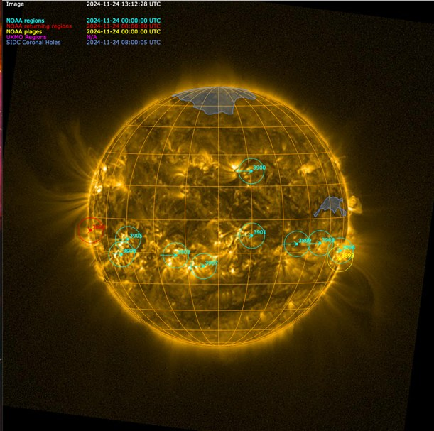

Este centro se especializa en el análisis de datos solares, incluyendo la observación de manchas solares y fenómenos relacionados con el clima espacial. Además, es un Centro Regional de Advertencia (RWC) para el monitoreo y pronóstico del clima espacial dentro de la red internacional del Servicio Internacional de Clima Espacial (ISES).

Además de las regiones activas podemos seleccionar los grupos de manchas solares de los equipos o instituciones que son referencia, como SIDC/USET de Bélgica y INAF/OACT de Italia, las playas (regiones brillantes que aparecen en la fotosfera), las AR's esperadas, etc

Para ver los sunspots en luz blanca, suelo consultar SOHO:

[soho.nascom.nasa.gov/sunspots](https://soho.nascom.nasa.gov/sunspots/)

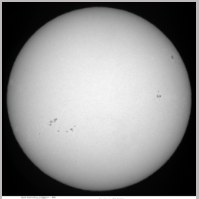

En ocasiones, puede suceder que alguna referencia no coincida entre ambos sistemas. En esos casos, cuando necesito verificar la calibración de mis fotografías solares, consulto:

[www.swpc.noaa.gov/products/solar-region-summary](https://www.swpc.noaa.gov/products/solar-region-summary)

que corresponde a la NOAA, National Oceanic And Atmospheric Administration. Aquí obtenemos un resumen diario actualizado a las 00:30 UTC. Es importante tener en cuenta que estos datos corresponden al día anterior, lo que puede generar un desfase significativo respecto a nuestras capturas.

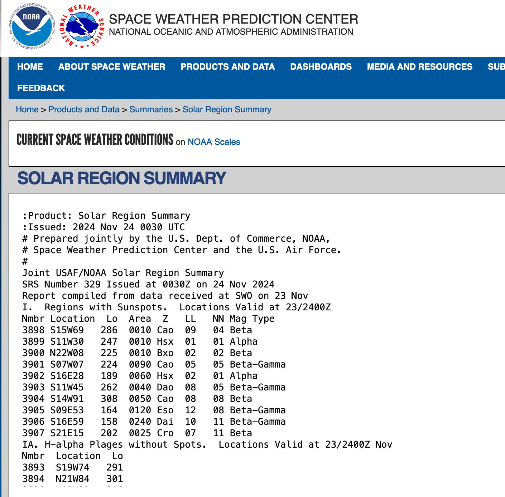

En realidad, además de la información obtenida en libros de consulta, la verdadera inspiración para representar las coordenadas heliográficas provino de la magnífica representación del Royal Observatory of Belgium que hemos visto anteriormente.

## 2. Sistema de Coordenadas heliográficas
> (1) Javier Ruiz Fernández (2018). El Sol. Editorial Marcombo. Cap.10.

Como ya hemos comentado, necesitamos un sistema de referencia para poder saber a qué posiciones nos referimos.

Inicialmente, podemos considerar un sistema de coordenadas similar al de la Tierra, con dos polos opuestos, donde el polo Norte (N) está arriba y equidistante del centro de la esfera solar. Al referirnos a 'N arriba', entendemos que el polo Norte solar se encuentra al norte del ecuador celeste.

El este (E) lo consideramos como en la Tierra pero como si estuviéramos posicionados en el Sol; desde nuestro punto de vista se encuentra a la izquierda.

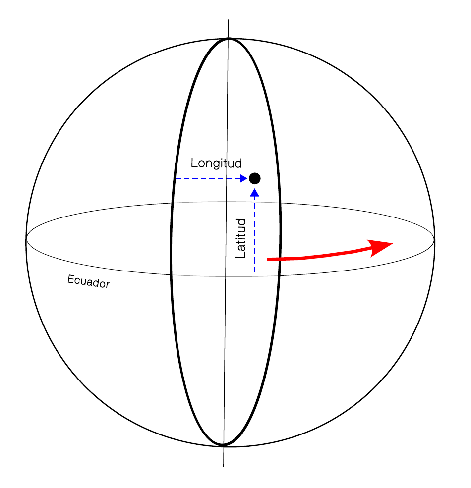

Definimos la latitud heliográfica como la distancia angular de un punto cualquiera al ecuador, como medida N o S y de 0 a +90°/-90°. Cualquier círculo perpendicular al ecuador será un meridiano. Como el Sol es un cuerpo gaseoso, no tenemos referencias como tenemos en la Tierra y lo que hacemos es medir la longitud desde el meridiano origen (2) (análogo a nuestro meridiano de Greenwich) siempre en sentido de la rotación del Sol hacia el Oeste (W) de 0° a 360°.

El valor para el meridiano origen (2) lo obtenemos igual que los otros dos que necesitaremos (P y B₀) mediante consulta de las efemérides.

El eje terrestre tiene una inclinación respecto a la eclíptica de +23.5° y apunta hacia la estrella Polar; en el Sol, el eje se encuentra inclinado 7.25° y apunta en una dirección completamente distinta.

Por este motivo, a lo largo del año, conforme la Tierra se mueve a lo largo de su órbita, cambia nuestra perspectiva y vemos los polos y el ecuador del Sol variando de posición a lo largo del año.

Se define el ángulo P como la inclinación del eje solar respecto a la dirección del Norte terrestre. Puede tomar un valor máximo de 26.3°, positivo hacia el E y negativo hacia el W.

Se define al ángulo B₀ como la inclinación del plano del ecuador solar, pasando de 0° a +/-7.25°. Cuando B₀ es positivo, el polo Norte se inclina hacia nosotros; cuando es negativo el polo Sur se inclina hacia nosotros y el polo Norte queda en el hemisferio oculto.

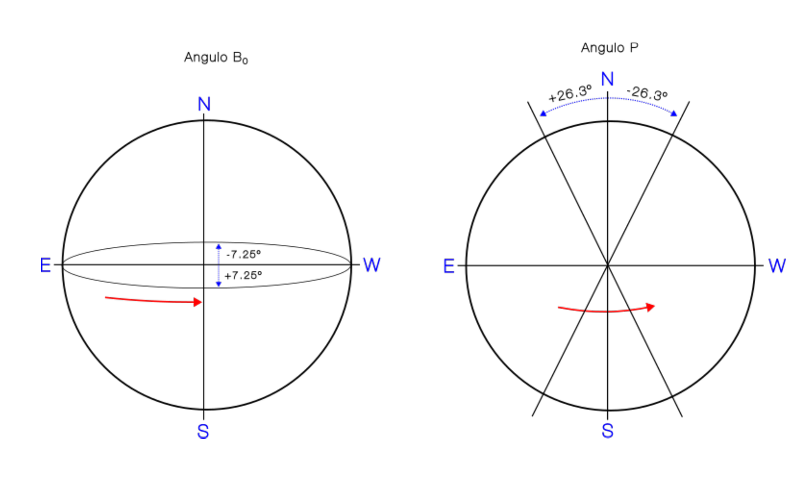

Así como P y B₀ nos dan información de cómo se posiciona la red de coordenadas sobre el disco solar, el ángulo que llamamos L₀ nos da información acerca de la posición del meridiano origen (2).

Visto desde el sistema de referencia del Sol y debido a como se definió el meridiano origen (2), L₀ varía de 0° a 360° en sentido horario solar de W a E; es decir, L₀ se incrementa conforme se produce la rotación del Sol.

Cuando L₀=90° el meridiano origen coincide con el limbo Este y coincide con el Oeste cuando L₀=270°. Cuando L₀=180°, el meridiano origen coincide con el centro del disco pero en el hemisferio oculto.

Cuando consultamos L₀ desde un software astronómico como Cartes du Ciel, vemos que el valor numérico disminuye con el paso de los días porque se calcula teniendo en cuenta la posición relativa Tierra-Sol.

P y B₀ dependen de la posición de la Tierra en el espacio y por lo tanto repiten aproximadamente los mismos valores en las mismas fechas.

Para determinar la posición de una AR medimos la longitud respecto al meridiano central y luego sumamos o restamos ese valor al valor de L₀ para el meridiano origen en ese momento; así obtenemos la longitud heliográfica.

Los valores de P, B₀ y L₀ se consiguen consultando las efemérides mediante software astronómico. En mi caso utilizo Cartes du Ciel.

### Definiciones
(2) En 1863, Richard Carrington definió el meridiano origen de la siguiente manera: El ecuador solar está inclinado respecto al plano de la eclíptica, y los puntos de intersección entre ambos se conocen como nodos. El nodo en el cual el ecuador asciende sobre la eclíptica, según el sentido de la rotación solar, se denomina nodo ascendente, mientras que su opuesto es el nodo descendente. El meridiano que pasaba por el nodo ascendente el 1 de enero de 1854 a las 12h UT se considera el meridiano origen. Aunque esta definición puede resultar algo compleja, no es de gran relevancia, ya que las efemérides proporcionan esta información de manera constante.

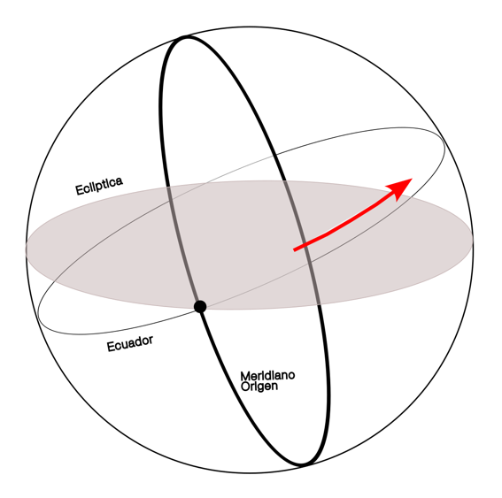

## 3. Dibujo de la rejilla de coordenadas
### 3.1 Diseño de la rejilla de coordenadas heliográficas
Hemos visto que el parámetro B₀ varía durante el año desde +7.25° a -7.25°. La variación se produce continuamente y para poder representar con buena precisión elegimos rejillas con pasos de 1° (Javier Ruiz 2018, 199); es decir, necesitaremos las siguientes rejillas con valores de B₀:

+7°, +6°, +5°, +4°, +3°, +2°, +1°, +0°, -1°, -2°, -3°, -4°, -5°, -6°, -7°

Con cada una de las rejillas abarcamos los siguientes valores de B₀:

| rejilla | valores |
| --- | --- |
| B₀= +6 | +6.5 > B₀ ≥ +5.5 |
| B₀= +5 | +5.5 > B₀ ≥ +4.5 |
| B₀= +4 | +4.5 > B₀ ≥ +3.5 |
| B₀= +3 | +3.5 > B₀ ≥ +2.5 |
| B₀= +2 | +2.5 > B₀ ≥ +1.5 |
| B₀= +1 | +1.5 > B₀ ≥ +0.5 |
| B₀= +0 | +0.5 > B₀ ≥ -0.5 |

de forma análoga para valores negativos:

| rejilla | valores |
| --- | --- |
| B₀= -1 | -0.5 > B₀ ≥ -1.5 |
| B₀= -2 | -1.5 > B₀ ≥ -2.5 |
| B₀= -3 | -2.5 > B₀ ≥ -3.5 |
| B₀= -4 | -3.5 > B₀ ≥ -4.5 |
| B₀= -5 | -4.5 > B₀ ≥ -5.5 |
| B₀= -6 | -5.5 > B₀ ≥ -6.5 |
| B₀= -7 | -6.5 > B₀ ≥ -7.5 |

Vemos que cada rejilla abarca un área de 1°

Para no saturar con demasiadas líneas elegimos separación de 10° para los meridianos y 15° para los paralelos.

### 3.2 Dibujo de la rejilla básica
En primer lugar, consideramos realizar el diseño utilizando un programa de dibujo 2D, como Inkscape, un software de código abierto y distribución gratuita.

La rejilla correspondiente a B₀= +0 será la primera que diseñaremos porque el plano del ecuador solar no tiene ningún desplazamiento; esto corresponde en torno al 6 de junio y al 7 de diciembre. A partir de esta plantilla iremos desplazando las líneas de los paralelos 1° hacia el S cada vez para formar las 7 primeras y lo mismo hacia el N para las siete últimas.

Para tener en cuenta las variaciones del ángulo P (variaciones del eje polar), en vez de mover nuestra rejilla moveremos la foto de nuestro Sol los grados necesarios indicados por el valor de P, de tal forma que el eje polar N-S siempre quede en posición vertical.

Además de que lo expuesto parece lógico, también cuadra con que las rejillas de nuestras webs de referencia siempre dibujan el N arriba!!

Teniendo en cuenta lo anterior, dibujamos nuestra primera rejilla para B₀=0, que presenta el aspecto mostrado en el gráfico adjunto:

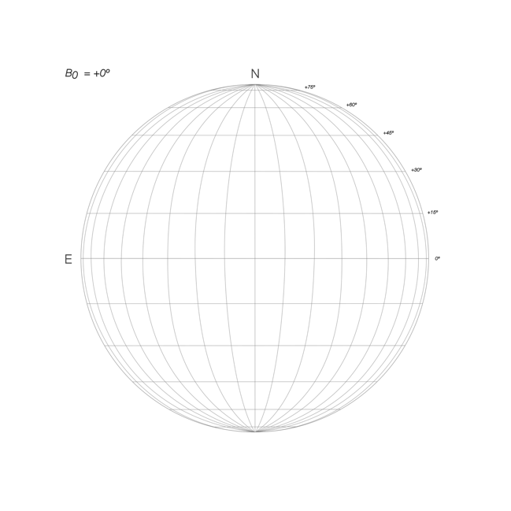

Como hemos comentado anteriormente esta rejilla nos servirá para valores:

+0.5 > B₀ ≥ -0.5

Escogemos utilizar una rejilla con pasos de 10° en longitud y de 15° en latitud y por tanto los paralelos se encuentran distribuidos cada 15° y los meridianos cada 10°.

La posición en Z de cada paralelo viene dada por: r⋅sen(15), r⋅sen(30), r⋅sen(45), r⋅sen(65), r⋅sen(75) y los radios respectivos tienen los valores: r⋅cos(15), r⋅cos(30), r⋅cos(45), r⋅cos(65), r⋅cos(75)

Con estos datos podemos dibujar directamente nuestra rejilla base.

### 3.3 Dibujar las diferentes rejillas heliográficas en 2D
Como hemos comentado anteriormente que vamos a crear una rejilla para cada variación de 1° en la inclinación del plano ecuatorial.

Como observamos el disco solar ortogonalmente, veremos el desplazamiento de la parte central de nuestros paralelos según la fórmula: d=r⋅sin(α), donde r es el radio de nuestra circunferencia y α es el ángulo de cada paralelo, cuyo valor se verá aumentado o disminuido en función de la plantilla que hemos dibujado.

Ya que las plantillas se aplicarán a una imagen fotográfica que se mide en pixels (px), pasamos a esta unidad a partir de ahora.

Para entender mejor pongo el ejemplo de las desviaciones en Z para una plantilla de 1000 px de radio y desviaciones polares de +1° a +7°:

Si posicionamos el ecuador, paralelo 0º, en z=1000, la tabla adjunta muestra las posiciones de los diferentes paralelos para la plantilla correspondiente a B₀=0.

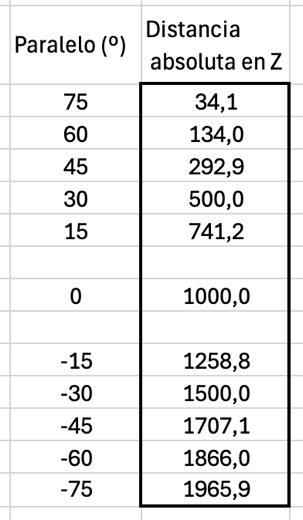

Las desviaciones relativas (+d) en pixels para cada paralelo en función de los diferentes valores de B₀:

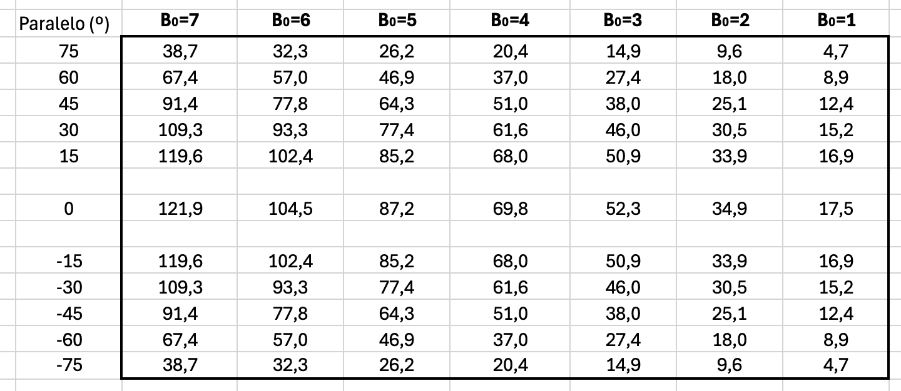

y las posiciones absolutas de las plantillas en función de los valores de B₀:

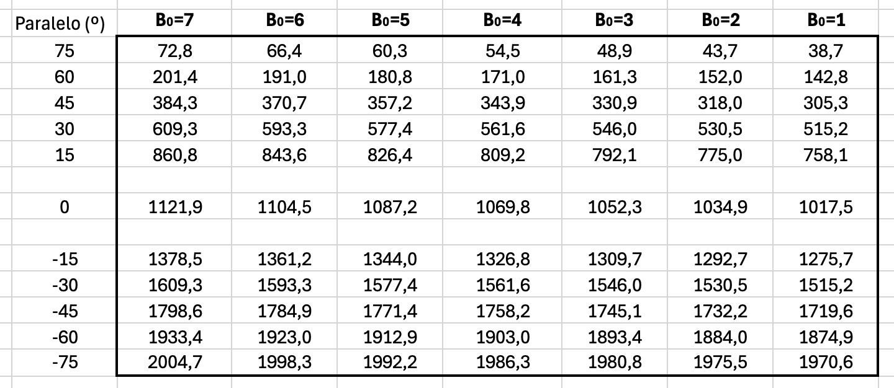

A estos valores solamente quedaría añadir el offset necesario para dejar el dibujo centrado en Z según nuestras necesidades.

Los valores obtenidos corresponden al centro del paralelo; la curvatura desde los extremos E y W (que quedan fijos), debe realizarse de forma manual bajo criterio de cada uno.

Para los valores de B₀ =-1 a B₀ =-7 los cálculos son iguales pero los incrementos se realizan en sentido contrario.

El gráfico adjunto es la plantilla acabada con este sistema para B₀ =+7.

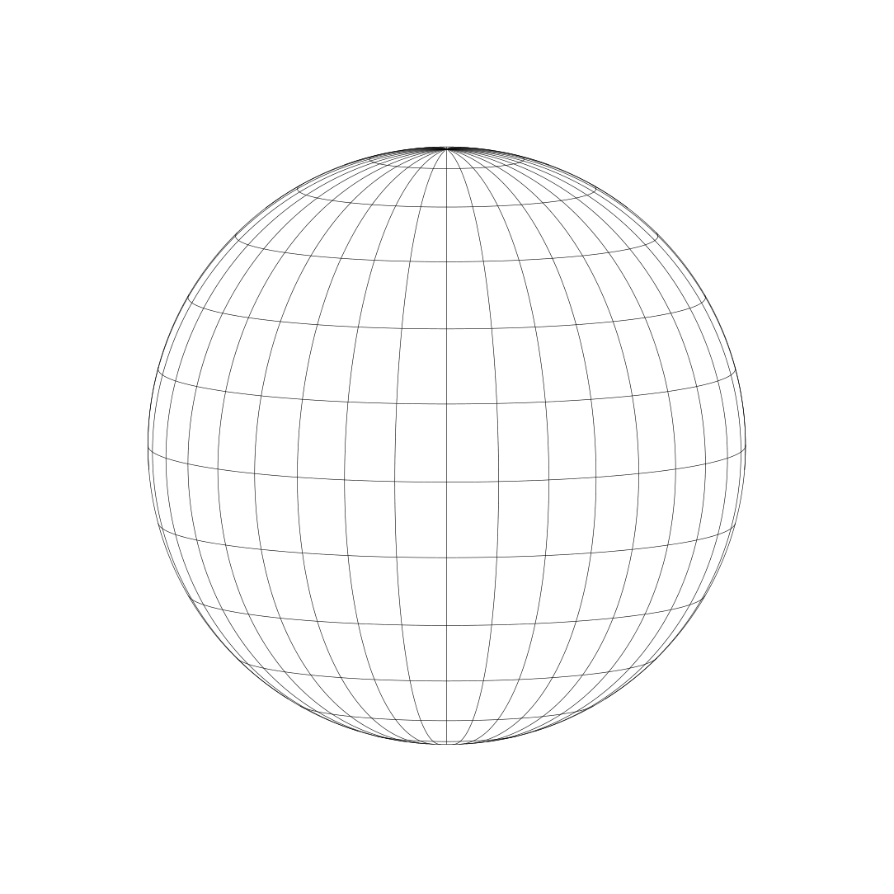

El resultado es aceptable, pero podemos incurrir en errores, especialmente en las zonas polares. Sin embargo, esto no es crítico, ya que en esas áreas no solemos encontrar AR's. El mayor error se produce allí, porque en realidad no hemos 'rotado' el dibujo.

Por ese motivo y porque modificar todos los paralelos de las 15 plantillas, aunque es bastante sistemático, es tedioso; he pensado crear las plantillas mediante un CAD 3D.

### 3.4 Dibujar las diferentes rejillas heliográficas en 3D
Quiero diseñar una rejilla con las mismas características que en el apartado de 2D, pero para facilitar el trabajo, he pensado crear una rejilla patrón que podré rotar en incrementos de 1°. De esta forma, podré obtener las 15 posiciones necesarias sin tener que retocar cada paralelo de manera independiente.

Para dibujar he seleccionado FreeCAD que es un programa de código abierto, potente y gratuito.

Los pasos para realizar este conjunto de plantillas se pueden resumir de la siguiente manera:

**1. Dibujar plantilla patrón para B₀ =+0**

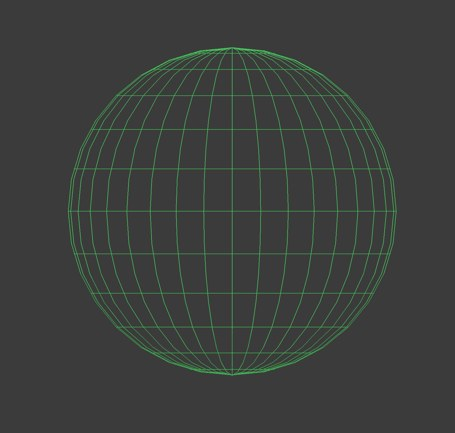

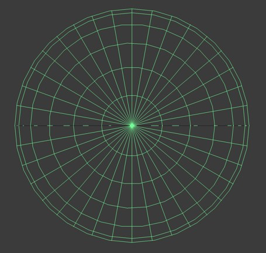

El acabado final de la plantilla lo tenemos que hacer en 2D y por lo tanto para pasar desde el 3D lo más fácil es hacer una proyección sobre el plano XZ o YZ porque los paralelos se han dibujado en el plano XY.

Sin embargo, tenemos el problema de que, al proyectar después de girar la imagen, vemos tanto la estructura de la cara anterior, que es la que nos interesa, como la posterior. Esto invalida el resultado.

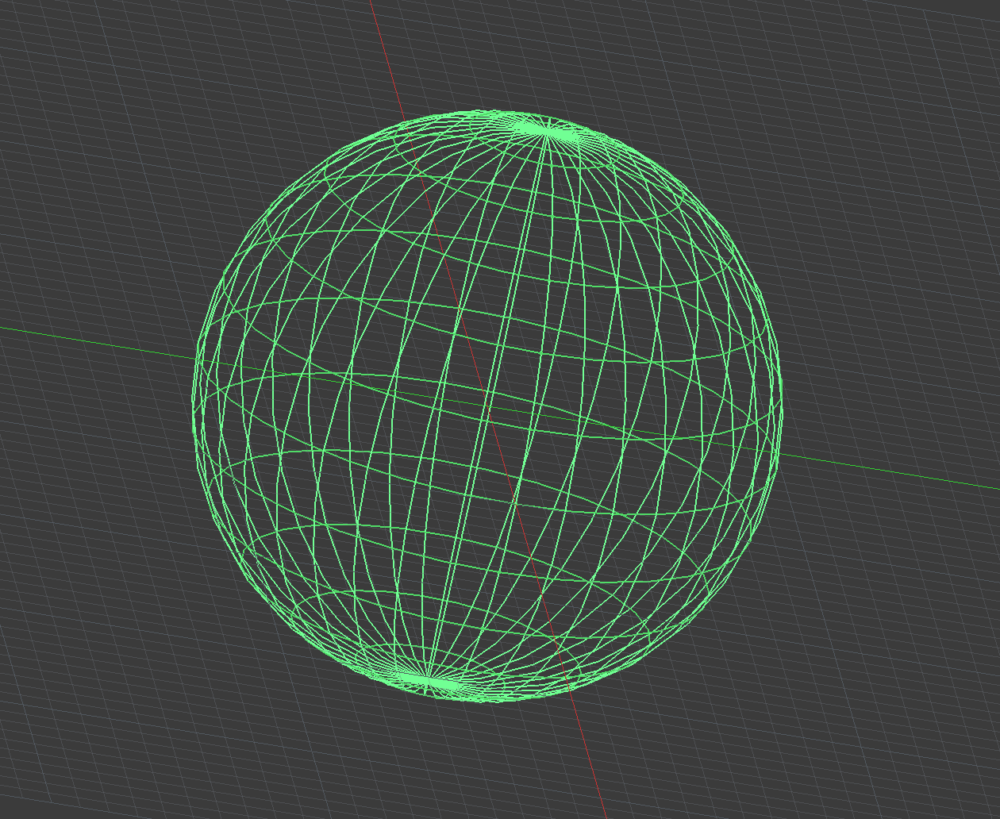

**2. Limpiar el dibujo eliminando la parte que no interesa**

Dado que podemos realizar operaciones booleanas de resta, eliminamos todo lo que esté en la región X negativa (región Y negativa dependiendo del plano de proyección elegido). El dibujo adjunto muestra la imagen para B₀=+0.

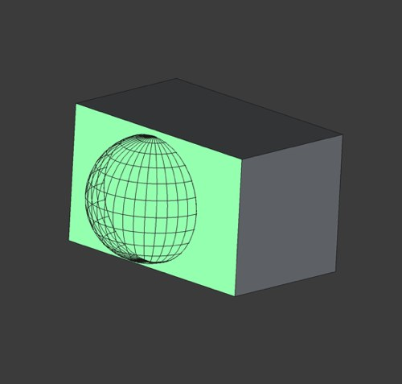

Al restar el cubo de la imagen de coordenadas, obtenemos la parte que nos interesa, la cual podemos proyectar sin interferencias.

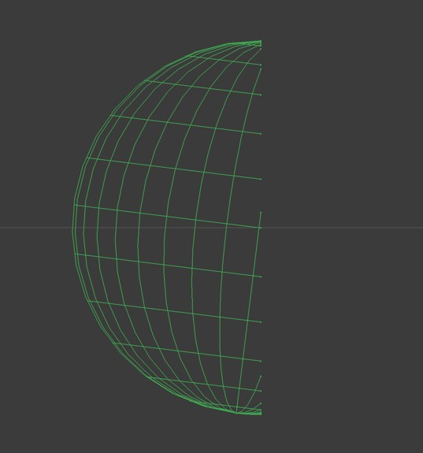

El resultado al hacer la resta, para B₀ =-7, es el siguiente: Lo que hemos hecho es antes de aplicar el recorte girar -7º según el eje X.

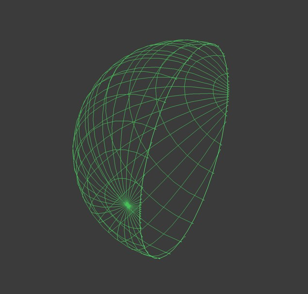

**3. Proyectar el dibujo en 2D y cargar con Inkscape para dejarlo en las medidas necesarias para añadirlo a nuestras fotos.**

En este punto ya hemos de tener en consideración el formato de la foto a la que vamos a aplicar la máscara.

Hemos de conseguir que la plantilla de la máscara tenga las mismas dimensiones que la foto y además que la rejilla tenga el mismo tamaño que el Sol en nuestras capturas.

El equipo que utilizo para fotografiar el Sol consiste en un refractor acromático de 70mm f13 y una cámara que es la misma que utilizo para cielo profundo, la ASI 294MM con un filtro solar continuum.

Este equipo me da unas dimensiones del disco solar de 1842px de diámetro.

El Sol varía a lo largo del año entre 32.53 minutos de arco en el perihelio y 32.44 minutos de arco en el afelio por lo que esa pequeña variación no nos va a crear problemas en cuanto al tamaño de plantilla necesario; en cualquier caso tomamos la medida de referencia a final de marzo o final de septiembre por tomar un valor medio.

Las fotografías las recorto siempre a 2700px x 2700px para tener espacio para los comentarios que añado así que el dibujo de la plantilla debe ser de 2700px x 2700px y la rejilla del Sol ha de tener un diámetro de 1842 px.

Estos valores son los que hemos de conseguir con el programa de 2D.

## 4. Aplicación de las plantillas con PixInsight
Como es habitual, utilizo PixInsight para procesar las fotografías, aunque estoy convencido de que, aplicando la gestión de capas, se puede lograr el mismo resultado con Photoshop, Gimp, etc,...

Repasamos el proceso que sigo desde la toma de los datos iniciales.

En primer lugar ajustamos nuestro conjunto telescopio-cámara para que el Sol recorra, si no hacemos seguimiento de AR, nuestro FOV de derecha a izquierda; esto es imprescindible para que al aplicar posteriormente el giro y el ajuste de P nos quede el Norte arriba.

Utilizo el conocido Firecapture para grabar el Sol y luego realizo el procesado con AstroSurface. Con este último, llevo a cabo la deconvolución (V-Cittert), el ajuste de wavelets (Wavelets) y la mejora de la nitidez (Sharpen).

Normalmente es suficiente y ya paso a PixI, donde si necesito hacer algún retoque utilizo el proceso SolarToolbox, tal vez para ajustar contraste y para cuando quiero aplicar color.

Inkscape suministra los ficheros en formato *.svg que es compatible con PixI y se pueden importar directamente.

Al fichero *.fit procedente de AstroSurface primeramente le aplico:

```
/Image/Geometry/Rotate 180º
```

Con esto conseguimos "deshacer" el giro vertical y el horizontal generados ópticamente por nuestro equipo, que recordamos es un refractor con cámara aplicada a foco primario.

Lo siguiente que tenemos que hacer es corregir el ángulo P para colocar nuestra foto con el norte (N) apuntando hacia arriba, por normalización, como ya hemos explicado.

Este valor de P, B₀ y L₀ los obtengo de Cartes du Ciel (versión 4.3).

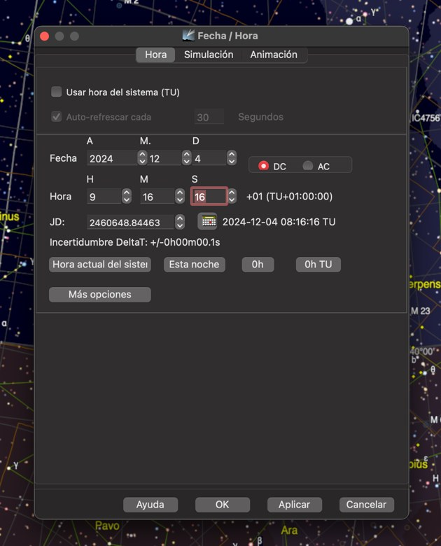

En primer lugar deshabilitamos "Usar hora del sistema (TU)" e introducimos la hora en que hemos realizado la grabación con Firecapture; podemos aprovechar la que figura por defecto en el nombre del fichero porque corresponde al tiempo medio de nuestra grabación.

Aplicamos los cambios, validamos y seleccionamos el objeto Sol con la información adjunta:

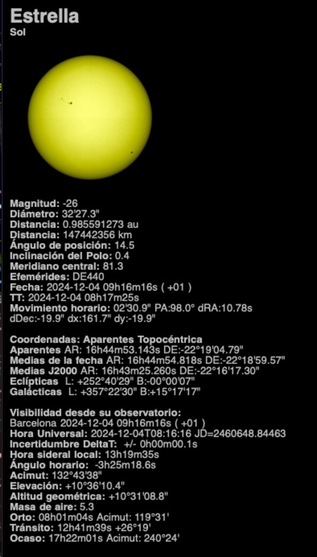

Tomamos el valor del ángulo de posición (P) que es 14.5 y lo aplicamos a nuestra imagen con el proceso DynamicCrop.

Colocamos el punto de giro en el centro de la imagen del Sol y hacemos Execute; con esto ya tenemos nuestro Sol con el Norte en posición vertical; el siguiente paso es recortar, también con DynamicCrop, a 2700x2700 para normalizar al tamaño que utilizamos en la plantilla.

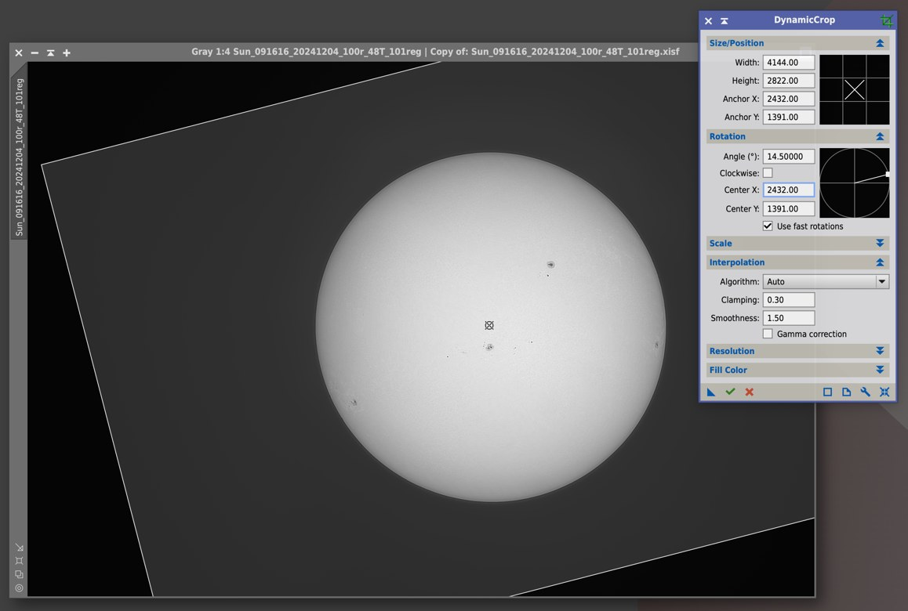

Al mismo tiempo que creamos en Inkscape nuestra plantilla de coordenadas, creamos una plantilla que llamo de "texto" y que contiene el valor de B₀ que corresponde a cada plantilla (-7,...,0,....+7), la letra que indica el este (E), la del norte (N) y la indicación de los paralelos de 0° a 75°.

Estas son las tres imágenes que tenemos hasta el momento; Sol, plantilla coordenadas y plantilla texto:

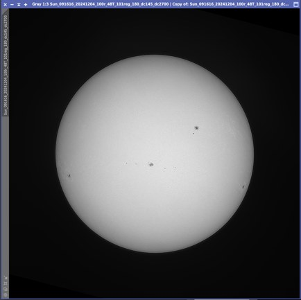

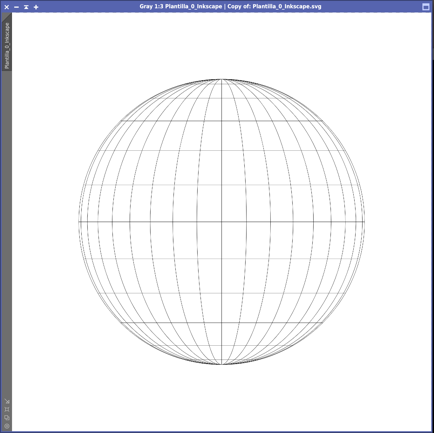

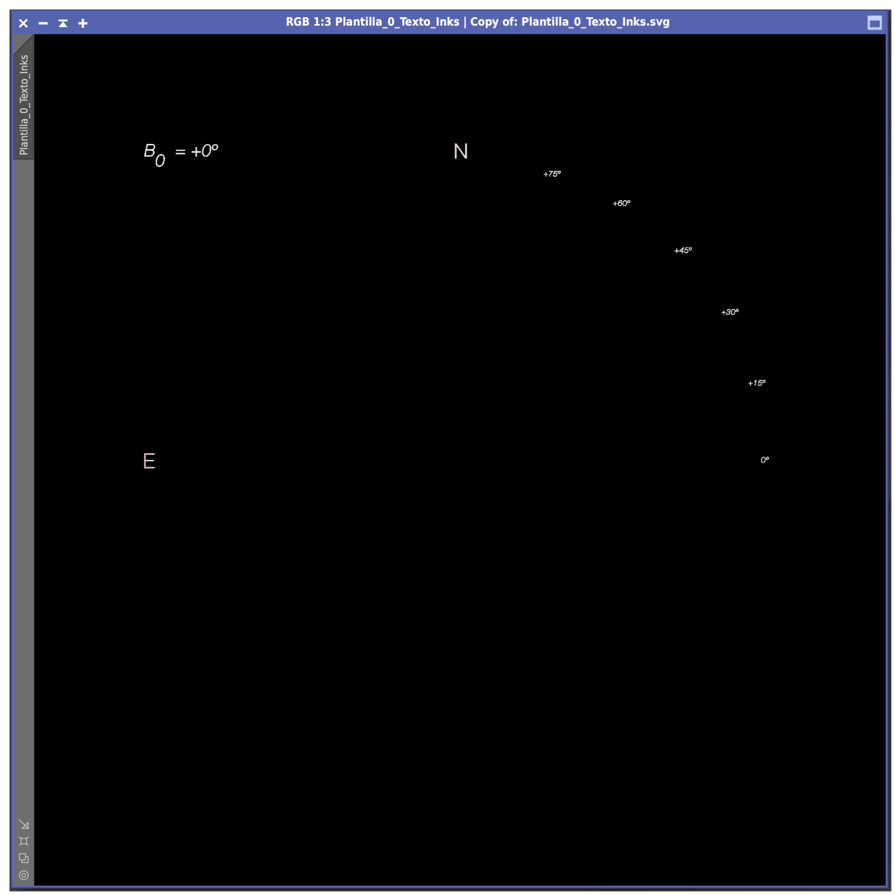

Todas con el mismo tamaño.

Como en otras ocasiones utilizamos el proceso PixelMath para aplicarlas sobre nuestra imagen. Es idóneo para operar pixel a pixel.

La fórmula que utilizamos:

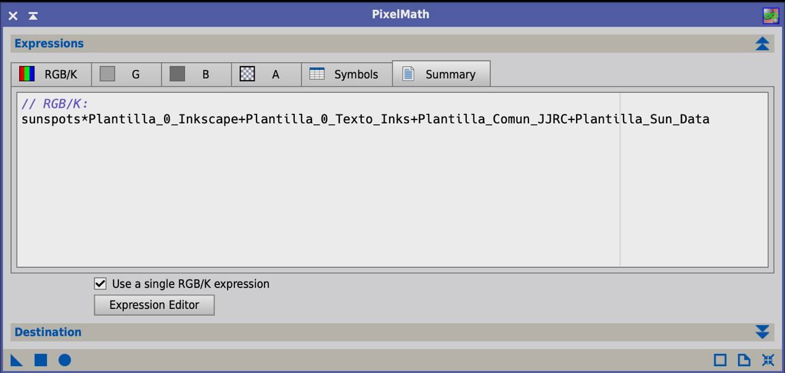

"sunspots" se refiere a nuestra imagen del Sol. "Plantilla_0_Inkscape" se refiere a la plantilla que hemos creado en Inkscape con B₀=+0. "Plantilla_0_Texto_Inks" es la plantilla de texto creada en Inkscape para B₀=+0.

En la expresión:

```
sunspots*Plantilla_0_Inkscape+Plantilla_0_Texto_Inks
```

puede llamar la atención el signo "*" entre los dos primeros operandos cuando seguramente esperaríamos un "+" porque queremos "sumar" (añadir) información de una imagen a otra; eso es así porque los "alambres" de la plantilla son de color negro, o sea valor "0"; eso quiere decir que si los sumamos a la superficie del Sol que es valor alto, digamos "0.8" el resultado sería "0.8" y no veríamos nuestra rejilla.

Por este motivo es por el que hemos de multiplicar para que el resultado sea "0" para los pixels que coinciden con nuestra rejilla, es decir, estamos pintando la rejilla sobre nuestro Sol.

El tercer operando ya se aplica con una suma porque los valores de las letras están cercanos al "1" y por lo tanto al sumarlos a valores "0" de la zona exterior al Sol, "pintamos" nuestros caracteres.

El cuarto operando corresponde a mi firma con mis coordenadas y el quinto operando son los valores solares que queremos incluir y que se suman porque son letras en color blanco aplicadas a fondo negro. Estas dos plantillas no las he incluido.

El resultado al aplicar PixelMath con las tres primeras plantillas es el deseado:

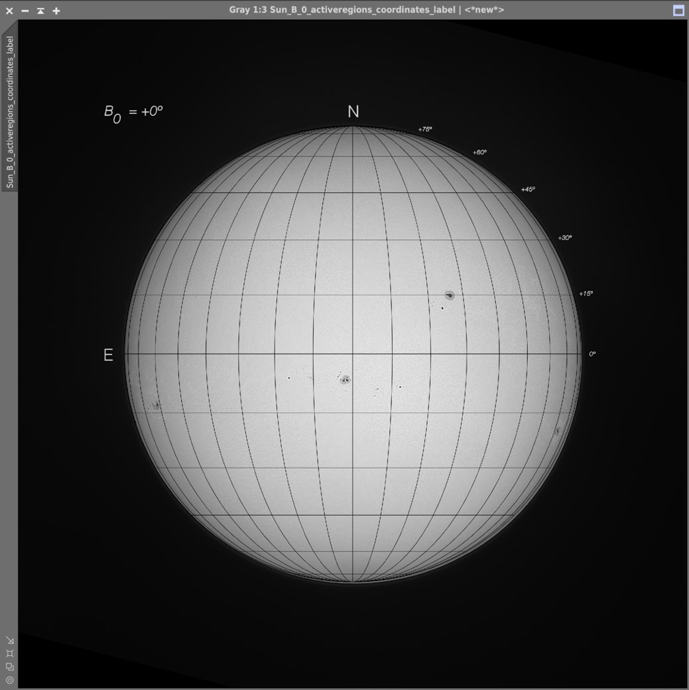

Como ejemplo comparativo, he generado las imágenes para B₀=+7 y B₀=-7 respectivamente. La comparación muestra las desviaciones máxima y mínima que pueden presentarse en los valores extremos de la inclinación del polo.

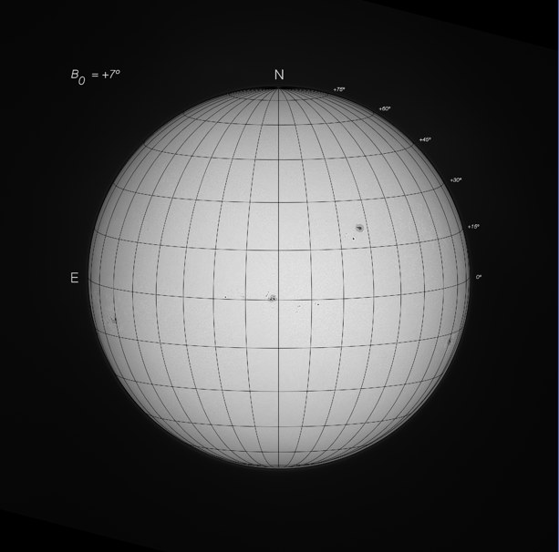

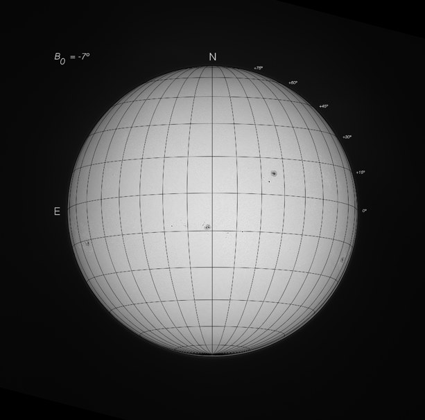

En definitiva, con este método logramos alinear nuestras fotografías solares con las referencias heliográficas oficiales, lo que no solo mejora la precisión de nuestro trabajo, sino que también enriquece nuestra comprensión del comportamiento del Sol y sus regiones activas.

Hasta la próxima amigos,

Cielos claros!!
