L'objectiu d'aquest article és oferir una visió general sobre el concepte de màscara a PixInsight, explicant com crear-les i en quines situacions aplicar-les.

Sovint, quan realitzem transformacions a les nostres imatges, volem fer-ho de forma selectiva, evitant afectar la totalitat de la imatge. Per exemple, podríem voler treballar el fons sense alterar l'objecte principal o viceversa. També és comú desitjar processar els estels de manera independent a la resta de la imatge, o ressaltar certes zones específiques.

PixInsight ens ofereix la possibilitat d'aconseguir aquesta selecció precisa mitjançant l'ús de màscares.

Per entendre aquest concepte, podem comparar-ho amb una diapositiva en fotografia convencional: les zones més clares permeten el pas de la llum, mentre que les àrees més fosques la bloquegen, sent el negre el que atura la llum del tot. Mantinguem aquesta idea al cap.

A l'àmbit digital, una imatge és una matriu de píxels organitzats i perfectament identificats. En aplicar un procés sobre la imatge, estem fent operacions matemàtiques sobre cadascun d'aquests píxels. Aquí és on entra en joc la màscara, que actua com un filtre, permetent que aquestes operacions s'apliquin de manera proporcional segons l'opacitat de la màscara: el blanc indica una aplicació al 100% i el negre al 0%.

Així, el concepte és semblant al de la diapositiva, però en lloc de controlar la quantitat de llum que travessa, estem ajustant la intensitat amb què s'aplica l'operació matemàtica a cada píxel de la imatge.

Per entendre-ho anem amb un exemple.

Suposem una màscara com aquesta que hem anomenat "mask_bin".

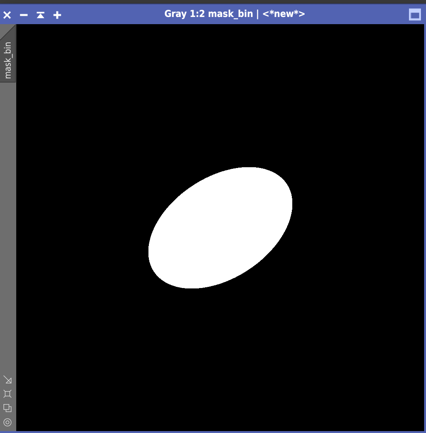

i l'apliquem a una imatge RGB de la mateixa mida i de color gris.

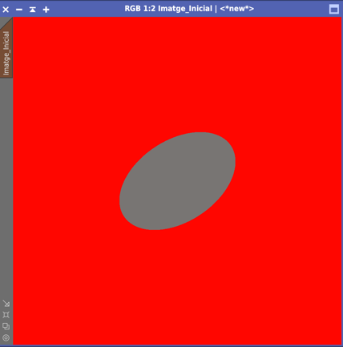

Podem veure que les parts protegides es veuen de color vermell, més intens com més gran és la protecció, i les que no són protegides es veuen sense canvi de color, amb el gris de la imatge de partida.

Ara per provar l'efecte de la màscara apliquem amb *CurvesTransformation* color verd a la imatge i el resultat és:

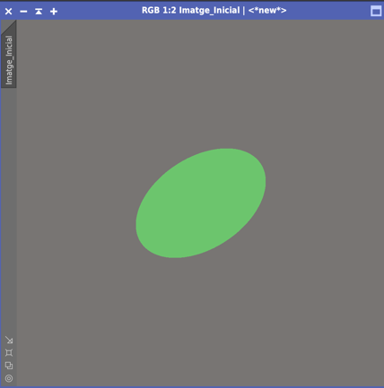

¡¡El color verd només s'ha aplicat a la part no protegida!!

i si apliquem aquesta altra màscara amb les vores difuminades veiem com varia la intensitat del color de l'el·lipse verda en funció del degradat:

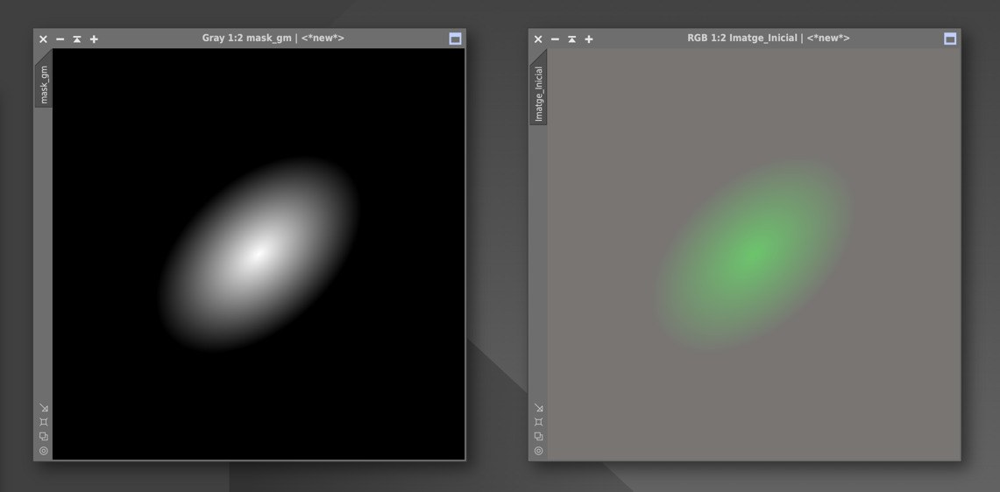

## Consideracions
Perquè PixI accepti una imatge com a màscara ha de complir les condicions:

- Per utilitzar una imatge com a màscara d'una altra, totes dues han de tenir exactament les mateixes dimensions de píxel (x,y).
- Les màscares han de ser imatges no lineals.
- Les imatges en escala de grisos només accepten màscares en escala de grisos.
- Les imatges a color accepten màscares a color o en escala de grisos.

## Aplicar i Treballar amb màscares
Per aplicar una màscara "mask" a una imatge "imatge_principal" fem que "imatge_principal" es trobe activa simplement clicant-hi.

Fem servir l'opció del menú principal: */Mask/SelectMask* i seleccionem al quadre de diàleg la imatge "mask".

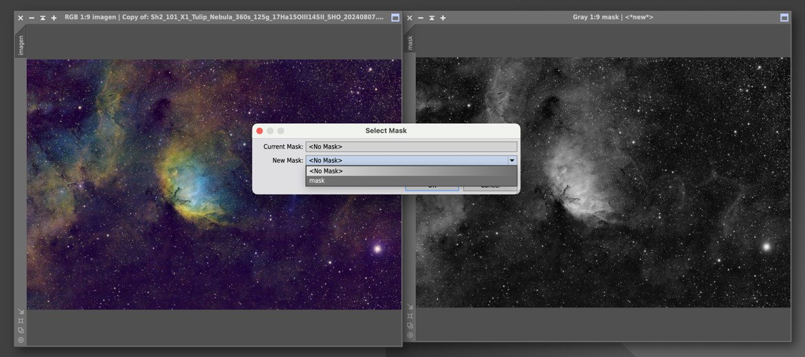

Quan la màscara queda aplicada, el color de fons de la pestanya de la imatge es torna de color marró/taronja; aquesta és la manera de saber que tenim una màscara aplicada.

Si no sabéssim quina màscara tenim aplicada, fem: */Mask/SelectMask* i podrem veure la màscara actual "Current Mask" i les màscares disponibles a "New Mask".

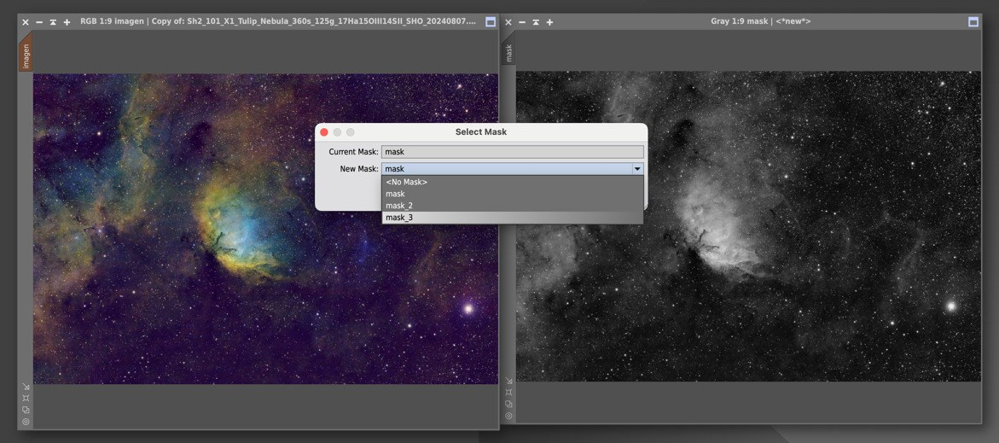

A la barra d'eines disposem de les eines que necessitem per treballar amb les màscares:

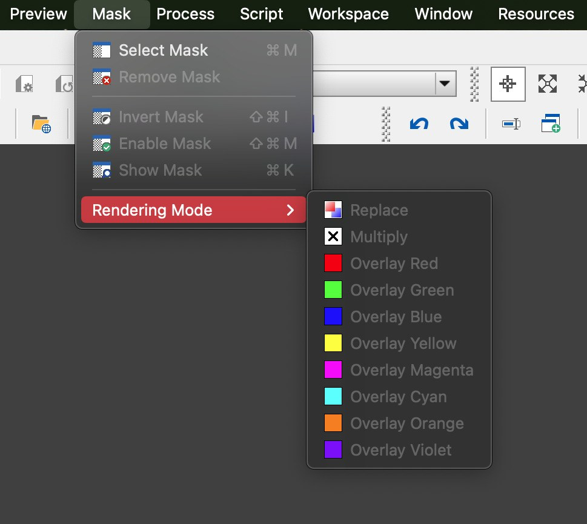

- *Select Mask:* Per mostrar i seleccionar una màscara entre les disponibles per a la imatge seleccionada; si aquesta ja té una màscara aplicada, mostra el nom.
- *Remove Mask:* Eliminar la màscara de la imatge seleccionada.
- *Invert Mask*: Inverteix la màscara.
- *Enable Mask:* Per activar o desactivar la màscara de la imatge seleccionada.
- *Show Mask:* Per mostrar o amagar la màscara de la imatge seleccionada.
- *Rendering Mode:* Serveix per seleccionar el color que s'utilitza per mostrar la màscara.

Quan hem aplicat una màscara a una imatge podem modificar les característiques de la màscara, típicament enfosquir o aclarir la imatge, per canviar el nivell de protecció o invertir-la per canviar entre objecte-fons.

No podem modificar la mida de la màscara !!

## Aplicacions de les màscares
Les màscares són eines versàtils que es poden emprar per a una àmplia varietat de propòsits, entre els més comuns:

- Aïllar l'objecte principal del fons per aplicar ajustaments de manera independent a cadascun.
- Separar les estrelles d'una imatge per treballar-hi específicament.
- Eliminar les estrelles d'una imatge per treballar en una versió starless.
- Modificar colors o característiques de manera selectiva.
- Intervenir en àrees específiques de la imatge.

Hi ha nombrosos mètodes per crear i manipular màscares. A continuació, explorarem els fonaments i algunes tècniques per crear màscares personalitzades segons les nostres necessitats específiques.

## Màscares de Luminància
La màscara més bàsica i segurament més utilitzada consisteix a obtenir la component de luminància de la nostra imatge: *Image/Extract/Lightness(CIE L\*)*

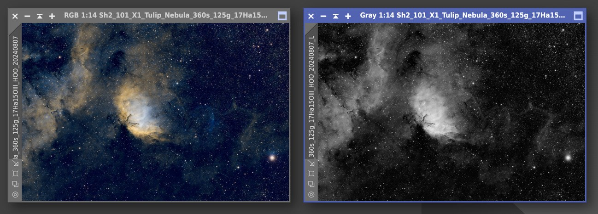

L'aplicació immediata és diferenciar entre l'objecte i el fons per modificar allò que ens interessi. Invertint la màscara seleccionem un o altre, com en els exemples següents:

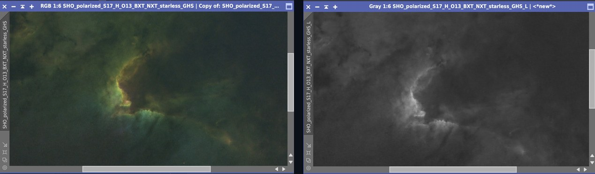

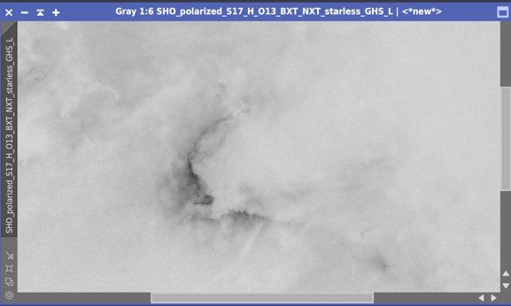

Aquesta màscara invertida la faríem servir per modificar característiques del fons.

Un altre exemple de màscara directa:

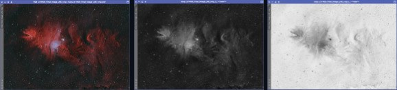

Com hem comentat, el color negre protegeix al 100% i el blanc suposa transparència total.

Aquestes màscares les podem enfosquir al nostre gust simplement modificant l'histograma amb *HistogramTransformation* o aplicant *CurvesTransformation*.

## Màscares mitjançant ACDNR
Una altra forma d'obtenir una màscara de luminància és mitjançant el procés *Adaptative Contrast-Driven Noise Reduction* més comunament conegut com a *ACDNR*. És una bona eina per reduir el soroll d'una imatge o suavitzar una imatge o una màscara. Té l'avantatge que podem activar *Real-time Preview* i veure com queda la nostra imatge conforme la modifiquem.

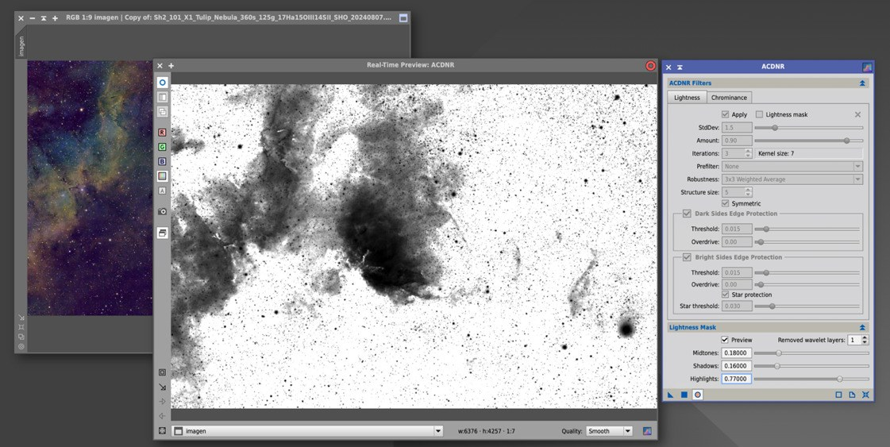

Però el que utilitzarem aquí d'aquest procés és la part corresponent a *Lightness Mask*. Minimitzem la part d'*ACDNR Filters* i ampliem la de *Lightness Mask*.

Podem crear fàcilment una màscara fent previsualització en temps real i modificar els tons mitjans (*Midtones*), les ombres (*Shadows*) i les altes llums (*Highlights*).

Amb els paràmetres de la figura obtenim una màscara de luminància molt contrastada; simplement modificant els sliders dels tres paràmetres podem variar immediatament el resultat.

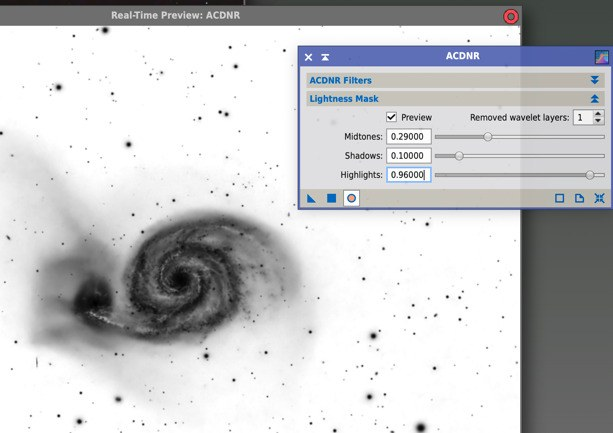

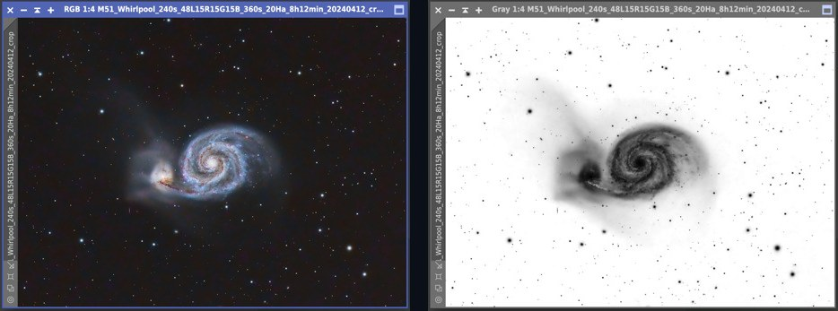

## Màscares mitjançant RangeSelection
El procés *RangeSelection* crea una imatge en escala de grisos basant-se en la imatge activa, amb ajustaments del límit superior i inferior del valor de píxel. Primer definim un rang de valors de píxel vàlids i llavors *RangeSelection* crearà aquesta nova imatge on els píxels a la imatge destinació dins aquest rang seran blancs, i els píxels fora de rang seran interpretats com a negre.

*RangeSelection* es fa servir gairebé exclusivament per crear màscares basades en luminància/luminositat

La pantalla és simple i es fa imprescindible utilitzar *Real-Time Preview* per veure els resultats que obtenim en modificar els controls de desplaçament.

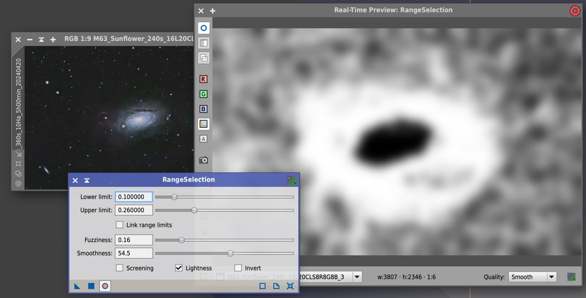

Aquest procés no modifica la imatge activa i crea una imatge nova anomenada *range_mask*

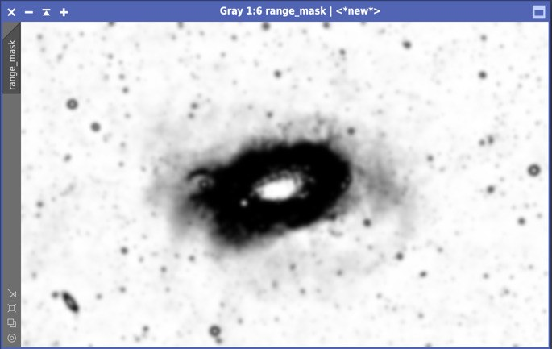

## Màscares d'estrelles amb StarMask
Les màscares següents més emprades són les màscares d'estrelles. Una manera de generar-les és mitjançant el procés: *Process/MaskGeneration/StarMask*

L'aplicació típica és filtrar les estrelles i millorar-ne el color o també podem "amagar" les estrelles per treballar sobre l'objecte principal.

Partint de la màscara de luminància adjunta:

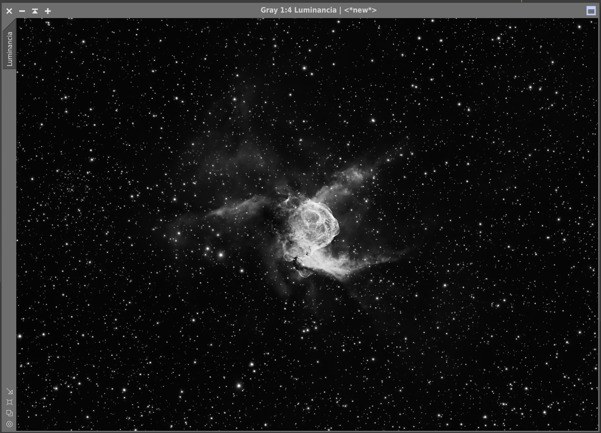

Apliquem el procés StarMask i obtenim la imatge *star_mask*; apliquem després el procés Binarize per transformar tots els píxels de la imatge en negre pur (0) o blanc pur (1), de manera que aconseguim definir l'estructura de cada estrella perfectament, és la imatge *star_mask_Binarize*.

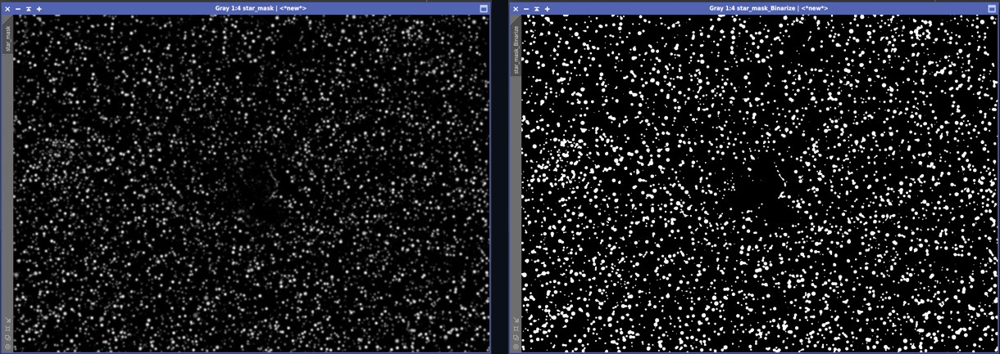

Ara podríem aplicar el procés Convolution per suavitzar els contorns; d'aquesta manera en aplicar la màscara l'efecte és molt més suau.

Aplicada directament ens permet actuar sobre les estrelles; si apliquem *Invert* a *star_mask_Binarize* podem actuar sobre tota la imatge menys les estrelles.

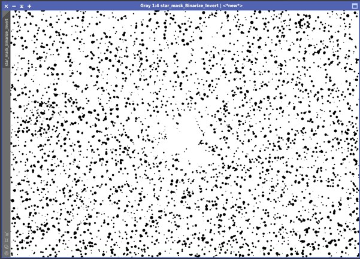

## Màscares aplicant Starnet2/StarXTerminator
Partim de la nostra imatge color i generem una primera possible màscara a partir de la component de luminància.

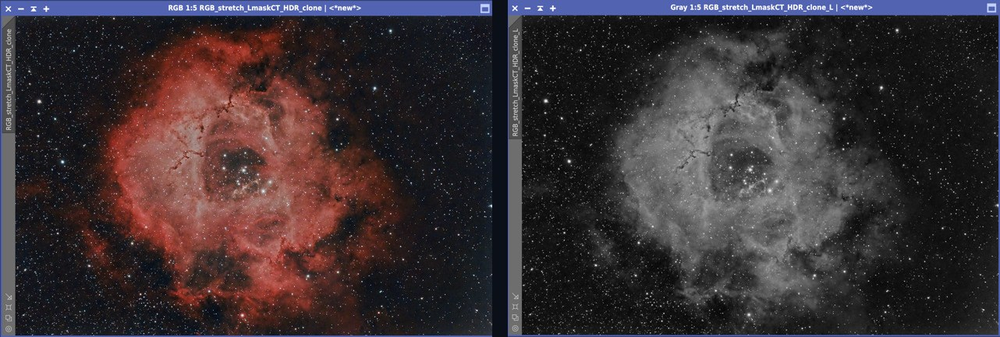

A la imatge de luminància apliquem un procés d'eliminació d'estrelles com *Starnet2* o *StarXTerminator*; obtenim la imatge *starless* i la imatge *stars*

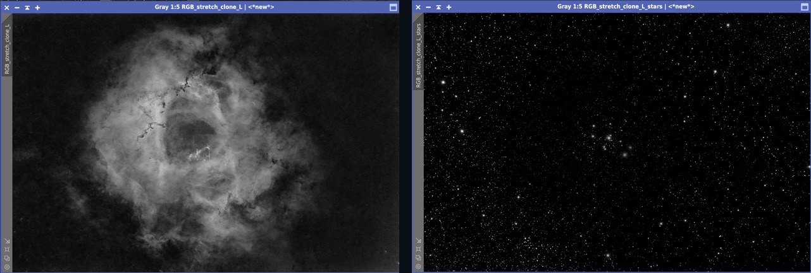

Podríem com a l'exemple anterior aplicar *Binarize* i *Convolution* per crear una màscara d'estrelles com desitgem.

Si restem la imatge stars de la imatge *starless* podem crear una màscara amb els espais de les estrelles buits al negre.

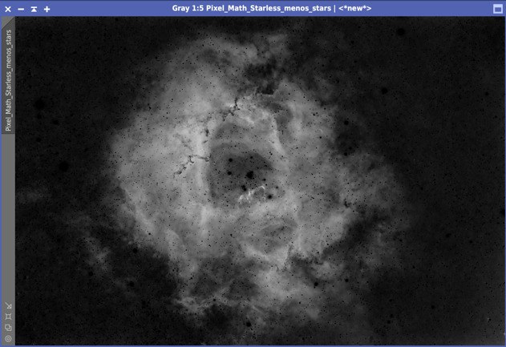

Hem aconseguit tres possibles variants de màscares a partir de la nostra imatge de partida separant les estrelles.

## Màscares amb GAME
*GAME*, és un script de PixI que ens permet de forma fàcil i molt interactiva generar màscares circulars, el·líptiques, per punts,... o una barreja d'elles. Fem: *Script/Utilities/GAME*, i se'ns mostra la següent pantalla:

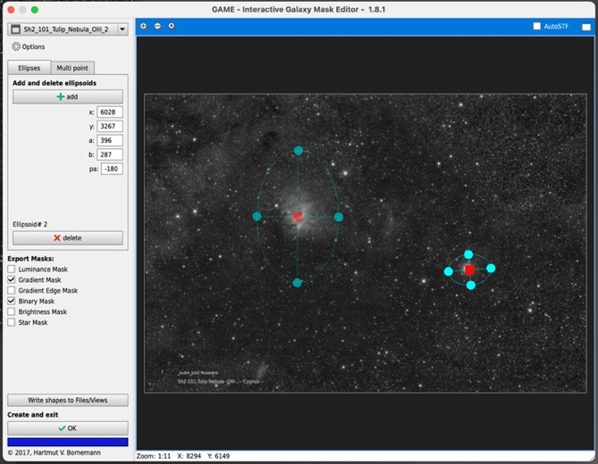

A la part esquerra podem triar afegir el·lipsoides o bé corbes a mida amb l'opció multipunt.

Podem també triar el tipus de màscara: de luminància, gradient, binària, estrelles, etc.

Com a exemple creem dues el·lipses i seleccionem una màscara de gradient i una altra binària a partir de les el·lipses que hem definit i obtenim:

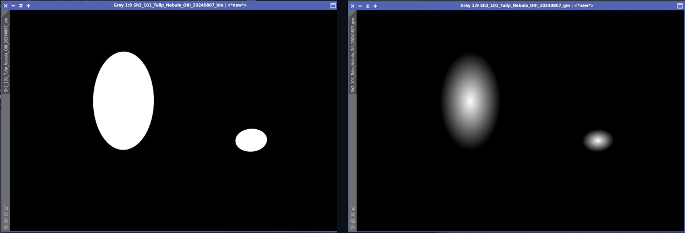

Mitjançant l'opció multipunt podem generar màscares que s'adaptin a les nostres necessitats

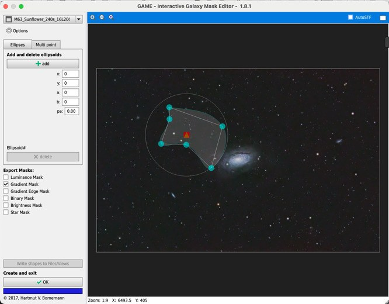

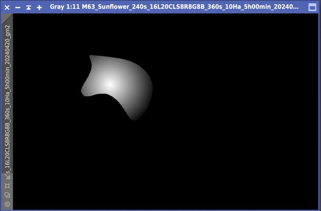

Amb aquest mètode i partint de la imatge de M 31 adjunta generarem amb *GAME* dues màscares. Amb la primera seleccionem la galàxia completa i amb la segona seleccionem el nucli.

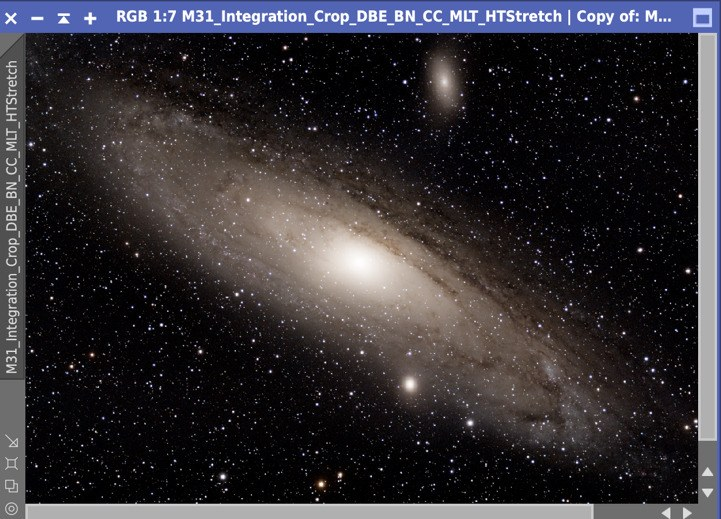

Obtenim aquestes dues imatges:

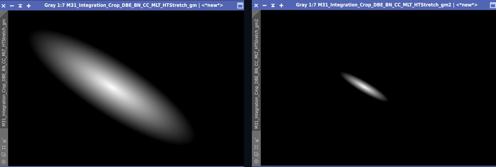

Si volem només modificar l'anell de la galàxia podem restar la segona imatge de la primera amb *PixelMath* i obtenim:

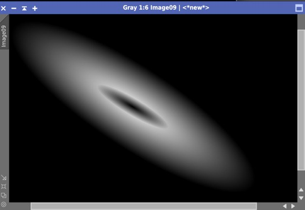

Amb aquestes tres imatges podem modificar la galàxia completa, el nucli o treballar sobre l'anell deixant intacte el nucli.

Les vores de les màscares es poden difuminar a voluntat aplicant el procés *Convolution*.

## Màscares d'estrelles utilitzant GAME + Starnet2/SXT
Anem ara amb un exemple on conjuguem la utilització de l'script *GAME* i del procés *Starnet2 o StarXTerminator (SXT)*. L'objectiu és crear una màscara que permeti eliminar les estrelles a l'interior del nostre objecte principal.

El primer que fem és aplicar *SXT* a la imatge de la Nebulosa de la Llacuna M 8 per obtenir una imatge *starless* i una altra imatge *stars*

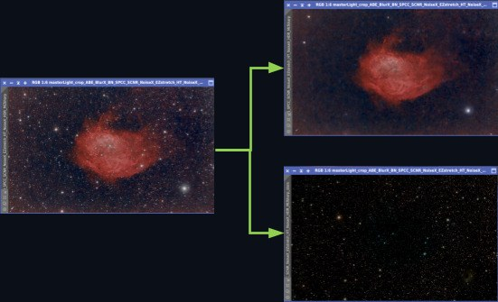

Prenent com a referència la imatge starless, apliquem *GAME* per construir mitjançant tres el·lipses el contorn aproximat de M 8:

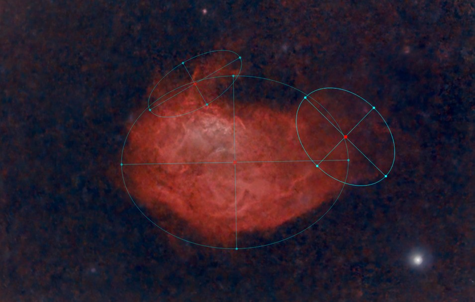

seleccionem una màscara binària i després apliquem el procés Convolution per suavitzar les vores a voluntat i obtenim una primera màscara.

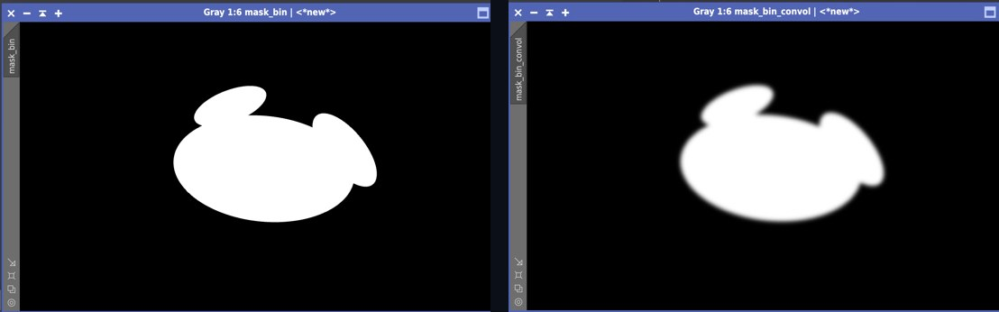

Val la pena comentar que el mateix resultat hauríem obtingut si seleccionem una màscara *Gradient Edge Mask* a l'script *GAME*.

El següent pas és restar amb *PixelMath* la màscara obtinguda a la imatge *stars* i resulta:

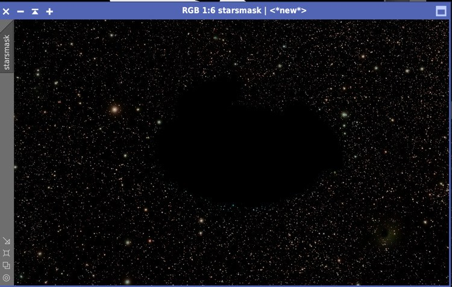

Si ara sumem també amb *PixelMath* aquestes estrelles a la imatge *starless* obtenim la imatge desitjada sense estrelles a l'objecte principal

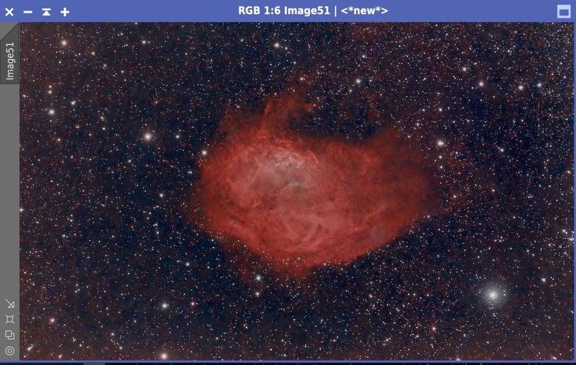

Per obtenir millors resultats hauríem d'afinar el contorn de la màscara binària i augmentar el paràmetre forma (*Shape*) a la convolució.

## Màscares mitjançant ColorMask
Una altra possibilitat molt atractiva és fer servir màscares segons un color determinat. Aquesta tècnica dóna molt bons resultats en fotografies en què la separació de colors és molt clara.

Hi ha nombrosos scripts però un simple i que funciona molt bé és: *Script/Utilities/ColorMask_mod*

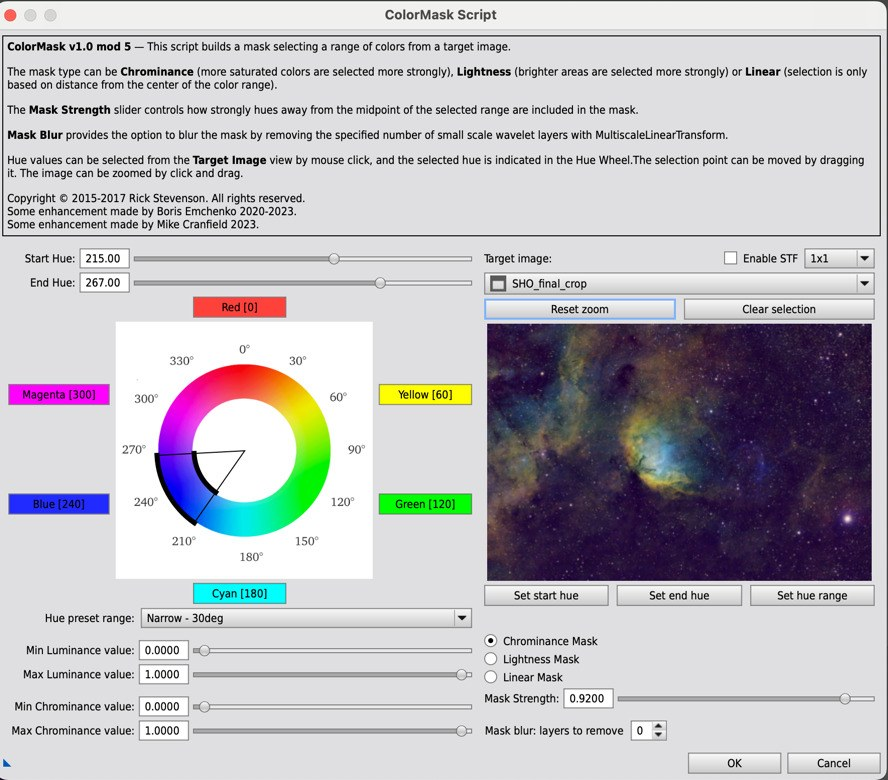

Podem triar entre sis colors predefinits, però amb *Start Hue* i *End Hue* podem seleccionar qualsevol tram del diagrama de color.

Com a exemple apliquem aquest script a la imatge de NGC 6995, anomenada de forma col·loquial Bat Nebula.

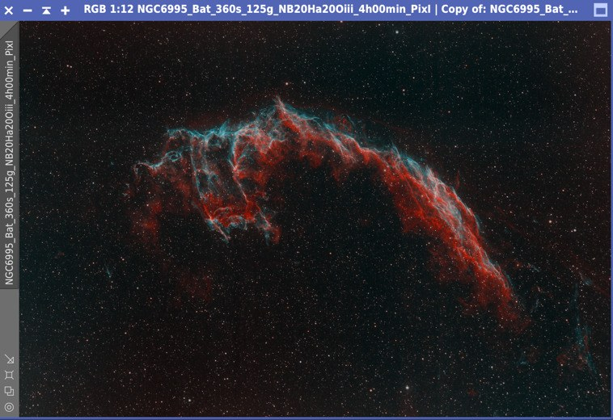

He pres una imatge starless com a punt de partida per aplicar l'script perquè així eliminem artefactes creats per parts residuals del color de les estrelles.

La primera imatge s'obté seleccionant el filtre per a color Cyan

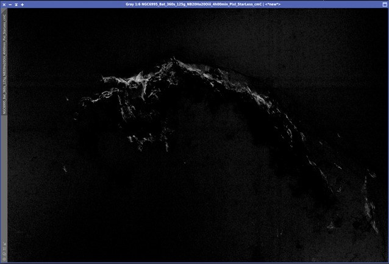

La segona correspon al filtre per a color vermell

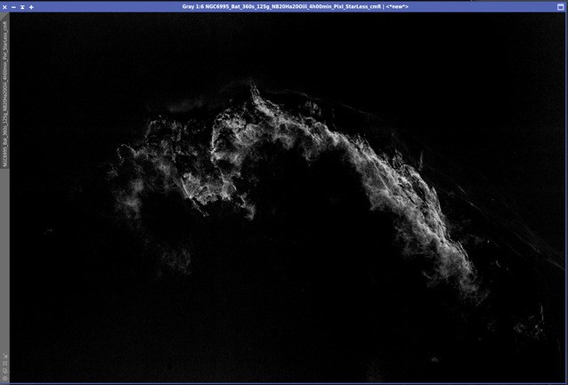

Amb aquestes dues màscares podem intensificar el color que ens interessi sense contaminar els altres

El resultat aplicant *CurvesSaturation* amb els dos filtres per separat per augmentar saturació i lluminositat *(CIE L\* component, lightness)* és el següent:

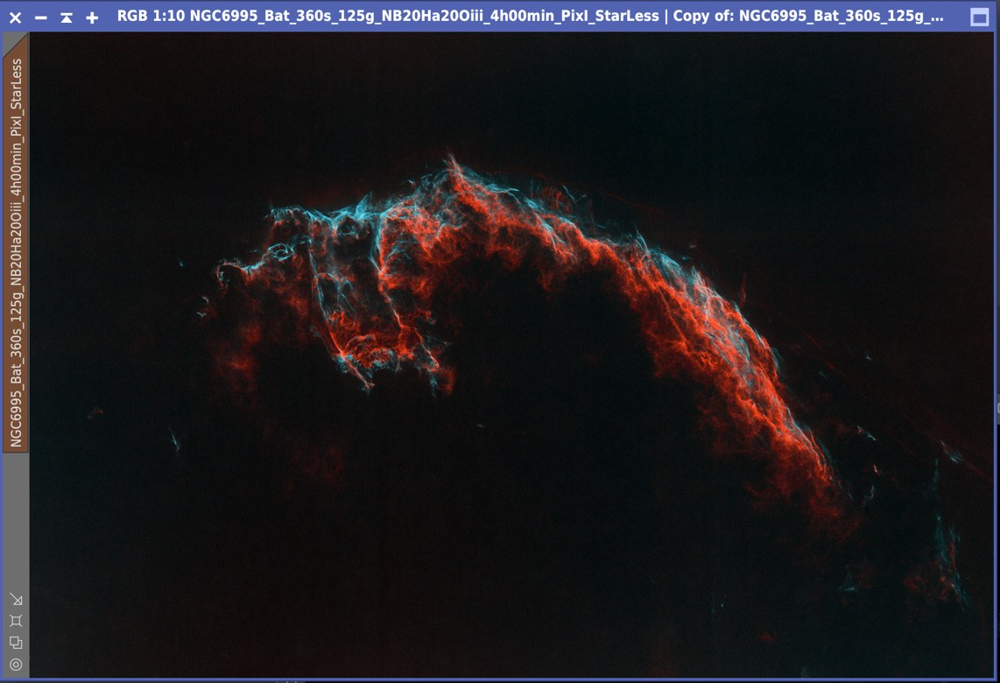

## Màscares mitjançant PixelMath
Aprofitant que *PixelMath* actua sobre cada píxel d'una imatge, podem aplicar equacions que modifiquin els seus valors segons una fórmula matemàtica.

Una fórmula útil per treballar amb franges en una imatge és la següent:

`iif(x() > D, 1 - (1 * (1 / x()) * D), $T)`, on *D* és un *Symbol* que actua com una variable ajustable a voluntat. En el nostre exemple, comencem amb *D = 3300*.

Si escrivim aquesta fórmula a *Pixel Math*:

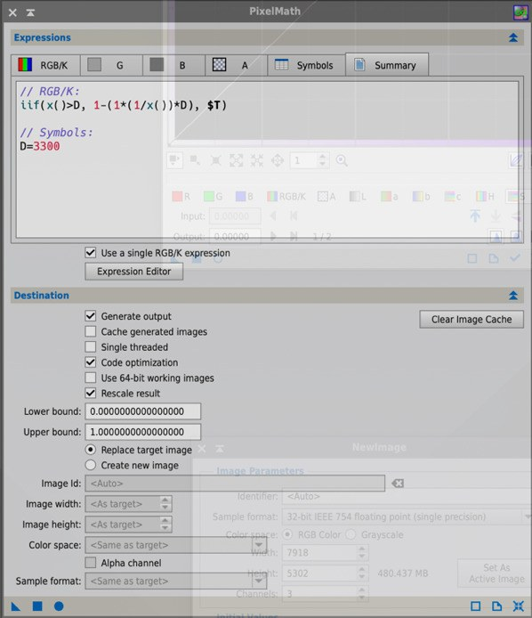

L'apliquem a una imatge negra i obtenim la següent:

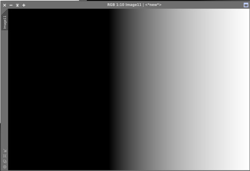

Si augmentem el valor del *Symbol D* a 5300 desplacem cap a la dreta la zona més clara.

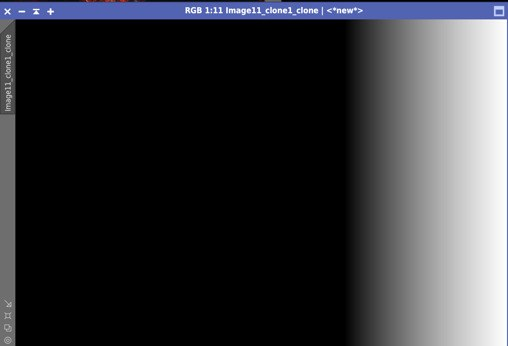

Aquesta màscara pot ser útil, per exemple, quan tenim imatges amb una zona més clara en forma de franja vertical per influència de la llum de la Lluna; podem actuar sobre ella salvaguardant la resta de la fotografia.

Una altra forma de generar gradients horitzontals poden ser:

`x( )` — `w( )-x( )`

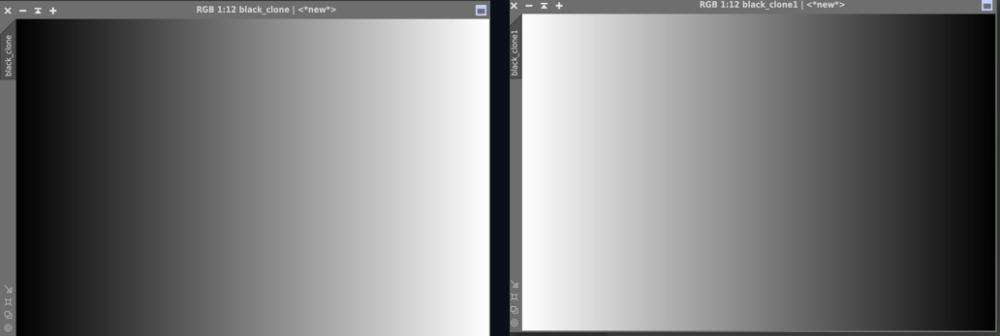

i per a gradients verticals:

`y( )` — `h( )-y( )`

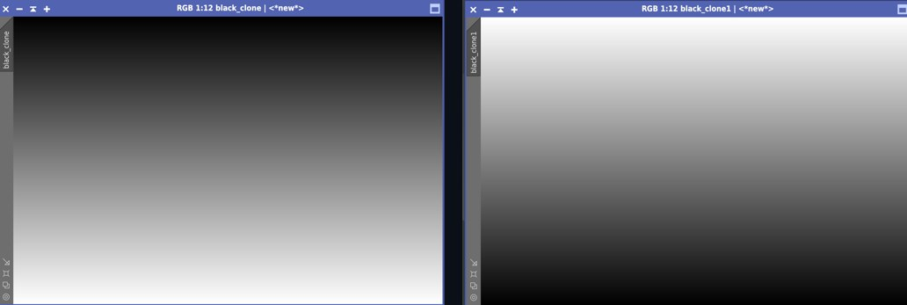

Una altra fórmula útil si volem aplicar un procés en una cantonada de les nostres imatges és la següent:

`(1-2*(w()-X()))*(1-2*(h()-Y()))`, que quan s'aplica a una imatge negra resulta:

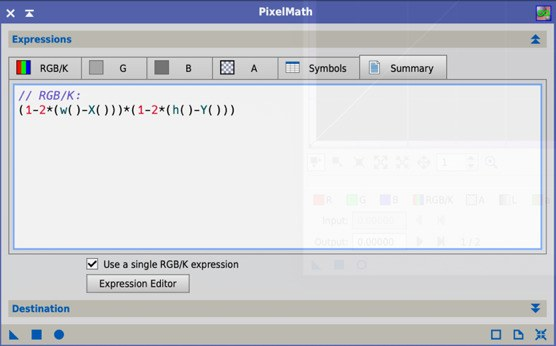

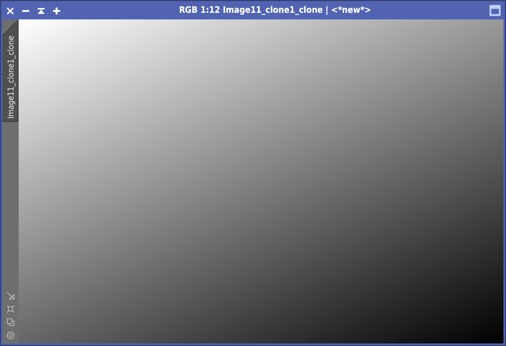

Amb la següent equació:

`(1-2*(X()))*(1-2*(Y()))`

resulta la imatge adjunta

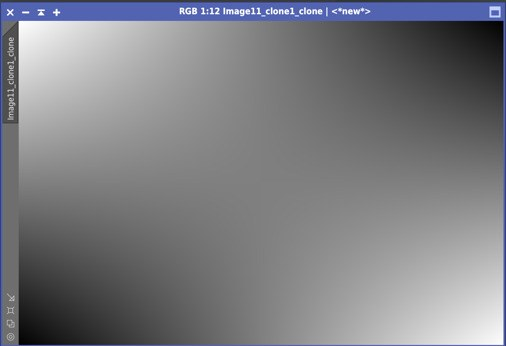

Altres exemples resultants de variar els coeficients a la fórmula anterior:

`1-2*(X()))*(1-8*(Y()))` — `(1-6*(X()))*(1-1.5*(Y()))`

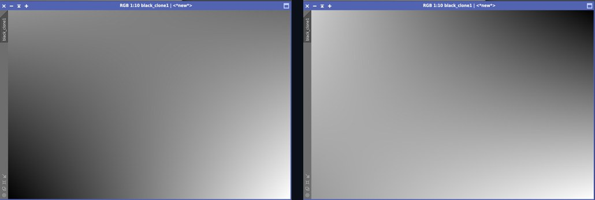

Aquest tipus de màscares i/o les seves inverses, ens permeten explorar una altra manera de solucionar problemes de contaminació a les nostres fotografies.

## Màscares utilitzades en scripts
Dins la multitud de scripts que hi ha disponibles, tenim un interessant paquet anomenat *Toolbox*. Ho podem obtenir al repositori: [https://www.ideviceapps.de/PixInsight/Utilities/](https://www.ideviceapps.de/PixInsight/Utilities/); un d'aquests scripts s'utilitza per al tractament del color.

Aquest script s'anomena *SelectiveColorCorrection* i el motiu per parlar-ne és perquè utilitza les màscares per modificar el color i ho fa d'una manera molt intuïtiva.

La pantalla general és:

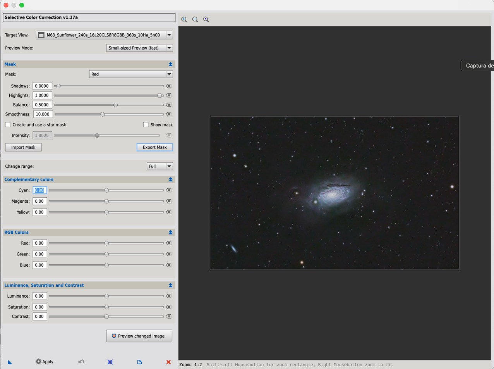

L'script ens permet modificar els colors RGB, els colors complementaris i la luminància així com la saturació i el contrast de la imatge activa.

El més interessant és que permet aplicar una màscara creada per nosaltres o triar entre les 13 màscares preseleccionades que ofereix

D'aquestes, sis són màscares de color, dues de saturació i quatre de nivell de senyal; la darrera fa referència a la importació d'una màscara creada per nosaltres.

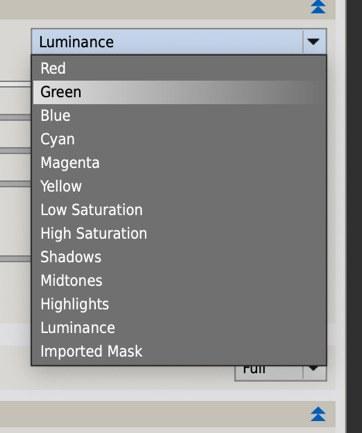

També podem ajustar quatre paràmetres per configurar la màscara com desitgem.

A més, hi ha la possibilitat d'exportar la màscara i fer-la servir fora d'aquest script.

---

Amb aquesta opció per generar les nostres màscares, hem arribat al final del recorregut.

Espero haver contribuït a que ara entenguis millor i puguis treure el màxim profit d'aquesta eina tan potent que són les màscares a PixInsight.

Fins a la propera amics, Cels clars !!
