El objetivo de este artículo es ofrecer una visión general del concepto de máscara en PixInsight, explicando cómo crearlas y en qué situaciones aplicarlas.

A menudo, cuando realizamos transformaciones en nuestras imágenes, queremos hacerlo de forma selectiva, evitando afectar a la totalidad de la imagen. Por ejemplo, podríamos querer trabajar el fondo sin alterar el objeto principal o viceversa. También es habitual querer procesar las estrellas de manera independiente al resto de la imagen, o resaltar determinadas zonas específicas.

PixInsight nos ofrece la posibilidad de conseguir esta selección precisa mediante el uso de máscaras.

Para entender este concepto, podemos compararlo con una diapositiva en fotografía convencional: las zonas más claras permiten el paso de la luz, mientras que las áreas más oscuras la bloquean, siendo el negro el que detiene la luz por completo. Mantengamos esta idea en mente.

En el ámbito digital, una imagen es una matriz de píxeles organizados y perfectamente identificados. Al aplicar un proceso sobre la imagen, realizamos operaciones matemáticas sobre cada uno de esos píxeles. Aquí entra en juego la máscara, que actúa como un filtro y permite que estas operaciones se apliquen de manera proporcional según su opacidad: el blanco indica una aplicación del 100 % y el negro del 0 %.

Así, el concepto es parecido al de la diapositiva, pero en lugar de controlar la cantidad de luz que la atraviesa, ajustamos la intensidad con la que se aplica la operación matemática a cada píxel de la imagen.

Para entenderlo, veamos un ejemplo.

Supongamos una máscara como esta, a la que hemos llamado "mask_bin".

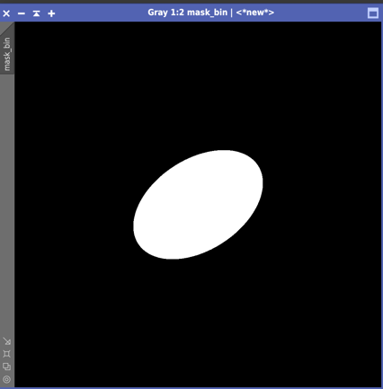

y la aplicamos a una imagen RGB del mismo tamaño y de color gris.

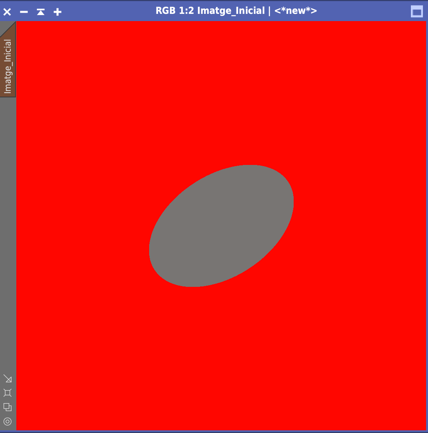

Podemos ver que las partes protegidas aparecen de color rojo, más intenso cuanto mayor es la protección, y las partes no protegidas se muestran sin cambio de color, con el gris de la imagen de partida.

Ahora, para comprobar el efecto de la máscara, aplicamos con *CurvesTransformation* color verde a la imagen y el resultado es:

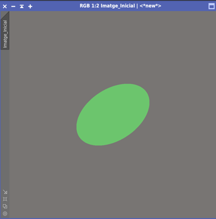

¡¡El color verde solo se ha aplicado a la parte no protegida!!

y si aplicamos esta otra máscara con los bordes difuminados, vemos cómo varía la intensidad del color de la elipse verde en función del degradado:

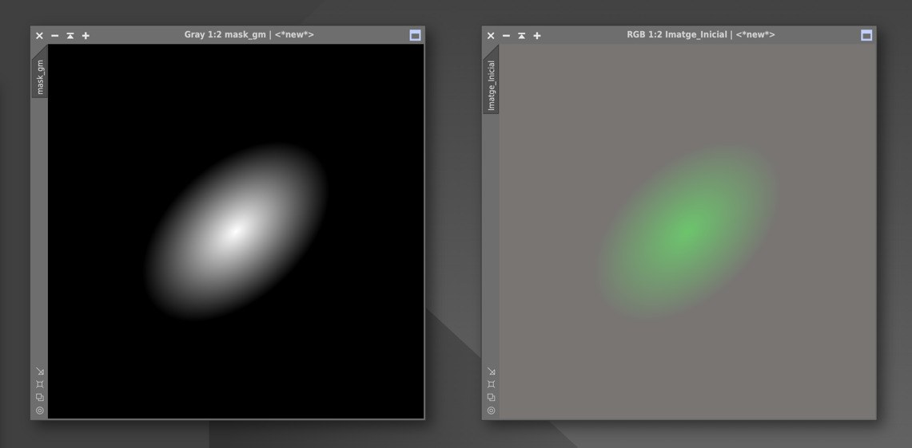

## Consideraciones
Para que PixInsight acepte una imagen como máscara debe cumplir las siguientes condiciones:

- Para utilizar una imagen como máscara de otra, ambas deben tener exactamente las mismas dimensiones en píxeles (x, y).
- Las máscaras deben ser imágenes no lineales.
- Las imágenes en escala de grises solo aceptan máscaras en escala de grises.
- Las imágenes en color aceptan máscaras en color o en escala de grises.

## Aplicar y trabajar con máscaras
Para aplicar una máscara "mask" a una imagen "imagen_principal", activamos "imagen_principal" haciendo clic sobre ella.

Utilizamos la opción del menú principal: */Mask/SelectMask* y seleccionamos en el cuadro de diálogo la imagen "mask".

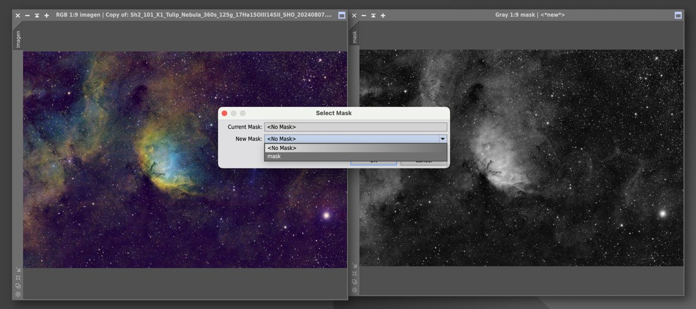

Cuando la máscara queda aplicada, el color de fondo de la pestaña de la imagen se vuelve marrón o naranja; esta es la forma de saber que tenemos una máscara aplicada.

Si no sabemos qué máscara tenemos aplicada, usamos: */Mask/SelectMask* y podremos ver la máscara actual en "Current Mask" y las máscaras disponibles en "New Mask".

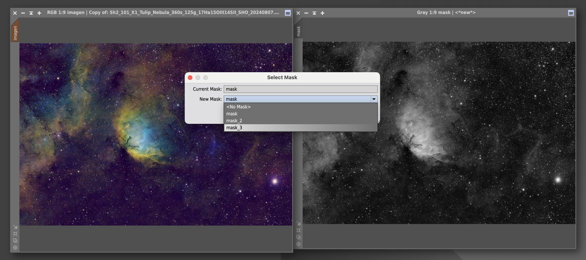

En la barra de herramientas disponemos de las opciones necesarias para trabajar con las máscaras:

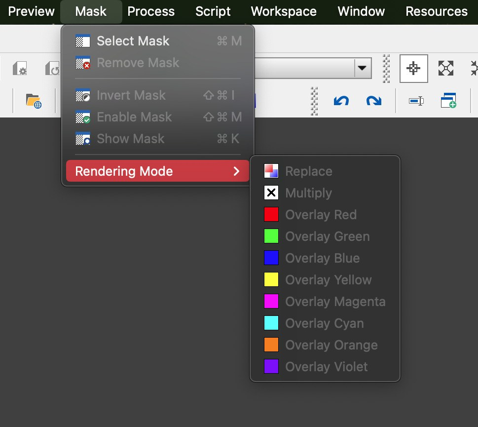

- *Select Mask:* Permite mostrar y seleccionar una máscara entre las disponibles para la imagen seleccionada; si esta ya tiene una máscara aplicada, muestra su nombre.
- *Remove Mask:* Elimina la máscara de la imagen seleccionada.
- *Invert Mask*: Invierte la máscara.
- *Enable Mask:* Permite activar o desactivar la máscara de la imagen seleccionada.
- *Show Mask:* Permite mostrar u ocultar la máscara de la imagen seleccionada.
- *Rendering Mode:* Permite seleccionar el color utilizado para mostrar la máscara.

Cuando hemos aplicado una máscara a una imagen podemos modificar las características de la máscara, normalmente oscurecerla o aclararla, para cambiar el nivel de protección, o invertirla para alternar entre objeto y fondo.

¡¡No podemos modificar el tamaño de la máscara!!

## Aplicaciones de las máscaras
Las máscaras son herramientas versátiles que pueden emplearse para una amplia variedad de propósitos. Entre los más habituales se encuentran:

- Aislar el objeto principal del fondo para aplicar ajustes de manera independiente a cada uno.
- Separar las estrellas de una imagen para trabajar específicamente sobre ellas.
- Eliminar las estrellas de una imagen para trabajar en una versión starless.
- Modificar colores o características de manera selectiva.
- Intervenir en áreas específicas de la imagen.

Existen numerosos métodos para crear y manipular máscaras. A continuación exploraremos los fundamentos y algunas técnicas para crear máscaras personalizadas según nuestras necesidades específicas.

## Máscaras de luminancia
La máscara más básica y probablemente la más utilizada consiste en obtener la componente de luminancia de nuestra imagen: *Image/Extract/Lightness(CIE L\*)*

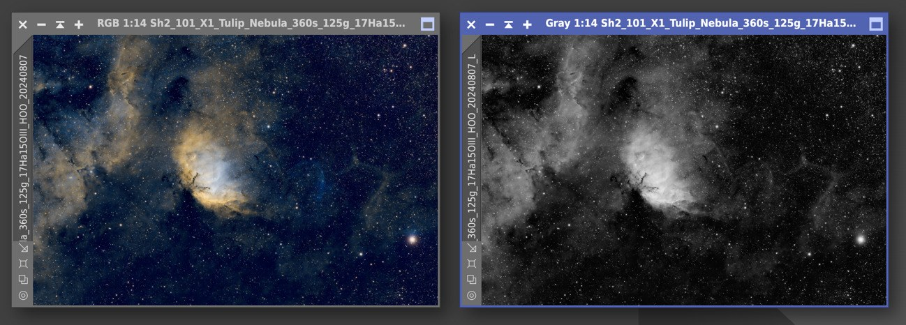

La aplicación inmediata consiste en diferenciar entre el objeto y el fondo para modificar aquello que nos interese. Invirtiendo la máscara seleccionamos uno u otro, como en los ejemplos siguientes:

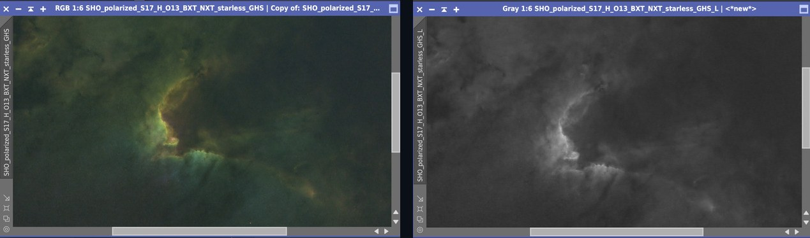

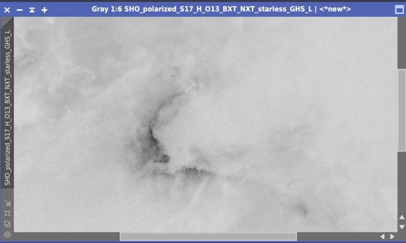

Esta máscara invertida nos serviría para modificar características del fondo.

Otro ejemplo de máscara directa:

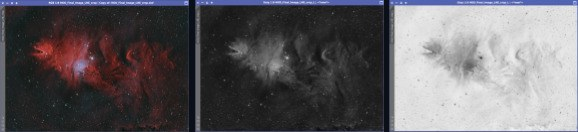

Como hemos comentado, el color negro protege al 100 % y el blanco supone transparencia total.

Podemos oscurecer estas máscaras a nuestro gusto modificando el histograma con *HistogramTransformation* o aplicando *CurvesTransformation*.

## Máscaras mediante ACDNR
Otra forma de obtener una máscara de luminancia es mediante el proceso *Adaptative Contrast-Driven Noise Reduction*, más conocido como *ACDNR*. Es una buena herramienta para reducir el ruido de una imagen o suavizar una imagen o una máscara. Tiene la ventaja de que podemos activar *Real-time Preview* y ver cómo queda la imagen a medida que la modificamos.

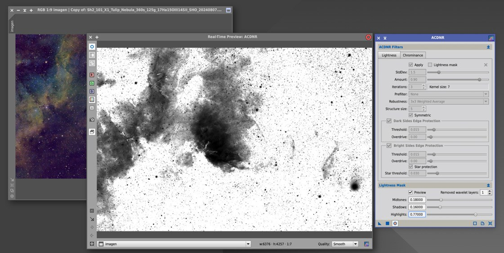

Pero lo que utilizaremos aquí de este proceso es la sección correspondiente a *Lightness Mask*. Minimizamos la sección de *ACDNR Filters* y ampliamos la de *Lightness Mask*.

Podemos crear fácilmente una máscara mediante la previsualización en tiempo real y modificar los tonos medios (*Midtones*), las sombras (*Shadows*) y las altas luces (*Highlights*).

Con los parámetros de la figura obtenemos una máscara de luminancia muy contrastada; modificando los controles deslizantes de los tres parámetros podemos variar inmediatamente el resultado.

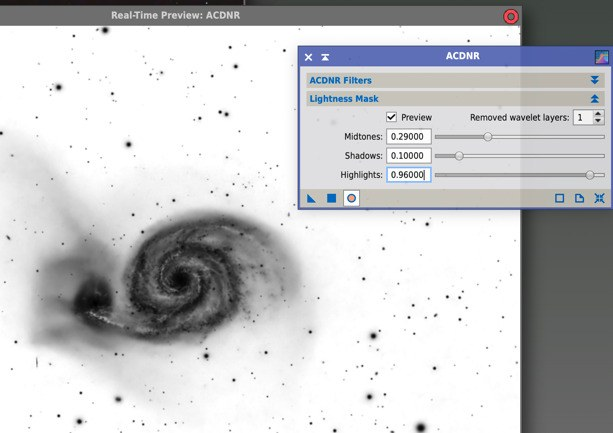

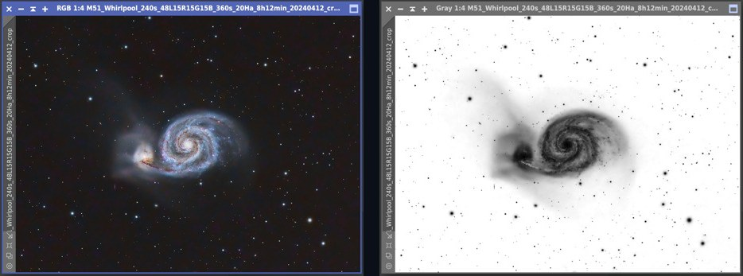

## Máscaras mediante RangeSelection
El proceso *RangeSelection* crea una imagen en escala de grises basándose en la imagen activa, con ajustes de los límites superior e inferior del valor de píxel. Primero definimos un intervalo de valores de píxel válidos y después *RangeSelection* crea una nueva imagen en la que los píxeles de la imagen de destino situados dentro de ese intervalo son blancos y los píxeles situados fuera se interpretan como negros.

*RangeSelection* se utiliza casi exclusivamente para crear máscaras basadas en la luminancia o luminosidad.

La interfaz es sencilla y resulta imprescindible utilizar *Real-Time Preview* para ver los resultados obtenidos al modificar los controles deslizantes.

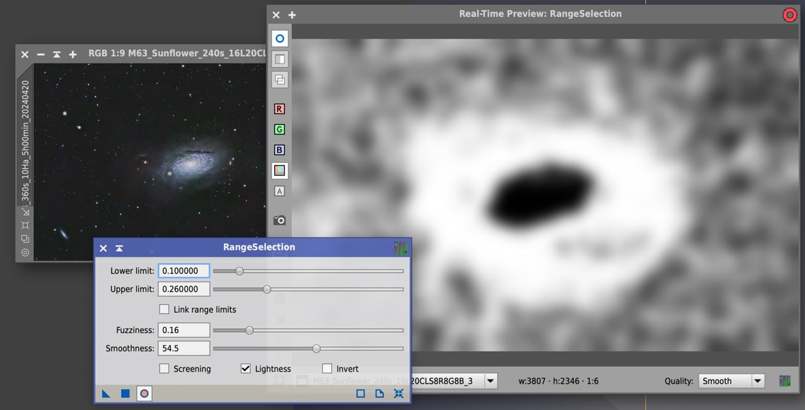

Este proceso no modifica la imagen activa y crea una imagen nueva denominada *range_mask*.

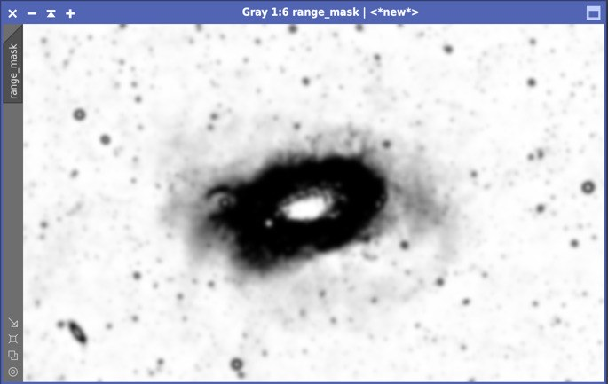

## Máscaras de estrellas con StarMask
Las siguientes máscaras más utilizadas son las máscaras de estrellas. Una forma de generarlas es mediante el proceso: *Process/MaskGeneration/StarMask*

La aplicación habitual consiste en filtrar las estrellas y mejorar su color; también podemos "ocultarlas" para trabajar sobre el objeto principal.

Partiendo de la máscara de luminancia adjunta:

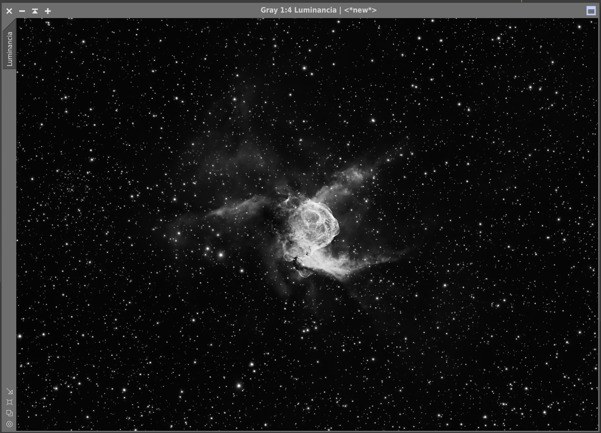

Aplicamos el proceso StarMask y obtenemos la imagen *star_mask*; después aplicamos el proceso Binarize para transformar todos los píxeles de la imagen en negro puro (0) o blanco puro (1). De esta manera conseguimos definir perfectamente la estructura de cada estrella; es la imagen *star_mask_Binarize*.

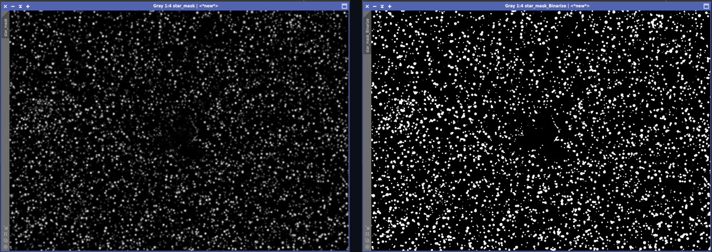

Ahora podríamos aplicar el proceso Convolution para suavizar los contornos; de esta forma, al aplicar la máscara, el efecto resulta mucho más suave.

Aplicada directamente nos permite actuar sobre las estrellas; si aplicamos *Invert* a *star_mask_Binarize* podemos actuar sobre toda la imagen excepto las estrellas.

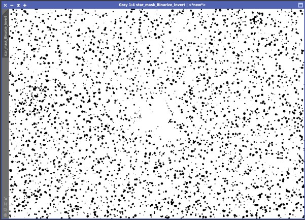

## Máscaras aplicando Starnet2/StarXTerminator
Partimos de nuestra imagen en color y generamos una primera máscara posible a partir de la componente de luminancia.

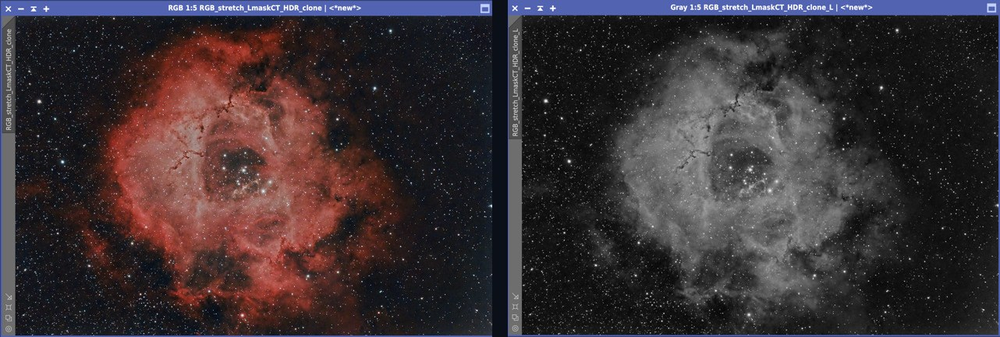

A la imagen de luminancia le aplicamos un proceso de eliminación de estrellas como *Starnet2* o *StarXTerminator*; obtenemos la imagen *starless* y la imagen *stars*.

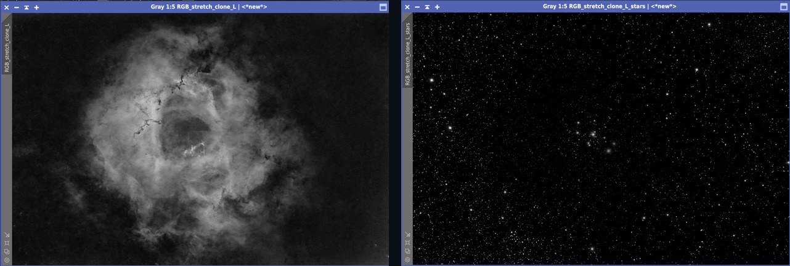

Como en el ejemplo anterior, podríamos aplicar *Binarize* y *Convolution* para crear la máscara de estrellas que deseemos.

Si restamos la imagen stars de la imagen *starless* podemos crear una máscara con los espacios vacíos de las estrellas en negro.

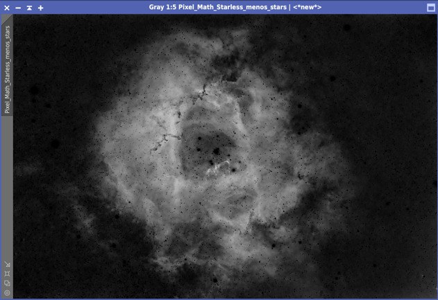

Hemos conseguido tres posibles variantes de máscaras a partir de nuestra imagen inicial, separando las estrellas.

## Máscaras con GAME
*GAME* es un script de PixInsight que nos permite generar de forma sencilla y muy interactiva máscaras circulares, elípticas, por puntos o una combinación de ellas. Abrimos: *Script/Utilities/GAME*, y aparece la pantalla siguiente:

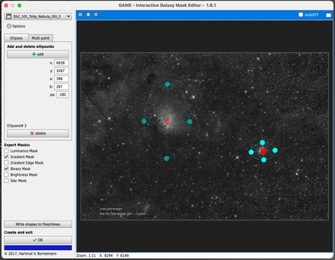

En la parte izquierda podemos añadir elipsoides o bien curvas personalizadas mediante la opción multipunto.

También podemos elegir el tipo de máscara: luminancia, gradiente, binaria, estrellas, etc.

Como ejemplo creamos dos elipses y seleccionamos una máscara de gradiente y otra binaria a partir de las elipses que hemos definido. Obtenemos:

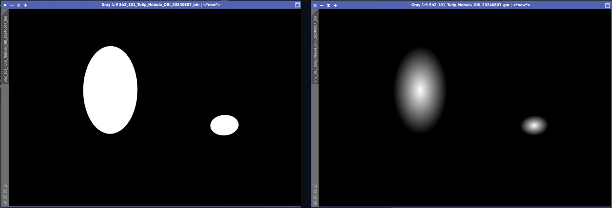

Mediante la opción multipunto podemos generar máscaras que se adapten a nuestras necesidades.

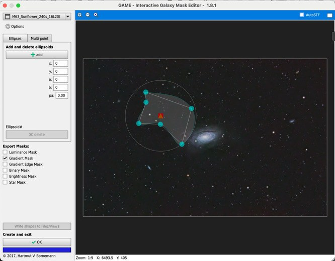

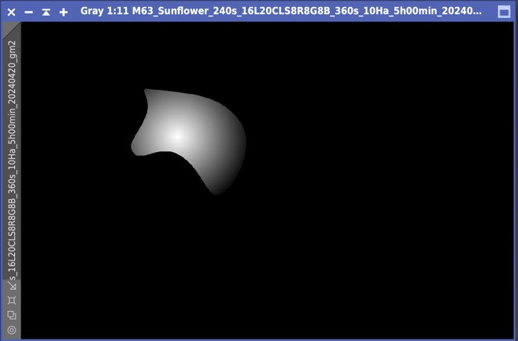

Con este método, y partiendo de la imagen adjunta de M 31, generaremos dos máscaras con *GAME*. Con la primera seleccionamos la galaxia completa y con la segunda seleccionamos el núcleo.

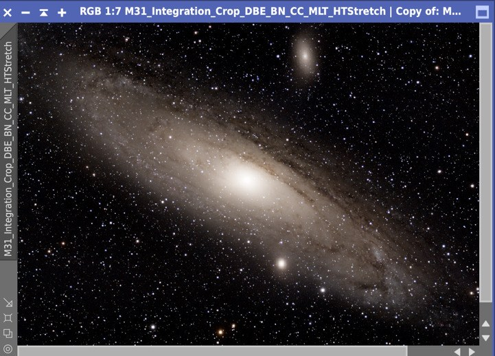

Obtenemos estas dos imágenes:

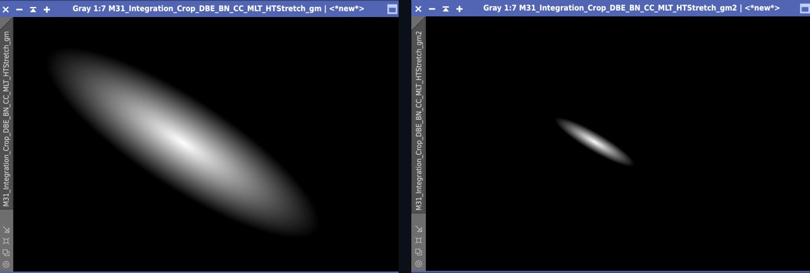

Si solo queremos modificar el anillo de la galaxia, podemos restar la segunda imagen de la primera con *PixelMath* y obtenemos:

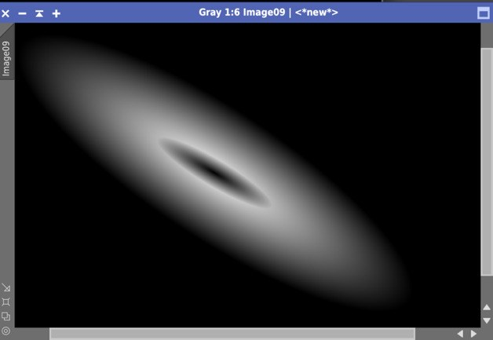

Con estas tres imágenes podemos modificar la galaxia completa, el núcleo o trabajar sobre el anillo dejando intacto el núcleo.

Los bordes de las máscaras pueden difuminarse a voluntad aplicando el proceso *Convolution*.

## Máscaras de estrellas utilizando GAME + Starnet2/SXT
Veamos ahora un ejemplo en el que combinamos la utilización del script *GAME* y del proceso *Starnet2 o StarXTerminator (SXT)*. El objetivo es crear una máscara que permita eliminar las estrellas del interior de nuestro objeto principal.

Lo primero que hacemos es aplicar *SXT* a la imagen de la nebulosa de la Laguna M 8 para obtener una imagen *starless* y otra imagen *stars*.

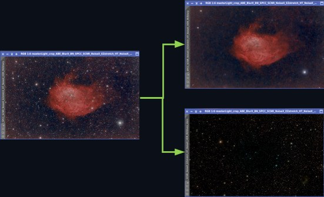

Tomando como referencia la imagen starless, aplicamos *GAME* para construir mediante tres elipses el contorno aproximado de M 8:

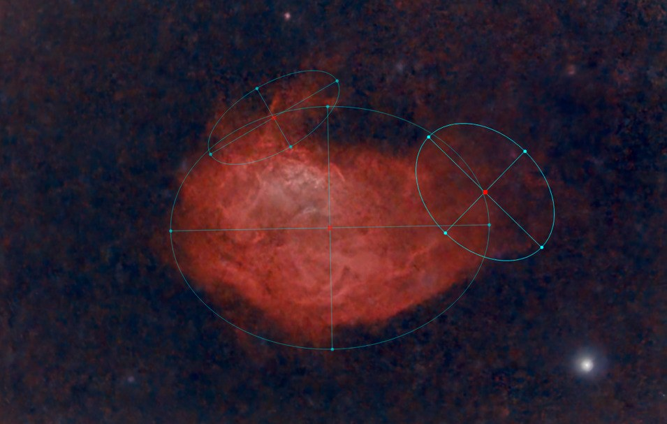

seleccionamos una máscara binaria y después aplicamos el proceso Convolution para suavizar los bordes a voluntad y obtenemos una primera máscara.

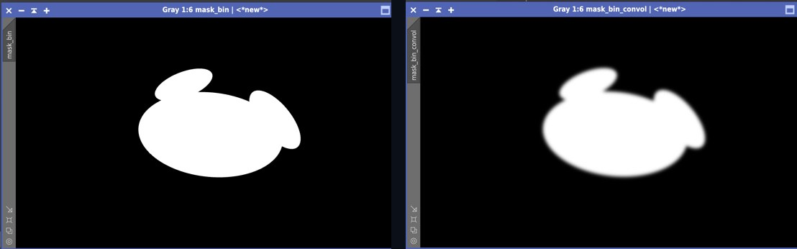

Conviene comentar que habríamos obtenido el mismo resultado seleccionando una máscara *Gradient Edge Mask* en el script *GAME*.

El siguiente paso consiste en restar con *PixelMath* la máscara obtenida de la imagen *stars*. El resultado es:

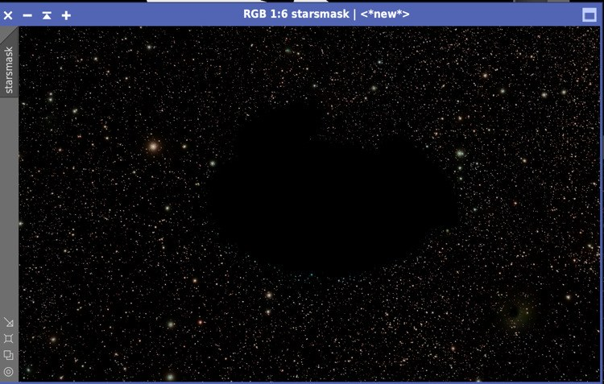

Si ahora sumamos también con *PixelMath* estas estrellas a la imagen *starless*, obtenemos la imagen deseada sin estrellas en el objeto principal.

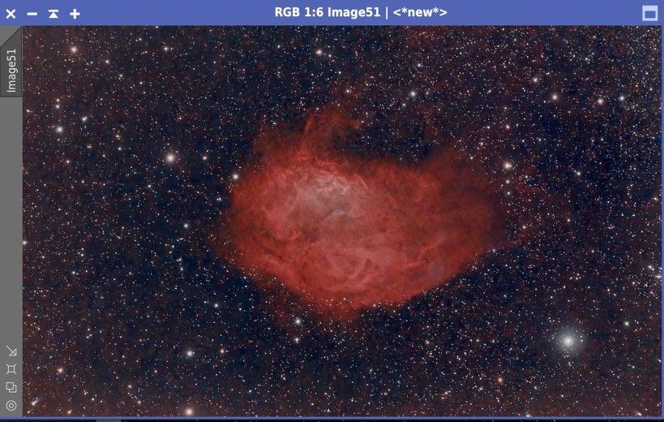

Para obtener mejores resultados deberíamos afinar el contorno de la máscara binaria y aumentar el parámetro de forma (*Shape*) en la convolución.

## Máscaras mediante ColorMask
Otra posibilidad muy atractiva consiste en utilizar máscaras según un color determinado. Esta técnica ofrece muy buenos resultados en fotografías en las que la separación de colores es muy clara.

Existen numerosos scripts, pero uno sencillo que funciona muy bien es: *Script/Utilities/ColorMask_mod*

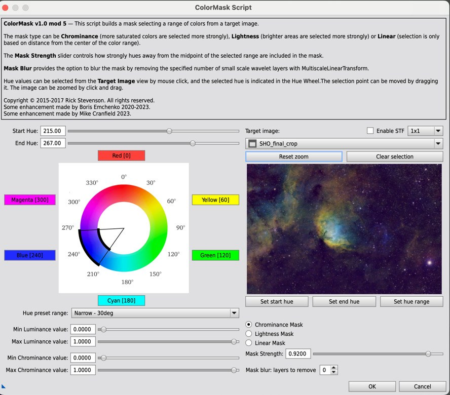

Podemos elegir entre seis colores predefinidos, pero con *Start Hue* y *End Hue* podemos seleccionar cualquier intervalo del diagrama de color.

Como ejemplo aplicamos este script a la imagen de NGC 6995, denominada coloquialmente Bat Nebula.

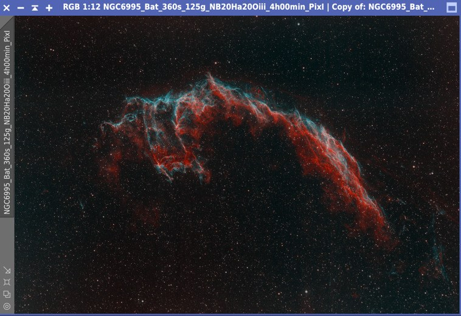

He tomado una imagen starless como punto de partida para aplicar el script, porque así eliminamos los artefactos creados por partes residuales del color de las estrellas.

La primera imagen se obtiene seleccionando el filtro para el color cian.

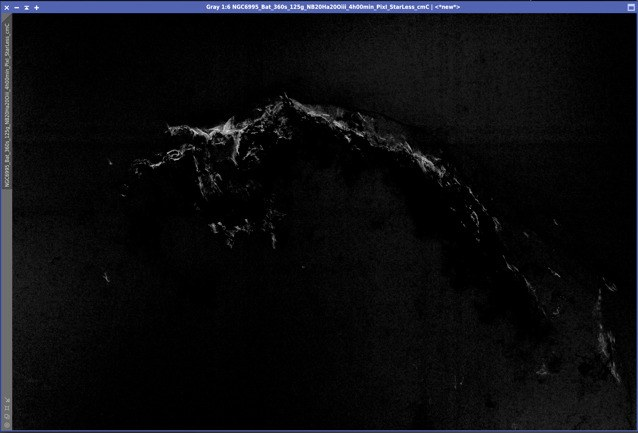

La segunda corresponde al filtro para el color rojo.

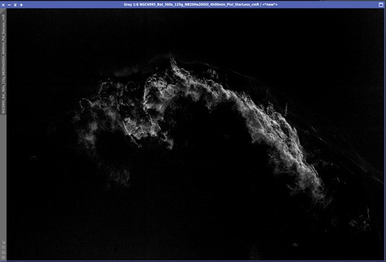

Con estas dos máscaras podemos intensificar el color que nos interese sin contaminar los demás.

El resultado de aplicar *CurvesSaturation* con los dos filtros por separado para aumentar la saturación y la luminosidad *(CIE L\* component, lightness)* es el siguiente:

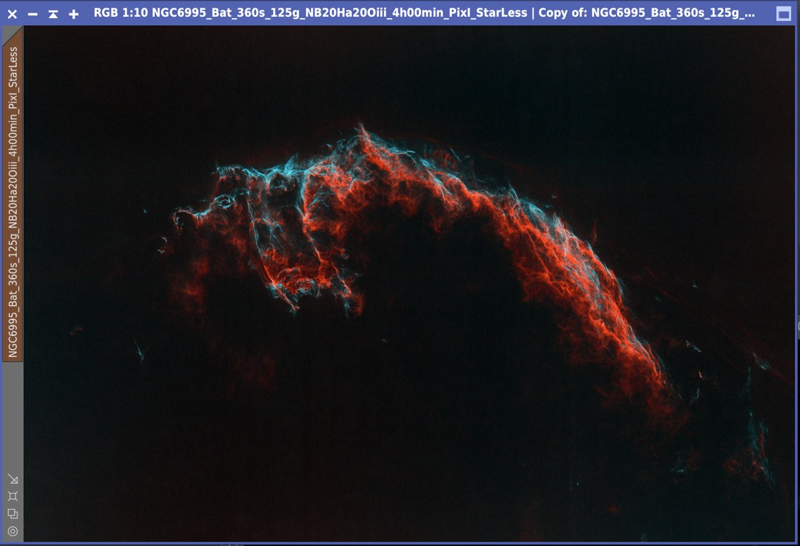

## Máscaras mediante PixelMath
Aprovechando que *PixelMath* actúa sobre cada píxel de una imagen, podemos aplicar ecuaciones que modifiquen sus valores según una fórmula matemática.

Una fórmula útil para trabajar con franjas en una imagen es la siguiente:

`iif(x() > D, 1 - (1 * (1 / x()) * D), $T)`, donde *D* es un *Symbol* que actúa como variable ajustable a voluntad. En nuestro ejemplo comenzamos con *D = 3300*.

Si escribimos esta fórmula en *Pixel Math*:

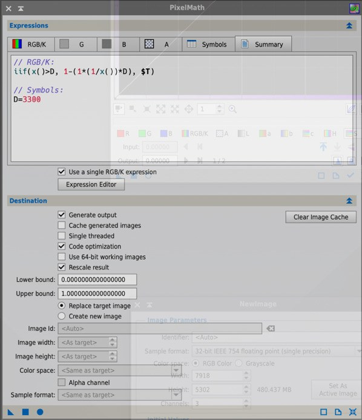

La aplicamos a una imagen negra y obtenemos lo siguiente:

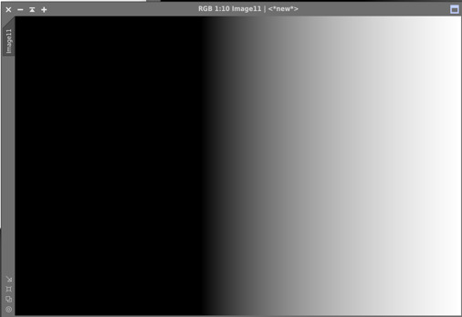

Si aumentamos el valor del *Symbol D* a 5300 desplazamos hacia la derecha la zona más clara.

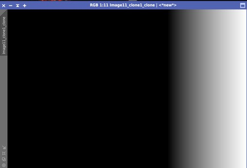

Esta máscara puede ser útil, por ejemplo, cuando tenemos imágenes con una zona más clara en forma de franja vertical por influencia de la luz de la Luna; podemos actuar sobre ella protegiendo el resto de la fotografía.

Otra forma de generar gradientes horizontales puede ser:

`x( )` — `w( )-x( )`

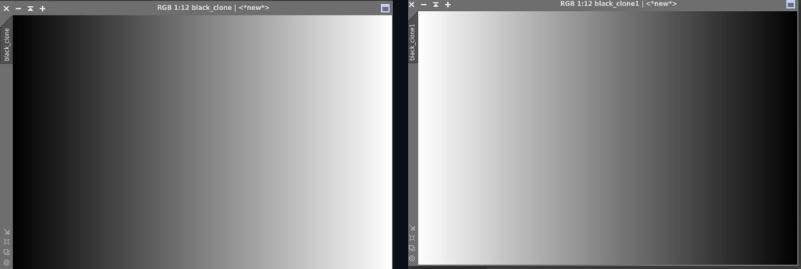

y para gradientes verticales:

`y( )` — `h( )-y( )`

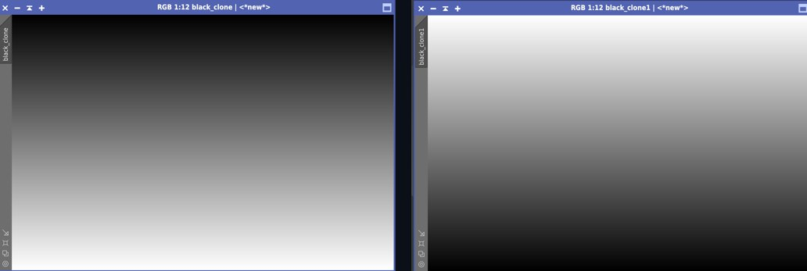

Otra fórmula útil si queremos aplicar un proceso en una esquina de nuestras imágenes es la siguiente:

`(1-2*(w()-X()))*(1-2*(h()-Y()))`, que al aplicarse a una imagen negra produce:

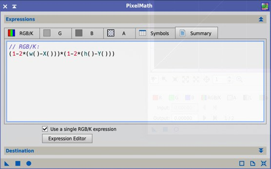

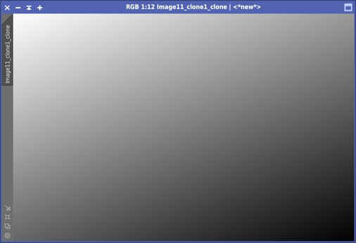

Con la siguiente ecuación:

`(1-2*(X()))*(1-2*(Y()))`

se obtiene la imagen adjunta.

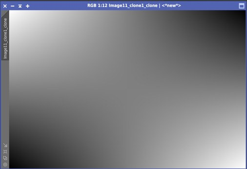

Otros ejemplos resultantes de variar los coeficientes de la fórmula anterior:

`1-2*(X()))*(1-8*(Y()))` — `(1-6*(X()))*(1-1.5*(Y()))`

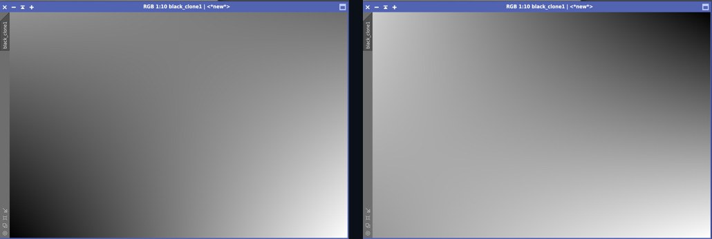

Este tipo de máscaras y sus inversas nos permiten explorar otra manera de solucionar problemas de contaminación en nuestras fotografías.

## Máscaras utilizadas en scripts
Entre la multitud de scripts disponibles encontramos un interesante paquete denominado *Toolbox*. Podemos obtenerlo en el repositorio: [https://www.ideviceapps.de/PixInsight/Utilities/](https://www.ideviceapps.de/PixInsight/Utilities/); uno de estos scripts se utiliza para el tratamiento del color.

Este script se denomina *SelectiveColorCorrection* y el motivo para hablar de él es que utiliza máscaras para modificar el color y lo hace de una manera muy intuitiva.

La pantalla general es:

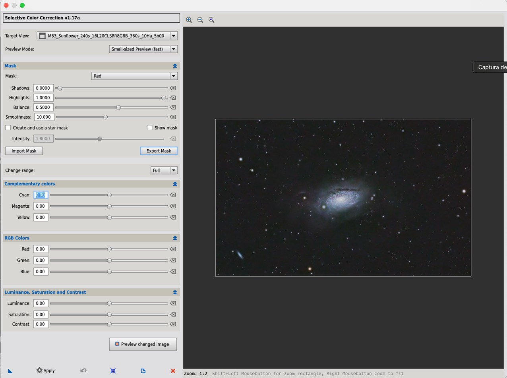

El script nos permite modificar los colores RGB, los colores complementarios y la luminancia, así como la saturación y el contraste de la imagen activa.

Lo más interesante es que permite aplicar una máscara creada por nosotros o elegir entre las 13 máscaras preseleccionadas que ofrece.

De estas, seis son máscaras de color, dos de saturación y cuatro de nivel de señal; la última permite importar una máscara creada por nosotros.

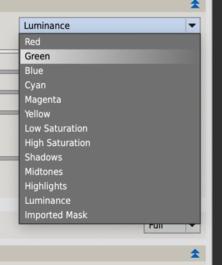

También podemos ajustar cuatro parámetros para configurar la máscara como deseemos.

Además, existe la posibilidad de exportar la máscara y utilizarla fuera de este script.

---

Con esta opción para generar nuestras máscaras hemos llegado al final del recorrido.

Espero haber contribuido a que ahora entiendas mejor y puedas aprovechar al máximo esta herramienta tan potente que son las máscaras en PixInsight.

Hasta la próxima, amigos. ¡¡Cielos despejados!!
