## Inici
L'equip de Pleiades Astrofoto va llançar cap al 2007 un programa que amb el temps s'ha convertit en un dels preferits per astrofotògrafs de tot el món per al processament de les seves fotografies; ho van batejar com a PixInsight.

Va néixer i és mantingut des de la localitat de Pobla de Vallbona, València, on Pleiades Astrofoto té la seva caserna general. És una aplicació totalment en anglès i així continuarà sent perquè els creadors aposten per aplicar els esforços a millorar el programari i no a realitzar treballs de traducció. Els fòrums segueixen en general el mateix criteri.

Aquí farem servir la nomenclatura anglesa que s'utilitza a PixI per no crear confusió.

Com a curiositat, comentar que la paraula “PixInsight” no vol dir res especial encara que s'hagi intentat assimilar amb diferents paraules angleses; aquest punt ha estat clarificat de manera explícita pels seus creadors. Per simplicitat ens referirem a ell com a “PixI”.

La versió que és utilitzada al moment d'escriure aquest article és la 1.8.9-2. A la web hi ha multitud de tutorials que expliquen de forma molt completa i didàctica com iniciar-se a PixI, però la idea d'aquest document és concretar un flux de treball per a la fase lineal del nostre processat, fins al moment de fer el estirat i convertir els nostres dades en no lineals; ja veurem que això és “estirar”.

Molts dels comentaris que podeu trobar aquí són fruit de la curiositat que m'han generat alguns temes i els dubtes i les preguntes que han sorgit en la fase d'aprenentatge des de zero; per tant, poden ajudar a manejar-nos a través d'aquest programa, que sigui dit de passada, gaudeix de la mala fama de tenir una corba d'aprenentatge lenta i difícil d'abordar. Ja veurem que no és així.

## Refrescant alguns conceptes
Assumim que disposem d'un coneixement bàsic del programa, la interfície i les icones generals de les barres d'eines estàndard. Com a refresc, una imatge per comentar els aspectes generals de la pantalla inicial.

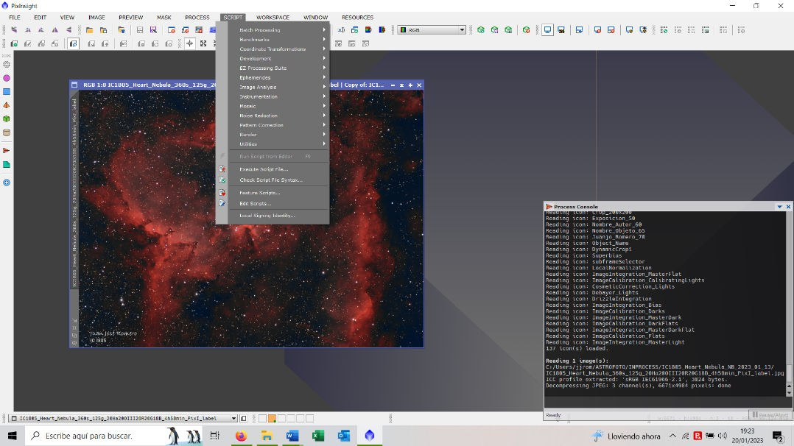

La primera línia correspon als menús desplegables on es troben totes les ordres necessàries; de manera resumida, les opcions més utilitzades (però no les úniques):

- *FILE:* càrrega i descàrrega d'arxius i projectes
- *EDIT:* Ctrl+C; Ctrl+V i preferències globals
- *VIEW:* configuració de les barres d'opcions i algunes maneres de zoom
- *IMAGE:* controls de mode d'imatge
- *PREVIEW:* control dels modes de preview; molt útil
- *MASK:* selecció i control de les màscares; molt útil
- *PROCESS:* figuren tots els processos ordenats per famílies i a més a més l'opció més requerida: `<All Processes>`; imprescindible
- *SCRIPT:* des d'aquest menú es trien els scripts estàndard de PixI i els que puguem afegir al futur; molt utilitzat
- *WORKSPACE:* tot allò referent als workspaces; noms, contingut, forma de gestionar-los, etc.; molt útil
- *WINDOW:* en referència a algunes gestions de les pantalles del programa
- *RESOURCES:* tot el que es refereix a actualitzacions, tutorials, etc. Imprescindible per controlar la càrrega i l'actualització de scripts.

Les dues línies següents corresponen a icones de procés que són totalment configurables i que depenen de les nostres preferències a l'hora de disposar de les funcions que més utilitzem i tenir-les a la vista.

Al peu de pantalla tenim indicació del fitxer amb què treballem, un resum dels workspaces utilitzats i els que tenim ocupats amb informació. També info sobre les coordenades de la imatge on està col·locat el cursor (el 0,0 es troba a la cantonada superior esquerra), la composició de luminància-croma de la posició del cursor i la mida en píxels de la imatge.

La pantalla fosca de la part inferior dreta és la “*Process Console*” que dóna info exhaustiva de tot allò que és processat per l'aplicació.

### Tipus d'instruccions
PixI utilitza dos tipus d'estructures que ens permeten realitzar accions sobre els nostres Files (fitxers d'imatges): els *Scripts* i els *Process*.

La diferència entre els primers i els segons és que els *Scripts* han estat programats amb Java Script i els *Process* a partir de C++ i posterior compilació; per aquest motiu mentre s'executa un Script no podem utilitzar res més, mentre que amb els Process podem simultaniejar amb altres tasques sense tancar-los i fins i tot tenir-ne més d'un obert.

Els *Scripts* poden ser desenvolupats per tercers i aplicar-se al paquet de PixI mitjançant l'opció: `/RESOURCES/Updates/Manage Repositories/…` Alguns són molt útils i ens simplifiquen la vida. En són exemple: EZ Processing Suite; ja sortirà més vegades en aquest article.

Els *Process* estan agrupats en famílies de treball quan els obrim des de la barra d'estat, però fent: `PROCESS/All Processes/…` apareixerà el llistat de tots; això al principi ens ajuda a manejar-nos amb els més de 100 diferents Process! que PixI incorpora; aquí ens hem de tranquil·litzar perquè utilitzarem una petita part.

Abans de passar al flux de treball, comentar algunes coses a tenir en compte. Els processos a PixI tenen normalment alguns ajustaments per personificar-los, alguns són evidents però la majoria no; això no obstant, normalment els valors per defecte solen donar resultats acceptables.

Per facilitar els ajustaments s'utilitza la funció “*Preview*” que consisteix a definir de forma molt fàcil petites zones de la imatge a les quals després de seleccionar-les, podem aplicar el procés en qüestió de forma molt ràpida i podem tornar enrere-endavant i provant les vegades que vulguem els ajustaments fins a trobar l'adequat.

### Aplicar els processos
Recordeu finalment que els processos poden aplicar-se de tres formes diferents segons la seva naturalesa; les tres formes corresponen a les icones situades a baix a l'esquerra de la finestra de procés.

El triangle *New Instance* s'arrossega sobre la imatge per aplicar el procés. El quadrat, *Apply (F5)* és per aplicar el procés obert sobre la darrera imatge activa al nostre espai de treball; només cal prémer sobre el botó.

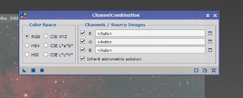

El cercle, *Apply Global (F6)*, aplica el procés sobre les imatges a què fa referència i no necessitem tenir la imatge oberta. Per sort, si premem l'opció incorrecta i en base a allò que s'ha explicat a dalt, PixI ens donarà error.

Altres processos utilitzen el que s'anomena Interfície Dinàmica; per exemple, *DynamicCrop* requereix tenir oberta la imatge sobre la qual actua en tot moment.

Aquests processos disposen de dos botons nous:

- ☑ *Execute* aplica el procés a la imatge amb què interaccionem
- ☒ *Cancel* cancel·la la sessió del procés i el tanca

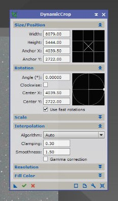

Un truc per guardar els processos amb els ajustaments que ens semblin idonis i poder-los utilitzar en una altra ocasió és “iconitzar” el procés.

Això s'aconsegueix arrossegant *New Instance* sobre l'espai de treball generant una icona on podem canviar-li el nom perquè ens faciliti saber la funció que realitza.

Podem així tenir diverses icones d'un mateix procés que facin funcions molt diferents. A més de tot això, podem desar el conjunt d'icones de forma separada per carregar-los quan ens interessi.

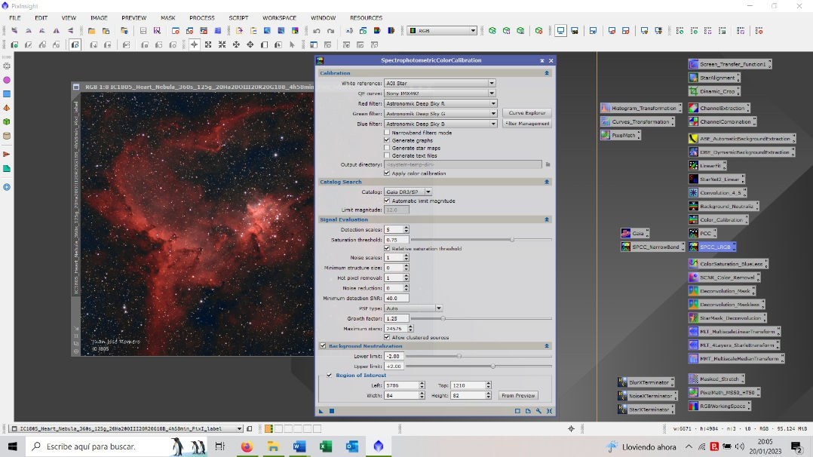

A la pantalla adjunta podem veure una trentena de processos iconitzats; alguns simplement estan per comoditat i altres amb ajustaments específics per a cada moment.

El procés desplegat com a exemple és *SpectrophotometricColorCalibration*, SPCC, i el guardo amb els valors de filtres, corbes i referències associats al meu equip; en tinc un per a RGB i un altre per a Banda estreta amb el que és molt fàcil aplicar quan toca.

Amb aquest conjunt de processos iconitzats podem realitzar totes les operacions necessàries a la part lineal. Remarcar que no tots s'han d'utilitzar; molts són redundants i no s'apliquen a una mateixa imatge.

Per fixar idees recordar que tots els processos es poden accedir a través de la barra de menús com indica la pantalla següent:

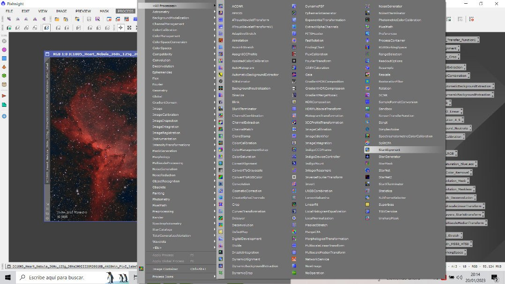

## Post-processament; Fase Lineal
Per iniciar el postprocessament partim de les dades obtingudes en el preprocessament. En aquesta fase prèvia és on hem calibrat les nostres imatges aplicant els fitxers de correcció i realitzat un posterior apilat per augmentar la nostra relació S/N (SNR).

Segurament la majoria de vosaltres haureu utilitzat DSS (Deep Sky Stacker); alguns menys WBPP (WeightedBatchPreprocessing) de PixI; en qualsevol cas partim d'un fitxer màster que conté tots els nostres frames correctament apilats.

Aquí considerarem càmeres OSC (One Shot Color), tant dedicades com DSLR i per tant tindrem un sol fitxer Master en color.

El flux de treball durant la fase lineal correspondrà al diagrama següent:

Aquí tractarem dels passos marcats en color verd i alguns processos de la dreta; la part blava representa interaccions amb processos de banda estreta i en general de càmeres monocromes.

Amb aquests passos ens plantarem a les portes de la fase no-lineal amb un fitxer perfectament preparat.

El concepte de lineal i no-lineal aplicat al processament de les nostres dades es refereix al fet que a la fase lineal totes les transformacions que realitzem a les nostres dades són aplicades de forma “lineal” a tots els píxels que formen la nostra imatge.

A la fase No-lineal ja no és així (pas 8 i posteriors) i els processos que apliquem són, en principi, diferents.

La frontera la marca el “stretch” o “estirat” de la imatge; anomenat així perquè com a resultant d'aquesta transformació l'histograma s'eixampla.

Anem amb els processos de la fase lineal.

## 1.- Cropping
Realitzarem aquesta operació mitjançant el procés “*DynamicCrop*”.

Ens permet realitzar una retallada, un escalat i una rotació alhora però el bàsic és realitzar una retallada.

Aquest procés el trobem a: `/Process/Geometry/DynamicCrop` o bé directament des de: `/Process/<All Processes>/`

La retallada comentada té per objecte en primer lloc eliminar els defectes de vores generats durant l'apilat; sobretot si els nostres lights s'han realitzat a tots dos hemisferis.

També s'utilitza per retallar la nostra imatge a la mida desitjada per adaptar l'enquadrament final al nostre desig (això també és possible fer-ho al final del nostre processament).

Necessitem tenir una finestra d'imatge oberta perquè pugueu treballar perquè és un procés d'interfície dinàmica.

Fem “*Reset*” i veiem a la nostra imatge un canvi de color perquè s'ha seleccionat un rectangle que l'abasta completament. Aleshores podem col·locar-nos sobre els extrems i clicant córrer cap a la posició desitjada. Un cop amb la retallada desitjada, fem “*Execute*” ☑ i s'aplicarà la retallada a la nostra imatge.

Hi ha ocasions en què volem aplicar la mateixa retallada a diverses imatges (com per exemple quan treballem amb LRGB) i aleshores una vegada mogut el quadre de retallada a la imatge patró fem un “*New Instance*” a cadascuna de les imatges a retallar; finalment “*Execute*” ☑ a la primera i tanquem el procés. Hem retallat exactament igual totes les imatges.

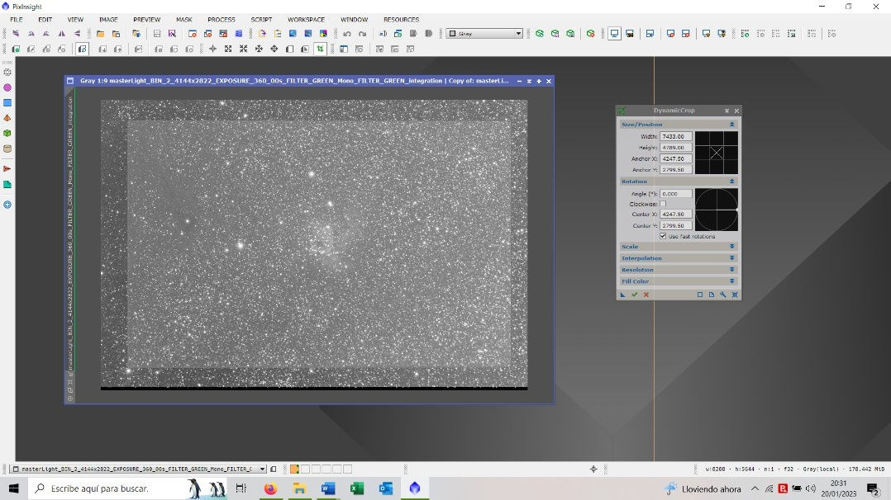

En aquesta pantalla s'aprecia com amb *DynamicCrop* estem eliminant la franja negra inferior producte de l'apilat; el requadre més clar indica la part resultant després del crop. Si aquest fos la nostra elecció, a més d'eliminar els defectes evidents, estem pensant en la retallada final.

Molts col·legues prefereixen retallar al final de la fase no lineal però opino que si es té clara la retallada pensant en l'enquadrament final, no val la pena processar (temps i memòria) parts de la foto que posteriorment rebutjarem.

Una altra recomanació és que cada cop que apliquem un procés a la nostra imatge, val la pena modificar l'identificador d'imatge per tenir traçabilitat del que hi estem fent.

Personalment també faig una gravació cada cop amb el mateix criteri. Gastem memòria, però ens permet en qualsevol moment tornar a reprocessar a partir de qualsevol punt.

Si hem partit d'un fitxer anomenat: `ImagenPrincipal`, després d'aquest procés en diríem: `ImagenPrincipal_crop`

## 2.- Background Modelization
El segon *Process* que aplicarem és la modelització del fons de la nostra imatge, mitjançant ABE o DBE.

Els podem trobar a: `/Process/BackgroundModelization/` o bé directament des de: `/Process/<All Processes>/`

Amb aquest procés tractem de suavitzar (o eliminar) els gradients presents a la nostra fotografia; aquestes diferències d'intensitat clar fosc en zones de la imatge.

Podem triar aplicar aquest procés de manera automàtica mitjançant ABE (*AutomaticBackgroundExtractor*) o bé de forma manual mitjançant DBE (*DynamicBackgroundExtraction*).

La primera opció sol funcionar molt bé amb els paràmetres per defecte i és aplicable immediatament.

L'opció DBE si bé pot resultar amb millors resultats en alguns casos, com ara presència de Luna, ens obligarà a realitzar diverses iteracions per aconseguir un resultat acceptable.

Per veure els resultats que anem obtenint és molt útil l'opció que ens presenta el fons de pantalla corregit quan apliquem DBE. Per comparació amb l'anterior podem veure en quina adreça treballa el nostre ajustament.

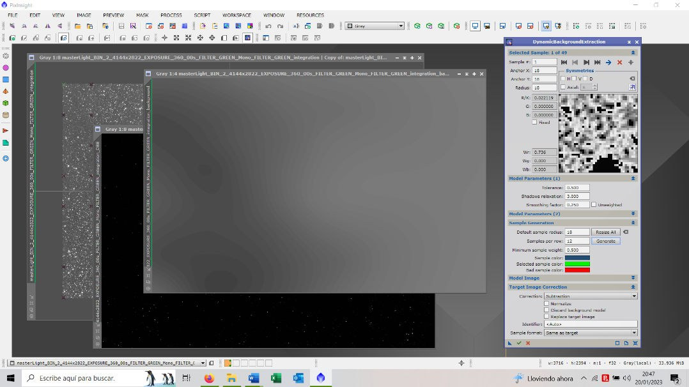

A la pantalla adjunta podem veure que a la pestanya “*Target Image Correction*” tenim seleccionada l'opció “*subtraction*” que és correcta per a la major part de casos. L'opció “*division*” seria adequada per corregir defectes de vinyeteig (vigneting).

Recordeu que el vigneting és l'aparició de zones fosques en alguna o les quatre cantonades de la foto degudes a desalineament de l'eix òptic en el primer cas o bé d'estrenyiment el tub òptic al segon. En general no és estrany que semblin zones una mica més fosques a les cantonades, però només “una mica” més fosques.

Després d'aplicar aquest procés li diem a la nostra imatge: `ImagenPrincipal_crop_DBE`

## 3.- Background Neutralization
Aquest procés consisteix a neutralitzar el color de fons de la imatge.

S'ha d'aplicar a la fase lineal i després d'haver eliminat els gradients de la imatge.

Els paràmetres per defecte funcionen correctament.

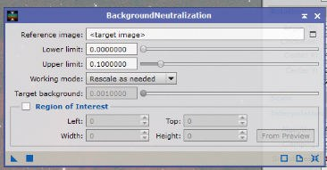

*Reference image* és la imatge target si no s'indica el contrari.

*Region of Interest* es refereix a la zona de fons que es pren com a referència; aquí la millor opció és generar una *Preview*, (Alt+N), que contingui una àrea representativa del fons de la nostra imatge; una àrea quadrada de 200 o 400 px seria suficient.

Després d'aplicar aquest procés li diem a la nostra imatge: `ImagenPrincipal_crop_DBE_BN`

## 4.- Color Calibration
Aquest procés calibra el color de la imatge prenent el blanc de múltiples estrelles com a referència.

S'aplica a la fase lineal sobre imatges amb il·luminació uniforme, és a dir, sense gradients i amb el valor de fons neutral.

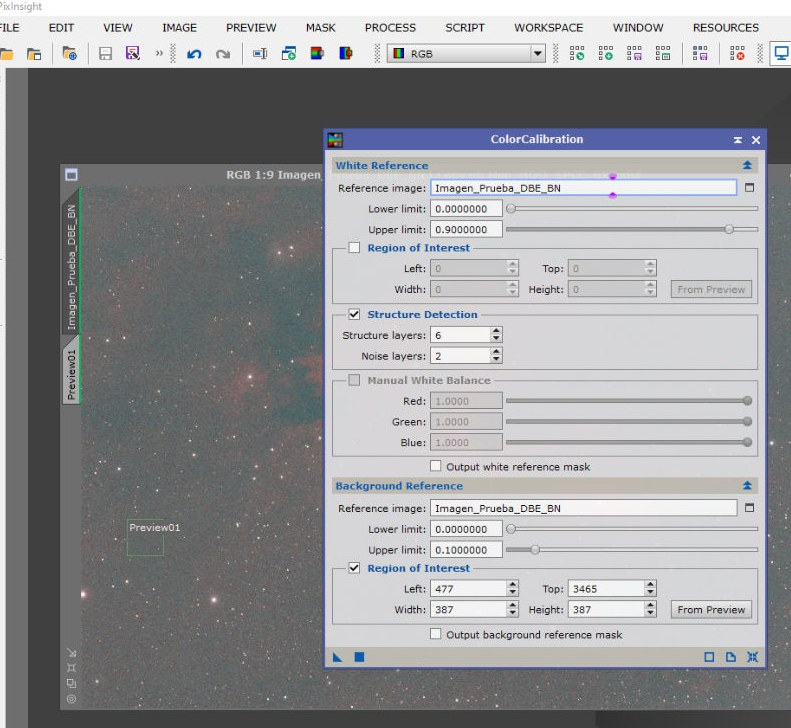

A *Reference image* es pot deixar la imatge sobre la qual aplicarem el procés.

*Structure layers* es pot partir d'un valor de 6.

*Noise layers* pot deixar-se a 2.

Aquests valors com moltes vegades a PixI, conviden a fer proves fins a arribar al millor compromís, però els indicats funcionen.

*Background Reference* requereix més atenció; *Reference Image* es refereix a la imatge que el procés prendrà com a referència per al càlcul del valor mitjà de fons per a cada canal. Sol utilitzar la imatge destinació.

*Region of Interest* es refereix a la zona que es pren com a referència; aquí la millor opció és generar una *Preview*, (Alt+N), que contingui una àrea representativa del fons de la nostra imatge; una àrea de 200x200 o 400x400 px seria suficient.

Hi ha processos que poden aportar una mica més de precisió o realitat en el calibratge del color com PCC (*PhotometricColorCalibration*) o SPCC (*SpectrophotometricColorCalibration*) que utilitzen catàlegs d'estrelles com a referència i informació dels filtres utilitzats però que anomenem aquí només com a curiositat.

Després d'aplicar aquest procés li diem a la nostra imatge: `ImagenPrincipal_crop_DBE_BN_CC`

## 5.- Deconvolution
Aquesta fase del procés que anomenem Deconvolució és la primera que requereix l’aplicació de més d’un procés i certa experiència. És un procés que podríem saltar-nos als nostres primers processats sense que s'acabés el món.

De fet, algunes vegades és recomanable fer-ho si tenim imatges amb baixa relació S/N (senyal-soroll). També podem dir que és menys important deconvolucionar si disposem d’òptiques amb relacions focals per sota de 700mm.

L'objectiu principal de la deconvolució és revertir la distorsió que genera la nostra òptica i la pròpia atmosfera als nostres lights. El resultat és una millora de la definició encara que no és una eina per fer-ho. La manera de mesurar la distorsió a la nostra imatge és mitjançant la funció PSF (*Point Spread Function*) que defineix la forma de la distorsió que s'aplica, per exemple, a les nostres estrelles.

Per conèixer el valor d'aquesta funció hi ha el procés *DynamicPSF*, però no és fàcil d'aplicar. Tenim una altra solució que consisteix a utilitzar un script de la suite *EZ Processing Suite*.

Aquí hem d'obrir un parèntesi per veure com podem incorporar al nostre PixI aplicacions de tercers que es poden integrar perfectament al nostre programa.

## Scripts de tercers
Aquí hem d'obrir un parèntesi per veure com podem incorporar al nostre PixI aplicacions de tercers que es poden integrar perfectament al nostre programa; escollim com a exemple *EZ Processing Suite*, es tracta d'un conjunt de sis scripts gratuïts molt útils (sobretot *EZ Decon* i *EZ Soft Stretch*) i que podem baixar des de:

[https://elveteek.ch/pixinsight-updates/ez-processing-suite/](https://elveteek.ch/pixinsight-updates/ez-processing-suite/)

Un cop entrem a la pàgina veiem les instruccions per descarregar la suite EZ.

Afegiu aquest URL a PixInsight a *"Resources -> Updates -> Manage Repositories".*

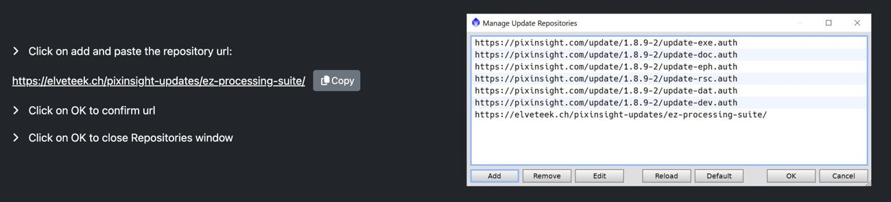

D'aquesta manera tan senzilla s'incorporen al nostre programa les sis aplicacions de *EZ Processing Suite* i cada cop que obrim PixI s'accedeix a la pàgina cercant noves actualitzacions.

Aquest sistema per afegir repositoris externs és molt útil per a qualsevol actualització recursiva.

El paquet EZ suite té els següents continguts:

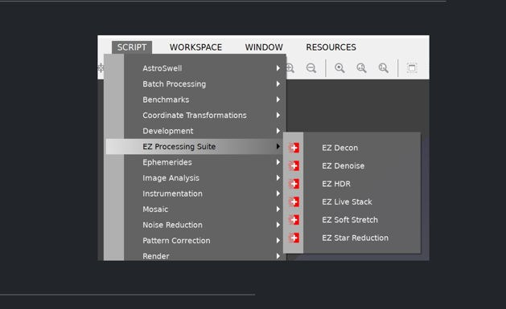

### Continuem deconvolucionant …
Descrivim ara un primer mètode per aplicar la deconvolució; per a l'exemple partim d'una imatge que anomenem: **ImagenInicial**

Obrim: `/script/EZ Processing Suite/EZ Decon`

I s'obre la pantalla de la figura:

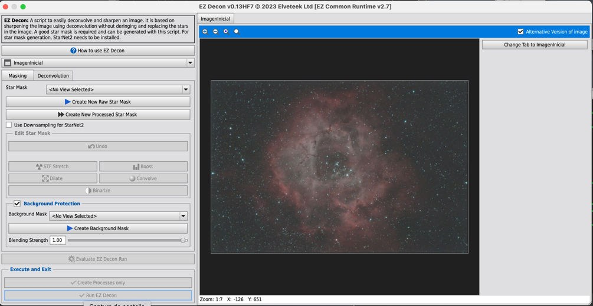

Aquest script serveix per realitzar una convolució completa, primer seleccionem “Create New Raw Star Mask” (requereix tenir instal·lat Starnet2).

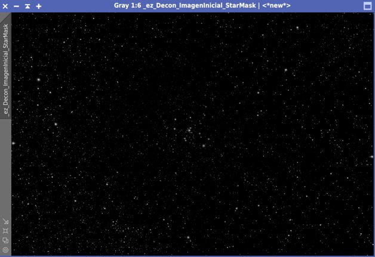

També podem seleccionar “Create Background Mask”.

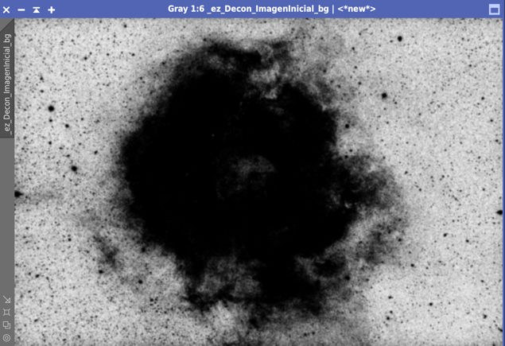

Seleccionem ara la pestanya “Deconvolution”

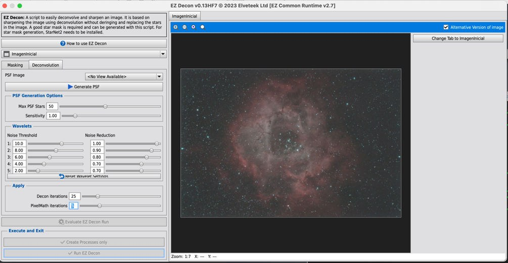

Aquí seleccionem "Create PSF"

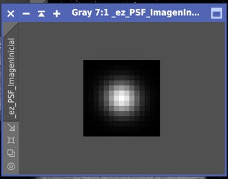

Obtindrem el fitxer: **\_ez_PSF_Nombrefichero** que conté el nostre PSF.

i ja podem provar els nostres ajustaments mitjançant "Evaluate EZ Decon Run"; si el resultat ja és satisfactori ordenem la deconvolució amb "Run EZ Decon".

### Continuem deconvolucionant …
Ara podem utilitzar el procés Deconvolution de PixInsight;

1. Creació d'una màscara d'Estrella per aplicar a “*Local deringing*” del procés

Utilitzem el procés *StarNet2* per generar una màscara d'estrelles marcant:

- *Create starmask:* ON
- *Linear Data:* ON

Apliquem *New Instance* ----> **ImagenInicial_clone**

Apliquem *Convolution* amb StdDev = 4.5 ----> **Local Supportimage**

2. Ara apliquem *Deconvolution* amb les imatges generades anteriorment

Abans d'executar la deconvolució a la imatge completa és convenient generar una preview que s'apliqui ràpidament per anar veient els resultats abans de decidir aplicar-la al total.

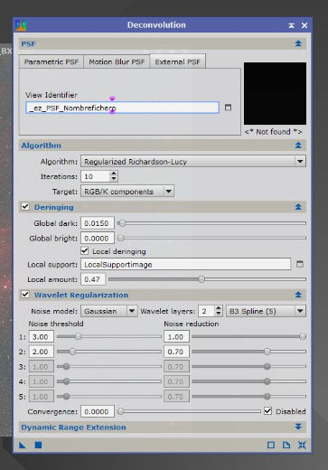

Com indica la figura adjunta col·loquem els fitxers generats en el procés Deconvolution:

- `/External PSF/View Identifier/_ez_PSF_Nombrefichero`
- `/Algorithm/Algorithm/Regularized Richardson-Lucy`
- `/Algorithm/Iterations/10`
- `/Algorithm/Target/RGB components`

Els valors de *Deringing* com a partida els indicats a la imatge adjunta.

Els valors de *Wavelet Regularization* també com els indicats.

Apliquem els canvis a la preview i quan estiguem satisfets amb el resultat fem *New Instance* a **ImagenInicial**.

Al final del procés de Deconvolució hem de tenir absència de halos a les estrelles, amb una imatge neta; si no és així fem Undo i continuem amb els ajustaments.

Posar èmfasi que si en un moment donat decidim obviar la deconvolució perquè no obtenim resultats satisfactoris, no passaria res transcendent amb la nostra imatge.

Després d'aplicar aquest procés li direm a la nostra imatge: `ImagenPrincipal_crop_DBE_BN_CC_SCNR_decon`

## 6.- Green Color Removal
Com a resultat dels processos anteriors pot aparèixer un color verd que no existeix en cap objecte o estrella al cel a no ser en algun estel o alguna nebulosa planetària; aquest és el motiu per voler eliminar-lo.

El procés SCNR (*Subtractive Chromatic Noise Reduction*) és simple, només hem de seleccionar *Green* a *Color to remove* i fer *New Instance* sobre la imatge a tractar o bé *Apply (F5)*.

Després d'aplicar aquest procés li diem a la nostra imatge: `ImagenPrincipal_crop_DBE_BN_CC_SCNR`

## 7.- Linear Noise Reduction
Per eliminar el soroll utilitzarem el procés MLT (*MultiscaleLinearTransform*). Aquí tornem a insistir en la conveniència d'utilitzar previews per monitoritzar els ajustaments que anem fent; en primer lloc per l'estalvi de temps en veure els resultats i segon per l'eina d'*Undo/Redo Preview* que agilitza tremendament la facilitat per detectar si anem obtenint resultats correctes.

Per donar una aproximació del que és MLT podem pensar que és un procés que permet descompondre una imatge a diferents escales de la seva estructura i que ens permet aplicar operacions matemàtiques a cadascuna.

A les escales petites resideixen els detalls de la imatge i on trobem la major part del soroll.

A les escales grans resideix la informació dels detalls grans de la imatge, és a dir, les formes més que els detalls.

La gràcia és que MLT permet aplicar diferents processos a cadascuna de les escales per separat. Podem, per tant, atacar el soroll de les estructures de les escales més petites i deixar intactes els detalls de gran escala.

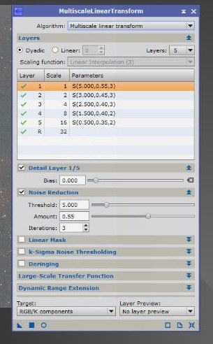

Dominar aquests processos no és una tasca fàcil, almenys per al que escriu, però és fàcil tenir iconitzada MLT amb uns paràmetres base i utilitzar-la quan cal.

La pantalla adjunta pot ser un bon punt de partida per eliminar soroll.

Hem de pensar que en aquest procés ja podríem començar a pensar en la necessitat d'utilitzar màscares per seleccionar si ataquem el soroll de fons, el soroll de l'objecte en qüestió o tots dos.

Com en altres processos, hi ha alternatives més avançades i algunes de pagament per a eliminació de soroll, però aquí estem als inicis del postprocessat i no cal més.

Després d'aplicar aquest procés li direm a la nostra imatge: `ImagenPrincipal_crop_DBE_BN_CC_SCNR_decon_MLT`

## 8.- Stretch
Amb la nostra imatge ja compensada i amb una primera reducció de soroll podem fer l'estirat per passar a ser no lineal.

Aquí podem trobar tres maneres de fer l'estirat (sense utilitzar processos més complicats):

- a. La més clàssica *STF + HT*
- b. *MaskedStretch*
- c. *EZ Soft Stretch* (que ara disposem amb la incorporació d’*EZ Processing Suite*)

### a.- STF + HT
Aquest és el procés estàndard que hem après en primer lloc. Obrim STF (*Screen Transfer Function*) amb la nostra imatge objecte oberta,

1. Premem *Reset*
2. Premem *Track View*
3. Premem *Unlink RGB Channels*
4. Premem *Auto Stretch*

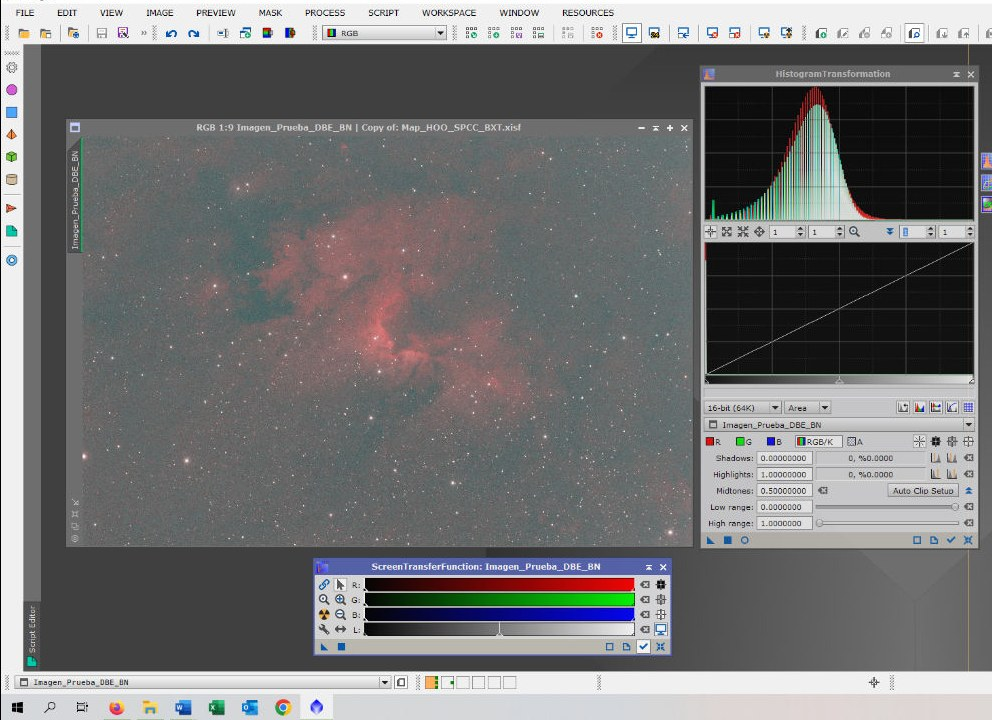

Amb això tenim la nostra imatge amb un *Auto Stretch* lleuger; obrim llavors HT (*HistogramTransformation*)

1. Premem *Reset*
2. Seleccionem la imatge de treball a
3. Arrosseguem *New Instance* fins a la barra grisa inferior de la finestra de HT
4. Fem *New Instance* de HT sobre la imatge de treball

La pantalla queda en blanc i hem de prémer Reset a STF. La imatge principal torna a aparèixer i ja la tenim estirada; aquesta imatge no s'enfosqueix a partir d'ara quan premem un *Reset Screen Transfer Functions*. Podem acabar de deixar-la al nostre gust amb HT.

### b.- MaskedStretch
Aquest procés comença a utilitzar la CPU amb una mica més intensitat que els anteriors i per això és important treballar amb *previews*.

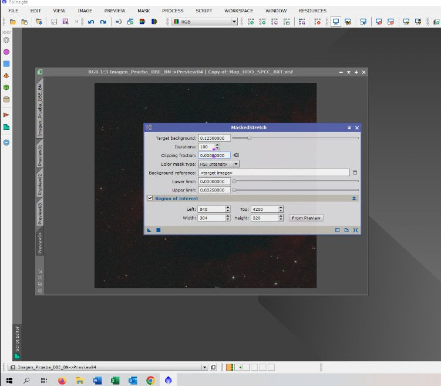

Anem fent la prova amb diversos *previews* de diferents zones per veure el resultat del total de la imatge.

Cal no oblidar seleccionar una *preview* per al valor del fons.

### c.- EZ Soft Stretch
Aquest script ens facilita molt l'estirat de les imatges. Té una zona de *Stretch Preview* que dóna una idea exacta de com està afectant l'ajust que vas fent. És una bona ajuda.

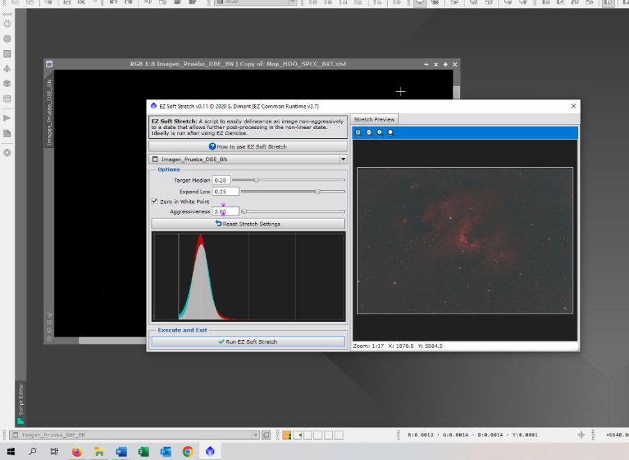

Quan tot està com volem premem *Run EZ Soft Stretch* i ja tenim la nostra imatge estirada.

Fins aquí els tres sistemes d’estirat plantejats.

Algunes vegades si utilitzes més d'un d'aquests processos pot ser que no sàpigues quin d’ells escollir com a definitiu, potser un sigui massa clar, un altre mostri millor les parts més brillants o mostri més detall.

En aquests casos pot ajudar a fer una barreja mitjançant *PixelMath*. Pots fer la suma de dues imatges al 50% o bé una barreja: `(ImagenHT*0.75+0.25*ImagenMStretch)` o qualsevol altra combinació; gairebé no hi ha límit amb *PixelMath*

Després d'aplicar aquest procés, suposem *EZ Soft Stretch*, bategem la nostra imatge: `ImagenPrincipal_crop_DBE_BN_CC_SCNR_decon_MLT_EZstretch`

## Processament de Fase No-Lineal
L'objectiu d'aquest treball era explicar la fase Lineal del post processat però només vull presentar un diagrama de blocs per a la fase no lineal.

No sense abans remarcar que així com a la fase lineal es pot definir un workflow que no variarà gaire entre diferents persones, a la fase no lineal les alternatives a utilitzar són moltes i molt variades amb resultats que poden ser molt similars però també molt dispars.

Un workflow que ens portarà a resultats correctes pot ser:

Fins a la propera amics, Cels clars!!
