## Inicio
El equipo de Pleiades Astrofoto lanzó allá por el 2007 un programa que con el tiempo se ha convertido en uno de los preferidos por astrofotógrafos de todo el mundo para el procesado de sus fotografías; lo bautizaron como PixInsight.

Nació y es mantenido desde la localidad de “Pobla de Vallbona”, Valencia, donde Pleiades Astrofoto tiene su cuartel general. Es una aplicación totalmente en inglés y así seguirá siendo porque los creadores apuestan por aplicar los esfuerzos en mejorar el software y no en realizar trabajos de traducción. Los foros siguen por lo general el mismo criterio.

Aquí utilizaremos la nomenclatura inglesa que se utiliza en PixI para no crear confusión.

Como curiosidad, comentar que la palabra “PixInsight” no significa nada especial aunque se haya intentado asimilar con diferentes palabras inglesas; este punto ha sido clarificado de forma explícita por sus creadores. Por simplicidad nos referiremos a él como “PixI”.

La versión que es utilizada en el momento de escribir este artículo es la 1.8.9.

En la web hay multitud de tutoriales que explican de forma muy completa y didáctica como iniciarse en PixI, pero la idea de este documento es concretar un flujo de trabajo para la fase lineal de nuestro procesado, hasta el momento de hacer el estirado y convertir nuestros datos en no lineales; ya veremos que es esto de “estirar”.

Muchos de los comentarios que podéis encontrar aquí son fruto de la curiosidad que me han generado algunos temas y las dudas y preguntas que han surgido en la fase de aprendizaje desde cero; por lo tanto pueden ayudar a manejarnos a través de este programa, que sea dicho de paso, goza de la mala fama de tener una curva de aprendizaje lenta y difícil de abordar. Ya veremos que no es así.

## Refrescando algunos conceptos
Asumimos que disponemos de un conocimiento básico del programa, su interfaz y los iconos generales de las barras de herramientas estándar.

Como refresco, una imagen para comentar los aspectos generales de la pantalla de inicio.

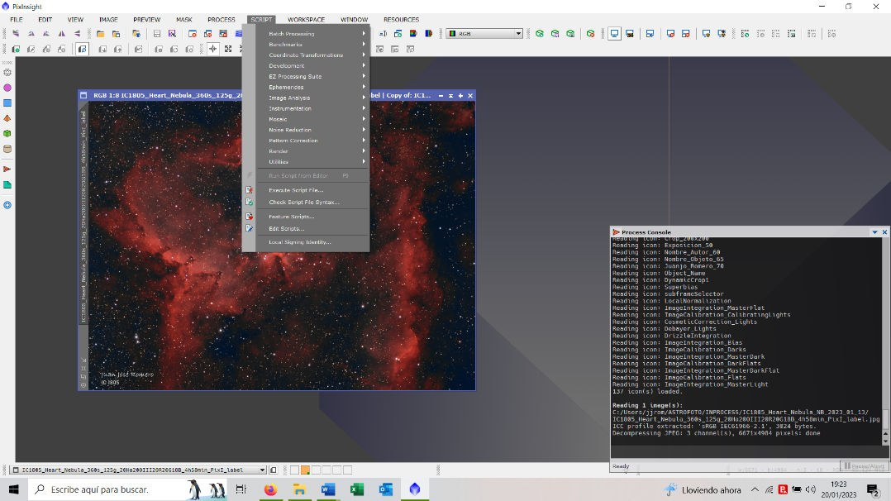

La primera línea corresponde a los menús desplegables donde se encuentran todos los comandos necesarios; de forma resumida, las opciones más utilizadas (pero no las únicas):

- *FILE:* carga y descarga de archivos y de proyectos
- *EDIT:* Ctrl+C; Ctrl+V y preferencias globales
- *VIEW:* configuración de las barras de opciones y algunos modos de zoom
- *IMAGE:* controles de modos de imagen
- *PREVIEW:* control de los modos de preview; muy útil
- *MASK:* selección y control de las máscaras; muy útil
- *PROCESS:* figuran todos los procesos ordenados por familias y además la opción más requerida: `<All Processes>`; imprescindible
- *SCRIPT:* desde este menú se eligen los scripts estándar de PixI y los que podamos añadir en el futuro; muy utilizado
- *WORKSPACE:* todo lo referente a los workspaces; sus nombres, contenido, forma de gestionarlos, etc.; muy útil
- *WINDOW:* en referencia a algunas gestiones de las pantallas del programa
- *RESOURCES:* todo lo que se refiere a actualizaciones, tutoriales, etc. Imprescindible para controlar carga y actualización de scripts.

Las dos siguientes líneas corresponden a iconos de proceso que son totalmente configurables y que dependen de nuestras preferencias a la hora de disponer de las funciones que más utilizamos y tenerlas a la vista.

En el pie de pantalla tenemos indicación del fichero con el que trabajamos, un resumen de los workspaces utilizados y los que tenemos ocupados con información. También info acerca de las coordenadas de la imagen donde está colocado el cursor (el 0,0 se encuentra en la esquina superior izquierda), la composición de luminancia-croma de la posición del cursor y el tamaño en píxels de la imagen.

La pantalla oscura de la parte inferior derecha es la “Process Console” que da info exhaustiva de todo lo que es procesado por la aplicación.

### Tipos de “instrucciones”
PixI utiliza dos tipos de “estructuras” que nos permiten realizar acciones sobre nuestros Files (ficheros de imágenes): los Scripts y los Process.

La diferencia entre los primeros y los segundos es que los Scripts se han programado con Java Script y los Process a partir de C++ y posterior compilación; por este motivo mientras se ejecuta un Script no podemos utilizar nada más, mientras que con los Process podemos simultanear con otras tareas sin cerrarlos e incluso tener más de uno abierto.

Los *Scripts* pueden estar desarrollados por terceros y aplicarse al paquete de PixI mediante la opción: `/RESOURCES/Updates/Manage Repositories/…` Algunos de ellos son muy útiles y nos simplifican la vida. Ejemplo de ellos son: EZ Processing Suite; ya saldrá más veces en este artículo.

Los *Process* están agrupados en familias de trabajo cuando los llamamos desde la barra de estado, pero haciendo: `PROCESS/All Processes/…` aparecerá el listado de todos ellos; esto al principio nos ayuda a manejarnos con los más de ¡100 diferentes Process! que PixI incorpora; aquí nos hemos de tranquilizar porque vamos a utilizar una pequeña parte.

Antes de pasar al flujo de trabajo comentar algunas cosas a tener en cuenta. Los procesos en PixI tienen normalmente algunos ajustes para personificarlos, algunos de ellos son evidentes pero la mayoría no; no obstante, normalmente los valores por defecto suelen dar resultados aceptables.

Para facilitar los ajustes se utiliza la función “*Preview*” que consiste en definir de forma muy fácil pequeñas zonas de la imagen a las que después de seleccionarlas, podemos aplicar el proceso en cuestión de forma muy rápida y podemos volver atrás-adelante y probando las veces que queramos los ajustes hasta dar con el adecuado.

### Aplicar los procesos
Recordar por último que los procesos pueden aplicarse de tres formas diferentes según su naturaleza; las tres formas corresponden a los iconos situados abajo a la izquierda de la ventana de proceso.

El triángulo, *New Instance* se arrastra sobre la imagen para aplicar el proceso. El cuadrado, *Apply (F5)* es para aplicar el proceso abierto sobre la última imagen activa en nuestro espacio de trabajo; basta con pulsar sobre el botón. El círculo, *Apply Global (F6)*, aplica el proceso sobre las imágenes a las que hace referencia y no necesitamos tener la imagen abierta. Por suerte, si pulsamos la opción incorrecta y en base a lo explicado arriba, PixI nos dará error.

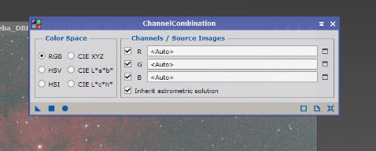

Otros procesos utilizan lo que se llama Interfaz Dinámica; por ejemplo, *DynamicCrop* requiere tener abierta la imagen sobre la que actúa en todo momento.

Estos procesos disponen de dos botones nuevos:

- ☑ *Execute* aplica el proceso a la imagen con la que interaccionamos
- ☒ *Cancel* cancela la sesión del proceso y lo cierra

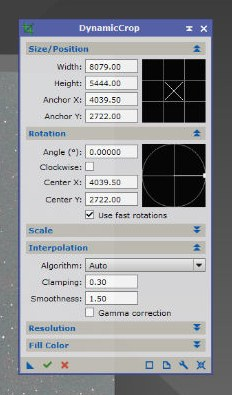

Un truco para guardar los procesos con los ajustes que nos parezcan idóneos y poderlos utilizar en otra ocasión es “iconizar” el proceso. Esto se consigue arrastrando *New Instance* sobre el espacio de trabajo generando un icono al que podemos cambiarle el nombre para que nos facilite saber la función que realiza. Podemos de esta forma tener varios iconos de un mismo proceso que realicen funciones muy diferentes.

Además de todo ello, podemos guardar el conjunto de iconos de forma separada para cargarlos cuando nos interese.

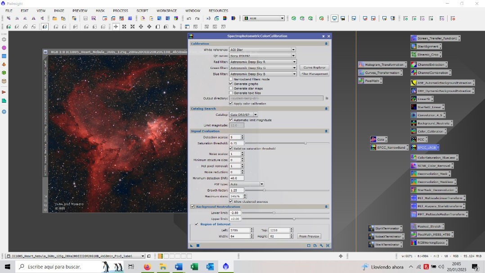

En la pantalla adjunta podemos ver una treintena de procesos iconizados; algunos simplemente están por comodidad y otros con ajustes específicos para cada momento.

El proceso desplegado como ejemplo es SpectrophotometricColorCalibration, SPCC, y lo guardo con los valores de filtros, curvas y referencias asociados a mi equipo; tengo uno para RGB y otro para Banda estrecha con lo que es muy fácil aplicarlos cuando toca.

Con este conjunto de procesos iconizados podemos realizar todas las operaciones necesarias en la parte lineal. Remarcar que no todos se deben de utilizar; muchos son redundantes y no se aplican a una misma imagen.

Para fijar ideas recordar que todos los procesos se pueden acceder a través de la barra de menús como indica la siguiente pantalla:

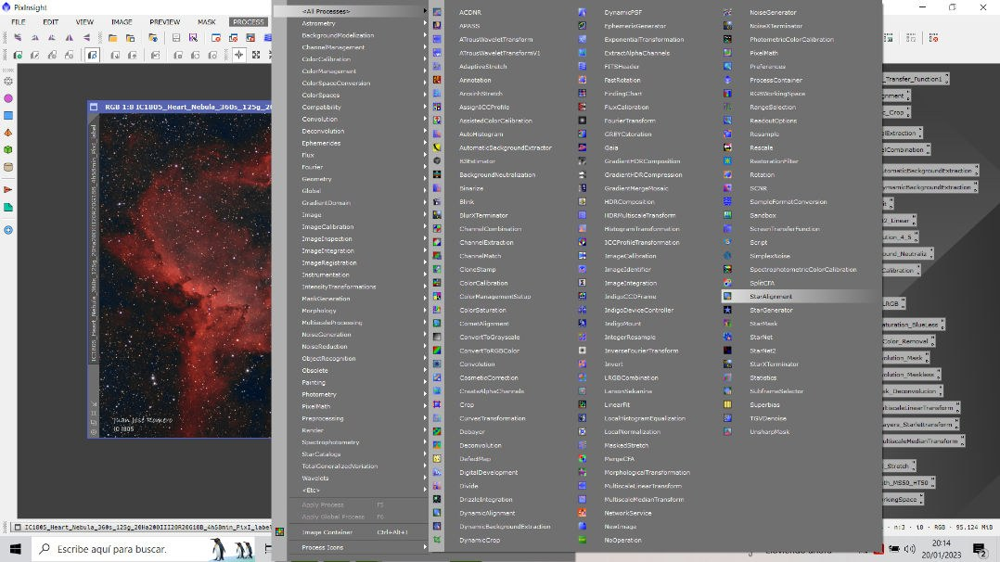

## Post-procesado
Para iniciar el post-procesado partimos de los datos obtenidos en el preprocesado. En esa fase previa es donde hemos calibrado nuestras imágenes aplicando los ficheros de corrección y realizado un posterior apilado para aumentar nuestra relación S/N (SNR).

Posiblemente la mayoría habréis utilizado DSS (Deep Sky Stacker); algunos menos WBPP (WeightedBatchPreprocessing) de PixI; en cualquier caso partimos de un fichero Master que contiene todas nuestros frames correctamente apilados.

Aquí vamos a considerar cámaras OSC (One Shot Color), tanto dedicadas como DSLR y por lo tanto tendremos un solo fichero Master en color.

El flujo de trabajo corresponderá al siguiente diagrama:

Con estos pasos nos plantaremos a las puertas de la fase no-lineal con un fichero perfectamente preparado.

El concepto de lineal y no-lineal aplicado al procesado de nuestros datos se refiere a que en la fase lineal todas las transformaciones que realizamos a nuestros datos son aplicadas de forma “lineal” a todos los píxeles que forman nuestra imagen.

En la fase No-lineal ya no es así (paso 8 y posteriores) y los procesos que aplicamos son, en principio, diferentes.

La frontera la marca el “stretch” o “estirado” de la imagen; llamado así porque como resultante de esa transformación el histograma se ensancha.

Vamos a por los procesos de la fase lineal.

## 1.- Cropping
Realizaremos esta operación mediante el proceso “DynamicCrop”.

Nos permite realizar un recorte, un escalado y una rotación al mismo tiempo pero lo básico es realizar un recorte.

Este proceso lo encontramos en: `/Process/Geometry/DynamicCrop` o bien directamente desde: `/Process/<All Processes>/`

El recorte comentado tiene por objeto en primer lugar eliminar los defectos de bordes generados durante el apilado; sobre todo si nuestros lights se han realizado en ambos hemisferios.

También se utiliza para recortar nuestra imagen al tamaño deseado para adaptar el encuadre final a nuestro deseo (esto también es posible realizarlo al final de nuestro procesado).

Necesitamos tener una ventana de imagen abierta para que pueda trabajar porque se trata de un proceso de interfaz dinámica.

Hacemos “Reset” y vemos en nuestra imagen un cambio de color porque se ha seleccionado un rectángulo que la abarca por completo. Entonces podemos colocarnos sobre los extremos y clicando correrlos hacia la posición deseada.

Una vez con el recorte deseado, hacemos “Execute” ☑ y se aplicará el recorte a nuestra imagen.

Hay ocasiones en las que deseamos aplicar el mismo recorte a varias imágenes (como por ejemplo cuando trabajamos con LRGB) y entonces una vez movido el cuadro de recorte en la imagen patrón hacemos un “*New Instance*” a cada una de las imágenes a recortar; finalmente “*Execute*” ☑ a la primera y cerramos el proceso. Hemos recortado exactamente igual todas las imágenes.

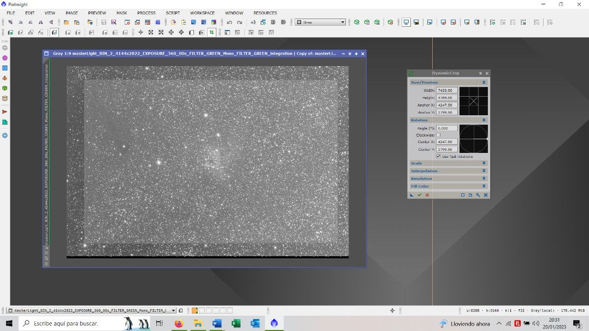

En esta pantalla se aprecia como con *DynamicCrop* estamos eliminando la franja negra inferior producto del apilado; el recuadro más claro indica la parte resultante después del crop. Si este fuera nuestra elección, además de eliminar los defectos evidentes estamos pensando en el recorte final.

Muchos colegas prefieren recortar al final de la fase no lineal pero opino que si se tiene claro el recorte pensando en el encuadre final, no vale la pena procesar (tiempo y memoria) partes de la foto que posteriormente vamos a desechar.

Otra recomendación es que cada vez que aplicamos un proceso a nuestra imagen, vale la pena modificar el identificador de imagen para tener trazabilidad de lo que estamos haciendo en ella.

Personalmente también hago una grabación cada vez con el mismo criterio. Gastamos memoria pero nos permite en cualquier momento volver a reprocesar a partir de cualquier punto.

Si hemos partido de un fichero llamado: `ImagenPrincipal`, después de este proceso la llamaríamos: `ImagenPrincipal_crop`

## 2.- Background Modelization
El segundo *Process* que vamos a aplicar es la modelización del fondo de nuestra imagen, mediante ABE o DBE.

Los podemos encontrar en: `/Process/BackgroundModelization/` o bien directamente desde: `/Process/<All Processes>/`

Con este proceso tratamos de suavizar (o eliminar) los gradientes presentes en la nuestra fotografía; esas diferencias de intensidad claro-oscuro en zonas de la imagen.

Podemos elegir aplicar este proceso de forma automática mediante ABE (**A**utomatic**B**ackground**E**xtractor) o bien de forma manual mediante DBE (**D**ynamic**B**ackground**E**xtraction).

La primera opción suele funcionar muy bien con los parámetros por defecto y es de aplicación inmediata.

La opción DBE si bien puede resultar con mejores resultados en algunos casos, como por ejemplo, presencia de Luna, nos obligará a realizar varias iteraciones para conseguir un resultado aceptable.

Para ver los resultados que vamos obteniendo es muy útil la opción que nos presenta el fondo de pantalla corregido una vez que aplicamos DBE. Por comparación con el anterior podemos ver en qué dirección trabaja nuestro ajuste.

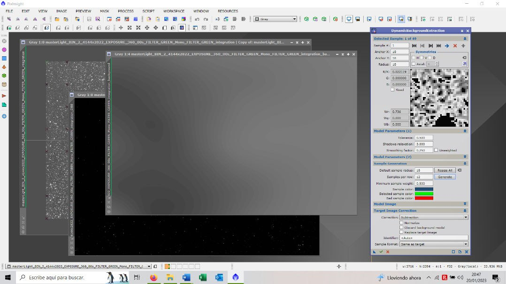

En la pantalla adjunta podemos ver que en la pestaña “*Target Image Correction*” tenemos seleccionada la opción “*subtraction*” que es correcta para la mayor parte de casos. La opción “división” sería adecuada para corregir defectos de viñeteo (vigneting).

Recordar que el vigneting es la aparición de zonas oscuras en alguna o las cuatro esquinas de la foto debidas a desalineamiento del eje óptico en el primer caso o bien de estrechamiento el tubo óptico en el segundo. En general no es extraño que parezcan zonas algo más oscuras en las esquinas, pero solamente “algo” más oscuras.

Después de aplicar este proceso llamamos a nuestra imagen: `ImagenPrincipal_crop_DBE`

## 3.- Background Neutralization
Este proceso consiste en neutralizar el color de fondo de la imagen.

Debe aplicarse en la fase lineal y después de haber eliminado los gradientes de la imagen.

Los parámetros por defecto funcionan de forma correcta.

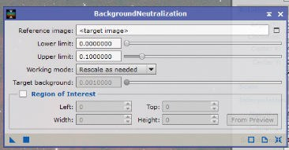

*Reference image* es la imagen target si no se indica lo contrario.

*Region of Interest* se refiere a la zona de fondo que se toma como referencia; aquí la mejor opción es generar una *Preview*, (Alt+N), que contenga un área representativa del fondo de nuestra imagen; un área cuadrada de 200 o 400 px sería suficiente.

Después de aplicar este proceso llamamos a nuestra imagen: `ImagenPrincipal_crop_DBE_BN`

## 4.- Color Calibration
Este proceso calibra el color de la imagen tomando el blanco de múltiples estrellas como referencia.

Se aplica en la fase lineal sobre imágenes con iluminación uniforme, es decir, sin gradientes y con el valor de fondo neutral.

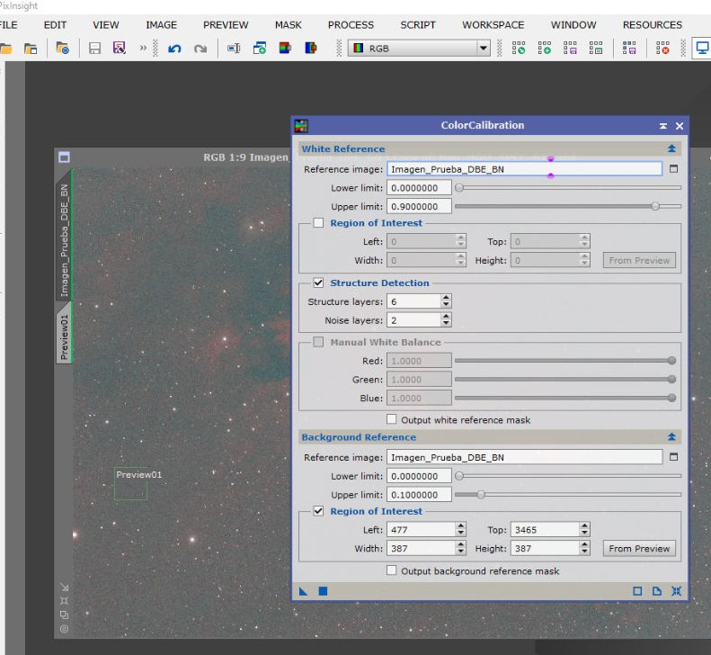

En *Reference image* puede dejarse la imagen sobre la que aplicaremos el proceso.

*Structure layers* puede partirse de un valor de 6.

*Noise layers* puede dejarse en 2.

Estos valores como muchas veces en PixI, invitan a hacer pruebas hasta llegar al mejor compromiso, pero los indicados funcionan.

*Background Reference* requiere mayor atención; *Reference Image* se refiere a la imagen que el proceso tomará como referencia para el cálculo del valor medio de fondo para cada canal. Suele utilizarse la imagen destino.

*Region of Interest* se refiere a la zona que se toma como referencia; aquí la mejor opción es generar una *Preview*, (Alt+N), que contenga un área representativa del fondo de nuestra imagen; un área de 200x200 o 400x400 px sería suficiente.

Hay procesos que pueden aportar algo más de precisión o realidad en la calibración del color como PCC (*PhotometricColorCalibration*) o SPCC (*SpectrophotometricColorCalibration*) que utilizan catálogos de estrellas como referencia e información de los filtros utilizados pero que nombramos aquí solamente como curiosidad.

Después de aplicar este proceso llamamos a nuestra imagen: `ImagenPrincipal_crop_DBE_BN_CC`

## 5.- Green Color Removal
Como resultado de los procesos anteriores puede aparecer un color verde que no existe en ningún objeto o estrella en el cielo a no ser en algún cometa o alguna nebulosa planetaria; este es el motivo para querer eliminarlo.

El proceso SCNR (*Subtractive Chromatic Noise Reduction*) es simple, solamente debemos seleccionar *Green* en *Color to remove* y hacer *New Instance* sobre la imagen a tratar o bien *Apply (F5)*.

Después de aplicar este proceso llamamos a nuestra imagen: `ImagenPrincipal_crop_DBE_BN_CC_SCNR`

## 6.- Deconvolution
Esta fase del proceso que llamamos Deconvolución es la primera que requiere la aplicación de más de un proceso y cierta experiencia. Es una fase que podríamos saltarnos en nuestros primeros procesados sin que se acabara el mundo. De hecho, algunas veces es recomendable hacerlo si tenemos imágenes con pobre relación S/N (señal-ruido). También podemos decir que es menos importante deconvolucionar si disponemos de ópticas con relaciones focales por debajo de 700mm.

El objetivo principal de la deconvolución es revertir la distorsión que genera nuestra óptica y la propia atmósfera en nuestros lights. El resultado es una mejora de la definición aunque no es una herramienta para ello.

La forma de medir la distorsión en nuestra imagen es mediante la función PSF (*Point Spread Function*) que define la forma de la distorsión que se aplica, por ejemplo, a nuestras estrellas. Para conocer el valor de esta función existe el proceso *DynamicPSF* pero no es fácil de aplicar. Tenemos otra solución que consiste en utilizar un script de EZ Processing Suite.

Aquí hemos de abrir un paréntesis para ver cómo podemos incorporar a nuestro PixI aplicaciones de terceros que se pueden integrar perfectamente en nuestro programa.

## Scripts de terceros
EZ Processing Suite, se trata de un conjunto de seis scripts gratuitos muy útiles (sobre todo EZ Decon y EZ Soft Stretch) y que podemos bajar desde:

[https://darkarchon.internet-box.ch:8443/](https://darkarchon.internet-box.ch:8443/)

Una vez entramos en la página vemos la figura anexa, donde además de pedirnos que le invitemos a una o dos cervezas 😊 (se lo merece), explica cómo cargar la suite en PixI.

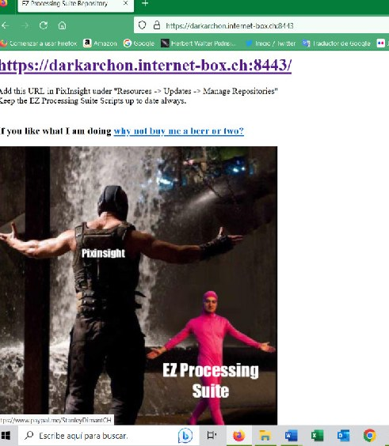

> *“Agregue esta URL en PixInsight en "Resources -> Updates -> Manage Repositories". Mantenga siempre actualizados los scripts de EZ Processing Suite.”*

De esta forma tan sencilla se incorporan a nuestro programa las seis aplicaciones de EZ processing Suite y cada vez que abrimos PixI se accede a la página buscando nuevas actualizaciones.

Este sistema para añadir repositorios externos es de suma utilidad para cualquier actualización recursiva.

### Seguimos deconvolucionando…
Describimos ahora el proceso para aplicar la deconvolución; para el ejemplo partimos de una imagen que llamamos: **ImagenInicial**

1. Creamos un modelo de la forma que presentan nuestras estrellas en la imagen

Abrimos: `/script/EZ Processing Suite/EZ Decon`

Y se abre la pantalla:

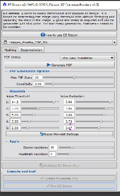

Aquí comentar que aunque este script sirve para realizar una convolución completa, aquí lo utilizaremos solamente para calcular el PSF para añadirlo a nuestro proceso *Deconvolution*.

Seleccionamos la pestaña *Deconvolution* y seleccionamos: `/Deconvolution/Generate PSF`

Obtendremos el fichero: **\_ez_PSF_Nombrefichero** que contiene nuestro PSF.

2. Creación de una máscara de Estrella para aplicar a “*Local deringing*” del proceso

Utilizamos el proceso *StarNet2* para generar una máscara de estrellas marcando:

- *Create starmask:* ON
- *Linear Data:* ON

Aplicamos *New Instance* ----> **ImagenInicial_clone**

Aplicamos Convolution con StdDev = 4.5 ----> **Local Supportimage**

3. Ahora aplicamos *Deconvolution* con las imágenes generadas anteriormente

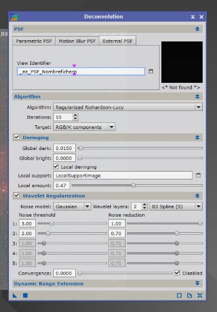

Antes de ejecutar la deconvolución a la imagen completa es conveniente generar una preview que se aplique rápidamente para ir viendo los resultados antes de decidir aplicar al total.

Como indica la figura adjunta colocamos los ficheros generados en el proceso *Deconvolution*:

- `/External PSF/View Identifier/_ez_PSF_Nombrefichero`
- `/Algorithm/Algorithm/Regularized Richardson-Lucy`
- `/Algorithm/Iterations/10`
- `/Algorithm/Target/RGB components`

Los valores de *Deringing* como partida los indicados en la imagen adjunta.

Los valores de *Wavelet Regularization* también como los indicados.

Aplicamos los cambios a la preview y cuando estemos satisfechos con el resultado hacemos *New Instance* a **ImagenInicial**.

Al final del proceso de Deconvolución debemos tener ausencia de halos en las estrellas, con una imagen limpia; si no es así hacemos Undo y continuamos con los ajustes.

Hacer hincapié en que si en un momento dado decidimos obviar la deconvolución porque no obtenemos resultados satisfactorios, no pasaría nada trascendente con nuestra imagen.

Después de aplicar este proceso llamamos a nuestra imagen: `ImagenPrincipal_crop_DBE_BN_CC_SCNR_decon`

## 7.- Linear Noise Reduction
Para la eliminación de ruido utilizaremos el proceso MLT (*MultiscaleLinearTransform*). Aquí volvemos a insistir en la conveniencia de utilizar previews para monitorizar los ajustes que vamos realizando; en primer lugar por el ahorro de tiempo en ver los resultados y segundo por la herramienta de Undo/Redo Preview que agiliza tremendamente la facilidad para detectar si vamos obteniendo resultados correctos. Para dar una aproximación de lo que es MLT podemos pensar que es un proceso que permite descomponer una imagen en diferentes escalas de su estructura y que nos permite aplicar operaciones matemáticas a cada una de ellas.

En las escalas pequeñas residen los detalles de la imagen y donde encontramos la mayor parte del ruido.

En las escalas grandes reside la información de los detalles grandes de la imagen, o sea, las formas más que los detalles

La gracia está en que MLT permite aplicar diferentes procesos a cada una de las escalas por separado. Podemos por lo tanto atacar el ruido de las estructuras de las escalas más pequeñas y dejar intactos los detalles de gran escala.

Dominar estos procesos no es tarea fácil, al menos para el que escribe, pero es fácil tener iconizada MLT con unos parámetros base y utilizarla cuando es necesario.

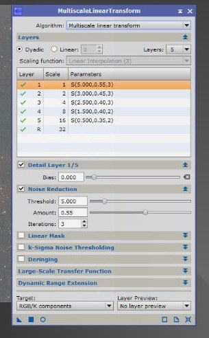

La pantalla adjunta puede ser un buen punto de partida para la eliminación de ruido.

Debemos pensar que en este proceso ya podríamos empezar a pensar en la necesidad de tener que emplear máscaras para seleccionar si atacamos el ruido de fondo, el ruido del objeto en cuestión o ambos.

Como en otros procesos, existen alternativas más avanzadas y algunas de pago para eliminación de ruido, pero aquí estamos en los inicios del postprocesado y no hace falta más.

Después de aplicar este proceso llamamos a nuestra imagen: `ImagenPrincipal_crop_DBE_BN_CC_SCNR_decon_MLT`

## 8.- Stretch
Con nuestra imagen ya compensada y con una primera reducción de ruido podemos hacer el Stretch para pasar a ser no lineal.

Aquí podemos encontrar tres formas de hacer el estirado (sin utilizar procesos más complicados):

- a. La más clásica de STF + HT
- b. MaskedStretch
- c. EZ Soft Stretch (que ahora disponemos con la incorporación de EZ Processing Suite)

### a.- STF + HT
Este es el proceso estándar que hemos aprendido en primer lugar.

Abrimos STF (*Screen Transfer Function*) con nuestra imagen objeto abierta,

1. Pulsamos *Reset*
2. Pulsamos *Track View*
3. Pulsamos *Unlink RGB Channels*
4. Pulsamos *Auto Stretch*

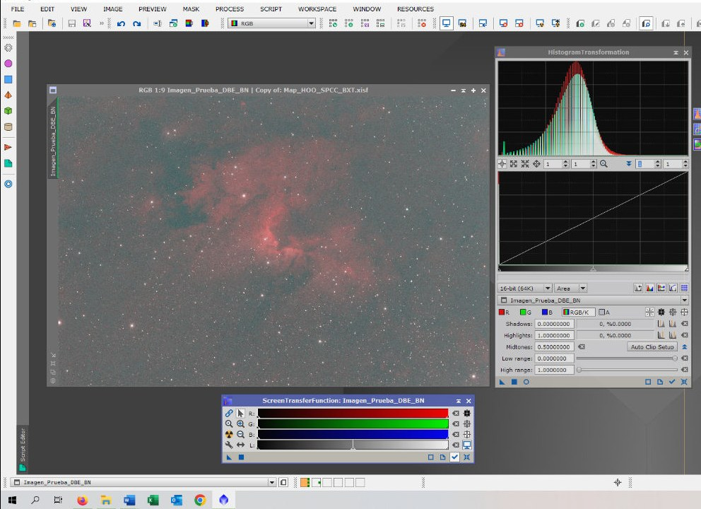

Con esto tenemos nuestra imagen con un Auto Stretch ligero; abrimos entonces HT (*HistogramTransformation*)

1. Pulsamos *Reset*
2. Seleccionamos la imagen de trabajo en HT
3. Arrastramos *New Instance* hasta la barra gris inferior de la ventana de HT
4. Hacemos *New Instance* de HT sobre la imagen de trabajo

La pantalla queda en blanco y tenemos que pulsar Reset en STF. La imagen principal vuelve a aparecer y ya la tenemos estirada; esa imagen no se oscurece a partir de ahora cuando pulsamos un *Reset Screen Transfer Functions*. Podemos acabar de dejarla a nuestro gusto con HT:

### b.- MaskedStretch
Este proceso empieza a utilizar la CPU con algo más de intensidad que los anteriores y por eso es importante trabajar con previews.

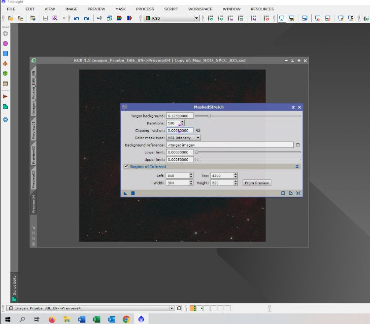

Vamos haciendo la prueba con varios previews de diferentes zonas para ver el resultado del total de la imagen.

No debemos olvidar seleccionar una preview para el valor del fondo.

### c.- EZ Soft Stretch
Este script nos facilita mucho el estirado de las imágenes. Tiene una zona de *Stretch Preview* que da una idea exacta de cómo está afectando el ajuste que vas realizando. Es una buena ayuda.

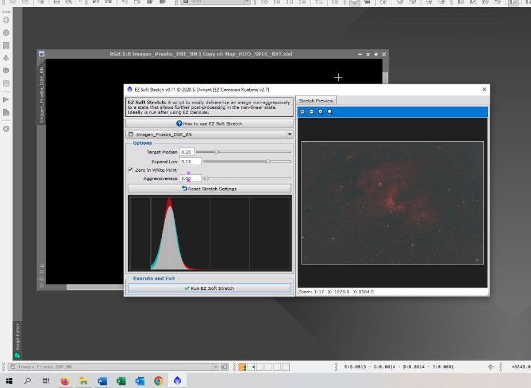

Cuando todo está como queremos pulsamos *Run EZ Soft Stretch* y ya tenemos nuestra imagen estirada. Hasta aquí los tres sistemas planteados.

Algunas veces si utilizas más de uno de estos procesos puede que no sepas cual escoger como definitivo, tal vez uno sea demasiado claro, otro muestre mejor las partes más brillantes o muestre más detalle.

En estos casos puede ayudar hacer una mezcla mediante *PixelMath*. Puedes hacer la suma de dos imágenes al 50% o bien una mezcla: `(ImagenHT*0.75+0.25*ImagenMStretch)` o cualquier otra combinación; casi no hay límite con *PixelMath*

Después de aplicar este proceso, supongamos EZ Soft Stretch, llamamos a nuestra imagen: `ImagenPrincipal_crop_DBE_BN_CC_SCNR_decon_MLT_EZstretch`

## Procesado de Fase No-Lineal
El objetivo de este trabajo era explicar la fase Lineal del post procesado pero quiero solamente presentar un diagrama de bloques para la fase no lineal.

No sin antes remarcar que así como en la fase lineal se puede definir un workflow que no variará mucho entre diferentes personas, en la fase no lineal las alternativas a utilizar son muchas y muy variadas con resultados que pueden ser muy similares pero también muy dispares.

Un workflow que nos llevará a resultados correctos puede ser:

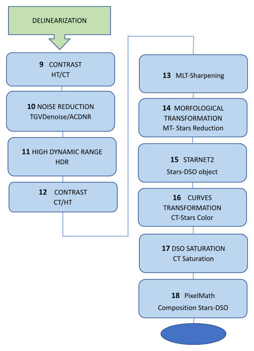

Hasta la próxima amigos,

Cielos claros!!
