L'objectiu d'aquest article és explicar la fase No-Lineal del postprocessat.

No sense abans remarcar que així com a la fase lineal es pot definir un workflow que no variarà gaire entre diferents persones, a la fase no lineal les alternatives a utilitzar són moltes i molt variades amb resultats que poden ser molt similars però també molt dispars.

Un workflow que ens portarà a resultats correctes pot ser:

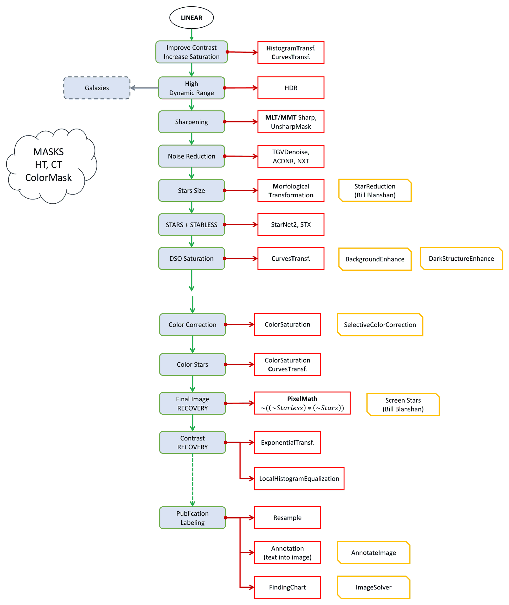

## Repasem l'estirat de la nostra imatge
Repetirem l'últim pas de la fase lineal, Stretching (delinearitzat, estirat, …), perquè obtindrem el fitxer per iniciar la fase no lineal.

Partim d'una imatge amb calibratge de color amb SPCC, deconvolucionada amb BlurXtermnator (BXT) i amb eliminació de soroll amb NoiseXterminator (NXT); podríem haver utilitzat altres processos per arribar al mateix resultat:

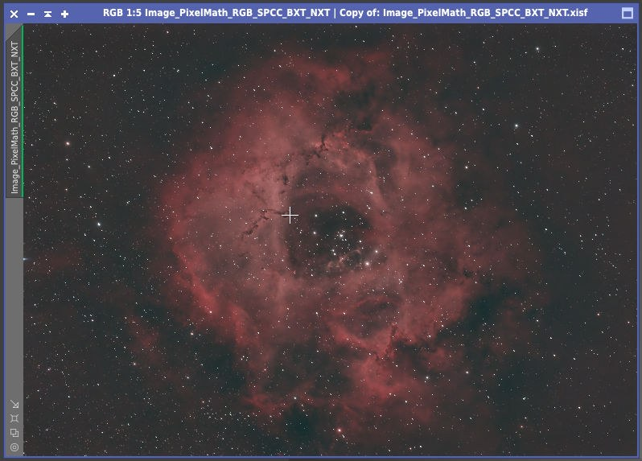

Com hem dit la següent fase és Delinearization (estirat):

Utilitzarem dos processos diferents, com a referència emprarem EZSoftStretch i també utilitzarem GHS (GeneralizedHyperbolicStretch). Utilitzar un procés com a referència per comparar el resultat amb un segon procés és una tàctica que utilitzo sovint.

De vegades, tenint dos estirats diferents, podem no trobar-nos a gust amb cap d'ells o bé que tinguem certes característiques que ens agradin com han quedat al primer i d'altres al segon; podem llavors utilitzar Pixel Math per obtenir-ne una barreja, en els percentatges que siguin, per veure si millorem així el resultat; normalment utilitzo un estirat “patró” amb STF+HT i després provo amb un altre que últimament sol ser GHS o EZSoftStretch.

Aquí hem fet servir l'estirat amb EZSoftStretch amb els valors per defecte. Veiem que hem guanyat en contrast i intensitat.

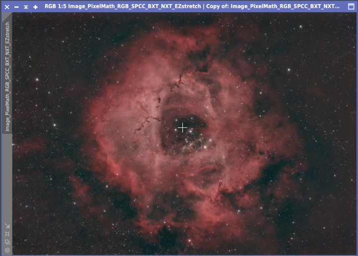

Moltes vegades n'hi ha prou amb el primer estirat realitzat, però si volem jugar una mica més amb PixI provarem amb GHS.

Farem servir la versió Process de GeneralizedHyperbolicStertch (també està en versió script).

L'aspecte que té GHS quan arrenquem el procés és el següent:

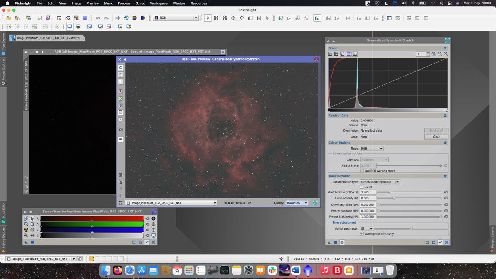

En primer lloc resetegem STF per tenir la nostra imatge sense estirar.

Movem l'stretch factor cap a la dreta per situar l'organigrama al 20-25% del fons d'escala.

Apliquem a la nostra imatge i fem reset per fer una altra iteració amb un nou ajust.

Amb el ratolí premut busquem sobre la nostra imatge zones de transició on la ratlla groga de SP canvia de sentit; seleccionem aquesta posició parant el ratolí i apliquem amb “Send to SP”.

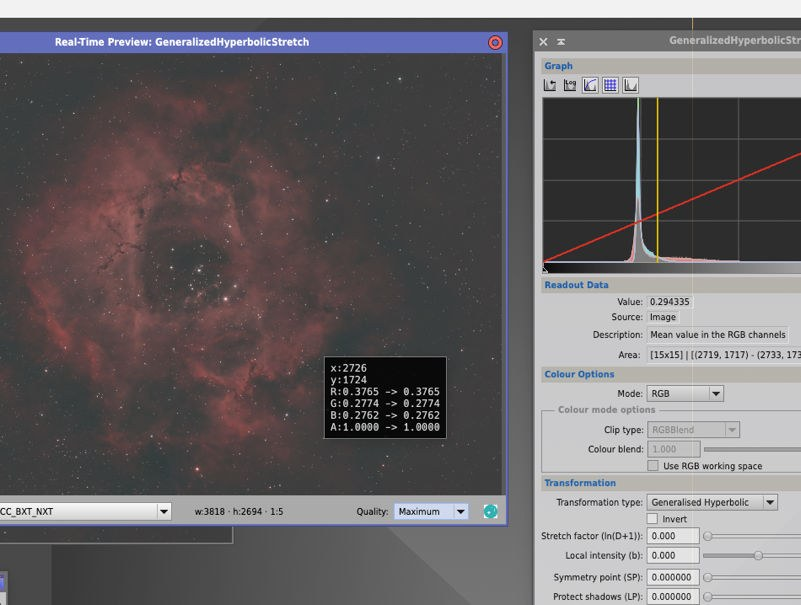

Movem “StretchFactor D” cap a la dreta i movem “Local Intensity (b)” cap a un valor que eixampli l'espectre, atenuant les baixes llums i reforçant les alts llums (aquest valor pot situar-se entre 6 i 8 però no necessàriament):

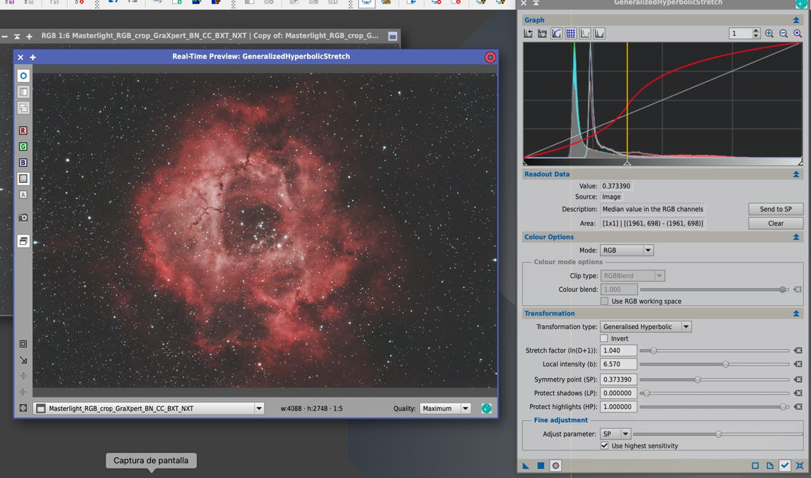

Un cop tinguem el valor desitjat apliquem al nostre fitxer original.

Fem tantes iteracions com creguem necessàries, buscant diferents zones de transició per aixecar els llums desitjats.

Després de cada aplicació, com estem a Real Time Preview, hem de fer reset per no tornar a aplicar el darrer ajustament a la nostra imatge.

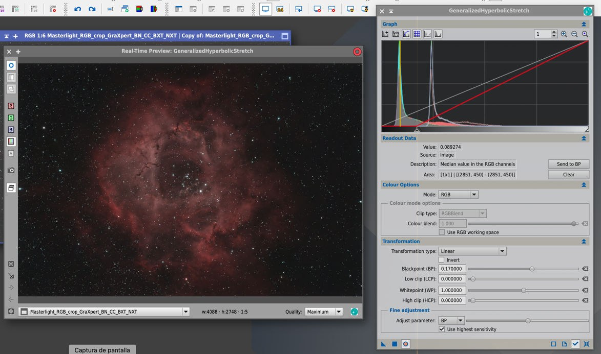

Ens fixem ara a la darrera imatge de pantalla.

Volem desplaçar la corba de l'histograma cap a l'esquerra, acostar-nos al punt zero i augmentar-ne el contrast.

Hem de seleccionar “Linear” a “Transformation Type” i augmentar el “Blackpoint(BP)” molt lleugerament (potser només algunes centmil·lèsimes {10E-5}) fins a col·locar la corba on desitgem.

Tinguem en compte que val més quedar-se una mica curt a passar-se.

Aquí tornem a comentar que igual que fem a la Fase Lineal, és convenient guardar-ne una còpia cada vegada que apliquem un procés; així sempre podem tornar a reprocessar des d’un punt determinat.

Aquesta serà la nostra elecció:

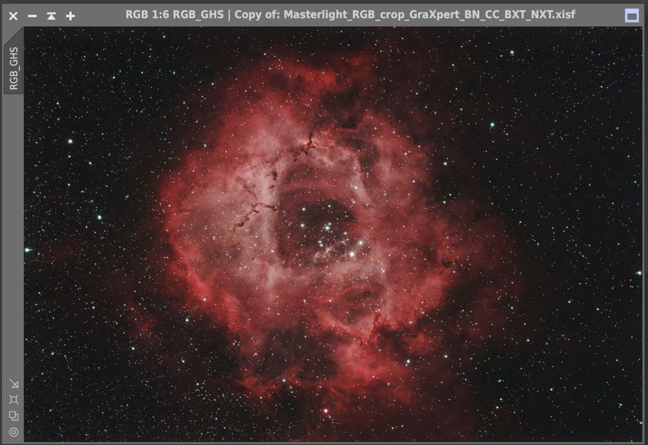

Sembla que la imatge resultant té més intensitat que amb EZSoftStretch.

Val la pena comentar que amb EZSoftStretch no hem jugat amb els valors, però és que així com GHS és molt amable mostrant-nos les modificacions que anem aplicant no passa igual amb EZSoftStretch.

Podríem millorar contrast i saturació de la nostra imatge amb HT i CT, però no val la pena amb el resultat obtingut.

## Millora del rang dinàmic
El pas següent podria ser aplicar el procés HDRMultiscaleTransform (High Dynamic Range) que normalment s'utilitza per rescatar detalls d'àrees massa brillants (molt utilitzat per processar el centre de les galàxies); els valors a aplicar serien:

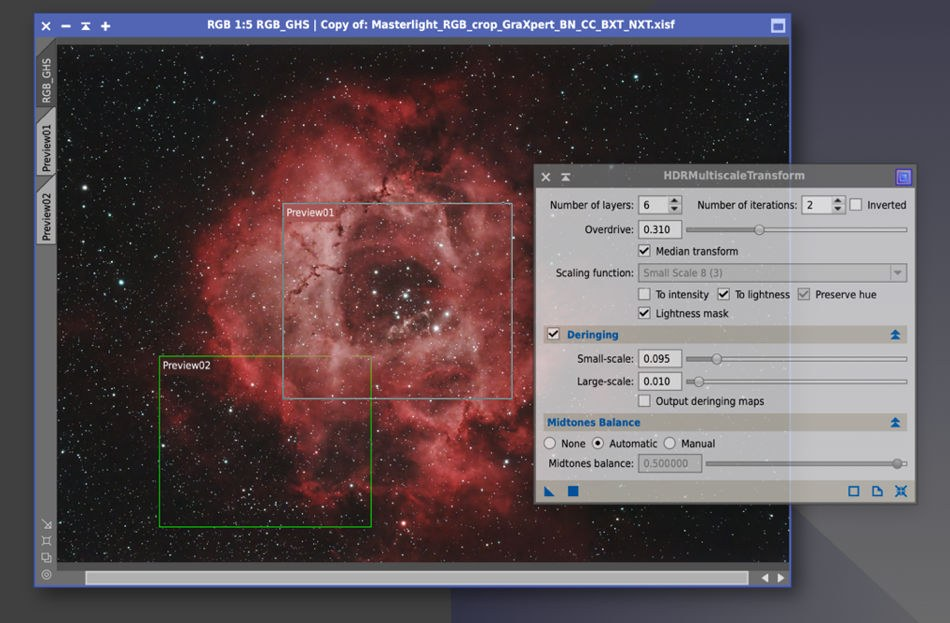

Aquí hem seleccionat l'opció “Median Transform”, però si no el seleccionem tenim fins a 15 diferents “Scaling Functions” per triar.

Amb aquestes eines de processament multiescala i altres de transformacions de wavelets és molt recomanable triar “Preview's”, tants com calguin, per valorar que la selecció realitzada sigui adequada i assegurar-se abans de llençar el procés a la imatge completa.

Recordem que tenim les icones Undo Preview i Redo Preview per fer un abans/després del procés que hem aplicat de manera molt efectiva.

En aplicar HDR la nostra imatge ha guanyat una mica de brillantor, però ha quedat més plana. No aplicarem HDR. En cas d'aplicar-ho, podeu ajustar el contrast amb CT o HT.

## Millora de la nitidesa i realçat de detalls
Tot seguit podem pensar en millorar el Sharpening de la nostra imatge amb MLT (MultiscaleLinearTransform) o amb MMT (MultiscaleMedianTransform).

Serà més indicat l'un o l'altre depenent de la naturalesa del nostre objecte.

Aconsello fer servir diversos Preview per provar el procés abans d'aplicar a la imatge original.

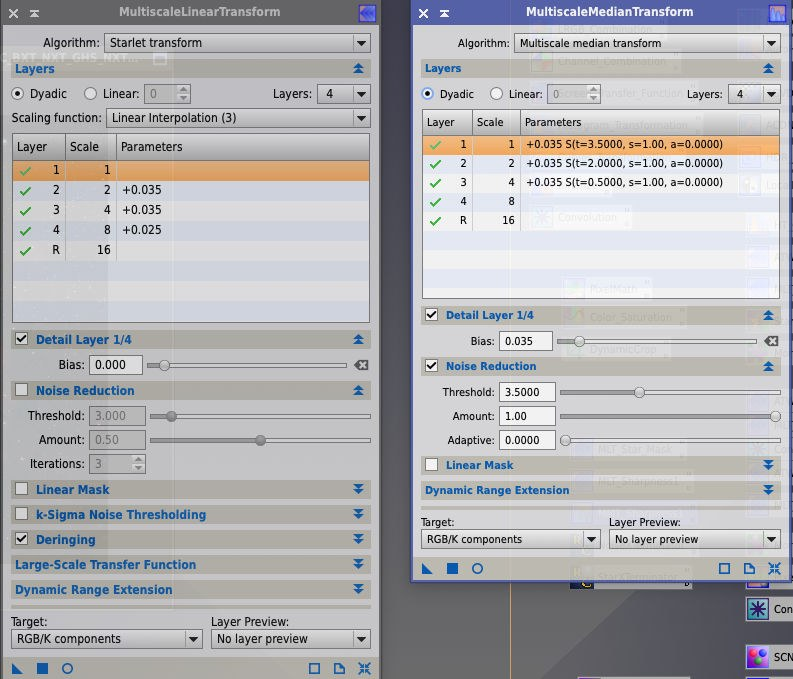

Els valors mostrats són els que utilitzo com a punt de partida i encara que no difereixin substancialment dels valors per defecte, són totalment aplicables amb bons resultats; amb la tècnica de Previews és fàcil aconseguir millors ajustaments.

Després de provar triem MMT perquè respecta millor la brillantor en aquesta imatge. El resultat és el següent:

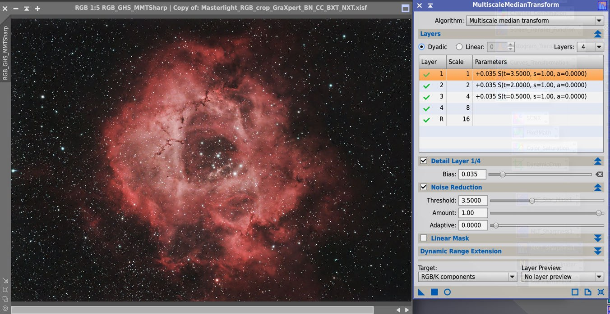

## Reducció de soroll
Aquí podem triar el procés TGVDenoise o el procés ACDNR, després d'aplicar una màscara de luminància invertida (Cie L* + Invert), o bé un procés d'última generació com NoiseXterminator (n'hi ha d'altres que no he provat).

Triem TGVDenoise amb els següents valors:

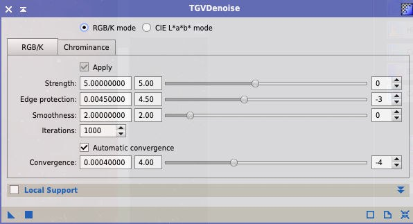

Com a curiositat una prova comparativa; el procés NoiseXTerminator ha trigat 4.8s; el procés TGVD ha trigat 3m50s amb 1000 iteracions i 1m37s quan hem ajustat a 400 iteracions; en tots dos casos amb els valors per defecte.

La comparativa de la imatge amb TGVD i amb NXT de l'extrem superior-esquerra de la Roseta és el següent:

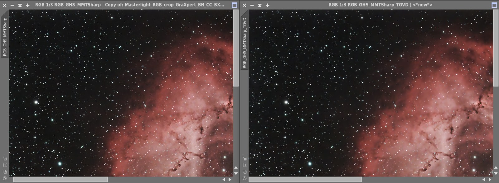

Aquí segurament costarà apreciar-ne la diferència. Els dos mètodes han eliminat el soroll correctament però NXT ha respectat més la imatge perquè apareix una mica més “tèrbola” amb TGVD. Cal tenir en compte que no hem emprat gaire temps a provar diferents valors.

El resultat amb TGVD és excel·lent.

## Reducció d'estrelles
Un cop eliminat el soroll podem fer una reducció d'estrelles; si no utilitzem scripts específics, podem utilitzar els processos nadius de PixI “StarMask” per fer una màscara d'estrelles i “MorfologicalTransformation” per reduir les estrelles.

Aplicant la màscara a la nostra imatge deixem només les pròpies estrelles com les parts que podem modificar en aplicar MorfologicalTransformation.

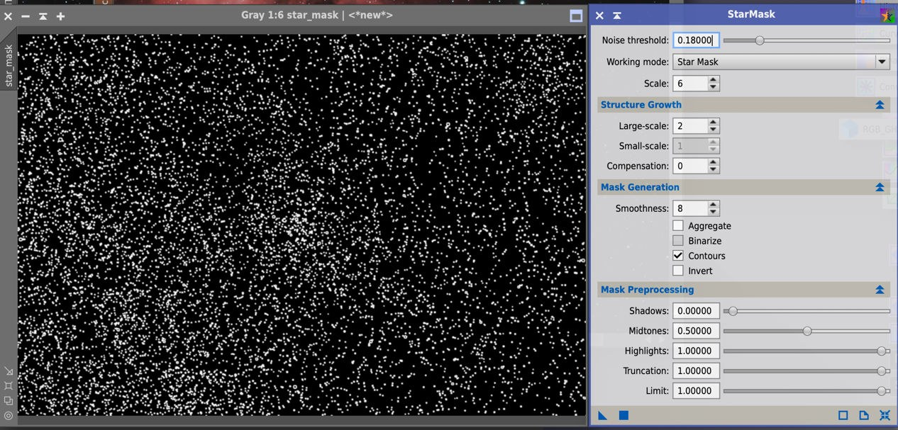

Amb la reducció d'estrelles, la nostra imatge queda amb aquest aspecte:

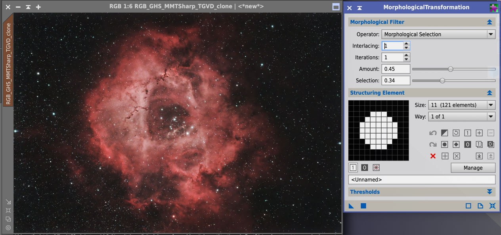

Podríem haver utilitzat el script StarReduction de Bill Blanshan; aquest té el següent aspecte:

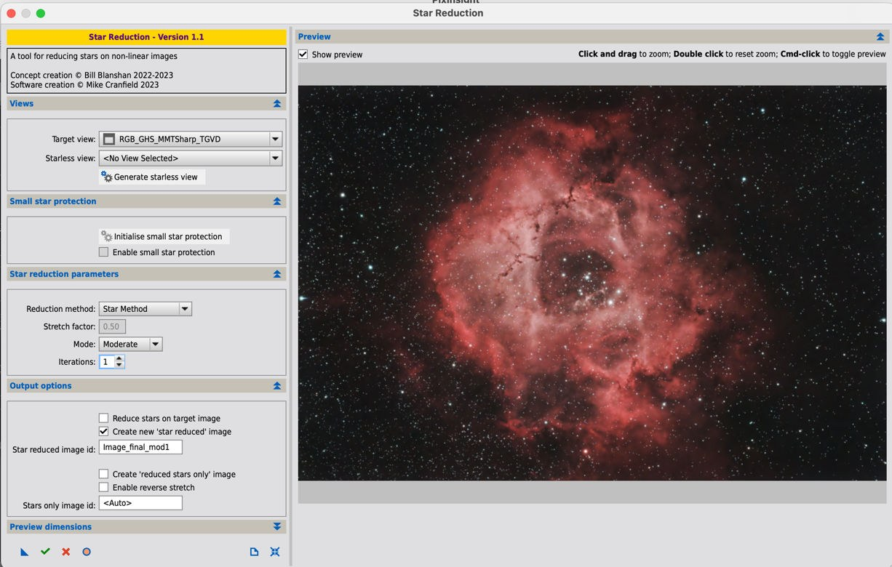

On només us hem d'indicar que ens generi la imatge starless (si la tenim, la seleccionem directament) i només queda triar els paràmetres de reducció escollits.

La pantalla Preview del propi script ens va mostrant el resultat de la selecció que anem fent. És molt efectiu !!!

## Millora d'estrelles i DSO
Després de la reducció d'estrelles podem dedicar un temps a millorar l'objecte principal (DSO, DeepSkyObject) per una banda i a millorar les estrelles de l'altra.

El sistema clàssic consistiria a utilitzar màscares d'estrelles perquè els tractaments que apliquem a l'objecte principal no afectin els estels i el mateix al contrari.

No obstant això, és molt més còmode separar les estrelles de l’objecte principal amb Starnet2 o StarXterminator; tots dos són equivalents i amb resultats molt similars.

Amb Starnet2 generarem les imatges “stars” i “starless”.

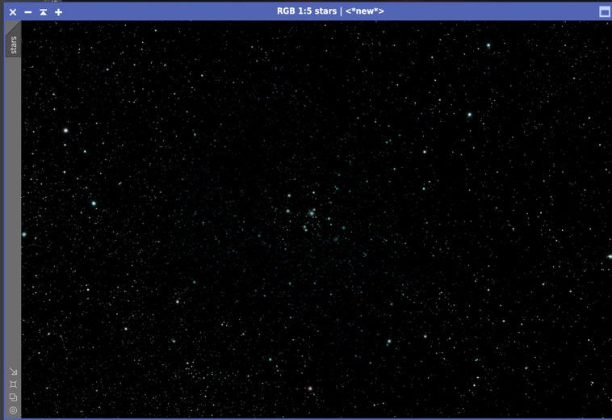

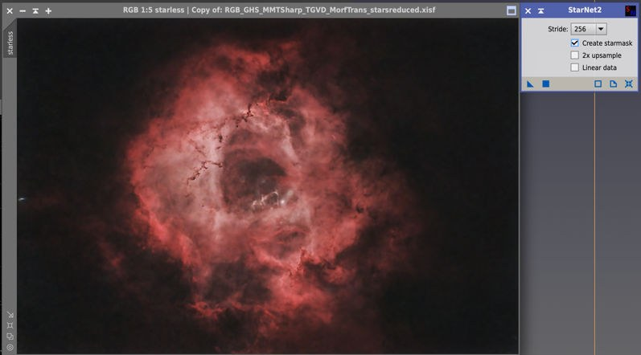

Per millorar el contrast de l'objecte principal podem aplicar l'script “DarkStructureEnhance”

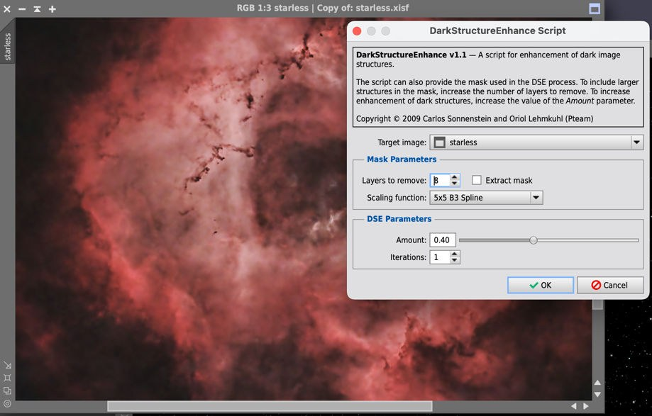

Ara retoquem lleugerament amb CurvesTransformation el contrast, saturació i lluminositat.

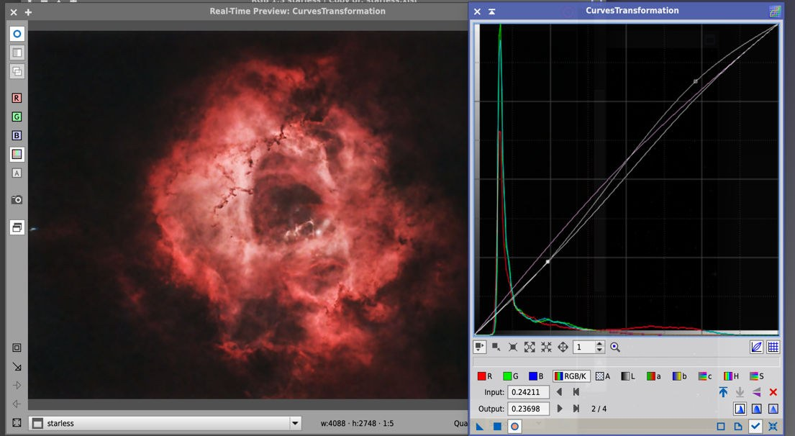

Ja ens agrada com queda i no retoquem res més.

## Correcció de color
En aquest punt podem fer canvis en el color de la nostra imatge mitjançant l'script “SelectiveColorCorrection”; les possibilitats que ens ofereix són infinites.

A la pantalla adjunta aplico una petita modificació com a exemple amb màscara de luminància seleccionada:

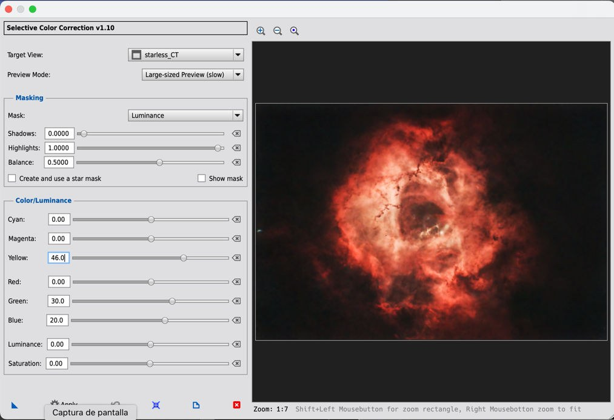

Hi ha tantes possibilitats de selecció que cal anar amb compte de no destrossar la nostra imatge amb un excés de modificacions de color.

Un cop hem acabat de modificar la imatge DSO podem centrar-nos en les estrelles.

Amb la imatge stars reduïm lleugerament el color blau amb “ColorSaturation” i no modifiquem res més.

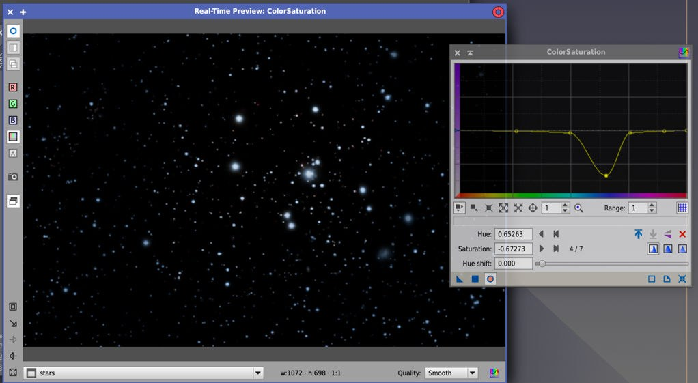

Altres camps d'estrelles potser ens inspiren per aplicar CurvesTransformation, però en el nostre cas no és així.

## Recuperació de la imatge final
Com ja hem acabat amb les nostres estrelles, passem a recuperar la imatge completa amb PixelMath utilitzant la fórmula:

```
~((~Starless) * (~Stars))
```

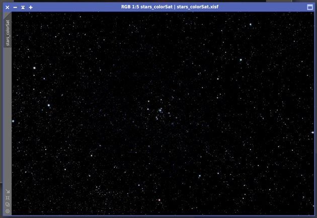

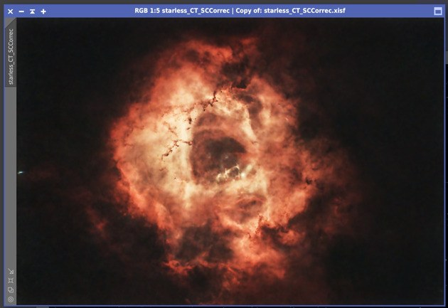

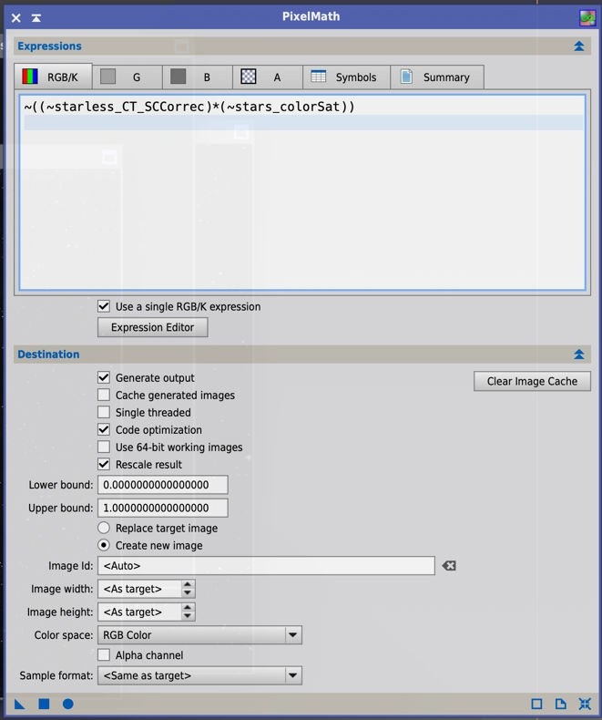

Aquesta fórmula que hem utilitzat a PixelMath permet integrar les estrelles sense produir les alteracions de sumar les dues imatges directament.

Apliquem PixelMath sobre la imatge starless i obtenim la nostra imatge final.

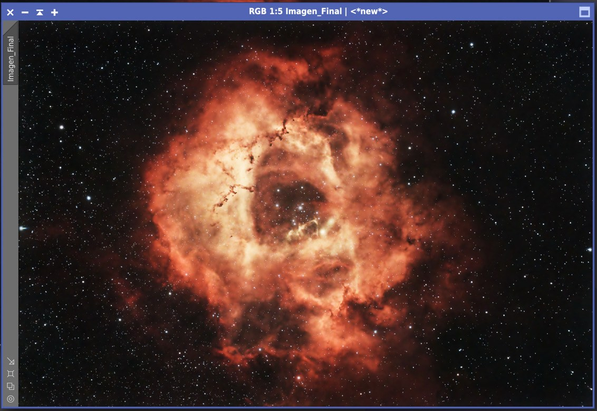

## Recuperació del contrast i detalls de la imatge
Ara podem intentar recuperar una mica de contrast local i detalls de la imatge.

Hem provat en un parell de previews el procés “ExponentialTransformation” però no obtenim millores a la imatge.

Provem amb el procés “LocalHistogramEqualization” i trobem un ajustament que queda bé amb aquests valors:

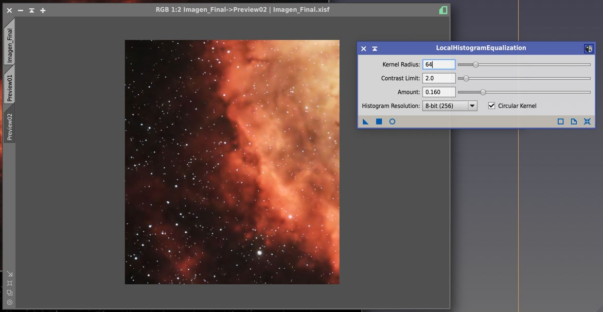

Apliquem el procés a ImatgeFinal i tenim ja el resultat definitiu:

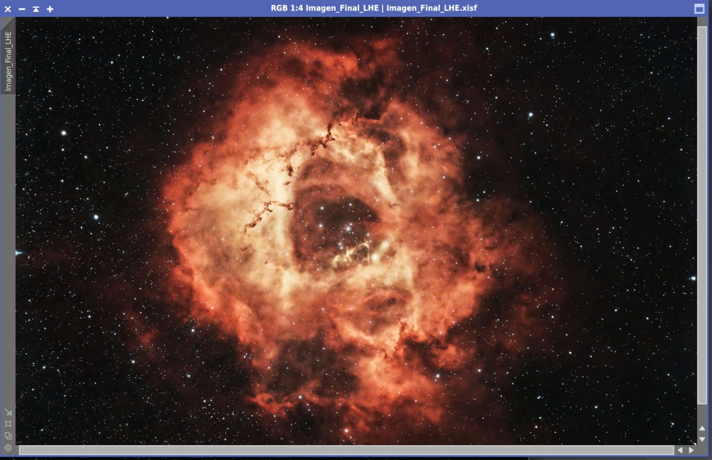

Potser no s'aprecia bé la diferència entre Imatge_Final i Imatge_Final_LHE, però recordem que els canvis han de ser subtils per obtenir un resultat correcte.

## Etiquetatge de la imatge final
Amb l'aplicació de LHE hem finalitzat l'organigrama bàsic per a la Fase No Lineal i només ens queda plantejar-nos si necessitem fer algun etiquetatge de la nostra fotografia, nom de l'autor, nom de l'objecte, etc.

A PixInsight no tenim gaires recursos per a tot això, però podem fer l'etiquetatge amb certa facilitat mitjançant el procés “AnnotateImage”:

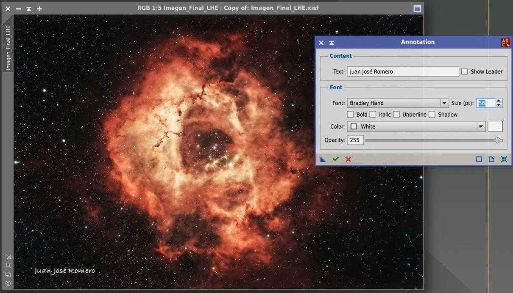

Amb el procés mostrat podem triar multitud de Fonts així com mida i colors dels nostres comentaris i posicionar-los on desitgem.

Si el que desitgem és col·locar comentaris amb indicadors tipus fletxa per remarcar detalls concrets de les nostres fotografies tenim l'script “DrawAnnotation”:

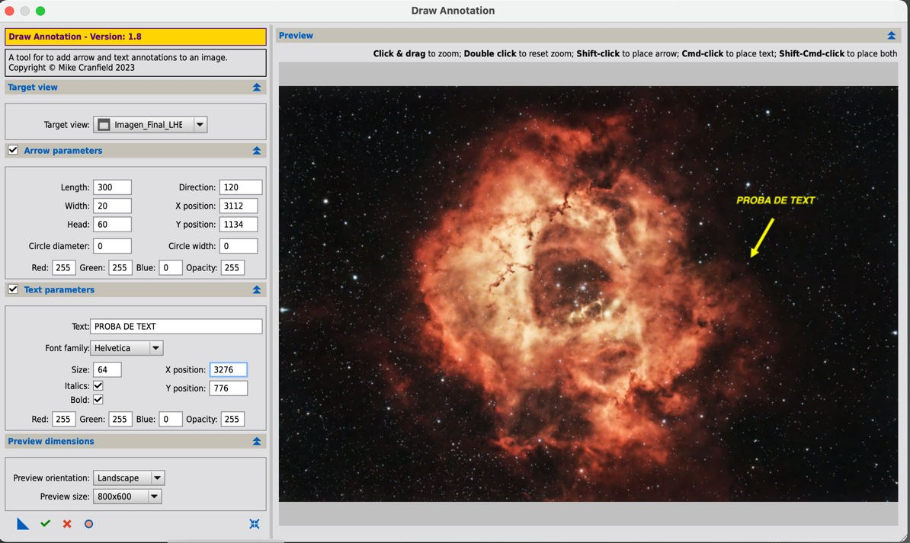

Finalment podem obtenir la Carta celeste corresponent a l'objecte que hem processat; això ho fem mitjançant el procés “FindingChart”.

Per aplicar aquest procés a la nostra Imagen_Final_LHE hem d'aconseguir que disposi d'un etiquetatge astromètric vàlid.

Per resoldre astromètricament la nostra imatge utilitzem l'script “ImageSolver” que el podem trobar a: `Script/Image Analysis/Image Solver`

La primera dificultat que ens podem trobar és que no coneguem els paràmetres de Dec i RA del centre de la nostra foto.

Podem obtenir les dades fent Search a la casella corresponent de l'script i això ens porta a la pantalla adjunta on podem seleccionar l'objecte desitjat de manera que quan polsem OK les dades es carreguen a l'script.

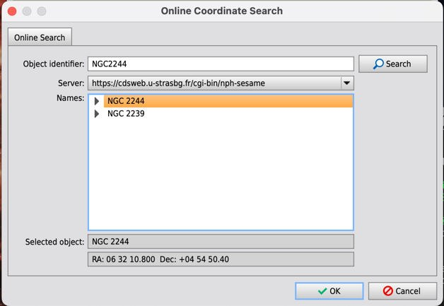

Les dades corresponents a la data i a l'hora les carreguem directament des del FITS Header de la nostra foto.

Si ho hem perdut durant el processament podem obtenir-lo del Header d'una foto \*.fit, \*.nef o \*.raw de la nostra col·lecció de lights; fem un New Instance a la nostra foto i ja tenim incorporades aquestes dades.

És molt important posar de forma correcta la mida de pixel i la distància focal del tub òptic. En el nostre cas, les dades de la Nikon D90 amb la què es van fer els lights.

Ja estem en disposició d'executar ImagePlateSolver fent servir el conjunt de dades Gaia DR3 que prèviament haurem carregat des de PixInsight Updater System.

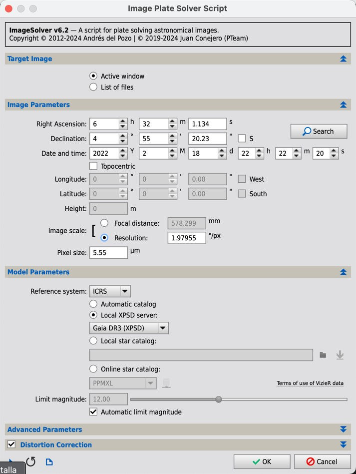

Premem OK i l'script s'executa resolent astromètricament la nostra imatge (que hem de tenir activa en carregar l'script).

El pas següent és executar el procés FindingChart, que té l'aspecte que veiem a la imatge adjunta.

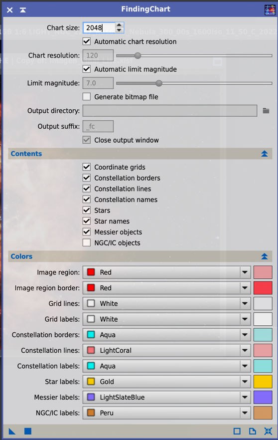

Podem seleccionar les informacions que volem que apareguin a la carta i els colors que desitgem per a cadascuna.

Seleccionem la mida de la nostra carta mitjançant Chart Size, serà de 2048 px en aquesta ocasió.

Fem New Instance sobre la nostra fotografia i obtenim una preciosa carta celeste amb el nostre objecte situat al centre de la mateixa marcat mitjançant un rectangle de color vermell.

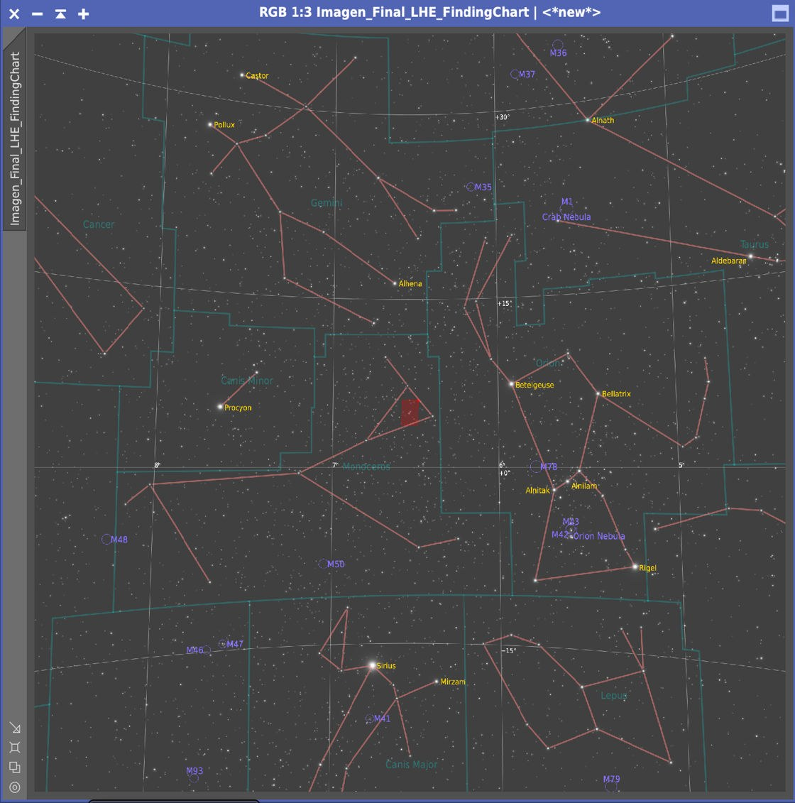

Amb aquest darrer procés hem arribat al final del nostre post-processat.

Fins a la propera amics, Cels clars !!
