El objetivo de este artículo es explicar la fase no lineal del posprocesado.

No sin antes remarcar que, así como en la fase lineal se puede definir un workflow que no variará demasiado entre distintas personas, en la fase no lineal las alternativas son numerosas y muy variadas, con resultados que pueden ser muy similares, pero también muy dispares.

Un workflow que nos llevará a resultados correctos puede ser:

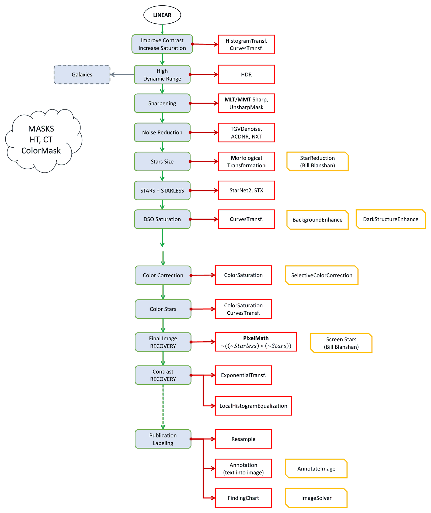

## Repasemos el estirado de nuestra imagen

Vamos a repetir el último paso de la fase lineal, Stretching (delinearizado, estirado, …), porque obtendremos el fichero para iniciar la fase no lineal.

Partimos de una imagen con calibración de color con SPCC, deconvolucionada con BlurXtermnator (BXT) y con eliminación de ruido con NoiseXterminator (NXT); podríamos haber utilizado otros procesos para llegar al mismo resultado:

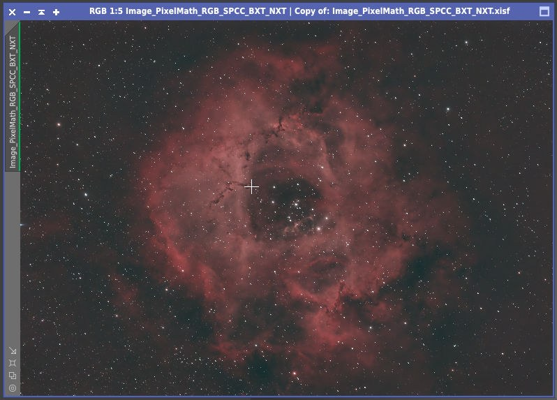

Como hemos dicho la siguiente fase es Delinearization (estirado):

Utilizaremos dos procesos diferentes, como referencia emplearemos EZSoftStretch y también utilizaremos GHS (GeneralizedHyperbolicStretch). Utilizar un proceso como referencia para comparar el resultado con un segundo proceso es una táctica que utilizo a menudo.

En ocasiones, teniendo dos estirados diferentes, podemos no encontrarnos a gusto con ninguno de ellos o bien que tengamos ciertas características que nos agraden como han quedado en el primero y otras en el segundo; podemos entonces utilizar Pixel Math para obtener una mezcla de ellos, en los porcentajes que sean, para ver si mejoramos así el resultado; normalmente utilizo un estirado “patrón” con STF+HT y luego pruebo con otro que últimamente suele ser GHS o EZSoftStretch.

Aquí hemos utilizado el estirado con EZSoftStretch con los valores por defecto. Vemos que hemos ganado en contraste e intensidad.

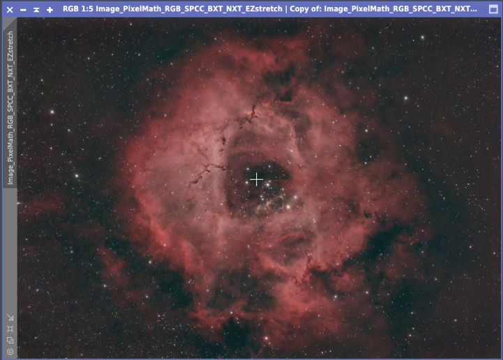

En muchas ocasiones es suficiente con el primer estirado realizado, pero si queremos jugar un poco más con PixI vamos a probar con GHS.

Utilizaremos la versión Process de GeneralizedHyperbolicStertch (también está en versión script).

El aspecto que tiene GHS cuando arrancamos el proceso es el siguiente:

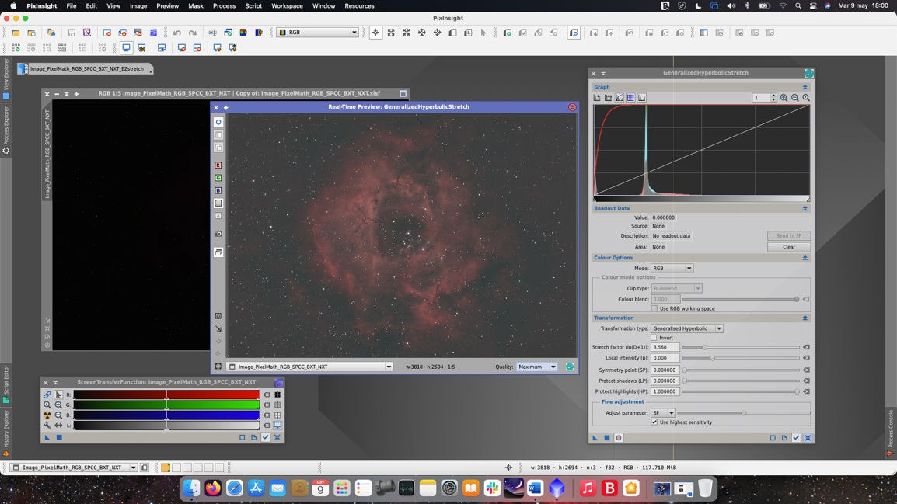

En primer lugar reseteamos STF para tener nuestra imagen sin estirar.

Movemos el stretch factor hacia la derecha para situar el organigrama al 20-25% del fondo de escala.

Aplicamos a nuestra imagen y hacemos reset para realizar otra iteración con un nuevo ajuste.

Con el ratón pulsado buscamos sobre nuestra imagen zonas de transición donde la raya amarilla de SP cambia de sentido; seleccionamos esa posición parando el ratón y aplicamos con “Send to SP”.

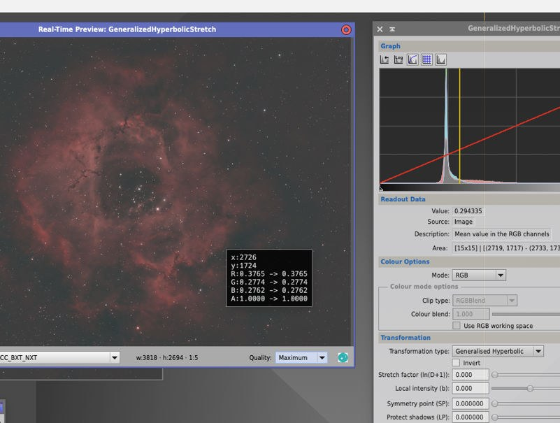

Movemos “StretchFactor D” hacia la derecha y movemos “Local Intensity (b)” hacia un valor que ensanche el espectro, atenuando las bajas luces reforzando las altas luces (ese valor puede situarse entre 6 y 8 pero no necesariamente):

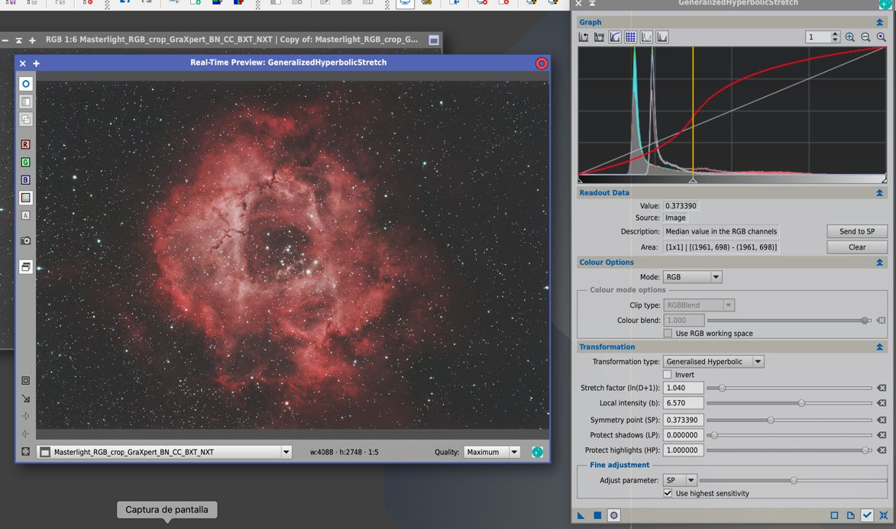

Una vez tengamos el valor deseado aplicamos a nuestro fichero original.

Hacemos tantas iteraciones como creamos necesarias, buscando diferentes zonas de transición para levantar las luces deseadas.

Después de cada aplicación, como estamos en Real Time Preview, tenemos que hacer reset para no volver a aplicar el último ajuste a nuestra imagen.

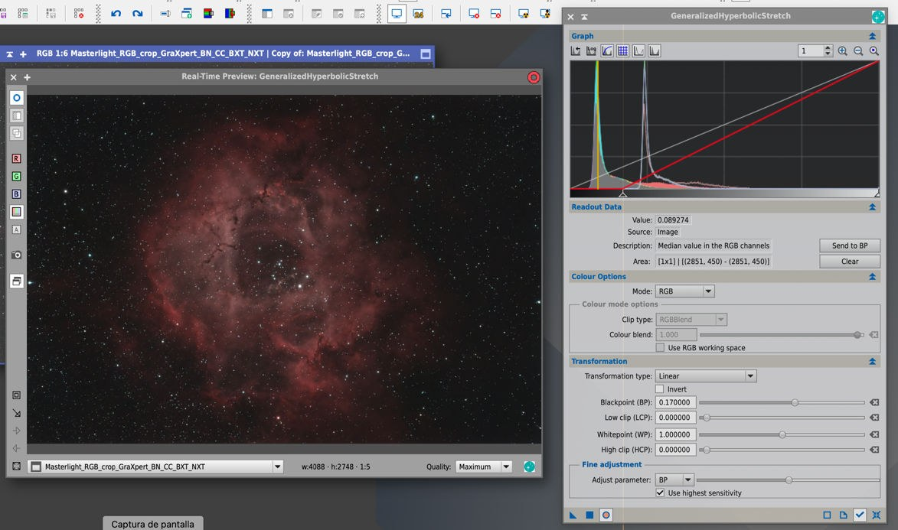

Nos fijamos ahora en la última imagen de pantalla.

Queremos desplazar la curva del histograma hacia la izquierda, acercarnos al punto cero y aumentar el contraste.

Hemos de seleccionar “Linear” en “Transformation Type” y aumentar el “Blackpoint(BP)” muy ligeramente (tal vez solamente algunas cienmilésimas {10E-5}) hasta colocar la curva donde deseamos.

Tengamos en cuenta que es mejor quedarse un poco corto a pasarse.

Aquí volvemos a comentar que igual que hacemos en la Fase Lineal, es conveniente guardar una copia cada vez que aplicamos un proceso; así siempre podemos volver a reprocesar desde un punto determinado.

Esta será nuestra elección:

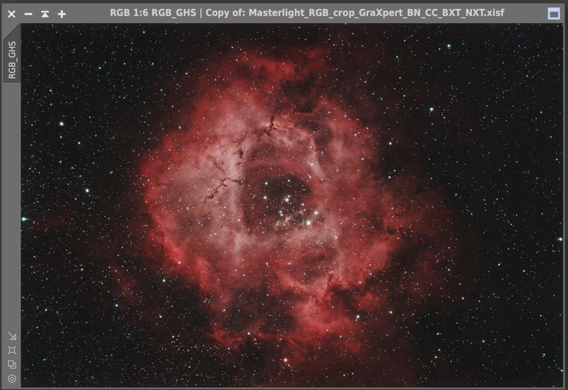

La imagen resultante parece que tiene más intensidad que con EZSoftStretch.

Vale la pena comentar que con EZSoftStretch no hemos jugado con los valores, pero es que así como GHS es muy amable mostrándonos las modificaciones que vamos aplicando no sucede igual con EZSoftStretch.

Podríamos mejorar contraste y saturación de nuestra imagen con HT y CT pero no vale la pena con el resultado obtenido.

## Mejora del rango dinámico

El siguiente paso podría ser aplicar el proceso HDRMultiscaleTransform (High Dynamic Range) que se suele utilizar para rescatar detalles de áreas demasiado brillantes (muy utilizado para procesar el centro de las galaxias); los valores a aplicar serían:

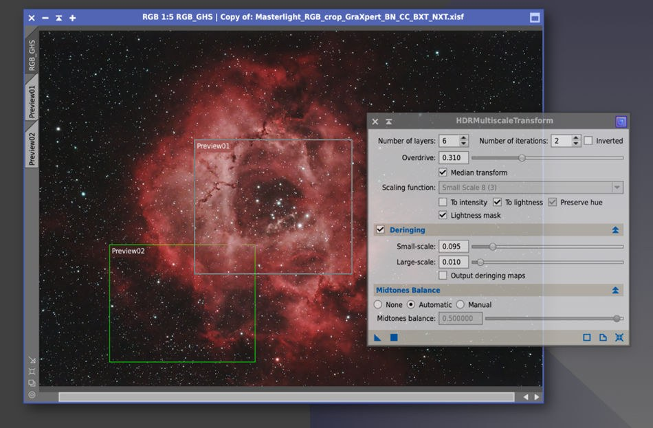

Aquí hemos seleccionado la opción Median Transform, pero si no lo seleccionamos tenemos hasta 15 diferentes “Scaling Functions” para elegir.

Con estas herramientas de procesado multiescala y otras de transformaciones de wavelets es muy recomendable elegir “Preview's”, tantos como hagan falta, para valorar que la selección realizada sea adecuada y asegurarse antes de lanzar el proceso a la imagen completa.

Recordemos que tenemos los iconos Undo Preview y Redo Preview para hacer un antes/después del proceso que hemos aplicado de una forma muy efectiva.

Al aplicar HDR nuestra imagen ha ganado algo de brillo, pero ha quedado más plana. No aplicaremos HDR. En caso de aplicarlo, podemos ajustar el contraste con CT o HT.

## Mejora de la nitidez y realce de detalles

Seguidamente podemos pensar en mejorar el Sharpening de nuestra imagen con MLT o con MMT. Será más indicado uno u otro dependiendo de la naturaleza de nuestro objeto.

Aconsejo utilizar diversos Preview para probar el proceso antes de aplicar a la imagen original.

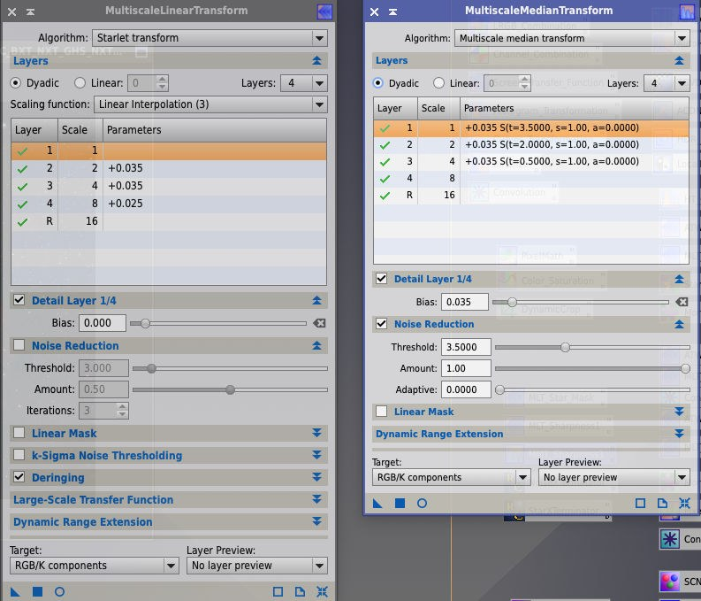

Los valores mostrados son los que utilizo como punto de partida y aunque no difieran sustancialmente de los valores por defecto, son totalmente aplicables con buenos resultados; con la técnica de Previews es fácil conseguir mejores ajustes.

Después de probar elegimos MMT porque respeta mejor el brillo en esta imagen. El resultado es el siguiente:

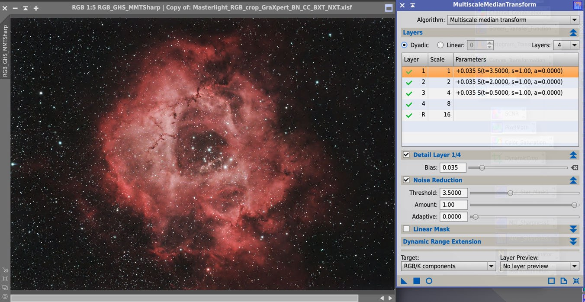

Ahora vamos a hacer una reducción de ruido.

## Reducción de ruido

Aquí podemos elegir el proceso TGVDenoise o el proceso ACDNR, después de aplicar una máscara de luminancia invertida (Cie L* + Invert), o bien un proceso de última generación como NoiseXterminator (existen otros que no he probado).

Elegimos TGVDenoise

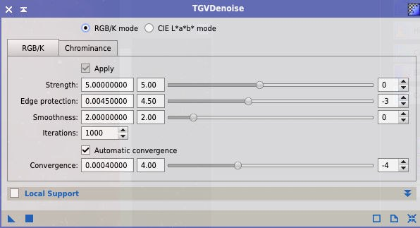

Como curiosidad una prueba comparativa; el proceso NoiseXTerminator ha tardado 4.8s, el proceso TGVD ha tardado 3m50s con 1000 iteraciones y 1m37s cuando hemos ajustado a 400 iteraciones; en ambos casos con los valores por defecto.

La comparativa de la imagen con TGVD y con NXT del extremo superior-izquierdo de la Roseta es el siguiente:

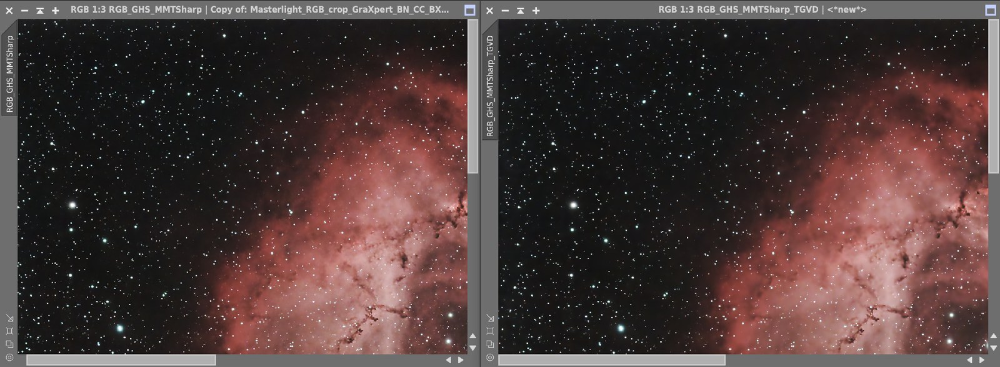

Aquí seguramente cueste apreciar la diferencia. Los dos métodos han eliminado el ruido correctamente pero NXT ha respetado más la imagen porque aparece un poco más “turbia” con TGVD. Hay que tener en cuenta que no hemos empleado mucho tiempo en probar diferentes valores.

El resultado con TGVD es excelente.

## Reducción de estrellas

Una vez eliminado el ruido podemos hacer una reducción de estrellas; si no utilizamos scripts específicos, podemos utilizar los procesos nativos de PixI “StarMask” para hacer una máscara de estrellas y “MorfologicalTransformation” para reducir las estrellas.

Aplicando la máscara a nuestra imagen dejamos solamente las propias estrellas como las partes que podemos modificar al aplicar MorfologicalTransformation.

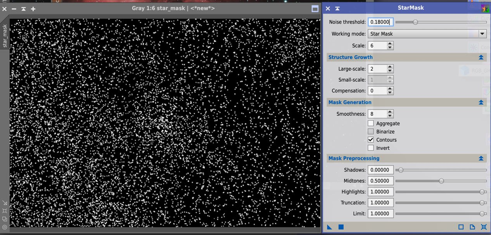

Con la reducción de estrellas nuestra imagen queda con este aspecto:

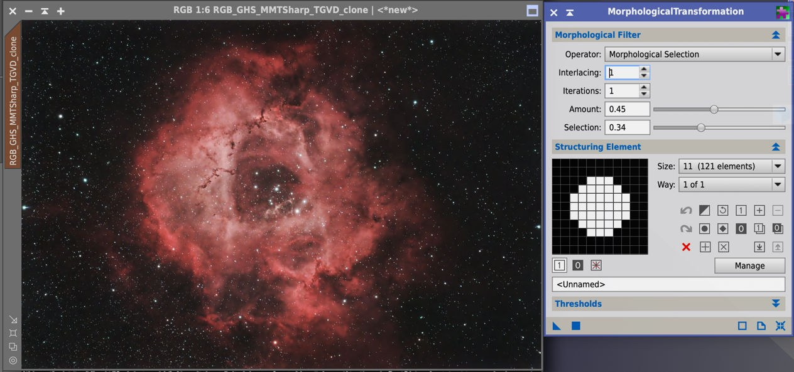

Podríamos haber utilizado el script StarReduction de Bill Blanshan; éste tiene el siguiente aspecto:

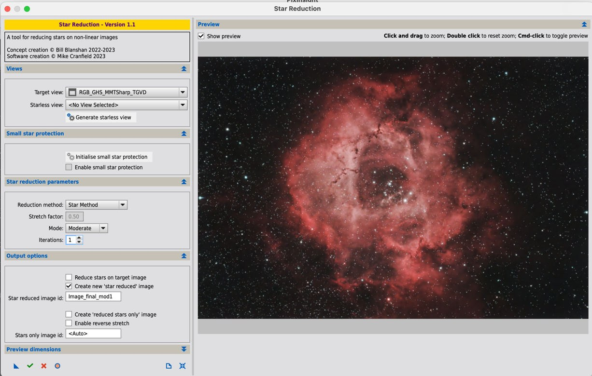

Donde solamente le tenemos que indicar que nos genere la imagen starless (si la tenemos, la seleccionamos directamente) y solamente queda elegir los parámetros de reducción escogidos.

La pantalla Preview del propio script nos va mostrando el resultado de la selección que vamos realizando. Es muy efectivo !!!

## Mejora de estrellas y DSO

Después de la reducción de estrellas podemos dedicar un tiempo a mejorar el objeto principal por un lado y a mejorar las estrellas por el otro.

El sistema clásico consistiría en utilizar máscaras de estrellas para que los tratamientos que aplicamos al objeto principal no afecten a las estrellas y lo mismo al contrario.

Sin embargo, es mucho más cómodo separar las estrellas del objeto principal con Starnet2 o StarXterminator; ambos son equivalentes y con resultados muy similares.

Con Starnet2 generaremos las imágenes “stars” y “starless”.

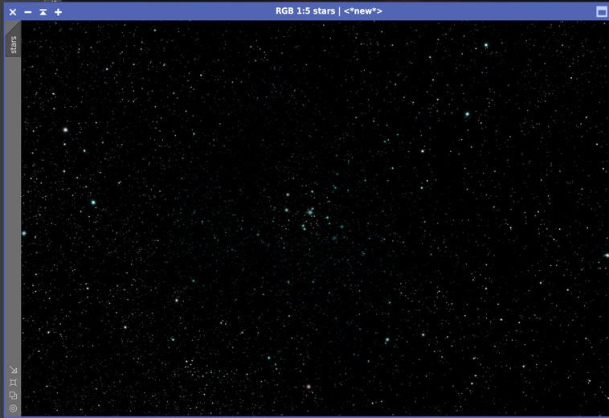

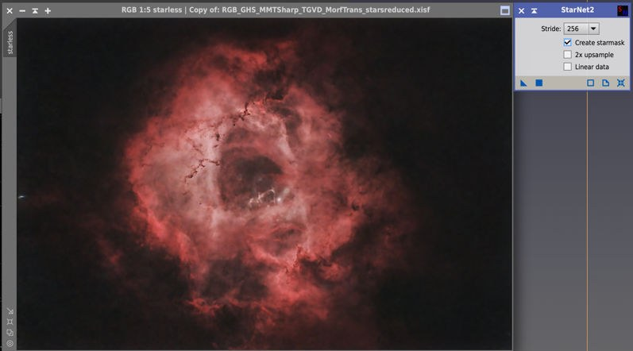

Para mejorar el contraste del objeto principal podemos aplicar el script “DarkStructureEnhance”

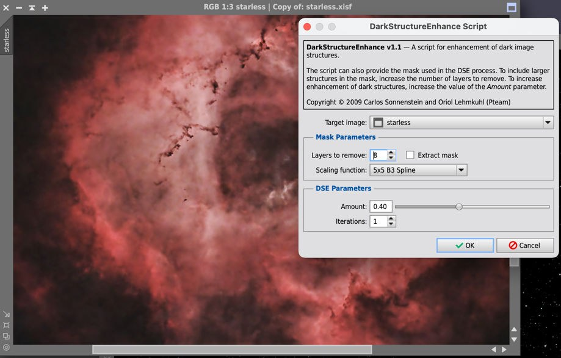

Ahora retocamos ligeramente con “CurvesTransformation” el contraste, saturación y luminosidad.

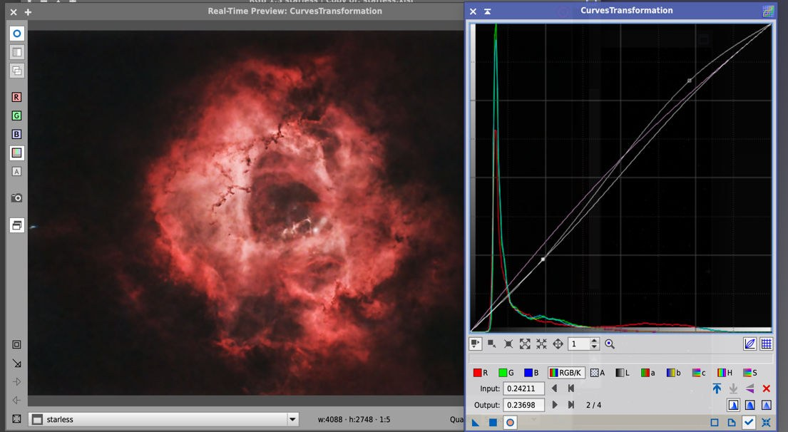

Ya nos gusta como queda y no retocamos nada más.

## Corrección de color

En este punto comentar que podemos hacer cambios en el color de nuestra imagen mediante el script “SelectiveColorCorrection”; las posibilidades que tenemos son infinitas.

En la pantalla adjunta aplico una pequeña modificación a modo de ejemplo con máscara de luminancia seleccionada:

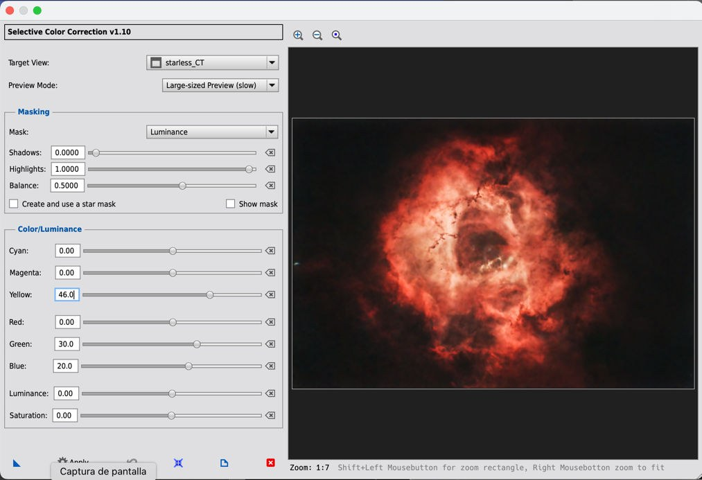

Hay tantas posibilidades de selección que hay que tener cuidado con no destrozar nuestra imagen con una “sobremodificación”.

Una vez hemos acabado de modificar la imagen DSO podemos centrarnos en las estrellas.

Con la imagen stars reducimos ligeramente el color azul con “ColorSaturation” y no modificamos nada más.

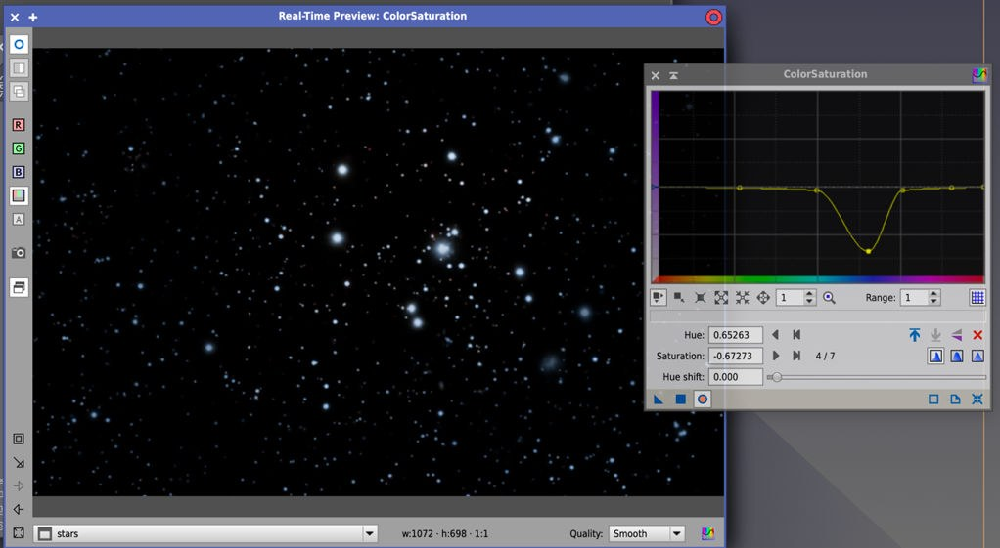

Otros campos de estrellas posiblemente nos inspiren para aplicar CurvesTransformation, pero en nuestro caso no es así.

## Recuperación de la imagen final

Como ya hemos acabado con nuestras estrellas, pasamos a recuperar la imagen completa con PixelMath utilizando la fórmula:

```
~((~Starless) * (~Stars))
```

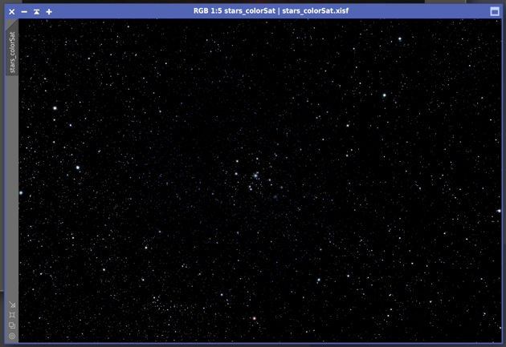

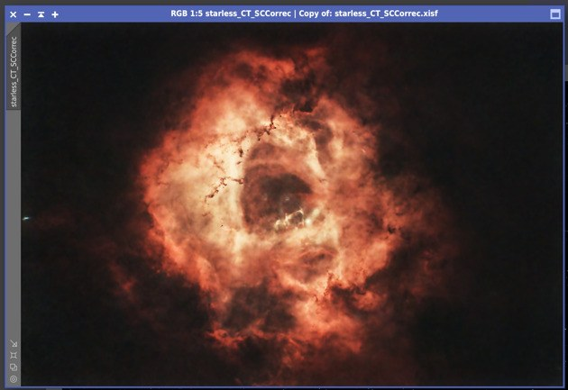

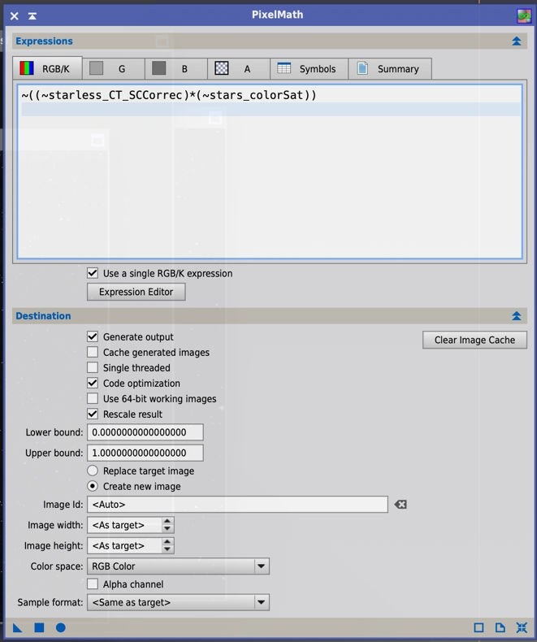

Esta fórmula que hemos utilizado en PixelMath permite integrar las estrellas sin producir las alteraciones de sumar ambas imágenes directamente.

Aplicamos PixelMath sobre la imagen starless y obtenemos nuestra imagen final.

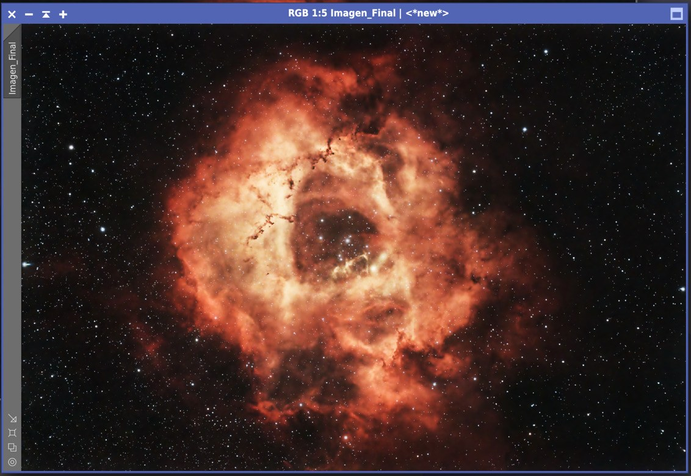

## Recuperación del contraste y detalles de la imagen

Ahora podemos intentar recuperar algo de contraste.

Hemos probado en un par de previews el proceso “ExponentialTransformation” pero no obtenemos mejoras en la imagen.

Probamos con el proceso “LocalHistogramEqualization” y encontramos un ajuste que queda bien con estos valores:

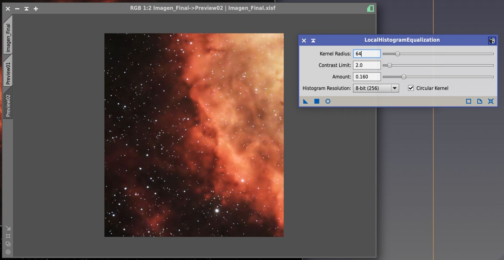

Aplicamos el proceso a ImagenFinal y tenemos ya el resultado definitivo:

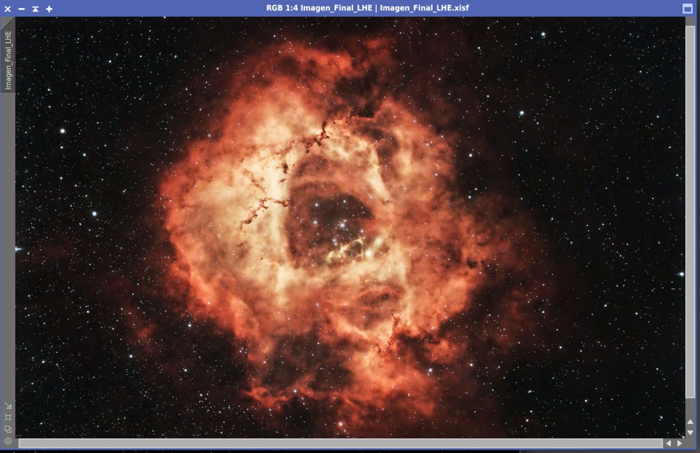

Tal vez no se aprecie bien la diferencia entre Imagen_Final e Imagen_Final_LHE, pero recordemos que los cambios deben ser sutiles para obtener un resultado correcto.

## Etiquetado de la imagen final

Con la aplicación de LHE hemos finalizado el organigrama básico para la Fase No Lineal y solamente queda plantearnos si necesitamos hacer algún etiquetado de nuestra fotografía, nombre del autor, nombre del objeto, … etc.

En PixInsight no tenemos demasiados recursos para todo ello, pero podemos realizar el etiquetado con cierta facilidad mediante el proceso “AnnotateImage”:

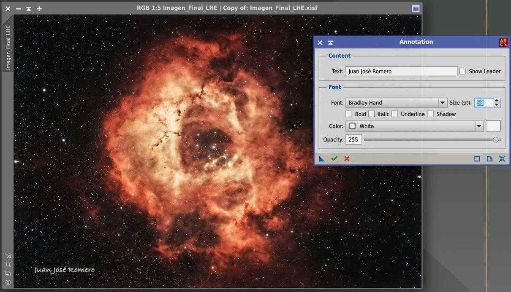

Con el proceso mostrado podemos elegir multitud de Fuentes así como tamaño y colores de nuestros comentarios y posicionarlos donde deseemos.

Si lo que deseamos es colocar comentarios con indicadores tipo flecha para remarcar detalles concretos de nuestras fotografías tenemos el script DrawAnnotation:

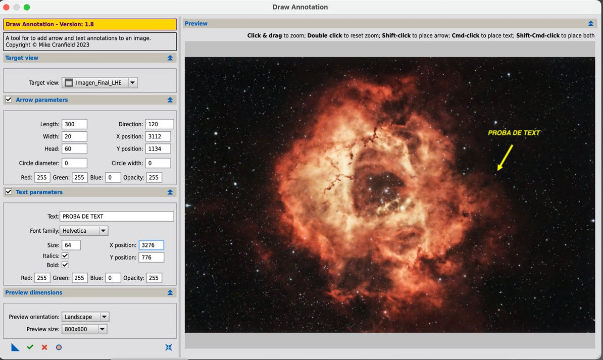

Por último podemos obtener la Carta celeste correspondiente al objeto que hemos procesado; esto lo hacemos mediante el proceso “FindingChart”.

Para aplicar este proceso a nuestra Imagen_Final_LHE hemos de conseguir que ésta disponga de un etiquetado astrométrico válido.

Para resolver astrométricamente nuestra imagen utilizamos el script “ImageSolver” que podemos encontrarlo en: `Script/Image Analysis/Image Solver`

La primera dificultad que podemos encontrarnos es que no conozcamos los parámetros de Dec y RA del centro de nuestra foto.

Podemos obtener los datos haciendo Search en la casilla correspondiente del script y esto nos lleva a la pantalla adjunta donde podemos seleccionar el objeto deseado de forma que cuando pulsamos OK los datos se cargan en el script.

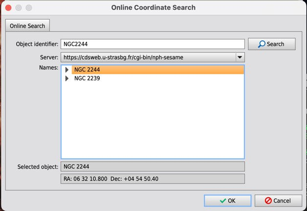

Los datos correspondientes a la fecha y a la hora los cargamos directamente desde el FITS Header de nuestra foto.

Si lo hemos perdido durante el procesado podemos obtenerlo del Header de una foto \*.fit, \*.nef o \*.raw de nuestra colección de lights; hacemos un New Instance a nuestra foto y ya tenemos incorporados esos datos.

Ya estamos en disposición de ejecutar ImagePlateSolver utilizando el conjunto de datos Gaia DR3 que previamente habremos cargado desde PixInsight Updater System.

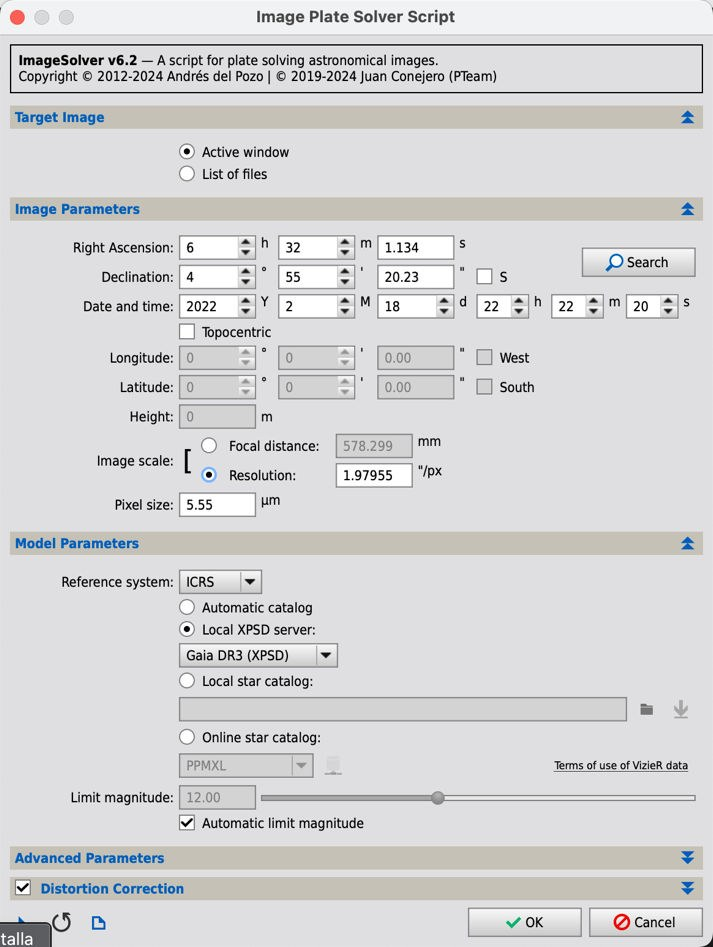

Pulsamos OK y el script se ejecuta resolviendo astrométricamente nuestra imagen (que debemos tener activa al cargar el script).

El siguiente paso es ejecutar el proceso FindingChart, que tiene el aspecto que vemos en la imagen adjunta.

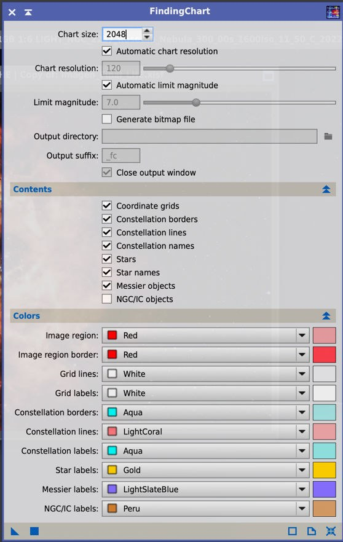

Podemos seleccionar las informaciones que queremos que aparezcan en la carta y los colores que deseamos para cada una de ellas.

Seleccionamos el tamaño de nuestra carta mediante Chart Size, será de 2048 px en esta ocasión.

Hacemos New Instance sobre nuestra fotografía y obtenemos una preciosa carta celeste con nuestro objeto situado en el centro de la misma marcado mediante un rectángulo de color rojo.

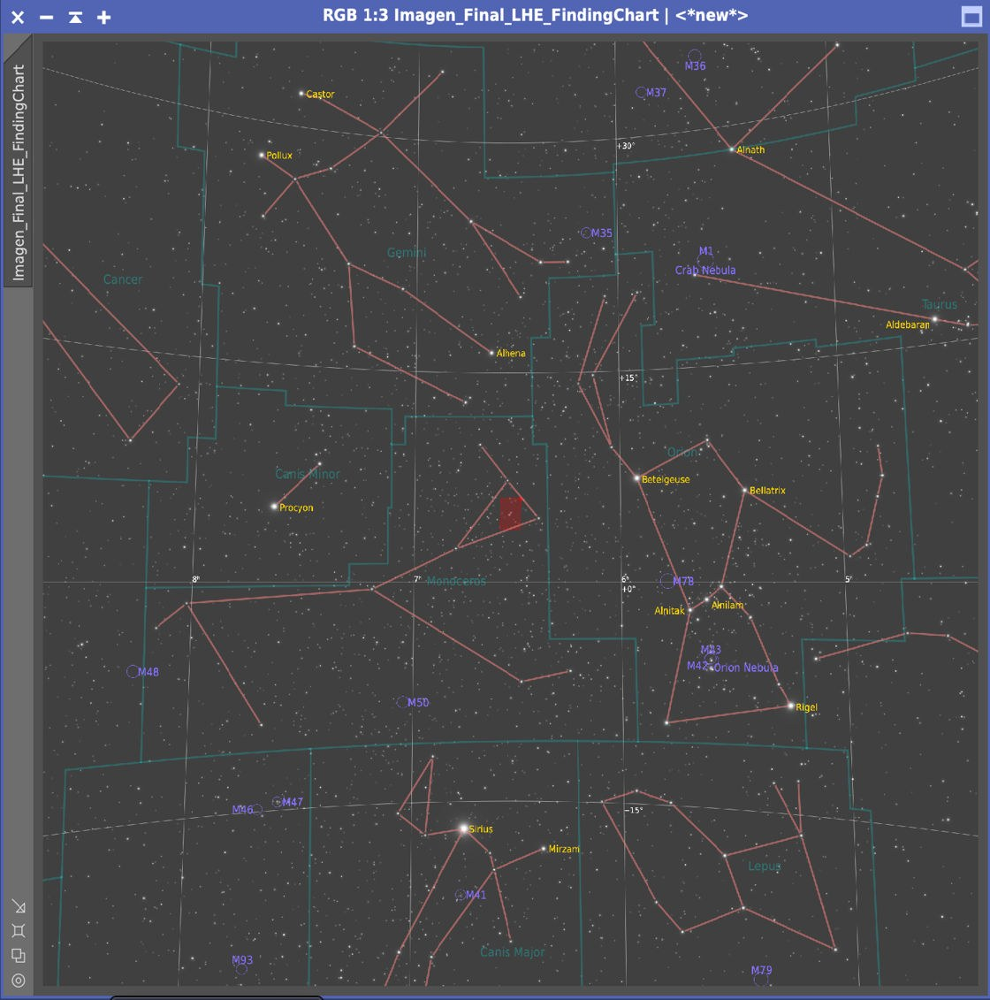

Con este último proceso hemos llegado al final de nuestro post-procesado.

Hasta la próxima, amigos. ¡Cielos despejados!
