Aquí proposo com preparar una sessió d'astronomia visual i/o fotogràfica sobre la base de la meva pròpia experiència i amb les ajudes que normalment utilitzo.

En una sessió d'astronomia disposem d'un temps limitat, moltes vegades ens obliga a fer un desplaçament considerable i sempre necessitem fer tasques de muntatge i desmuntatge que de vegades són laborioses. Potser el temps útil que en podem gaudir pot ser un petit percentatge del total emprat i és el primer motiu pel qual hem de preparar adequadament la sessió i treure'n rendiment.

Partim que tenim elegit el lloc d'observació i que coneixem perfectament aspectes de contaminació lumínica i valor a l'escala bortle de la zona escollida.

Veurem quins aspectes controlar per realitzar la nostra sessió astronòmica.

- El primer punt és controlar quan tenim una finestra de cel fosc
- En segon lloc, conèixer la previsió meteorològica: nebulositat, vent, seeing
- En tercer lloc triar l'objecte a observar i la finestra temporal disponible

## 1. Conèixer posició i edat de la Lluna
Dins l'apartat de conèixer quines condicions ens trobarem hem de donar importància crucial a la Lluna.

Sempre intentem sortir amb Lluna Nova però també hi ha situacions en què tenim una fase lunar amb forta il·luminació però que la sortida o l'ocultació es produeix fora del període de foscor com a l'exemple mostrat al capítol següent.

Per això utilitzo una App molt senzilla, fàcil d'utilitzar i gratuïta: APT Darkness Clock (APT DC) que està dissenyada pels creadors de la suite APT.

Un apunt: la suite APT (Astro Photography Tool) és una aplicació que es fa servir per controlar les sessions d'astrofoto (anàloga a NINA, SGP, SharpCap,…) APT Darkness Clock es troba a: [www.astroplace.net/MobileApps/](https://www.astroplace.net/MobileApps/)

S'utilitza de forma independent i l'aspecte que té en un telèfon intel·ligent és el següent:

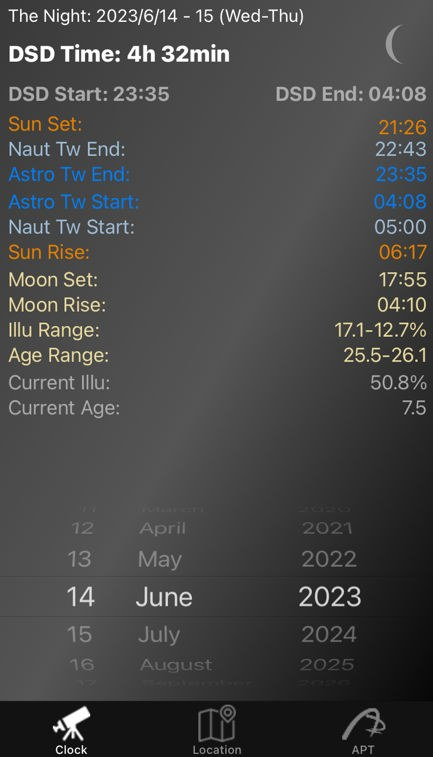

- **DSD Time:** Deep Sky Darkness; és el temps disponible per observar o fotografiar objectes de cel profund sense Lluna ni crepuscles.
- **DSD Start:** quan comença el DSD
- **DSD End:** quan finalitza el DSD
- **Sun Set/Rise:** Temps per a la posta de Sol / matinada
- **Naut Tw End/Start:** temps per a la posta de Sol / matinada nàutics
- **Astro Tw End/Start:** temps per a la posta de Sol / matinada astronòmics
- **Illu Range:** Rang d'il·luminació de la Lluna per a la data seleccionada
- **Age Range:** Rang d'edat de la Lluna (dies) per a la data seleccionada
- **Current Illu/Age:** La il·luminació/edat de la Lluna pel moment present

A la pantalla adjunta veiem que disposem de 4h 32 min de foscor per a la data seleccionada.

## 2. Previsió meteorològica
Hem d'aconseguir una previsió el més encertada possible sobre la meteorologia que ens trobarem al lloc i data escollits per a la sessió.

Afortunadament avui dia disposem de moltes eines que ens faciliten la tasca; les dades de la nebulositat, vent i seeing són les més importants.

De les moltes App's que existeixen jo acostumo a utilitzar “Windy” ([windy.com](https://windy.com)) per tenir una aproximació ràpida dels propers cinc dies amb estat de nebulositat i vent; es tracta d'una aplicació per a mòbil o Tablet que està disponible per a iOS i per a Android. És gratuïta.

Adjunto la pantalla general on podem observar la previsió per a 5 dies (versió bàsica) i en mida gran el mapa de vent que està centrat al meu observatori de l’Ampolla.

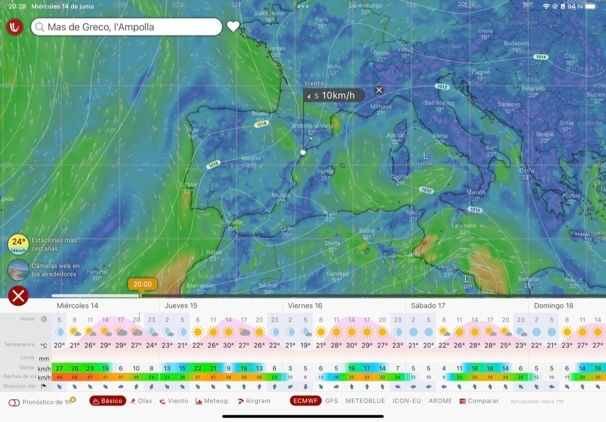

Això és important en aquesta zona perquè hi pot haver dies amb molt de vent.

Les línies d'informació que trobem a la pestanya inferior “Bàsic” són:

- Dia de la setmana
- Nebulositat/Sol esperat
- Temperatura esperada
- Pluja (mm)
- Vent (Km/h)
- Ratxes de vent (Km/h)
- Direcció del vent

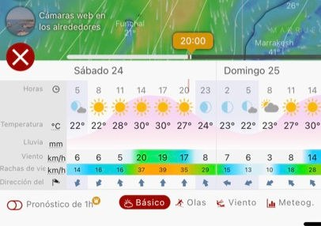

Si seleccionem la pestanya inferior “Meteog.” la informació subministrada és:

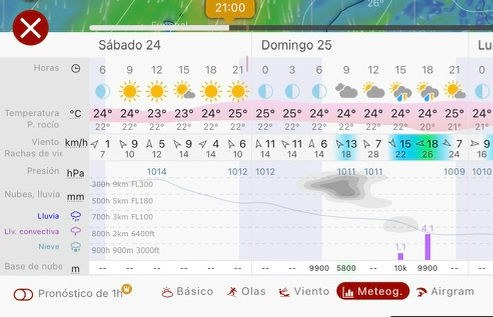

On també subministra informació sobre la temperatura del punt de rosada, pressió en hPa i nivells de pluja entre d'altres.

Atenció als nivells d'humitat relativa i temperatura del punt de rosada que ens indicaran quan caldrà utilitzar escalfadors a les nostres òptiques, per evitar que es dipositi rosada a la superfície de les lents.

Per al segon factor, el vent, és molt important conèixer la previsió sobretot si la nostra zona d'observació és normalment assotada per vents canalitzats per valls properes.

El vent ratxat és el que planteja més dificultats perquè afecta directament el seguiment i si el nostre equip presenta una superfície important a aquestes ratxes, les nostres estrelles poden deixar traços com a línies que fan inservibles les preses lights.

Amb Windy tenim una estimació del vent mitjà, de les ratxes de vent i sobretot la direcció del mateix. A tall d'exemple, al meu lloc d'observació usual un vent de NO amb vents superiors a 10 km/h ja suposa un mal presagi….

Windy també té una opció que consisteix a comparar fins a cinc models de previsió diferents; això enforteix les decisions que prenem.

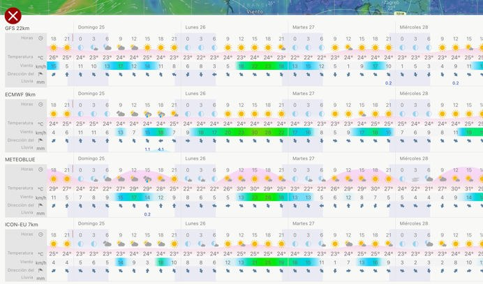

Com a tercer factor important tenim el seeing.

Per definició, el terme "seeing" fa referència a la mesura de la qualitat de la imatge d'un objecte celeste a causa de les pertorbacions atmosfèriques. És causat per turbulències atmosfèriques que deformen el camí òptic recorregut pels raigs de llum d'objectes exteriors a l'atmosfera.

La turbulència atmosfèrica és causada pel moviment de l'aire en diferents capes de l'atmosfera, cosa que crea variacions en la densitat i la temperatura. Aquestes variacions actuen com a lents en moviment que distorsionen la llum i afecten la claredat i la resolució de les imatges astronòmiques.

Un bon seeing es caracteritza per imatges nítides i estables, amb estrelles que apareixen com a punts de llum ben definits. D'altra banda, un seeing deficient es manifesta amb imatges borroses i estrelles que semblen moure's o parpellejar

És, per tant, un valor que mesura la qualitat del cel en funció de les turbulències de l'atmosfera. Per a les nostres observacions necessitem un cel estable sense turbulències.

Una aplicació que s'hi adapta perfectament és METEOBLUE ([meteoblue.com](https://www.meteoblue.com)).

En primer lloc seleccionem “Astronomy seeing” a la columna de l'esquerra i apareix la pantalla que es mostra a continuació:

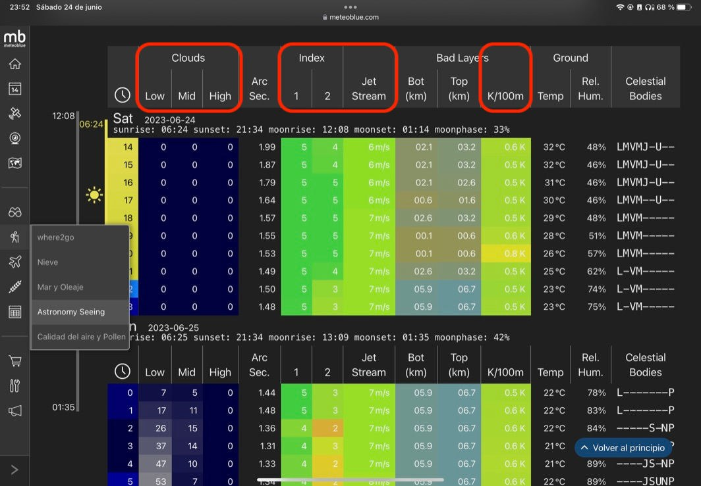

L'aplicació ens dóna una estimació per a les 72 hores següents.

Les columnes que tenen a veure directament amb el seeing són les que he remarcat amb un rectangle vermell:

- **Clouds Low:** indica el percentatge de núvols baixos entre 0 i 4 km d'alçada
- **Clouds Mid:** indica el percentatge de núvols entre 4 i 8 km d'alçada
- **Clouds High:** indica el percentatge de núvols entre 8 i 15 km d'alçada

Aquests paràmetres estan en %; en el nostre exemple, la penúltima fila del gràfic ens mostra un 47% de núvols a baixa alçada i un 10% en alçada mitjana.

- **Index 1:** té a veure amb el seeing per a visual; valors entre 1 (dolent, vermell) i 5 (bo, verd)
- **Index 2:** té a veure amb el seeing per a astrofotografia; valors entre 1 (dolent, vermell) i 5 (bo, verd)
- **Jet Stream:** Corrents en raig; es tracta d'un fort flux de vent estret i concentrat en un corrent d'aire en moviment ràpid, generalment ubicat a gran altitud, a la troposfera, la capa més baixa de l'atmosfera. Com més gran és la velocitat pitjor és el seeing

Les tres darreres columnes utilitzen codi de color de manera que com més verda millor és la predicció i pitjor com més s'acosta al color vermell.

- **Bad Layers (ºK/100m):** indica la variació de temperatura en graus Kelvin a les capes inferior i superior indicades a les dues columnes a l'esquerra.

A totes les columnes comentades, els valors van des del verd, que és bo, passant per groc, ataronjat i arribant fins al vermell que és dolent.

Tot i que es fa estrany veure una predicció amb tants números junts, els colors ens ajuden a veure amb una simple inspecció l'estat de nebulositat i seeing a la nostra ubicació i amb una antelació <72 hores.

A més de les columnes comentades també podem veure a l'esquerra de la taula i de manera gràfica les franges horàries de presència de Lluna i de Sol respectivament.

La columna **Arc Sec.** ens indica la mida mínima de l'objecte que podem resoldre. En observatoris a baixa altura és usual que aquest valor no sigui inferior a 1”

Les columnes **Ground Temp** i **Ground Rel.Hum.** ens donen temperatura i humitat relativa a nivell de terra i la columna de Celestial Bodies ens indica els cossos del Sistema Solar que són visibles; utilitza la primera lletra de cada cos i “-“ quan no són observables. Si ens col·loquem amb el cursor sobre una fila determinada ens indica els valors “Az”, “Alt”, “Ra” i “Dec” de cadascun.

## 3. Quin objecte observarem
Una aplicació que serveix per conèixer amb facilitat els objectes que podem veure en una nit determinada és Telescopius.

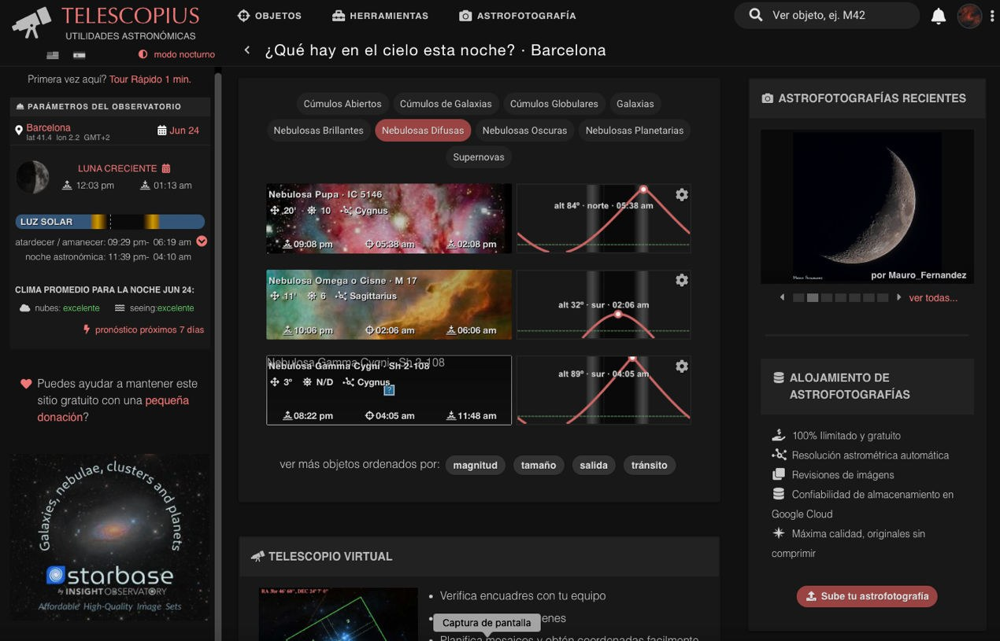

Podem definir el lloc del nostre observatori, veure els períodes de foscor, els objectes que hi podem veure i moltes més coses. També podem filtrar el tipus d’objectes que volem observar.

És recomanable fer una volta per totes les opcions que ofereix.

El més rellevant un cop preseleccionat un objecte és estudiar la corba d'elevació-temps que s'adjunta a la dreta; ens permet veure la finestra d'observació de què disposem.

També és important conèixer la mida aparent de l'objecte perquè coneixent el FOV resultant del nostre equip podem avaluar la mida final de la nostra observació.

D'altra banda, la magnitud de l'objecte que volem observar és fonamental per a astrofotografia perquè afecta directament el temps d'exposició que hem de fer servir i això enllaça directament amb la finestra d'observació de què disposem.

Una altra App per a iOS que ens ensenya de forma molt completa els objectes que són visibles en una nit determinada és SkySafari Pro; l'aspecte d'aquesta opció és el de la pantalla:

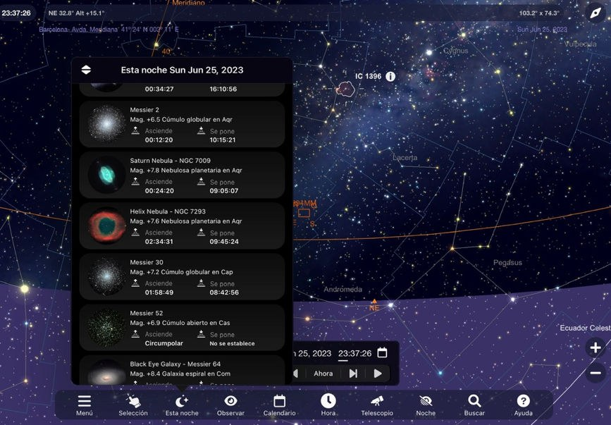

Un cop decidit amb quin objecte treballarem, el pas següent és localitzar-lo a l'esfera celeste per veure si és visible des de la nostra posició (edificis, xemeneies, arbres, etc.) i si estarà en una posició que ens permeti el temps d'observació que desitgem.

Per a aquestes qüestions acostumo a utilitzar les ajudes següents:

- Com a mapa de cel utilitzo Cartes du Ciel connectat amb NINA.
- Com a planetari utilitzo SkySafari 7 Pro (SS7).

Cartes du Ciel (CDC) és un programari de lliure distribució per a Linux i Windows. SkySafari 7 ho distribueix Simulation Curriculum Corp. i és de pagament; és per a iOS i també està disponible per a Android.

L'alternativa de lliure distribució per a SS7 és Stellarium, però potser menys àgil i intuïtiu en el seu maneig. L'elecció queda a gust de l'usuari.

L'aspecte de SS7 és el següent:

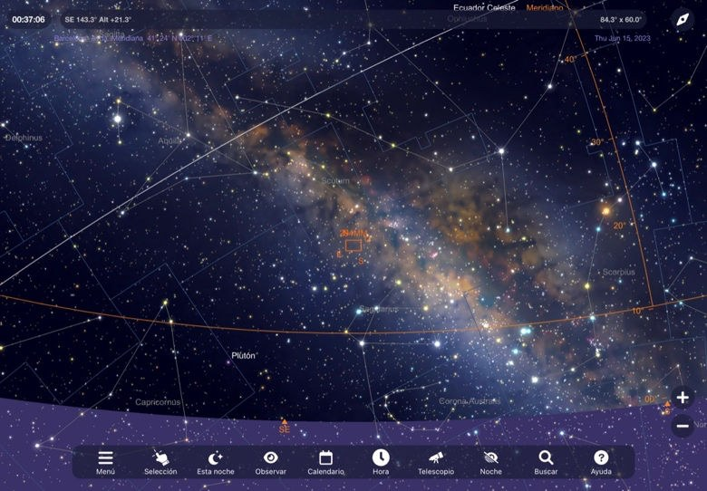

Que és similar a Stellarium.

Un o altre els utilitzo per localitzar la posició dels objectes disponibles en un moment donat.

Faig servir el reticle de visualització rectangular que representa el FOV resultant de l'equip (OTA+càmera).

Però el que realment valoro és l'eina que utilitza NINA (només per a Windows) a la pestanya de “Framing (Enquadrant)”.

Aquí no parlo de fer servir NINA com a control de tot l'equip d'astre (que també) sinó només per visualitzar quan és visible un determinat objecte mitjançant el gràfic altitud-hora local i visualitzant alhora la gràfica anàloga per a la Lluna. També podem veure a la dreta la foto real de l'objecte i l'enquadrament (FOV) del nostre equip fins i tot escollint els graus d'inclinació que ens interessin.

Com a exemple vegem com es mostra l'objecte M20 i M8:

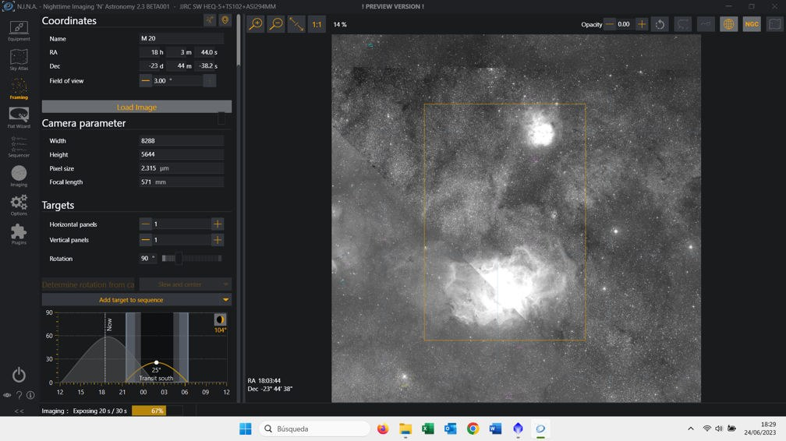

A la part dreta podem observar l'enquadrament triat pel nostre equip.

Al quadrant inferior esquerre podem veure la gràfica amb altitud del nostre objecte en funció de l'hora i amb transparència podem veure el mateix per a la Lluna; en aquest cas per a la data escollida veiem que la Lluna no ens molestarà en absolut independentment de la seva fase perquè a les 23:42h ja es troba per sota de 21º.

En detall seria:

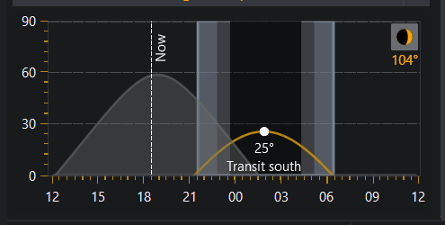

On podem veure que entre les 23:42 i les 04:18 hi tenim foscor total per a aquest objecte.

No obstant això amb APT Darkness Clock veuríem només 2h 40 min de foscor total!!

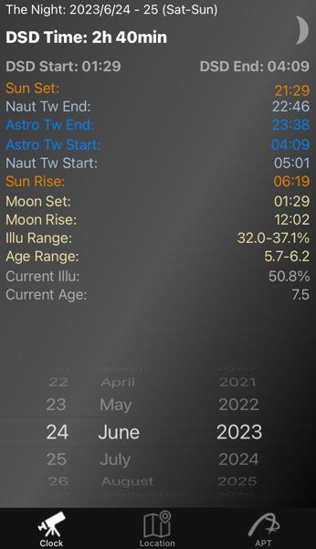

Aquesta dada és correcta perquè està comptada des que la Lluna s'amaga. Però el que passa és que des de les 23:42h la Lluna no ens afecta perquè es troba ja per sota de 21º.

Queda molt clar doncs la utilitat de les gràfiques d'altitud-temps.

A més, si mirem el nostre planetari SS7 (Stellarium) veiem que mentre M8-M20 es troba cap a l'S-SE, la Lluna s'està ocultant cap a l'O; és a dir, tampoc no molestaria gaire (o gairebé res) encara que tingués un nivell d'il·luminació alt.

Hem vist amb aquest exemple la utilitat de fer servir APT Darkness Clock en primera aproximació i un cop seleccionat el nostre objecte, verificar amb les corbes d'Altitud-temps la finestra d'observació de què disposem i amb el nostre planetari preferit la seva posició a l'esfera celeste respecte al nostre observatori.

Lamentablement l'objecte seleccionat en aquest exemple no pujarà més de 25º i tindrà certa dificultat 😉.

## 4. Prenent referències
Finalment, quan estem pensant en un objecte determinat i volem conèixer informació d'altres col·legues per tenir una referència dels paràmetres utilitzats, aconsello utilitzar “AstroBin ([astrobin.com](https://www.astrobin.com))”.

És una web creada per a l'allotjament d'imatges astronòmiques que ens permet fer una cerca d'un objecte determinat i veure enquadraments, temps d'exposició, etc. d'altres aficionats. En determinats casos, pot ser un bon punt de partida.

Es pot començar a utilitzar amb una subscripció gratuïta que us permet pujar fins a 10 fotos i utilitzar les opcions bàsiques.

Com a exemple, una visió parcial dels resultats obtinguts en fer una cerca de NGC2359 el Casc de Thor, donaria aquest resultat:

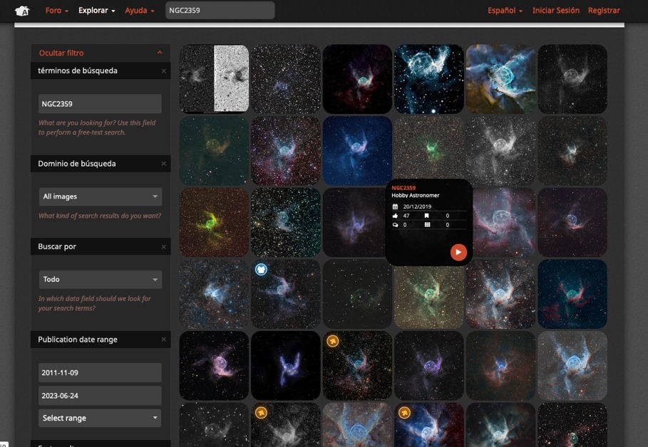

Seleccionant un quadre determinat ens dirigeix a la foto de l'autor on obtenim, si els han introduït, les dades utilitzades.

Potser algun com filtres utilitzats, equip, temps d'exposició, etc, ens poden ajudar a entendre com treballen altres aficionats i aprendre.

Òbviament hi ha moltes aplicacions que no apareixen en aquest article, però la intenció era subministrar unes eines que ens permetin afrontar les nostres sessions d'astronomia; amb el temps cadascú de nosaltres tria les millors segons les seves pròpies experiències.

Espero que us hagi servit d'ajuda,

Fins a la propera i cels clars!!
