Aquí propongo cómo preparar una sesión de astronomía visual y/o fotográfica en base a mi propia experiencia y con las ayudas que normalmente utilizo.

En una sesión de astronomía disponemos de un tiempo limitado, muchas veces nos obliga a realizar un desplazamiento considerable y siempre necesitamos realizar tareas de montaje y desmontaje que a veces son laboriosas. A lo mejor el tiempo útil que podemos disfrutar puede ser un pequeño porcentaje del total empleado y es el primer motivo por el que debemos preparar adecuadamente la sesión y sacar rendimiento de la misma.

Partimos de que tenemos elegido el lugar de observación y que conocemos perfectamente aspectos de contaminación lumínica y valor en la escala bortle de la zona elegida.

Vamos a ver qué aspectos controlar para realizar nuestra sesión astronómica.

- El primer punto es controlar cuando tenemos una ventana de cielo oscuro
- En segundo lugar conocer la previsión meteorológica: nebulosidad, viento, seeing
- En tercer lugar elegir el objeto-s a observar y la ventana temporal disponible

## 1. Conocer posición y edad de la Luna
Dentro del apartado de conocer qué condiciones nos vamos a encontrar tenemos que dar importancia crucial a la Luna.

Siempre intentamos salir con Luna Nueva pero también hay situaciones en las que tenemos una fase lunar con fuerte iluminación pero que la salida o la ocultación se produce fuera del periodo de oscuridad como en el ejemplo mostrado en el siguiente capítulo.

Para ello utilizo una App muy sencilla, fácil de utilizar y gratuita: APT Darkness Clock (APT DC) que está diseñada por los creadores de la suite APT.

Un apunte: la suite APT (Astro Photography Tool) es una aplicación que se utiliza para controlar las sesiones de astrofoto (análoga a NINA, SGP, SharpCap,…) APT Darkness Clock se encuentra en: [www.astroplace.net/MobileApps/](https://www.astroplace.net/MobileApps/)

Se utiliza de forma independiente y el aspecto que tiene en un smartphone es el siguiente:

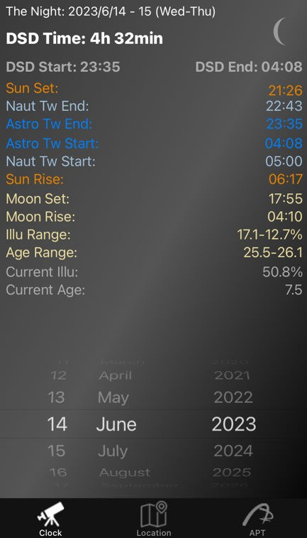

- **DSD Time:** Deep Sky Darkness; es el tiempo disponible para observar o fotografiar objetos de cielo profundo sin Luna ni crepúsculos.
- **DSD Start:** cuando comienza el DSD
- **DSD End:** cuando finaliza el DSD
- **Sun Set/Rise:** Tiempo para la puesta de Sol / amanecer
- **Naut Tw End/Start:** tiempo para la puesta/amanecer náuticos
- **Astro Tw End/Start:** tiempo para la puesta/amanecer astronómicos
- **Illu Range:** Rango de iluminación de la Luna para la fecha seleccionada
- **Age Range:** Rango de edad de la Luna (días) para la fecha seleccionada
- **Current Illu/Age:** La iluminación/edad de la Luna para el momento presente

En la pantalla adjunta vemos que disponemos de 4h 32 min de oscuridad para la fecha seleccionada.

## 2. Previsión meteorológica
Hemos de conseguir una previsión lo más certera posible acerca de la meteorología que nos vamos a encontrar en el lugar y fecha elegidos para la sesión.

Afortunadamente hoy en día disponemos de muchas herramientas que nos facilitan la tarea; los datos de la nebulosidad, viento y seeing son los más importantes.

De las muchas App's que existen yo suelo utilizar “Windy” ([windy.com](https://windy.com)) para tener una aproximación rápida de los próximos cinco días con estado de nebulosidad y viento; se trata de una aplicación para móvil o Tablet que se encuentra disponible para iOS y para Android. Es gratuita.

Adjunto la pantalla general donde podemos observar la previsión para 5 días (versión básica) y en tamaño grande el mapa de viento que está centrado en mi observatorio de l’Ampolla.

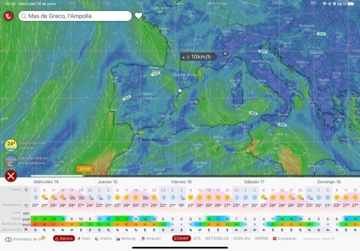

Esto es importante en esta zona porque puede haber días con mucho viento.

Las líneas de información que encontramos en la pestaña inferior “Básico” son:

- Día de la semana
- Nebulosidad/Sol esperado
- Temperatura esperada
- Lluvia (mm)
- Viento (Km/h)
- Rachas de viento (Km/h)
- Dirección del viento

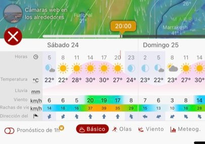

Si seleccionamos la pestaña inferior “Meteog.” la información suministrada es:

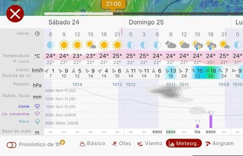

Donde también suministra información sobre la temperatura del punto de rocío, presión en hPa y niveles de lluvia entre otros.

Atención a los niveles de humedad relativa y temperatura del punto de rocío que nos indicarán cuando va a ser necesario utilizar calentadores en nuestras ópticas, para evitar que se deposite rocío en la superficie de las lentes.

Para el segundo factor, el viento, es muy importante conocer la previsión sobre todo si nuestra zona de observación es normalmente azotada por vientos encauzados por valles próximos.

El viento racheado es el que plantea mayores dificultades porque afecta directamente al seguimiento y si nuestro equipo presenta una superficie importante a estas rachas, nuestras estrellas pueden dejar trazos como líneas que hacen inservibles las tomas lights.

Con Windy tenemos una estimación del viento medio, de las rachas de viento y sobre todo la dirección del mismo. A modo de ejemplo, en mi lugar de observación usual un viento de NO con vientos superiores a 10Km/h ya supone un mal presagio,….

Windy también dispone de una opción que consiste en comparar hasta cinco modelos de previsión diferentes; esto fortalece las decisiones que tomamos.

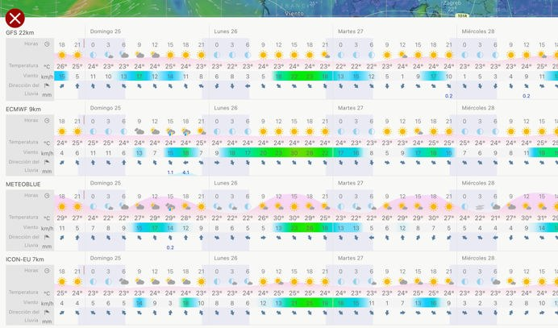

Como tercer factor importante tenemos el seeing.

Por definición, el término "seeing" se refiere a la medida de la calidad de la imagen de un objeto celeste debido a las perturbaciones atmosféricas. Está causado por turbulencias atmosféricas que deforman el camino óptico recorrido por los rayos de luz de objetos exteriores a la atmósfera.

La turbulencia atmosférica es causada por el movimiento del aire en diferentes capas de la atmósfera, lo que crea variaciones en la densidad y la temperatura. Estas variaciones actúan como lentes en movimiento que distorsionan la luz y afectan la claridad y la resolución de las imágenes astronómicas.

Un buen seeing se caracteriza por imágenes nítidas y estables, con estrellas que aparecen como puntos de luz bien definidos. Por otro lado, un seeing deficiente se manifiesta con imágenes borrosas y estrellas que parecen moverse o parpadear

Es por lo tanto un valor que mide la calidad del cielo en función de las turbulencias de la atmósfera. Para nuestras observaciones necesitamos un cielo estable sin turbulencias.

Una aplicación que se adapta perfectamente es METEOBLUE ([meteoblue.com](https://www.meteoblue.com)).

En primer lugar seleccionamos “Astronomy seeing” en la columna de la izquierda y aparece la pantalla que se muestra a continuación:

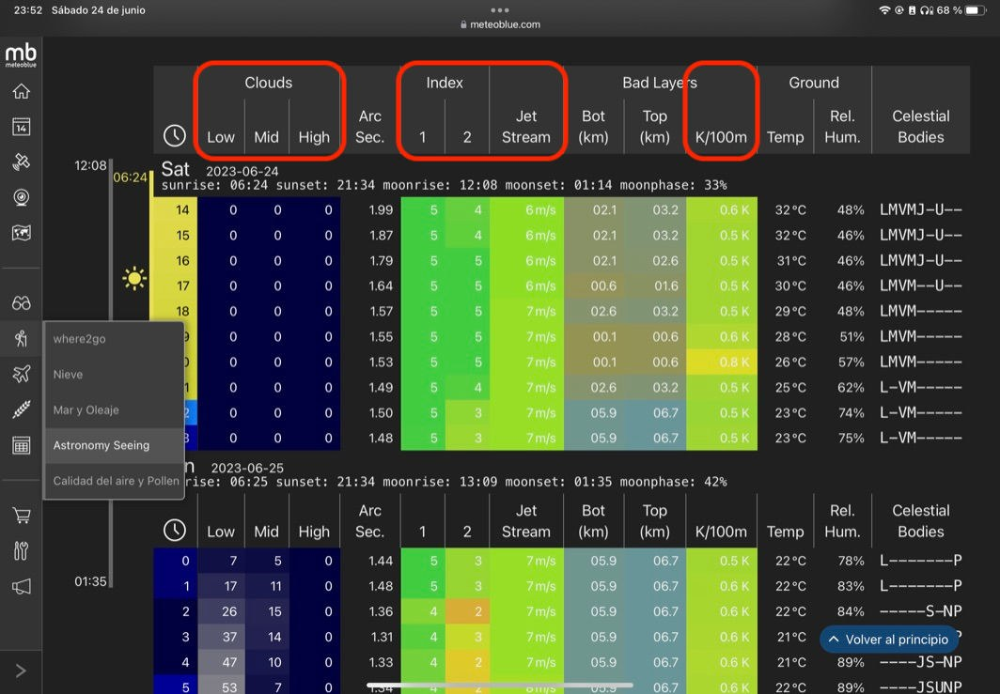

La aplicación nos da una estimación para las siguientes 72 horas.

Las columnas que tienen que ver directamente con el seeing son las que he remarcado con un rectángulo rojo:

- **Clouds Low:** indica el porcentaje de nubes bajas entre 0 y 4 Km de altura
- **Clouds Mid:** indica el porcentaje de nubes entre 4 y 8 Km de altura
- **Clouds High:** indica el porcentaje de nubes entre 8 y 15 Km de altura

Estos parámetros están en %; en nuestro ejemplo, la penúltima fila del gráfico nos muestra un 47% de nubes a baja altura y un 10% en altura media.

- **Index 1:** tiene que ver con el seeing para visual; valores entre 1 (malo, rojo) y 5 (bueno, verde)
- **Index 2:** tiene que ver con el seeing para astrofotografía; valores entre 1 (malo, rojo) y 5 (bueno, verde)
- **Jet Stream:** Corrientes en chorro; se trata de un fuerte flujo de viento estrecho y concentrado en una corriente de aire en movimiento rápido, generalmente ubicado a gran altitud, en la troposfera, la capa más baja de la atmósfera. Cuanto mayor es la velocidad peor es el seeing

Las tres últimas columnas utilizan código de color de tal forma que cuanto más verde mejor es la predicción y peor cuanto más se acerca al color rojo.

- **Bad Layers (ºK/100m):** indica la variación de temperatura en grados Kelvin en las capas inferior y superior indicadas en las dos columnas a la izquierda.

En todas las columnas comentadas, los valores van desde el verde, que es bueno, pasando por amarillo, anaranjado y llegando hasta el rojo que es malo.

Aunque se hace extraño ver una predicción con tantos números juntos, los colores nos ayudan a ver con una simple inspección el estado de nebulosidad y seeing en nuestra ubicación y con una antelación <72 horas.

Además de las columnas comentadas también podemos ver en la izquierda de la tabla y de forma gráfica las franjas horarias de presencia de Luna y de Sol respectivamente.

La columna **Arc Sec.** nos indica el tamaño mínimo del objeto que podemos resolver. En observatorios a baja altura es usual que este valor no sea inferior a 1”

Las columnas **Ground Temp** y **Ground Rel.Hum.** nos dan temperatura y humedad relativa a nivel de suelo y la columna de Celestial Bodies nos indica los cuerpos del Sistema Solar que son visibles; utiliza la primera letra de cada cuerpo y “-“ cuando no son observables. Si nos colocamos con el cursor sobre una fila determinada nos indica los valores “Az”, “Alt”, “Ra” y “Dec” de cada uno de ellos.

## 3. Qué objeto vamos a observar
Una aplicación que sirve para conocer con facilidad los objetos que podemos ver en una noche determinada es “Telescopius”.

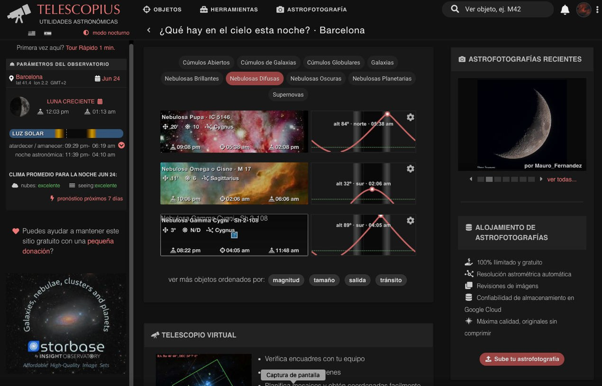

Podemos definir el lugar de nuestro observatorio, ver los periodos de oscuridad, los objetos que podemos ver y muchas más cosas. También podemos filtrar el tipo de objetos que queremos observar.

Es recomendable darse una vuelta por todas las opciones que ofrece.

Lo más relevante una vez preseleccionado un objeto es estudiar la curva de elevación-tiempo que se adjunta a la derecha; nos permite ver la ventana de observación que disponemos.

También es importante conocer el tamaño aparente del objeto porque conociendo el FOV resultante de nuestro equipo podemos evaluar el tamaño final de nuestra observación.

Por otro lado, la magnitud del objeto que queremos observar es fundamental para astrofotografía porque afecta directamente al tiempo de exposición que hemos de emplear y esto enlaza directamente con la ventana de observación que disponemos.

Otra App para iOS que nos enseña de forma muy completa los objetos que son visibles en una noche determinada es SkySafari Pro; el aspecto de esta opción es el de la pantalla:

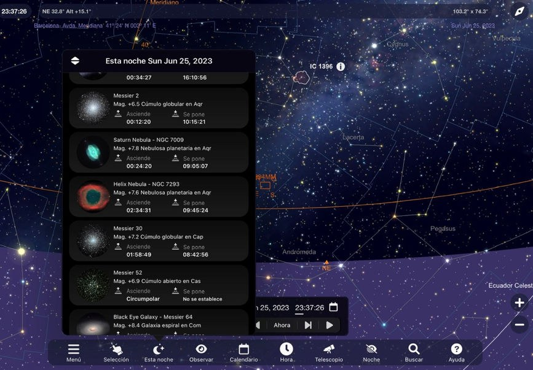

Una vez decidido con qué objeto vamos a trabajar, el paso siguiente es localizarlo en la esfera celeste para ver si es visible desde nuestra posición (edificios, chimeneas, árboles, etc.) y si estará en una posición que nos permita el tiempo de observación que deseamos.

Para estas cuestiones suelo utilizar las siguientes ayudas:

- Como mapa de cielo utilizo *Cartes du Ciel* conectado con NINA.
- Como planetario utilizo *SkySafari 7 Pro* (SS7).

Cartes du Ciel (CDC) es un software de libre distribución para Linux y Windows. SkySafari 7 lo distribuye Simulation Curriculum Corp. y es de pago; es para iOS y también está disponible para Android.

La alternativa de libre distribución para SS7 es Stellarium, pero tal vez menos ágil e intuitivo en su manejo. La elección queda a gusto del usuario.

El aspecto de SS7 es el siguiente:

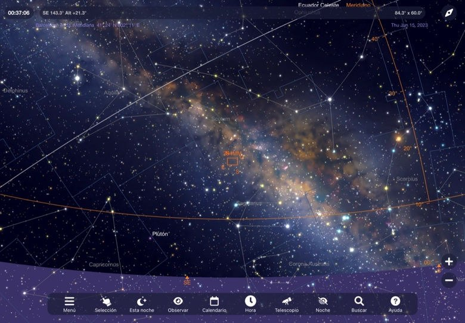

Que es similar a Stellarium.

Uno u otro los utilizo para localizar la posición de los objetos disponibles en un momento dado.

Utilizo el retículo de visualización rectangular que representa el FOV resultante del equipo (OTA+cámara).

Pero lo que realmente valoro es la herramienta que utiliza NINA (solamente para Windows) en la pestaña de “Framing (Encuadrando)”.

Aquí no hablo de utilizar NINA como control de todo el equipo de astro (que también) sino solamente para visualizar cuando es visible un determinado objeto mediante el gráfico altitud-hora local y visualizando al mismo tiempo la gráfica análoga para la Luna. También podemos ver a la derecha la foto real del objeto y el encuadre (FOV) de nuestro equipo incluso eligiendo los grados de inclinación que nos interesen.

Como ejemplo veamos como se muestra el objeto M20 y M8:

En la parte derecha podemos observar el encuadre elegido para nuestro equipo.

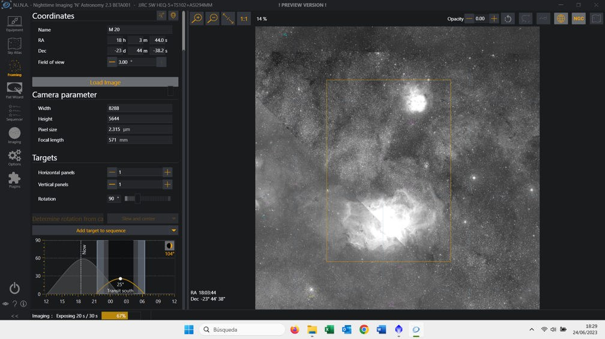

En el cuadrante inferior izquierdo podemos ver la gráfica con altitud de nuestro objeto en función de la hora y con transparencia podemos ver lo mismo para la Luna; en este caso para la fecha elegida vemos que la Luna no nos va a molestar en absoluto independientemente de su fase porque a las 23:42h ya se encuentra por debajo de 21º.

En detalle sería:

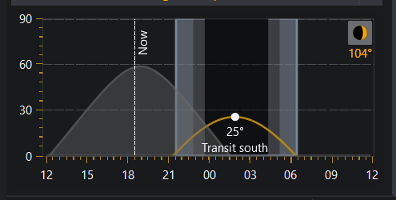

Donde podemos ver que entre las 23:42h y las 04:18h tenemos oscuridad total para este objeto.

Sin embargo con APT Darkness Clock veríamos solamente 2h 40 min de oscuridad total!!

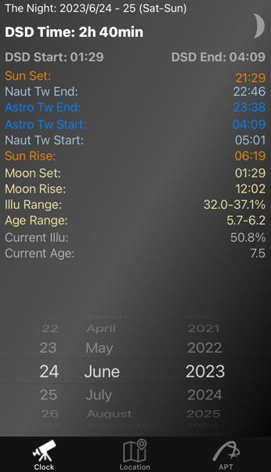

Este dato es correcto porque está contado desde que la Luna se oculta. Pero lo que sucede es que desde las 23:42h la Luna no nos afecta porque se encuentra ya por debajo de 21º.

Queda muy claro pues la utilidad de las gráficas de Altitud-tiempo.

Además, si miramos nuestro planetario SS7 (Stellarium) vemos que mientras M8-M20 se encuentra hacia el S-SE, la Luna se está ocultando hacia el O; es decir, tampoco molestaría demasiado (o casi nada) aunque tuviera un nivel de iluminación alto.

Hemos visto con este ejemplo la utilidad de emplear APT Darkness Clock en primera aproximación y una vez seleccionado nuestro objeto, verificar con las curvas de Altitud-tiempo la ventana de observación que disponemos y con nuestro planetario preferido su posición en la esfera celeste respecto a nuestro observatorio.

Lamentablemente el objeto seleccionado en este ejemplo no ascenderá más de 25º y tendrá cierta dificultad 😉.

## 4. Tomando referencias
Por último, cuando estamos pensando en un determinado objeto y queremos conocer información de otros colegas para tener una referencia de los parámetros utilizados, aconsejo utilizar “AstroBin ([astrobin.com](https://www.astrobin.com))”.

Es una web creada para el alojamiento de imágenes astronómicas que nos permite realizar una búsqueda de un determinado objeto y ver encuadres, tiempos de exposición, etc. de otros aficionados. En determinados casos puede ser un buen punto de partida.

Se puede empezar a utilizar con una suscripción gratuita que te permite subir hasta 10 fotos y utilizar las opciones básicas.

Como ejemplo, una visión parcial de los resultados obtenidos al hacer una búsqueda de NGC2359 el Casco de Thor, daría este resultado:

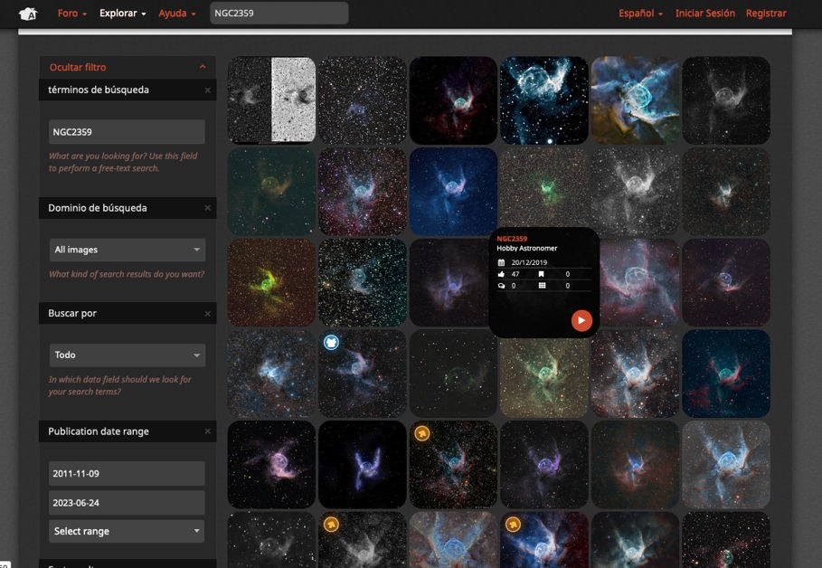

Seleccionando un determinado cuadro nos dirige a la foto del autor donde obtenemos, si los han introducido, los datos utilizados.

Tal vez alguno de ellos como filtros utilizados, equipo, tiempos de exposición, etc,… nos pueden ayudar a entender cómo trabajan otros aficionados y aprender.

Obviamente hay muchas aplicaciones que no aparecen en este artículo pero la intención era suministrar unas herramientas que nos permitan afrontar nuestras sesiones de astronomía; con el tiempo cada uno de nosotros elige las mejores según sus propias experiencias.

Espero que os haya servido de ayuda,

Hasta la próxima y cielos claros!!
