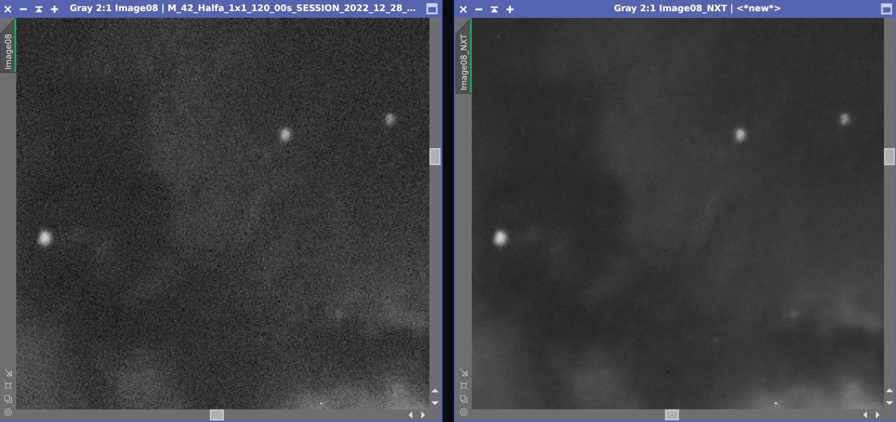
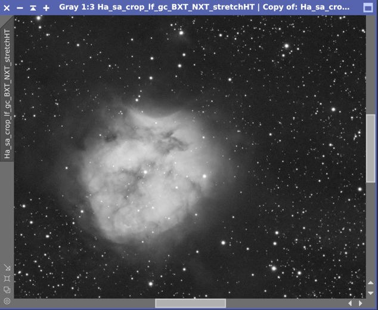
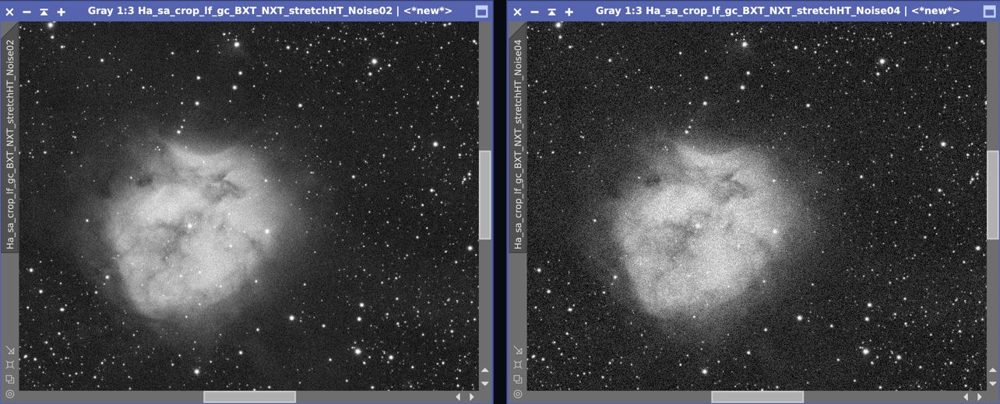
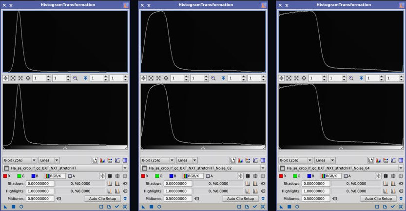
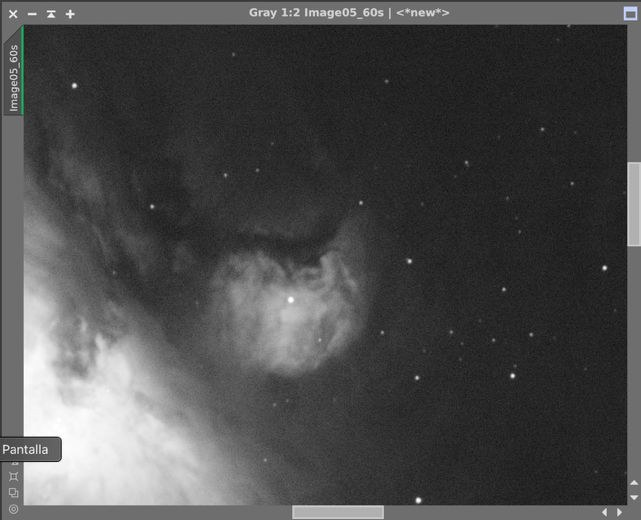
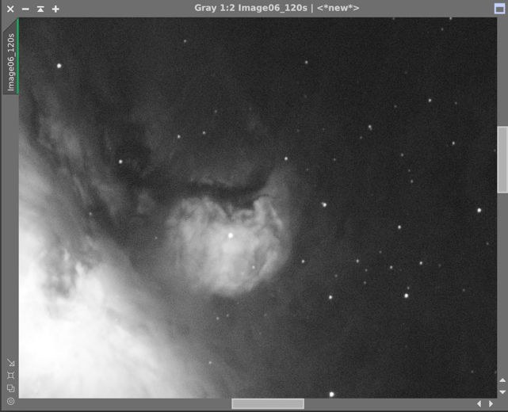
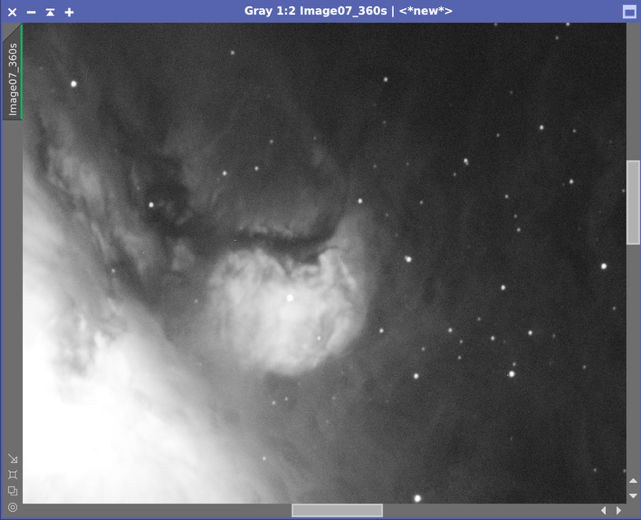
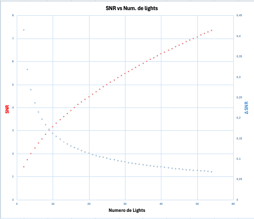
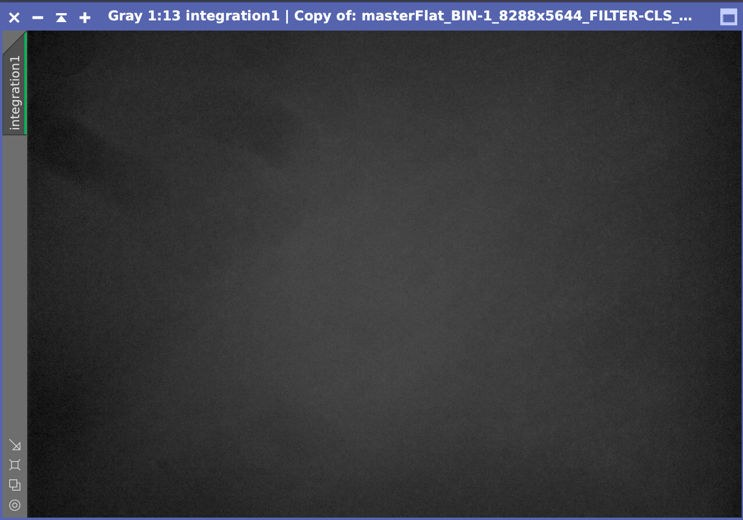
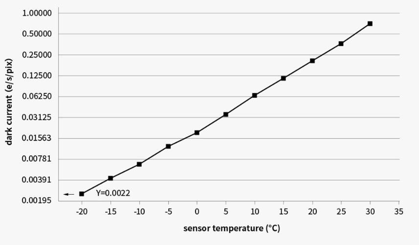

## 1. Introducció: La importància del soroll en astrofotografia
L'astrofotografia és més que un simple registre visual del cosmos: és una manera de connectar amb la immensitat de l'univers i capturar detalls que sovint escapen fins i tot a l'ull humà. No obstant això, aquest art enfronta un desafiament constant: el soroll.

El soroll en astrofotografia no és només un inconvenient tècnic, sinó també el principal obstacle que separa una imatge clara i vibrant d'una de confusa i opaca. Aquesta interferència enterboleix els senyals lluminosos que han viatjat durant milions d'anys abans d'arribar als nostres sensors.

Aprendre a identificar, comprendre i minimitzar el soroll no només és crucial per millorar les nostres imatges, sinó també per aprofitar al màxim l'esforç i el temps invertit en les nostres sessions sota el cel.

Aquest article no només et guiarà pels conceptes fonamentals, com ara què és la llum i com afecta les nostres imatges, sinó que també explorarà les arrels del soroll, els seus tipus i la manera de mesurar i millorar la relació senyal-soroll (SNR).

A través d'aquest recorregut, descobriràs que cada estratègia per combatre el soroll és un pas cap a la creació d'astrofotografies que fan justícia a la fascinació que sentim en mirar les estrelles.

## 2. Què és la llum i com afecta les nostres imatges?
La llum és una forma d'energia que es propaga per l'espai com una ona electromagnètica.

Tot i que solem associar la llum amb el que els nostres ulls poden veure, en realitat, això és només una petita part de l'espectre electromagnètic. Aquest espectre inclou altres formes de radiació invisibles per a nosaltres, com els raigs X, l'ultraviolat, l'infraroig, les microones i les ones de ràdio.

### 2.1 Com veiem la llum
Els nostres ulls estan dissenyats per captar certes longituds d'ona en l'espectre visible, aproximadament entre 400 i 700 nanòmetres. Això és possible gràcies a dos tipus de cèl·lules especialitzades de la retina:

- Els **cons**, que detecten colors (vermell, verd i blau) i funcionen millor amb llum brillant.
- Els **bastons**, que són més sensibles a la llum tènue i ens permeten veure en la foscor, encara que només en blanc i negre.

Quan mirem al cel de nit, són els bastons els que ens ajuden a distingir les estrelles i altres fonts de llum feble. No obstant això, les nostres càmeres astronòmiques funcionen de manera diferent: poden captar llum més enllà del visible, com l'infraroig o l'ultraviolat, revelant detalls que els nostres ulls no poden percebre.

### 2.2 La dualitat de la llum
La llum té una naturalesa fascinant: pot comportar-se alhora com una ona i com una partícula, en el fenomen conegut com la dualitat ona-partícula.

- Com a **ona**, la llum pot formar patrons d'interferència i difracció, cosa que afecta com s'enfoca en els nostres telescopis.
- Com a **partícula**, la llum està formada per fotons, petites unitats d'energia que viatgen des de les estrelles i galàxies fins als nostres telescopis.

### 2.3 La llum en astrofotografia
Un fotó és una partícula de llum que transporta una quantitat específica d'energia. Aquestes partícules són les que volem detectar amb els nostres sensors per formar la nostra imatge.

En astrofotografia, cada fotó compta. Els sensors de les nostres càmeres estan dissenyats per captar aquests fotons i convertir-los en informació digital, que després es processa per formar una imatge. No obstant això, en treballar amb objectes extremadament llunyans i febles, sovint els fotons que volem capturar es veuen "ofegats" pel soroll.

## 3. Què és el soroll en astrofotografia?
En termes generals, el soroll es defineix com qualsevol senyal que no aporta informació útil per al nostre objectiu. En astrofotografia, això es tradueix en elements no desitjats que contaminen les imatges i en dificulten la identificació clara dels objectes celestes que volem capturar.

El soroll es converteix en un enemic que pertorba les nostres imatges i ens allunya del nostre objectiu: capturar la bellesa del cosmos en tota la seva esplendor.

El soroll pot manifestar-se de diverses formes en les nostres fotografies:

- Ratlles horitzontals o verticals que generen interferències.
- Nebulosa de fons que desdibuixa detalls subtils.
- Punts brillants o negres que no corresponen a estrelles ni a objectes reals.

Aquests efectes no només resten qualitat estètica a les nostres imatges, sinó que també poden dificultar l'anàlisi científica o l'apreciació de detalls importants en objectes com galàxies, nebuloses o cúmuls estel·lars.

El soroll és una constant en astrofotografia, ja que treballem amb senyals extremadament febles provinents d'objectes situats a milions d'anys llum. Per això, aprendre a identificar-lo i reduir-lo és una part essencial de qualsevol projecte astrofotogràfic.

Observem aquestes dues fotografies per identificar i comprendre l'efecte del soroll:

En el retall de l’esquerra, la granulació visible, especialment en el fons, enterboleix la imatge i redueix significativament el nivell de detall. En canvi, en el retall de la dreta hem aplicat un procés de reducció de soroll que permet visualitzar amb més claredat el contingut.

Podem comparar aquest efecte amb el "gra" típic de les fotografies analògiques d’abans, quan en augmentar la sensibilitat ISO s’incrementava notablement la textura no desitjada en la imatge.

Un altre exemple anàleg és el soroll de "estàtica" que es percep en sintonitzar una emissora en AM: un brunzit de fons que dificulta l’audició i sovint fa inintel·ligible el missatge.

Després d’una sessió prolongada sota un cel serè, amb l’equip correctament alineat i calibrat, i després de diverses hores d’adquisició, és habitual que en revisar les imatges apareguin defectes no desitjats. En lloc d’estructures ben definides —com els braços d’una galàxia o els contorns d’una nebulosa— podem observar una boirina uniforme o punts dispersos de llum i foscor sense correspondència real amb l’objecte observat.

Això és degut al soroll, un component aleatori introduït per múltiples factors: el sensor de la càmera, la temperatura, l’electrònica, i fins i tot el processat posterior. El soroll degrada la relació senyal/soroll (SNR) i limita la capacitat d’extraure informació real del fons celeste.

Entendre’n l’origen, mesurar-ne l’impacte i aplicar tècniques eficaces de reducció (com l’apilat, la calibració amb darks/bias/flats i algoritmes específics de programari) és fonamental per millorar la qualitat final de la imatge. Superar el soroll no és només una qüestió estètica, sinó una millora objectiva en la fiabilitat de les dades astronòmiques representades.

## 4. Què és la relació senyal-soroll (SNR)?
La relació senyal-soroll, o SNR (Signal-to-Noise Ratio), és un dels conceptes més importants en astrofotografia. En termes simples, mesura quant de la llum útil (senyal) que volem capturar sobrepassa el soroll (les interferències no desitjades).

Un SNR alt indica que la nostra imatge té més detalls clars i menys contaminació, mentre que un SNR baix suggereix que el soroll està dominant, dificultant la visualització dels objectes celestes. L'optimització de l'SNR és, per tant, fonamental per obtenir imatges nítides i espectaculars del cel nocturn.

Entendre el soroll i les seves causes és el primer pas per reduir-lo i obtenir imatges més clares i detallades.

### 4.1 Entendre la relació senyal-soroll: la clau d'una bona astrofotografia
La relació senyal-soroll (SNR) és un indicador essencial en astrofotografia perquè ens diu quanta llum útil (senyal) podem capturar en comparació amb les interferències no desitjades (soroll). Però per què és tan important?

#### L'impacte de l'SNR en les nostres imatges
Un SNR alt significa que el senyal útil de l'objecte astronòmic destaca clarament sobre el soroll, permetent-nos capturar detalls nítids i precisos.

En canvi, un SNR baix dificulta distingir l'objecte principal, fent que la nostra imatge sembli borrosa o envaïda per taques i artefactes no desitjats.

**Exemple pràctic:** Imagina fotografiar una galàxia feble en una nit amb contaminació lumínica. Si el soroll (llum no desitjada) és massa alt en comparació amb el senyal (la llum de la galàxia), la galàxia es perdrà entre la brillantor del fons. Per contra, si aconsegueix reduir el soroll, els braços espirals i els detalls de la galàxia es començaran a revelar amb més claredat.

#### Com es calcula el SNR
El SNR es defineix com la relació entre la intensitat del senyal útil i la intensitat del soroll.

Matemàticament:

*SNR = Intensitat del senyal / Intensitat del soroll*

Un valor alt indica una imatge més neta i amb detalls més definits.

#### Factors que afecten el SNR
1. **Durada de l'exposició:** Com més temps deixes que el sensor capturi llum, més fotons útils acumules, millorant així el SNR.
2. **Qualitat de l'equip:** Càmeres amb sensors refrigerats i de baix soroll de lectura permeten obtenir un millor SNR.
3. **Condicions del cel:** La contaminació lumínica i la brillantor natural del cel impacten negativament en el SNR. Fotografiar des de llocs foscos millora notablement la qualitat de les imatges.
4. **Processament:** Tècniques com l'apilament d'imatges (stacking) ajuden a incrementar l'SNR en combinar múltiples exposicions, reduint el soroll aleatori.

#### Analogia per entendre el SNR
Pensa en una conversa en una cafeteria concorreguda. El senyal és la veu del teu amic, mentre que el soroll és el bullici de fons. Si el lloc està molt sorollós (SNR baix), tindràs dificultats per entendre el que diu. Però si estàs en una cafeteria tranquil·la (SNR alt), la seva veu s'escoltarà clarament, permetent-te captar cada detall.

#### Millorant el SNR: Un pas cap a l'excel·lència
La clau per a una bona astrofotografia és maximitzar el senyal i minimitzar el soroll. En les següents seccions, veurem com mesurar l'SNR i aplicarem estratègies pràctiques per optimitzar-lo, des de tècniques en la captura fins a ajustos en el postprocessament.

Com a exemple, mostrem una imatge en banda estreta (hidrogen alfa) després d’aplicar una reducció de soroll i un estirament mitjançant HistogramTransformation.

La SNR inicial, per a aquesta captura, mesurada amb l’script SNRView de PixInsight, és de 19,31 dB.

Per il·lustrar l’impacte del soroll, hem afegit soroll sintètic amb el procés NoiseGenerator (distribució uniforme, amplituds 0,2 i 0,4):

- Amb soroll afegit de 0,2 → **SNR: 9,75 dB**
- Amb soroll afegit de 0,4 → **SNR: 6,70 dB**

El deteriorament en la qualitat visual és evident i queda quantificat per la reducció progressiva de la SNR. Aquest exemple mostra com fins i tot petites variacions en el soroll poden afectar significativament la claredat d’una imatge astronòmica.

> Nota: Usualment veiem la mesura de la SNR en decibels (dB); això és degut al fet que la relació abans mostrada per al càlcul de la SNR es mesura de la següent forma:
>
> *SNR (dB) = 10 · log10 (Potència del senyal / Potència del soroll)*
>
> Això significa que cada augment de 10 dB en la SNR representa un augment de deu vegades de la potència del senyal en relació amb el soroll. Així, és més fàcil comprendre la magnitud de les millores en treballar amb l'escala logarítmica.
>
> L'ús de decibels no és exclusiu de l'astrofotografia; també s'utilitza en telecomunicacions, àudio i electrònica. Això facilita la transferència de conceptes entre disciplines i proporciona un estàndard comú per treballar amb relacions senyal-soroll.
>
> Si tens una SNR de 10, això significa que el senyal és 10 vegades més fort que el soroll. Si el teu SNR puja a 100, el senyal és 100 vegades més fort. En termes de decibels, segons la fórmula anterior, això es tradueix en un canvi de 10 dB a 20 dB, cosa que fa molt més evident la millora en la qualitat de la imatge.

## 5. Tipus de Soroll: causes i exemples
Podem dividir el soroll en els tipus següents:

**Soroll de dispar o soroll fotònic:** Aquest soroll es genera a causa de la naturalesa quàntica de la llum. Les fonts lluminoses emeten fotons de manera aleatòria, la qual cosa introdueix fluctuacions naturals en la intensitat del senyal. Aquest tipus de soroll depèn directament de la intensitat del senyal que volem capturar.

**Soroll de quantificació:** Construir una imatge digital requereix prendre una mesura d'un valor analògic (voltatge) i convertir-lo en un número. Aquest procés de digitalització exigeix realitzar un arrodoniment i això introdueix una petita desviació (soroll) respecte al valor analògic generat pel sensor.

**Soroll de lectura:** Es genera pel procés de lectura del sensor de la càmera. Aquest tipus de soroll és present en cada presa, independentment del temps d'exposició.

**Soroll de fons del cel:** És la llum no desitjada, com contaminació lumínica o la brillantor del fons del cel (airglow). Aquest soroll pot camuflar objectes febles com nebuloses i galàxies.

**Soroll tèrmic:** generat per l'escalfament del sensor fotogràfic. El sensor converteix fotons de llum en electrons, però en escalfar-se, els circuits electrònics del nostre sensor desprenen electrons que no es corresponen amb els fotons de la nostra imatge però que acaben incrustant-s'hi produint soroll. Aquest tipus de soroll augmenta amb temps d'exposició prolongats i amb temperatures més altes.

> **Nota:** Aquest és el tipus de soroll més rellevant en astrofotografia i sobre el qual podem actuar més eficaçment mitjançant tècniques com la refrigeració del sensor o l'ús de dark frames.

**Altres (interferència lumínica, etc.):** Per exemple, llums artificials que es filtren a la imatge durant la captura. Podem incloure satèl·lits, bòlids, etc.

Ara que entenem què és el soroll i com afecta les nostres imatges, el següent pas és aprendre a mesurar i millorar la relació senyal-soroll (SNR). Això ens permetrà prendre el control del procés de captura i postprocessament, optimitzant les nostres imatges per ressaltar els detalls més subtils de l'univers.

## 6. Naturalesa del soroll i com mesurar la SNR
### 6.1 La naturalesa del soroll
El soroll en astrofotografia té diverses causes i manifestacions, però, en la seva essència, és una pertorbació que se superposa al senyal desitjat i que dificulta la captura de detalls precisos dels objectes astronòmics.

Comprendre la naturalesa del soroll és clau per desenvolupar estratègies efectives que minimitzin el seu impacte.

#### 6.1.1 El soroll com a fenomen intrínsec i extern
El soroll es pot dividir en dues grans categories segons el seu origen:

1. **Soroll intrínsec:** És inherent al propi sistema de captura d'imatges, com el soroll generat pel sensor de la càmera o el procés de digitalització. Aquest tipus de soroll és present fins i tot en condicions ideals d'observació.
2. **Soroll extern:** Prové de fonts externes al sistema de captura, com la contaminació lumínica, la brillantor del cel o interferències ambientals. Aquest soroll varia depenent de les condicions d'observació i la ubicació de l'observador.

#### 6.1.2 Les propietats estadístiques del soroll
Una característica important del soroll és la seva naturalesa aleatòria. Això significa que:

- **No segueix un patró regular.** Per exemple, el soroll tèrmic o el soroll de dispar presenten fluctuacions impredictibles.
- **Es pot modelar estadísticament.** Moltes formes de soroll segueixen distribucions estadístiques conegudes, com la distribució de Poisson (en el cas del soroll fotònic) o la distribució gaussiana (en el soroll de lectura).

Aquestes propietats estadístiques són útils perquè permeten aplicar tècniques matemàtiques i programari especialitzat per reduir el soroll de manera sistemàtica.

#### 6.1.3 L'impacte físic del soroll en les imatges
El soroll afecta les imatges de diverses formes, depenent del seu tipus i font:

- **Granularitat:** Produeix un efecte de "gra" visible en el fons de les imatges.
- **Estries o bandes:** En alguns casos, el soroll apareix en forma de línies horitzontals o verticals (banding), especialment en càmeres amb sensors electrònics (major en CCD que en CMOS).
- **Neblina de fons:** Una brillantor uniforme però indesitjada, generalment causada pel soroll del cel o la contaminació lumínica.
- **Píxels calents o freds:** Punts brillants o foscos que no corresponen al senyal real i són causats per defectes en el sensor o per soroll tèrmic.

#### 6.1.4 Relació entre soroll i senyal: els fotons, missatgers imperfectes
La naturalesa quàntica de la llum també influeix en el soroll:

- Els fotons no arriben als nostres sensors de manera uniforme, sinó que ho fan amb fluctuacions estadístiques. Aquest fenomen, conegut com a soroll de dispar, és inevitable i depèn de la intensitat del senyal. Quantes més partícules de llum (fotons) capturem, menys significatiu és el soroll relatiu al total del senyal.
- La conversió dels fotons en dades digitals tampoc és perfecta. Els processos de lectura i digitalització introdueixen més soroll, com el soroll de quantificació i el soroll de lectura.

### 6.2 Com mesurar la SNR
Com ja hem raonat anteriorment, mesurar l'SNR és fonamental per avaluar i millorar la qualitat de les nostres imatges.

Tot i que hi ha diverses maneres de fer-ho, el procés bàsic implica calcular la relació entre el senyal útil (llum provinent dels objectes astronòmics) i el soroll (totes les interferències no desitjades).

#### 6.2.1 Mètode 1: Mesurar el SNR en la imatge directament
Una forma directa de mesurar la SNR és analitzar una zona lliure de soroll (per exemple, una part del cel fosc) i una zona amb senyal (l'objecte astronòmic que volem capturar, com una estrella o una nebulosa).

1. **Pas 1: Selecció d'una mostra de fons i una mostra de senyal**
   - Tria una regió fosca de la imatge per mesurar el soroll de fons. Aquí, el valor del senyal hauria de ser baix, però el soroll haurà de ser predominant.
   - Selecciona una regió que contingui l'objecte astronòmic (per exemple, una estrella o una nebulosa) per mesurar el senyal. Aquí, la llum provinent de l'objecte serà més intensa.
2. **Pas 2: Calcular la mitjana i la desviació estàndard**
   - Calcula la mitjana dels valors de píxels de les dues regions seleccionades: una per al soroll i una altra per al senyal.
   - Calcula la desviació estàndard dels píxels a cada regió. La desviació estàndard proporciona una mesura de la dispersió dels valors dels píxels, indicant la quantitat de variabilitat del soroll.
3. **Pas 3: Calcular el SNR**

   El SNR en aquest cas es pot calcular utilitzant la fórmula:

   *SNR = Mitjana del senyal / Desviació estàndard del soroll*

   El valor resultant serà la relació senyal-soroll de la imatge. Si l'SNR és baix, la imatge tindrà més soroll, i si és alt, el senyal serà més clar en comparació el soroll.

Vegem ara una propietat important de la relació senyal-soroll.

Partint de la definició:

- μs: mitjana del senyal
- σn: desviació estàndard del soroll

tenim: SNR = μs / σn

Quan es combinen *N* preses independents (per exemple, mitjançant la mitjana), el senyal i el soroll es comporten de la manera següent:

- La mitjana del senyal es manté constant:

  μsN = μs

- El soroll aleatori, suposadament gaussià i independent, es redueix segons:

  σnN = σn / sqrt(N), on indiquem amb **sqrt(N)** l'arrel quadrada de N.

Per tant, la relació senyal-soroll després de combinar N preses és:

SNRN = μs / σnN = μs / σn / sqrt(N) = (μs / σn) · sqrt(N)

En definitiva:

SNR ∝ sqrt(N)

La relació senyal-soroll és proporcional a l’arrel quadrada del nombre de preses. Aquesta dependència fonamental justifica l’apilat com a tècnica per augmentar la SNR. Més endavant, recuperarem aquest resultat quan tractem el nombre òptim de preses a apilar.

#### 6.2.2 Mètode 2: Ús d'un gràfic d'histograma
L'histograma d'una imatge també ens pot proporcionar informació útil sobre el SNR. A l'eix X de l'histograma es representen els valors dels píxels, mentre que a l'eix Y es mostra la freqüència d'aquests valors.

- **Senyal:** En el cas d'una bona imatge, els valors del senyal apareixeran concentrats en un rang específic de l'histograma, especialment en els valors més alts (representant la llum de l'objecte capturat).
- **Soroll:** El soroll es distribuirà de forma més àmplia al llarg de l'histograma, especialment a les ombres (les àrees fosques).

Un histograma ben distribuït que tingui un pic clar de senyal i una caiguda ràpida del soroll, indica una bona relació SNR.

Utilitzant les imatges mostrades a 4.1 i mirant l’histograma mitjançant PixI, obtenim les gràfiques següents:

on podem apreciar com el soroll eixampla l’histograma.

#### 6.2.3 Mètode 3: Ús de programari d'anàlisi d'imatge
Eines com PixInsight, AstroImageJ, ASTAP o fins i tot algunes funcions a Photoshop o GIMP, permeten calcular el SNR d'una imatge automàticament.

Aquests programes poden realitzar anàlisis més detallades i oferir mètriques precises del SNR en diferents àrees de la imatge.

### 6.3 Per què és important mesurar l'SNR?
Mesurar l'SNR no només ens ajuda a avaluar la qualitat de les nostres imatges, sinó també a optimitzar els nostres processos de captura i postprocessament. Si tenim un SNR baix, sabem que hem de:

- **Ajustar l'exposició:** Augmentar el temps d'exposició o el guany pot ajudar a millorar el senyal.
- **Millorar l'equip:** Usar càmeres amb sensors de baix soroll o refrigerats pot reduir el soroll tèrmic.
- **Utilitzar tècniques d'apilament:** Apilar múltiples imatges pot millorar l'SNR en combinar diverses exposicions i reduir el soroll aleatori.

El mesurament de l'SNR també és essencial per decidir quines imatges fer servir per al processament final. Imatges amb un SNR baix poden no ser útils per obtenir resultats d'alta qualitat, de manera que és possible que necessitem repetir les preses o aplicar un enfocament diferent.

## 7. SNR, maximitzar el senyal i reduir el soroll
La relació senyal-soroll (SNR) és un indicador crucial per avaluar la qualitat de les nostres imatges en astrofotografia. Ens mostra quant senyal útil (llum provinent dels objectes astronòmics) tenim en comparació amb el soroll (senyals no desitjats o interferències).

Per aconseguir imatges nítides i detallades de galàxies, nebuloses i estrelles, necessitem maximitzar el senyal i minimitzar el soroll.

Si la SNR és alta, ens proporciona una imatge clara, amb detalls fins i ben definits dels objectes astronòmics. Podem observar estructures complexes en nebuloses, estrelles i galàxies sense que el soroll interfereixi massa.

Si la SNR és baixa, el senyal útil queda emmascarat amb el soroll i no podem definir correctament el nostre objecte. Això dificulta la visualització dels detalls i pot fer que la imatge final sigui menys útil o fins i tot inutilitzable.

**Com millorar la SNR**

### 7.1 Augmentar el temps d'exposició
Una de les formes més directes de millorar la SNR és augmentar el temps d'exposició.

En capturar més llum durant un període més llarg, el senyal augmenta considerablement, la qual cosa permet capturar més detalls de l'objecte astronòmic que estem fotografiant.

Tot i que el soroll també augmenta amb el temps d'exposició, ho fa de forma més lenta (aproximadament amb l'arrel quadrada del temps d'exposició). En altres paraules, el senyal augmenta de forma proporcional al temps, mentre que el soroll creix més lentament.

**Consell pràctic:** Si augmentes el temps d'exposició al doble, el senyal es duplicarà, però el soroll només augmentarà un 40%. Això millora significativament la SNR.

Com a exemple del que s’ha exposat anteriorment, observem tres imatges: la primera (imatge 05) amb una exposició de 60 segons, la segona (imatge 06) amb 120 segons, i la tercera (imatge 07) amb 360 segons.

A més de percebre’s més detalls a mesura que augmenta el temps d’exposició, també es nota una reducció del soroll. Per comprovar-ho, hem mesurat la relació senyal/soroll (SNR) en una porció del quadre, després d’haver alineat prèviament les tres imatges amb StarAlignment, i hem obtingut el resultat següent:

60s → SNR: 32.89 dB

120s → SNR: 34.41 dB

360s → SNR: 35.26 dB

### 7.2 Prendre moltes exposicions i apilar-les
L'apilament d'imatges és una tècnica fonamental en astrofotografia. Consisteix a capturar múltiples exposicions del mateix objecte i combinar-les per crear una imatge final.

L'apilat té dos efectes clau:

- **El senyal s'acumula:** Les exposicions addicionals reforcen el senyal, fent que els detalls de l'objecte astronòmic es tornin més clars.
- **El soroll es promedia:** Com que el soroll és aleatori, tendeix a distribuir-se de forma irregular. En apilar moltes imatges, el soroll es redueix mitjançant el procés de mitjana, disminuint el seu impacte en la imatge final.

**Programari útil:** Programes com DeepSkyStacker o PixInsight són excel·lents per apilar imatges de manera eficient, millorant la qualitat final de la imatge.

A la gràfica següent es mostra en vermell com augmenta la SNR i en blau com disminueix l’increment de SNR (∆SNR), ambdues corbes en funció del nombre d’exposicions.

Podem estimar que val la pena seguir augmentant les exposicions mentre el ∆SNR es mantingui per sobre del 20 % del valor inicial; aquest criteri ens situa al voltant de 35 o 40 exposicions.

Tanmateix, aquesta decisió s’ha de valorar en conjunt, ja que és evident que no és el mateix fer 40 exposicions de 60 segons que 40 de 360 segons.

### 7.3 Utilitzar calibracions (dark frames, bias, flat frames)
- **Dark frames:** Són exposicions preses amb la càmera tancada, que permeten capturar el soroll tèrmic del sensor. En restar aquests dark frames de les imatges, eliminem aquest tipus de soroll.
- **Bias frames:** Es capturen amb una exposició molt curta i ajuden a corregir el soroll de lectura del sensor.
- **Flat frames:** Capturen les imperfeccions del sistema òptic, com el vinyetatge o la presència de pols en el telescopi. En restar els flat frames, s'eliminen aquestes imperfeccions i es millora la uniformitat de la imatge.

Aquestes calibracions permeten reduir el soroll sistemàtic de les imatges, cosa que millora significativament la SNR.

La imatge adjunta mostra un master flat pres amb filtre CLS, on s'aprecien clarament el vinyeteig i els "donuts" provocats per brutícia al tren òptic.

### 7.4 Reduir la contaminació lumínica
La contaminació lumínica és una de les principals fonts de soroll en astrofotografia, especialment quan es fotografia des d'àrees urbanes. La llum artificial dels carrers i edificis genera una brillantor de fons que interfereix amb el senyal dels objectes astronòmics.

Per reduir aquest soroll:

- **Filtres de banda estreta:** Els filtres de banda estreta (com els filtres H-alpha, OIII o SII) permeten capturar només longituds d'ona específiques de la llum emesa per les nebuloses, bloquejant les longituds d'ona no desitjades provinents de la contaminació lumínica.
- **Fotografia des de llocs foscos:** Com més allunyats estiguem de les fonts de contaminació lumínica, més fosca serà la imatge de fons, cosa que millora el contrast i la qualitat del senyal.

Un tractament semblant s'ha de considerar per a les sessions amb Lluna Plena: intentar treballar el més lluny possible de la seva ubicació i utilitzar filtres de banda estreta.

### 7.5 Refrigeració del sensor
El soroll tèrmic és un dels sorolls més perjudicials per a la SNR, i està relacionat amb l'escalfament del sensor de la càmera.

Quan el sensor s'escalfa, els circuits electrònics generen electrons addicionals que es registren com a soroll, reduint així la qualitat de la imatge.

Per combatre el soroll tèrmic:

- **Càmeres refrigerades:** Utilitzar càmeres amb sensors refrigerats, com les càmeres CCD o CMOS específicament dissenyades per a astrofotografia, pot reduir significativament el soroll tèrmic. La refrigeració activa redueix la temperatura del sensor, cosa que redueix la generació d'electrons no desitjats.

En una càmera força popular com la ASI294MM, la gràfica de la corrent fosca en funció de la temperatura és la següent:

Les unitats e⁻/s/pix tenen el significat següent:

- **e⁻ (electrons):** quantitat d’electrons generats al sensor en absència de llum (corrent fosca).
- **s (segon):** indica la taxa per unitat de temps.
- **pix (píxel):** valor corresponent a cada píxel individual del sensor.

Això vol dir que un valor de 0,01 e⁻/s/pix indica que cada píxel acumula 0,01 electrons per segon a causa de la corrent fosca, fins i tot en foscor total. Per exemple, en una exposició de 300 segons, es generarien 3 e⁻ per píxel únicament per aquest efecte.

Si la càmera és capaç de reduir la temperatura ambiental fins a 35 °C per sota, una opció raonable pot ser fixar una consigna de –10 °C. Això permetria mantenir la refrigeració fins i tot en una nit càlida amb una temperatura ambient de fins a +25 °C.

> **Nota:** Tot i que l’ús de càmeres refrigerades suposa una inversió, pot marcar una diferència significativa en la qualitat de les imatges, especialment en exposicions llargues.

## 8. Conclusió: Reduir el soroll per millorar els resultats
L'astrofotografia és un desafiament tècnic en què cada detall compta. Entendre el soroll i com afecta les nostres imatges és essencial per aconseguir resultats més precisos i satisfactoris.

Al llarg d'aquest article, hem analitzat els tipus de soroll, com mesurar-ne l'impacte i, sobretot, les estratègies clau per reduir-lo.

Des d'augmentar el temps d'exposició fins a aplicar tècniques d'apilat o calibratge, cada acció que prenguem per maximitzar la relació senyal-soroll ens permetrà obtenir imatges més clares i detallades. L'astrofotografia no es tracta només de mirar al cel, sinó d'aconseguir que les nostres eines i coneixements treballin al nostre favor, fins i tot en condicions adverses.

Amb aquests conceptes en ment, és hora de posar-los en pràctica. Perquè, encara que les nits fredes i els ajustos minuciosos puguin ser exigents, els resultats finals —amb menys soroll i una millor definició dels objectes celestes— faran que tot l'esforç hagi valgut la pena.

Fins a la propera, amics,

Cels clars!!
