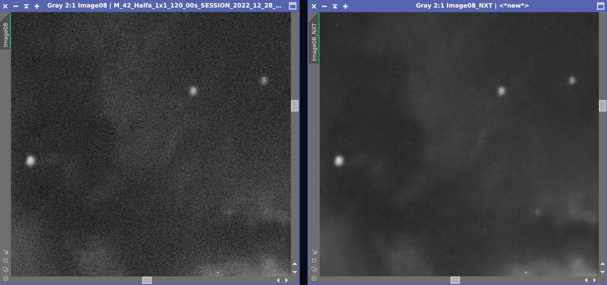
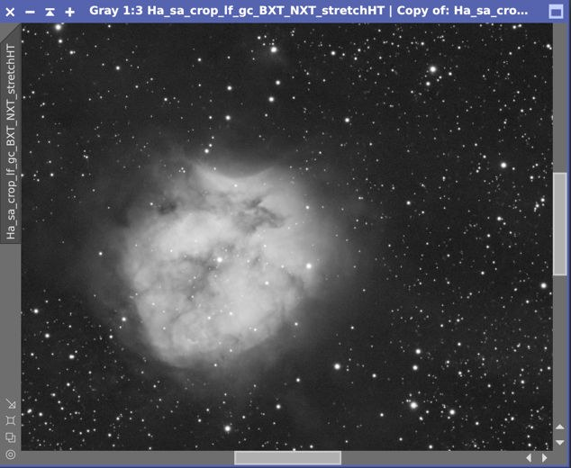
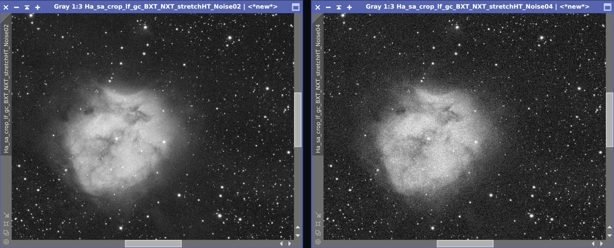
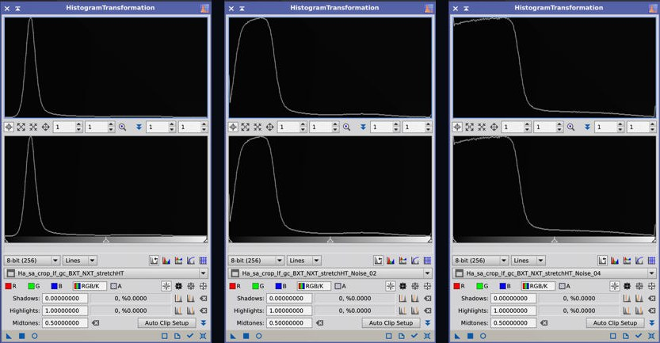
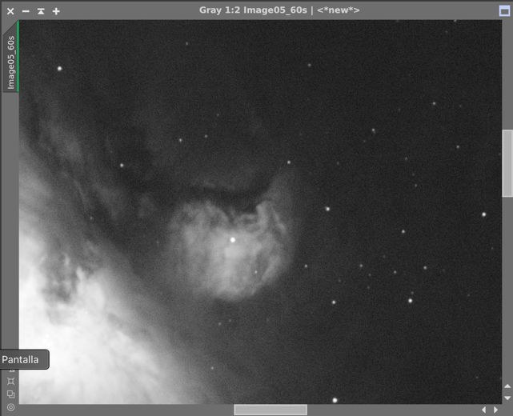
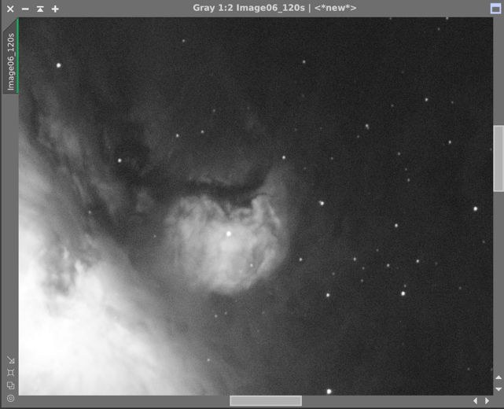
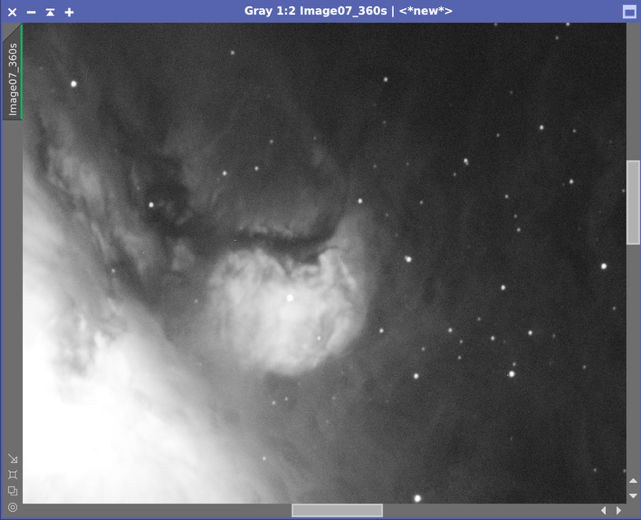
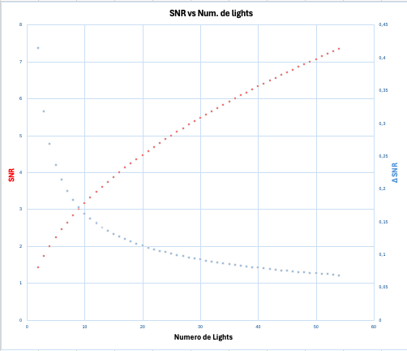
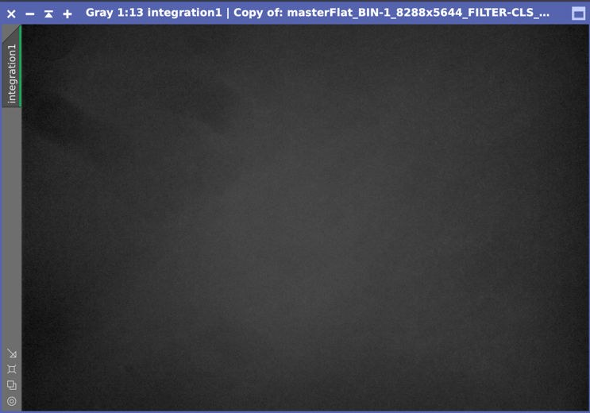
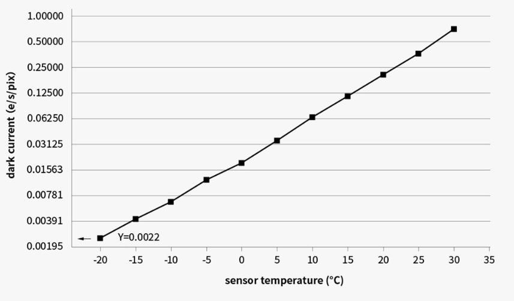

## 1. Introducción: La importancia del ruido en astrofotografía
La astrofotografía es más que un simple registro visual del cosmos; es una forma de conectar con la inmensidad del universo y capturar detalles que a menudo escapan incluso al ojo humano. Sin embargo, este arte enfrenta un desafío constante: el ruido.

El ruido en astrofotografía no es solo un inconveniente técnico, sino el principal obstáculo que separa una imagen clara y vibrante de una confusa y opaca. Es esa interferencia que enturbia las señales luminosas que viajan por millones de años hasta llegar a nuestros sensores.

Aprender a identificar, comprender y minimizar el ruido no solo es crucial para mejorar nuestras imágenes, sino también para aprovechar al máximo el esfuerzo y el tiempo invertido en nuestras sesiones bajo el cielo.

Este artículo no solo te guiará por los conceptos fundamentales, como qué es la luz y cómo afecta a nuestras imágenes, sino que también explorará las raíces del ruido, sus tipos, y cómo medir y mejorar la relación señal-ruido (SNR).

A través de este recorrido, descubrirás que cada estrategia para combatir el ruido es un paso hacia la creación de astrofotografías que hacen justicia al asombro que sentimos al mirar las estrellas.

## 2. ¿Qué es la luz y cómo afecta a nuestras imágenes?
La luz es una forma de energía que viaja a través del espacio como una onda electromagnética.

Aunque solemos asociar "luz" con lo que nuestros ojos pueden ver, en realidad, esto es solo una pequeña parte del espectro electromagnético. Este espectro incluye otras ondas invisibles para nosotros, como los rayos X, el ultravioleta, el infrarrojo, las microondas y las ondas de radio.

### 2.1 Cómo vemos la luz
Nuestros ojos están diseñados para captar ciertas longitudes de onda en el espectro visible, aproximadamente entre 400 y 700 nanómetros. Esto es posible gracias a dos tipos de células especializadas en la retina:

- Los **conos**, que detectan colores (rojo, verde y azul) y funcionan mejor con luz brillante.
- Los **bastones**, que son más sensibles a la luz tenue y nos permiten ver en la oscuridad, aunque solo en blanco y negro.

Cuando miramos al cielo de noche, son los bastones los que nos ayudan a distinguir las estrellas y otras fuentes de luz débil. Sin embargo, nuestras cámaras astronómicas funcionan de manera diferente: pueden captar luz más allá de lo visible, como el infrarrojo o el ultravioleta, revelando detalles que nuestros ojos no pueden percibir.

### 2.2 La dualidad de la luz
La luz tiene una naturaleza fascinante: puede comportarse como una onda y como una partícula al mismo tiempo, en lo que se conoce como la dualidad onda-partícula.

- Como **onda**, la luz puede formar patrones de interferencia y difracción, lo que afecta cómo se enfoca en nuestros telescopios.
- Como **partícula**, la luz está formada por fotones, pequeñas unidades de energía que viajan desde las estrellas y galaxias hasta nuestros telescopios.

### 2.3 La luz en astrofotografía
Un fotón es una partícula de luz que transporta una cantidad específica de energía. Estas partículas son las que queremos detectar con nuestros sensores para formar nuestra imagen.

En astrofotografía, cada fotón cuenta. Los sensores de nuestras cámaras están diseñados para captar estos fotones y convertirlos en información digital, que luego se procesa para formar una imagen. Sin embargo, al trabajar con objetos extremadamente lejanos y débiles, muchas veces los fotones que queremos capturar se ven "ahogados" por el ruido.

## 3. ¿Qué es el ruido en astrofotografía?
En términos generales, el ruido se define como cualquier señal que no aporta información útil a nuestro objetivo. En astrofotografía, esto se traduce en elementos no deseados que "contaminan" nuestras imágenes y dificultan la identificación clara de los objetos celestes que queremos capturar.

El ruido se convierte en un enemigo que "ensucia" nuestras imágenes y nos aleja de nuestro objetivo que es capturar la belleza del cosmos en todo su esplendor.

El ruido puede manifestarse de varias formas en nuestras fotografías:

- Rayas horizontales o verticales que parecen interferencias.
- Neblina en el fondo que desdibuja detalles sutiles.
- Puntos brillantes o negros que no corresponden a estrellas ni a objetos reales.

Estos efectos no solo restan calidad estética a nuestras imágenes, sino que también pueden dificultar el análisis científico o la apreciación de detalles importantes en objetos como galaxias, nebulosas o cúmulos estelares.

El ruido es una constante en astrofotografía porque estamos trabajando con señales extremadamente débiles provenientes de objetos situados a millones de años luz. Por ello, aprender a identificarlo y reducirlo es una parte esencial de cualquier proyecto astrofotográfico.

Observemos estas dos fotografías para identificar y comprender el efecto del ruido:

En el recorte de la izquierda, la granulación visible, especialmente en el fondo, enturbia la imagen y reduce significativamente el nivel de detalle. En cambio, en el recorte de la derecha hemos aplicado un proceso de reducción de ruido que permite visualizar con más claridad el contenido.

Podemos comparar este efecto con el "grano" típico de las fotografías analógicas de antaño, cuando al aumentar el ISO se incrementaba notablemente la textura indeseada en la imagen.

Otro ejemplo análogo es el ruido de "estática" que se percibe al sintonizar una emisora en AM: un zumbido de fondo que dificulta la audición y muchas veces hace ininteligible el mensaje.

Después de una sesión prolongada bajo un cielo despejado, con el equipo correctamente alineado y calibrado, y tras varias horas de adquisición, es habitual que al revisar las imágenes aparezcan defectos no deseados. En lugar de estructuras bien definidas —como los brazos de una galaxia o los bordes de una nebulosa— podemos encontrar una neblina uniforme o puntos dispersos de brillo y oscuridad sin correspondencia real con el objeto observado.

Esto se debe al ruido, un componente aleatorio introducido por múltiples factores: el sensor de la cámara, la temperatura, la electrónica, e incluso el procesado posterior. El ruido degrada la relación señal/ruido (SNR) y limita la capacidad de extraer información real del fondo celeste.

Comprender su origen, medir su impacto y aplicar técnicas eficaces de reducción (como el apilado, la calibración con darks/bias/flats y algoritmos específicos de software) es fundamental para mejorar la calidad final de la imagen. Superar el ruido no es solo una cuestión estética, sino una mejora objetiva en la fiabilidad de los datos astronómicos representados.

## 4. ¿Qué es la relación señal-ruido (SNR)?
La relación señal-ruido, o SNR (Signal-to-Noise Ratio), es uno de los conceptos más importantes en astrofotografía. En términos simples, mide cuánto de la luz útil (señal) que queremos capturar sobrepasa el ruido (las interferencias no deseadas).

Un SNR alto indica que nuestra imagen tiene más detalles claros y menos contaminación, mientras que un SNR bajo sugiere que el ruido está dominando, dificultando la visualización de los objetos celestes. La optimización del SNR es, por tanto, clave para obtener imágenes nítidas y espectaculares del cielo nocturno.

Entender el ruido y sus causas es el primer paso para reducirlo y obtener imágenes más claras y detalladas.

### 4.1 Entender la relación señal-ruido: la clave de una buena astrofotografía
La relación señal-ruido (SNR) es un indicador esencial en astrofotografía porque nos dice cuánta luz útil (señal) podemos capturar en comparación con las interferencias no deseadas (ruido). Pero, ¿por qué es tan importante?

#### El impacto del SNR en nuestras imágenes
Un SNR alto significa que la señal útil del objeto astronómico destaca claramente sobre el ruido, permitiéndonos capturar detalles nítidos y precisos.

En cambio, un SNR bajo dificulta distinguir el objeto principal, haciendo que nuestra imagen parezca borrosa o invadida por manchas y artefactos no deseados.

**Ejemplo práctico:** Imagina fotografiar una galaxia débil en una noche con contaminación lumínica. Si el ruido (luz no deseada) es demasiado alto en comparación con la señal (la luz de la galaxia), la galaxia se perderá entre el brillo del fondo. Por el contrario, si logramos reducir el ruido, los brazos espirales y los detalles de la galaxia comenzarán a revelarse con mayor claridad.

#### Cómo se calcula el SNR
El SNR se define como la relación entre la intensidad de la señal útil y la intensidad del ruido.

Matemáticamente:

*SNR = Intensidad de la señal / Intensidad del ruido*

Un valor alto indica una imagen más limpia y con detalles más definidos.

#### Factores que afectan al SNR
1. **Duración de la exposición:** Cuanto más tiempo dejas que el sensor capture luz, más fotones útiles acumulas, mejorando el SNR.
2. **Calidad del equipo:** Cámaras con sensores refrigerados y de bajo ruido de lectura permiten obtener un mejor SNR.
3. **Condiciones del cielo:** La contaminación lumínica y el brillo natural del cielo impactan negativamente en el SNR. Fotografiar desde lugares oscuros mejora notablemente la calidad de las imágenes.
4. **Procesamiento:** Técnicas como el apilado de imágenes (stacking) ayudan a incrementar el SNR al combinar múltiples exposiciones, reduciendo el ruido aleatorio.

#### Analogía para entender el SNR
Piensa en una conversación en una cafetería concurrida. La señal es la voz de tu amigo, mientras que el ruido es el bullicio de fondo. Si el lugar está muy ruidoso (SNR bajo), tendrás dificultades para entender lo que dice. Pero si estás en una cafetería tranquila (SNR alto), su voz se escuchará claramente, permitiéndote captar cada detalle.

#### Mejorando el SNR: Un paso hacia la excelencia
La base de una buena astrofotografía es maximizar la señal útil y minimizar el ruido. En las secciones siguientes exploraremos cómo medir la relación señal/ruido (SNR) y aplicaremos estrategias prácticas para optimizarla, tanto en la captura como en el posprocesado.

Como ejemplo, mostramos una imagen en banda estrecha (hidrógeno alfa) tras aplicar reducción de ruido y un estirado mediante HistogramTransformation.

La SNR inicial, para esta toma, medida con el script SNRView de PixInsight, es de 19.31 dB

Para ilustrar el impacto del ruido, hemos añadido ruido sintético con el proceso NoiseGenerator (distribución uniforme, amplitudes 0.2 y 0.4):

- Con ruido añadido de 0.2 → **SNR: 9.75 dB**
- Con ruido añadido de 0.4 → **SNR: 6.70 dB**

El deterioro en la calidad visual es evidente, y queda cuantificado por la reducción progresiva del SNR. Este ejemplo ilustra cómo incluso pequeñas variaciones en el ruido pueden afectar significativamente la claridad de una imagen astronómica.

> Nota: Usualmente vemos la medida de la SNR en decibelios (dB); ello es debido a que la relación antes mostrada para el cálculo de la SNR se mide de la siguiente forma:
>
> *SNR (dB) = 10 log10 (Potencia de la señal / Potencia del Ruido)*
>
> Esto significa que cada aumento de 10 dB en la SNR representa un aumento de diez veces en la potencia de la señal en relación con el ruido. Así, es más fácil comprender la magnitud de las mejoras al trabajar con la escala logarítmica.
>
> El uso de decibelios no es exclusivo de la astrofotografía; también se utiliza en telecomunicaciones, audio y electrónica. Esto facilita la transferencia de conceptos entre disciplinas y proporciona un estándar común para trabajar con relaciones señal-ruido.
>
> Si tienes un SNR de 10, eso significa que la señal es 10 veces más fuerte que el ruido. Si tu SNR sube a 100, la señal es 100 veces más fuerte. En términos de decibelios, según la fórmula anterior, esto se traduce en un cambio de 10 dB a 20 dB, lo que hace mucho más evidente la mejora en la calidad de la imagen.

## 5. Tipos de Ruido: causas y ejemplos
El ruido podemos dividirlo en los siguientes tipos:

**Ruido de disparo o ruido fotónico:** Este ruido se genera debido a la naturaleza cuántica de la luz. Las fuentes luminosas emiten fotones de manera aleatoria, lo que introduce fluctuaciones naturales en la intensidad de la señal. Este tipo de ruido depende directamente de la intensidad de la señal que queremos capturar.

**Ruido de cuantificación:** construir una imagen digital requiere tomar una medida de un valor analógico (voltaje) y convertirlo en un número. Este proceso de digitalización exige realizar un redondeo y esto introduce una pequeña desviación (ruido) respecto al valor analógico generado por el sensor.

**Ruido de lectura:** generado por el proceso de lectura del sensor de la cámara. Este tipo de ruido está presente en cada toma, independientemente del tiempo de exposición.

**Ruido de fondo del cielo:** luz no deseada, como contaminación lumínica o el brillo del fondo del cielo (airglow). Este ruido puede camuflar objetos débiles como nebulosas y galaxias.

**Ruido térmico:** generado por el calentamiento del sensor fotográfico. El sensor convierte fotones de luz en electrones pero al calentarse, los circuitos electrónicos de nuestro sensor desprenden electrones que no se corresponden con los fotones de nuestra imagen pero que acaban incrustándose en ella produciendo ruido. Este tipo de ruido aumenta con tiempos de exposición prolongados y con temperaturas más altas.

> **Nota:** Este es el tipo de ruido más relevante en astrofotografía y sobre el que podemos actuar más eficazmente mediante técnicas como la refrigeración del sensor o el uso de dark frames.

**Otros (interferencia lumínica, ...):** Por ejemplo, luces artificiales que se cuelan en la imagen durante la captura. Podemos incluir satélites, bólidos,...

Ahora que entendemos qué es el ruido y cómo afecta nuestras imágenes, el siguiente paso es aprender a medir y mejorar la relación señal-ruido (SNR). Esto nos permitirá tomar el control del proceso de captura y posprocesamiento, optimizando nuestras imágenes para resaltar los detalles más sutiles del universo.

## 6. Naturaleza del ruido, cómo medir la SNR
### 6.1 La naturaleza del ruido
El ruido en astrofotografía tiene diversas causas y manifestaciones, pero en su esencia, es una perturbación que se superpone a la señal deseada y que dificulta la captura de detalles precisos de los objetos astronómicos.

Comprender la naturaleza del ruido es clave para desarrollar estrategias efectivas para minimizar su impacto.

#### 6.1.1 El ruido como fenómeno intrínseco y externo
El ruido puede dividirse en dos grandes categorías según su origen:

1. **Ruido intrínseco:** Es inherente al propio sistema de captura de imágenes, como el ruido generado por el sensor de la cámara o el proceso de digitalización. Este tipo de ruido está presente incluso en condiciones ideales de observación.
2. **Ruido externo:** Proviene de fuentes externas al sistema de captura, como la contaminación lumínica, el brillo del cielo o interferencias ambientales. Este ruido varía dependiendo de las condiciones de observación y la ubicación del observador.

#### 6.1.2 Las propiedades estadísticas del ruido
Una característica importante del ruido es su naturaleza aleatoria. Esto significa que:

- **No sigue un patrón regular.** Por ejemplo, el ruido térmico o el ruido de disparo presentan fluctuaciones impredecibles.
- **Puede modelarse estadísticamente.** Muchas formas de ruido siguen distribuciones estadísticas conocidas, como la distribución de Poisson (en el caso del ruido fotónico) o la distribución gaussiana (en el ruido de lectura).

Estas propiedades estadísticas son útiles porque permiten aplicar técnicas matemáticas y software especializado para reducir el ruido de manera sistemática.

#### 6.1.3 El impacto físico del ruido en las imágenes
El ruido afecta las imágenes de varias formas, dependiendo de su tipo y fuente:

- **Granularidad:** Produce un efecto de "grano" visible en el fondo de las imágenes.
- **Estrías o bandas:** En algunos casos, el ruido aparece en forma de líneas horizontales o verticales (banding), especialmente en cámaras con sensores electrónicos (mayor en CCD que en CMOS).
- **Neblina de fondo:** Un brillo uniforme pero indeseado, generalmente causado por el ruido del cielo o la contaminación lumínica.
- **Píxeles calientes o fríos:** Puntos brillantes o oscuros que no corresponden a la señal real y son causados por defectos en el sensor o por ruido térmico.

#### 6.1.4 Relación entre ruido y señal: los fotones como mensajeros imperfectos
La naturaleza cuántica de la luz también influye en el ruido:

- Los fotones no llegan a nuestros sensores de manera uniforme, sino que lo hacen con fluctuaciones estadísticas. Este fenómeno, conocido como ruido de disparo, es inevitable y depende de la intensidad de la señal. Cuantas más partículas de luz (fotones) capturamos, menos significativo es el ruido relativo al total de la señal.
- La conversión de los fotones en datos digitales tampoco es perfecta. Los procesos de lectura y digitalización introducen más ruido, como el ruido de cuantificación o el ruido de lectura.

### 6.2 Cómo medir la SNR
Como ya hemos razonado anteriormente, medir el SNR es fundamental para evaluar y mejorar la calidad de nuestras imágenes.

Aunque existen diversas maneras de hacerlo, el proceso básico involucra calcular la relación entre la señal útil (luz proveniente de los objetos astronómicos) y el ruido (todas las interferencias no deseadas).

#### 6.2.1 Método 1: Medir el SNR en la imagen directamente
Una forma directa de medir la SNR es analizar una zona sin ruido (por ejemplo, una parte del cielo oscuro) y una zona con señal (el objeto astronómico que queremos capturar, como una estrella o una nebulosa).

1. **Paso 1: Selección de una muestra de fondo y una muestra de señal**
   - Elige una región oscura de la imagen para medir el ruido de fondo. Aquí, el valor de la señal debería ser bajo, pero el ruido deberá ser predominante.
   - Selecciona una región que contenga el objeto astronómico (por ejemplo, una estrella o una nebulosa) para medir la señal. Aquí, la luz proveniente del objeto será más intensa.
2. **Paso 2: Calcular la media y la desviación estándar**
   - Calcula la media de los valores de píxeles de las dos regiones seleccionadas: una para el ruido y otra para la señal.
   - Calcula la desviación estándar de los píxeles en cada región. La desviación estándar proporciona una medida de la dispersión de los valores de los píxeles, lo que indica la cantidad de variabilidad del ruido.
3. **Paso 3: Calcular el SNR**

   El SNR en este caso se puede calcular usando la fórmula:

   *SNR = Media de la señal / Desviación estándar del ruido*

   El valor resultante será la relación señal-ruido de la imagen. Si el SNR es bajo, la imagen tendrá más ruido, y si es alto, la señal será más clara frente al ruido.

Vamos ahora a ver una propiedad importante de la relación señal-ruido.

Partiendo de la definición:

- μs: media de la señal
- σn: desviación estándar del ruido

tenemos que: SNR = μs / σn

Cuando se combinan *N* tomas independientes (por ejemplo, mediante promedio), la señal y el ruido se comportan de la siguiente manera:

- La señal media permanece constante:

  μsN = μs

- El ruido aleatorio, supuesto gaussiano e independiente, se reduce según:

  σnN = σn / sqrt(N), donde indicamos con **sqrt(N)** la raíz cuadrada de N.

Por tanto, la relación señal-ruido tras combinar N tomas es:

SNRN = μs / σnN = μs / σn / sqrt(N) = (μs / σn) · sqrt(N)

En definitiva:

SNR ∝ sqrt(N)

La relación señal-ruido es proporcional a la raíz cuadrada del número de tomas. Esta dependencia fundamental justifica el apilado como técnica para aumentar la SNR. Más adelante, retomaremos este resultado al tratar el número óptimo de tomas a apilar.

#### 6.2.2 Método 2: Uso de un gráfico de histograma
El histograma de una imagen también puede proporcionarnos información útil sobre el SNR.

En el eje X del histograma se representan los valores de los píxeles, mientras que en el eje Y se muestra la frecuencia de esos valores.

- **Señal:** En el caso de una buena imagen, los valores de la señal aparecerán concentrados en un rango específico del histograma, especialmente en los valores más altos (siendo la luz del objeto lo que se captura).
- **Ruido:** El ruido se distribuirá de forma más amplia a lo largo del histograma, especialmente en las sombras (áreas oscuras).

Un histograma bien distribuido que tenga un pico claro de señal y una caída rápida del ruido, indica una buena relación SNR.

Utilizando las imágenes mostradas en 4.1 y mirando el histograma mediante PixI obtenemos las gráficas:

donde podemos apreciar como el ruido ensancha el histograma.

#### 6.2.3 Método 3: Uso de software de análisis de imagen
Herramientas como PixInsight, AstroImageJ, ASTAP o incluso algunas funciones en Photoshop o GIMP, permiten calcular el SNR de una imagen automáticamente.

Estos programas pueden realizar análisis más detallados y ofrecer métricas precisas del SNR en diferentes áreas de la imagen.

### 6.3 ¿Por qué es importante medir el SNR?
Medir el SNR no solo nos ayuda a evaluar la calidad de nuestras imágenes, sino también a optimizar nuestros procesos de captura y posprocesamiento. Si tenemos un SNR bajo, sabemos que debemos:

- **Ajustar la exposición:** Aumentar el tiempo de exposición o la ganancia puede ayudar a mejorar la señal.
- **Mejorar el equipo:** Usar cámaras con sensores de bajo ruido o refrigerados puede reducir el ruido térmico.
- **Utilizar técnicas de apilado:** Apilar múltiples imágenes puede mejorar el SNR al combinar varias exposiciones y reducir el ruido aleatorio.

La medición del SNR también es esencial para decidir qué imágenes usar para el procesamiento final. Imágenes con bajo SNR pueden no ser útiles para obtener resultados de alta calidad, por lo que es posible que necesitemos repetir las tomas o aplicar un enfoque diferente.

## 7. SNR, maximizando la señal: el arte de reducir el ruido
La relación señal-ruido (SNR) es un indicador crucial para evaluar la calidad de nuestras imágenes en astrofotografía. Nos muestra cuánta señal útil (luz proveniente de los objetos astronómicos) tenemos en comparación con el ruido (señales no deseadas o interferencias).

Para lograr imágenes nítidas y detalladas de galaxias, nebulosas y estrellas, necesitamos maximizar la señal y minimizar el ruido.

Si la SNR es alta, nos proporciona una imagen clara, con detalles finos y bien definidos de los objetos astronómicos. Podemos observar estructuras complejas en nebulosas, estrellas y galaxias sin que el ruido interfiera demasiado.

Si la SNR es baja, la señal útil queda enmascarada con el ruido y no podemos definir correctamente nuestro objeto. Esto dificulta la visualización de los detalles y puede hacer que la imagen final sea menos útil o incluso inutilizable.

**Cómo mejorar la SNR**

### 7.1 Aumentar el tiempo de exposición
Una de las formas más directas de mejorar la SNR es aumentar el tiempo de exposición.

Al capturar más luz durante un período más largo, la señal aumenta de manera considerable, lo que permite capturar más detalles del objeto astronómico que estamos fotografiando.

Aunque el ruido también aumenta con el tiempo de exposición, lo hace de forma más lenta (aproximadamente con la raíz cuadrada del tiempo de exposición). En otras palabras, la señal aumenta de forma proporcional al tiempo, mientras que el ruido crece de manera más lenta.

**Consejo práctico:** Si aumentas el tiempo de exposición al doble, la señal se duplicará, pero el ruido solo aumentará en un 40%. Esto mejora la SNR de forma significativa.

Como ejemplo de lo anterior, observamos tres imágenes: la primera (imagen 05) con una exposición de 60 segundos, la segunda (imagen 06) con 120 segundos, y la tercera (imagen 07) con 360 segundos.

Además de percibirse más detalles a medida que aumenta el tiempo de exposición, también se aprecia una reducción del ruido. Para comprobarlo, hemos medido la relación señal/ruido (SNR) en una porción del encuadre, tras alinear previamente las tres imágenes mediante StarAlignment, obteniendo el siguiente resultado:

60s → SNR: 32.89 dB

120s → SNR: 34.41 dB

360s → SNR: 35.26 dB

### 7.2 Tomar muchas exposiciones y apilarlas
El apilado de imágenes es una técnica fundamental en astrofotografía. Consiste en tomar múltiples exposiciones del mismo objeto y luego combinarlas para crear una imagen final.

El apilado tiene dos efectos importantes:

- **La señal se acumula:** Las exposiciones adicionales refuerzan la señal, haciendo que los detalles del objeto astronómico se vuelvan más claros.
- **El ruido se promedia:** El ruido es aleatorio y tiende a distribuirse de forma irregular. Al apilar muchas imágenes, el ruido se promedia hacia cero, lo que reduce su impacto en la imagen final.

**Software útil:** Programas como DeepSkyStacker o PixInsight son excelentes para apilar imágenes de manera eficiente, mejorando la calidad final de la imagen.

En la siguiente gráfica se muestra en rojo cómo aumenta la SNR y en azul cómo disminuye el incremento de SNR (∆SNR), ambas curvas en función del número de exposiciones.

Podemos estimar que merece la pena seguir aumentando las exposiciones mientras el ∆SNR se mantenga por encima del 20 % del valor inicial; este criterio nos sitúa en torno a 35 o 40 exposiciones.

No obstante, esta decisión debe evaluarse en conjunto, ya que evidentemente no es lo mismo realizar 40 exposiciones de 60 segundos que 40 de 360 segundos.

### 7.3 Usar calibraciones (dark frames, bias, flat frames)
- **Dark frames:** Son exposiciones tomadas con la cámara cerrada, lo que permite capturar el ruido térmico del sensor. Al restar estos dark frames de las imágenes tomadas, eliminamos el ruido térmico.
- **Bias frames:** Se toman con una exposición muy corta y ayudan a corregir el ruido de lectura del sensor.
- **Flat frames:** Capturan las imperfecciones del sistema óptico, como el viñeteo o el polvo en el telescopio. Al restar los flat frames, se eliminan estas imperfecciones y se mejora la uniformidad de la imagen.

Estas calibraciones permiten reducir el ruido sistemático de las imágenes, lo que mejora significativamente la SNR.

La imagen adjunta muestra un master flat tomado con filtro CLS, en el que se aprecian claramente el viñeteo y los "donuts" causados por suciedad en el tren óptico.

### 7.4 Reducir la contaminación lumínica
La contaminación lumínica es una de las principales fuentes de ruido en astrofotografía, especialmente cuando se fotografía en áreas urbanas. La luz artificial de las calles y edificios genera un brillo de fondo que interfiere con la señal de los objetos astronómicos.

Para reducir este ruido:

- **Filtros de banda estrecha:** Los filtros de banda estrecha (como los filtros H-alpha, OIII o SII) permiten capturar solo longitudes de onda específicas de la luz emitida por las nebulosas, bloqueando las longitudes de onda no deseadas que provienen de la contaminación lumínica.
- **Fotografía desde lugares oscuros:** Cuanto más alejados estemos de las fuentes de contaminación lumínica, más oscura será la imagen de fondo, lo que mejora el contraste y la calidad de la señal.

Semejante tratamiento debemos considerar para las sesiones con Luna Llena; intentar trabajar lo más lejos posible de su ubicación y utilizar banda estrecha.

### 7.5 Refrigeración del sensor
El ruido térmico es uno de los ruidos más perjudiciales para la SNR, y está relacionado con el calentamiento del sensor de la cámara.

Cuando el sensor se calienta, los circuitos electrónicos generan electrones adicionales que se registran como ruido, lo que reduce la calidad de la imagen.

Para combatir el ruido térmico:

- **Cámaras refrigeradas:** Utilizar cámaras con sensores refrigerados, como las cámaras CCD o CMOS específicamente diseñadas para astrofotografía, puede reducir significativamente el ruido térmico. La refrigeración activa reduce la temperatura del sensor, lo que disminuye la generación de electrones no deseados.

En una cámara bastante popular como la ASI294MM, la gráfica de corriente oscura en función de la temperatura es la siguiente:

Las unidades e⁻/s/pix tienen el siguiente significado:

- **e⁻ (electrones):** cantidad de electrones generados en el sensor sin presencia de luz (corriente oscura).
- **s (segundo):** indica la tasa por unidad de tiempo.
- **pix (píxel):** valor correspondiente a cada píxel individual del sensor.

Esto significa que un valor de 0,01 e⁻/s/pix indica que cada píxel acumula 0,01 electrones por segundo debido a corriente oscura, incluso en ausencia total de luz. Por ejemplo, en una exposición de 300 segundos, se generarían 3 e⁻ por píxel únicamente por este efecto.

Si la cámara es capaz de reducir la temperatura ambiente hasta 35 °C por debajo, una opción razonable puede ser fijar una consigna de –10 °C. Esto permitiría mantener la refrigeración incluso en una noche cálida con una temperatura ambiente de hasta +25 °C.

> **Nota:** Si bien el uso de cámaras refrigeradas es una inversión, puede marcar una diferencia significativa en la calidad de las imágenes, especialmente en exposiciones largas.

## 8. Conclusión: Reducir el ruido para mejorar nuestros resultados
La astrofotografía es un desafío técnico en el que cada detalle cuenta. Entender el ruido y cómo afecta a nuestras imágenes es esencial para lograr resultados más precisos y satisfactorios.

A lo largo de este artículo hemos analizado los tipos de ruido, cómo medir su impacto y, sobre todo, las estrategias clave para reducirlo.

Desde aumentar el tiempo de exposición hasta aplicar técnicas de apilado o calibración, cada acción que tomemos para maximizar la relación señal-ruido nos permitirá obtener imágenes más claras y detalladas. La astrofotografía no se trata solo de mirar al cielo, sino de lograr que nuestras herramientas y conocimientos trabajen a nuestro favor, incluso en condiciones adversas.

Con estos conceptos en mente, es hora de ponerlos en práctica. Porque, aunque las noches frías y los ajustes minuciosos pueden ser exigentes, los resultados finales, con un menor ruido y una mejor definición de los objetos celestes, harán que todo el esfuerzo haya valido la pena.

Hasta la próxima amigos,

Cielos claros!!
